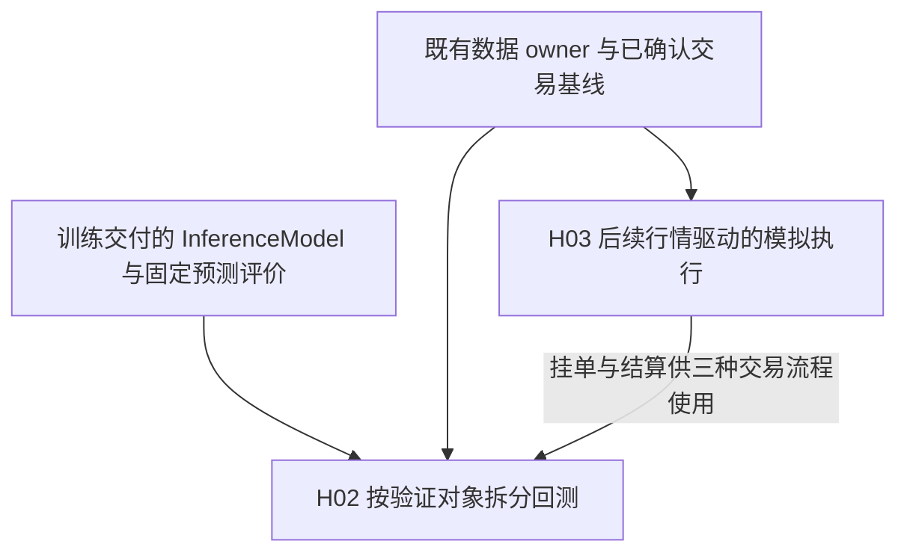
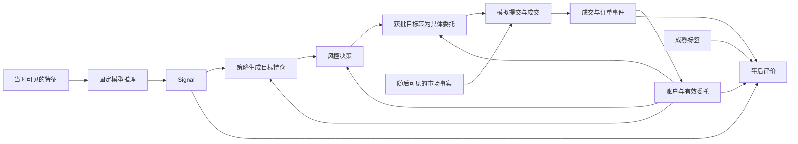

# 回测架构与模拟执行

本卷宗记录独立信号评价、固定风控、策略回放、价格模型及多频率模拟执行的研究设计、
论证与验收。训练和模型交付由[训练研究](../training/README.md)拥有；正式编排仍由
[Offline 工作流契约](../../docs/offline_workflow_contract.md)及其引用的 owner 定义，
研究治理遵循[研究工作流](../../docs/engineering/research_workflow.md)。

## 目标与边界

让五种模式按验证对象独立运行，共用相同的预测、策略、风险、执行、结算与评价计算，
并能组成一条可解释的完整回测路径。五种模式及价格模型的适用范围见
[模式契约](#五种模式对应三个验证问题)；分钟和日频共用时钟、委托与账户边界，
具体日程和成交假设分别声明。

本轮消费已有训练能力，以 FakeLive / FakeExecution 验证本地回放，不实现拟合、模型
保存或另一套预处理，也不接入真实行情服务、broker 或通用券商平台。实时输入与真实
执行的既有讨论保留在[历史边界](#实时接入的历史边界)，不计入本轮实施范围。

H02 拥有五种验证任务的设计与接入方案，H03 拥有模拟执行、结算和时间能力；各自的候选
状态、已完成工作与下一步在对应记录中维护。目录组织属于不改变行为的结构维护，见
[交易领域命名与代码组织](#交易领域命名与代码组织)。文档整理不改变设计决定、正式
owner 或验收状态。

## 当前背景与依据

| 日期与来源 | 本卷宗的形成及范围变化 |
| --- | --- |
| 2026-10-03 至 10-05，原联合研究 H01 的讨论与用户确认 | 确立共用计算、固定规则交易基线、实际接收复演及单一 broker 方向；具体决定和理由见[已确认边界](#已确认的交易与运行边界) |
| 2026-10-08，用户要求分别验证信号、风控和成交，并澄清五种 mode 就是其具体表达 | 形成 H02/H03；训练作为已有能力，当前聚焦 Fake 回测。保留五种 mode 的确认不等于采用全部新增细节 |
| 2026-10-09，用户要求训练与回测分开研究，并记录审查、价格模型及代码级设计 | 从联合卷宗迁入交易基线及 H02/H03，保留原编号、决定、反例与证据；该次记录授权不包含代码实施 |
| 2026-10-09，用户随后要求编码并明确“先完成 H03 模拟执行、结算与时钟” | 在独立 `feature/backtest-h03` 分支实施及验证 H03；五种模式重构、CLI/配置接入和正式采用仍在其范围之外 |
| 2026-10-10，用户要求按审阅后的目录方案组织代码 | 保留 trading、集中回测专用实现并明确未来 live 归属；维护记录和验证见[代码组织](#交易领域命名与代码组织) |

训练侧最初的源码核查及交付整改证据留在[训练卷宗](../training/README.md#当前背景与依据)，
回测的源码与目标 owner 对照见[重设计的事实依据](#重设计的事实依据)。历史 Evidence 中的
“本文/全文”、检查数量及路径均按记录时的版本理解；迁移和整理不重跑或改写历史结果。
源码本地链接随目录迁移指向当前位置，历史 SHA、外部固定版本链接及源码指纹仍指原快照。

## 对训练能力的依赖

回测依赖[训练的交付边界](../training/README.md#与回测的交付边界)，不依赖训练 workflow
或其 Context。需要新预测时，准备侧加载指定模型，交付可直接消费的 InferenceModel，
按回测日程提供当时可见特征；启动、换日和预测均不隐式训练。

固定预测沿用[预测记录与身份](../training/README.md#事实记录日志与验证边界)，
独立评价复用[固定结果评价](../training/README.md#评价独立消费固定结果)。固定风险案例和
冻结委托无需模型。训练完成程度、模型的使用依据和回测工程验收分别判断，不共用完成状态。

## 依赖图



## 研究索引

- [已确认的交易与运行边界](#已确认的交易与运行边界)
- [固定规则交易基线](#固定规则交易基线) · [回测任务输入](#回测任务输入)
- [H02 按验证对象拆分回测](#h02-按验证对象拆分回测)
- [五种模式的代码级设计](#五种模式的代码级设计) · [实施与验收](#实施映射与候选验收)
- [H03 后续行情驱动的模拟执行](#h03-后续行情驱动的模拟执行)
- [时间与持有期限](#bar-时间与持有期限的代码级设计) · [报价与成交](#报价成交价格与可成交数量) · [执行与结算](#执行接口与单一结算入口)
- [H03 独立实施与验收](#h03-独立实施与验收2026-10-09)
- [行情异常下的诊断回放](#行情异常下的诊断回放)
- [交易领域命名与代码组织](#交易领域命名与代码组织)
- [实时输入与历史复演](#实时输入与历史复演) · [单一 broker 的真实执行边界](#单一-broker-的真实执行边界)
- [训练研究](../training/README.md)

## 已确认的交易与运行边界

以下保留原联合研究 H01 于 2026-10-03 至 10-05 确认的约束：训练、回测和 live 分别
组织运行，共用数据、推理和交易计算，每种业务语义只有一个实现归属，未来标签只进入
训练和事后评价。重复实现或未来数据进入决策都会否定这一边界；H02/H03 在此基础上
细化当前 Fake 模式。

### 共用交易计算与各自运行

共用交易计算消费当时可见的输入、本次明确使用的就绪模型、当前决策可用的账户事实，
以及策略自身需要延续的状态，执行同一份推理、组合与风控逻辑。每次运行拥有自己的状态。

| 能力 | 唯一实现位置 | 调用关系 |
| --- | --- | --- |
| 历史特征读取、资格与特征计算 | 数据侧 | 各入口消费所需能力；历史读取与实时接入保留各自必要差异 |
| 预处理拟合与变换 | 共用预处理实现 | 训练拟合状态，InferenceModel 使用已拟合状态；各 family 不重复实现 |
| 算法拟合与就绪模型构造 | 训练侧 | 同一 family 的配置变化复用训练实现，每次训练独立交付 |
| 模型保存与加载 | 共用产物能力 | 训练保存具体 ref，评价、回测、live 按明确 ref 加载 |
| 预测与输出行对应 | InferenceModel | 评价、回测、live 直接消费等长同序结果，不在各消费侧恢复被删行 |
| 选池、组合与风控决策 | 交易侧 | 回测、live 共用 |
| 历史输入推进与模拟成交 | 回测侧 | 推进可见输入，按已产生的委托与随后市场路径形成模拟执行事实 |
| 实时输入接收与运行调度〔最后处理〕 | live 侧 | 将实际可用输入交给共用计算，消费真实执行事实 |
| 真实订单与账户交互〔最后处理〕 | 所选 broker 的执行侧〔待明确〕 | 按具体 API 提供已确认的订单、成交和账户事实 |
| 指标计算 | 评价侧 | 消费固定结果与后验数据 |

表中每行表示责任归属，不要求分别新增模块、类或转发函数；此前八层 Step 图的层数
也不构成新增实体的理由。现行 Pipeline、Context、Step 和统一测量仍遵循 Offline owner，
归并业务计算不能自行推出删除编排。

订阅名单与持仓目标分别表达。订阅某只股票的某个 topic 表示选择观察它，
研究中的 Top50 观察名单不能直接解释为买入名单。本轮不预设必须使用两个模型。

真实执行仍停在外部接口边界；不把现有同步模拟成交接口推广成统一的 live 执行接口。

### 结构数据流

2026-10-03 用户在缺口讨论中回复“同意你的方案。记录到文档”，确认三入口共用结构及
模型绑定、实际接收复演、交易基线、单一 broker、评价和记录方向。
2026-10-04 用户阅读完整方案后回复“同意你的建议，记录到文档。然后针对待明确的契约，
给出解决方案，以及你的建议”，确认以下数据流及[共用能力归属](#共用交易计算与各自运行)；
该次确认尚未包含随后提出的具体契约建议，后续决定已归入各自主题。

```text
训练
历史可见输入 → 数据侧交付特征 ─┐
拟合前已成熟且可用的标签 ──────┴→ 拟合预处理与模型
                                  → 就绪 InferenceModel → 独立保存 → 具体 ref

模型使用
本次运行指定 ref → 共用加载 → 按运行依据显式绑定就绪模型

回测与 live 的共用计算
回测推进历史输入 / live 接收实时输入 → 数据侧交付当时可用特征
    + 本次绑定模型 → 等长同序预测
    + 当前决策可用的账户事实 + 本次运行的策略状态
    → 共用选池、组合与风控 → 交易目标

各自执行
回测：交易目标 → 模拟执行 → 模拟订单、成交和账户事实 → 后续决策
live〔最后处理〕：交易目标 → 单一 broker 执行〔具体 API 待定〕
              → 已确认的订单、成交和账户事实 → 后续决策

评价
固定预测 / 名单 / 交易事实 + 后验数据 → 共用指标计算 → 展示
```

每次运行独占策略状态、输入进度和执行事实；评价标签与模拟成交所用的随后市场路径
均不回传过去的决策。箭头表达依赖，不要求逐一增加接口类、Context、Result 或转发函数。

### 固定规则交易基线

缺口是预测怎样成为可执行的交易：买哪些、买多少、何时买卖，以及无法成交时如何处理。
次日最高价机会标签没有定义退出策略；其价格只能事后识别。正式
[日频标签契约](../../docs/data/daily_feature_label_contract.md)也不拥有入场、退出和成本语义。

固定规则便于辨认预测与简单执行的作用；引入盘中信号则同时改变信号、实时观察和交易
行为，需要额外证据。因此用户于 2026-10-03 在缺口讨论中确认，在模型与训练及预测比较
基础确定后先用固定规则：固定时点决策、固定目标持仓数量、等权分配，下一正式交易日
固定时点退出，检验模型在固定交易行为下的价值。等权减少仓位优化变量，固定目标数量
不保证实际全部成交。
此决定没有指定股票、资金、持仓数量的具体数值、买卖时点或订单类型，也没有把 Top50
观察名单变成持仓名单。

**已确认的选择、数量与资金规则。** 2026-10-05 用户在待澄清契约讨论中确认：从当时合格
且已有预测的证券中按预测降序选择，同分按 `symbol` 升序。有效候选不足目标数量时接受
不足，保留未用现金，不加入无预测证券。
延续持仓占用目标数量和资金，新买入结合剩余名额及当时可用现金；只有已确认成交产生的
卖出所得才能用于后续买入，不提前使用计划卖出所得。

委托数量使用决策时可见价格及对应证券的数量约束计算，不能根据未来成交均价反推当时
本应下多少单。具体参数由[回测任务输入](#回测任务输入)给出。

**已确认的未成交与期末处理。** 2026-10-04 确认处理方向，2026-10-05 进一步确定期末
价格口径；具体时点及数值由交易任务给出。本节讨论历史回测，不依赖真实 broker 先行接入。

| 情形 | 处理约定 |
| --- | --- |
| 入场窗口结束仍有未成交买入部分 | 撤销剩余部分，当次不补选 |
| 计划退出未全部成交 | 未完成部分继续作为持仓，在后续正式交易日的固定退出时点继续尝试 |
| 回测结束仍有持仓 | 保留未平仓事实，以期末正式日频不复权收盘价估值，不伪造强制成交 |

未成交必须反映在现金、持仓与后续可用资金中；计划退出没有成交，不能在账面上当作已卖出。
规则在交易任务处明确，由模拟执行反映结果，不由模拟器自行补充选股、资金或风险规则。
旧草案的 top-20、95% 资金和 5bp 滑点不自动成为本次参数，依据见原研究的
[训练与执行边界](../subscription-training/README.md#训练与执行边界)。费用和滑点使用
显式场景参数及来源依据，不自动将旧费率当作实际净收益成本。工程测试可以明确设为
零费用，但该结果仅属于毛收益场景，不能据此宣称真实净收益。

比较交易方案时固定预测与其他条件，后续比较模型时固定交易规则及成本假设，使结果变化
有明确解释。盘中 L2 的行动价值在此基线上另行研究，不能由机会命中指标推导。

**已确认的首轮模拟假设。** 同次讨论确认委托产生后逐分钟推进，使用随后可见分钟的 VWAP
作为粗略成交价格。每分钟可成交数量受剩余委托量、当时可用现金、可卖数量及该分钟观察成交量
限制；没有可执行观察时保持未成交，入场窗口结束按上表撤销剩余买入。不先读取整个
窗口均价再倒算委托数量。

这是粗略成交假设，不证明队列位置或市场冲击。提出方案时的即时模拟尚不支持逐步推进
与部分成交，后续实施见 H03 验收。订单由当时可见输入生成，随后市场路径只用于模拟
成交；改变未来价格可以改变后续成交，不能改变此前委托。

### 回测任务输入

已确认规则不替代具体任务参数。交易任务须给出交易范围、目标数量、初始资金、买卖
时点、入场窗口、订单类型及适用的证券数量和风险约束；同时明确费用/滑点的参数与来源、
分钟成交及期末价格的数据依据，并按交易基线验证账本。必需参数缺失时拒绝启动，
不沿用旧代码数值。这是回测准备责任，不重新要求训练用户提交交易参数。

### 既定交易与复演验收

以下原验收条件在 2026-10-05 已记录，现与对应交易设计放在一起。它们不属于训练完成的
条件；未运行的实时与 broker 场景仍未运行。当前 Fake 回测的具体候选验收见 H02/H03，
历史材料及范围不因迁移变成新的通过证据。

| 边界 | 验收材料与通过条件 |
| --- | --- |
| 交易账本 | 用少量证券和正式交易日构造未成交、延迟退出、费用及期末持仓场景，逐笔核对现金与数量；按既定委托及后续分钟判断成交，选择顺序、资金约束、剩余买入撤销和期末估值符合上文规则 |
| 实时输入〔最后处理〕 | 保留此前验证方向：同一合法输入前缀产生一致结果；晚到消息不改变过去决策；中断不冒充零成交；当前不要求执行 |
| broker 执行〔最后处理〕 | 保留此前验证方向：按具体 API 覆盖部分成交、结果不明、撤单竞争、重复回报及账户恢复；当前不要求执行 |

## H02 按验证对象拆分回测

- Status: open。
- Hypothesis / Why: 保留五种 mode，按信号统计价值、策略收益、风控和成交分别验证，并
  复用同一套计算组成完整闭环，能够定位问题而无需复制引擎。信号排序有效、风控要求
  减仓和订单获接纳，分别不能代替策略盈利、风险消除和实际成交的证据。
- Scope: 验证任务的输入、编排、状态所有权、事实消费、报告解释、Python 接口、调用链、
  关键代码、实施映射及工程验收；这些也是拟正式化范围。
- Not included: 不训练模型、选择实际策略或风险阈值、运行真实历史收益实验或接入 broker。
  持续冻结及恢复机制未纳入首轮。2026-10-10 用户要求“执行”后，本轮扩展到隔离候选实施与工程验收。
- Depends on: [共用交易计算](#共用交易计算与各自运行)、[交易基线](#固定规则交易基线)及
  训练的[固定结果评价](../training/README.md#评价独立消费固定结果)。训练实现和正式状态见
  [训练卷宗](../training/README.md#设计与仓库状态)。独立信号、固定风控案例可先实施，
  三种交易流程依赖 H03 的挂单、推进与结算；H02 通过不表示 H03 已采用。
- Acceptance / Stop: 沿用实施前[候选验收](#候选验收)，验证独立任务不消费无关输入、完整
  回放共用计算、报告如实说明覆盖；本地实现、对应回归与文档完成后停止，不自动运行真实
  市场实验或执行 Git 发布。缺少单位、费用、公司行动或可用性依据时停止相应真实实验。
- Conclusion: 五个入口、独立信号/风控、H03 共享账户闭环、固定期限策略、真实风险接线和
  报告已在隔离候选工作树实现，证据及限制见[H02 集成实施](#h02-集成实施2026-10-10)。
  2026-10-11 按用户认可的边界补齐完整 Step 链，见[编排细化验收](#h02-编排细化与验收2026-10-11)。
  工程测试不构成盈利结论，也不构成目标分支已采用。
- Next: 审查本轮候选与所依赖的 H03/训练交付边界；在用户决定整体采用及授权对应 Git 操作后，
  同步 owner、实现、测试进入目标分支。真实历史实验另需确定输入口径、费用来源、
  比较基线和保留数据，不能直接把合成验收参数投入正式实验。

**用户约束与决定。** 2026-10-08 用户以 `Signal = model(x)`、`Orders = strategy(signal)`、
`execute(orders)` 提出三个验证问题，随后澄清“代码层面的5种模式就是我的想法，具体的表示”。
据此撤回误解用户意图而提出的四任务方案，保留五种 mode；入口可不同，相同业务组件必须
复用，full 按确定顺序组合这些能力。用户选择的交付是具体接口、调用链、关键代码和改动
清单，并要求符合 Python 编码规范、对照旧 Components / NoOp 方案说明省略风险 Step 的依据。

2026-10-08 用户审阅业务代码后回复“同意这些内容。记录到文档”，确认共享策略、真实
风险计算与执行器、按 Step 组合，以及原始目标、风险决策、委托和成交分别留存的方向。
2026-10-09 再次要求记录审查与解决方案，修正定时风控、Fake 边界和评价采样，并明确
execution/full 必须使用价格模型，其余模式按小资金前提默认价格可成交。两次记录决定
不构成全部候选细节的正式采用；具体模式含义如下。

### 五种模式对应三个验证问题

保留一个面向用户的 `backtest --mode ...` 命令。signal 与 strategy_eval 分别检验信号本身和
信号形成的策略收益，共同回答信号价值问题；risk、execution 对应风控与成交问题，full
组合全部验证。共用回放是内部能力，不增加 `replay` 模式或任意开关组合。

2026-10-11 用户审阅命名建议后要求“执行”，确定将 `tradable_alpha_eval` 改为
`strategy_eval`、`risk_eval` 改为 `risk_rule_eval`，请求类型与 workflow 同步命名，不保留
旧任务名称别名。当时前者评价参考成交假设下的策略：资金、可卖数量和费用仍参与计算，但不
验证报价与市场量下的可成交性；其结果受选股、仓位和持有规则共同影响，因此不以
`tradable_alpha` 概括。后者评价固定案例中风控规则的决策与覆盖，规则对后续账户路径的
影响另由完整回测验证。历史源码核查与既有验收记录保留当时名称；本次命名决定不改变
五种任务的运行边界，也不表示 H02/H03 已合入目标分支。

同日用户进一步指出，缺少“已有预测＋策略＋价格和成交量约束下的模拟成交，但不运行
业务风控”的直接入口，并明确要求解除 strategy_eval 与参考成交的强制绑定。当前采用方向
保持五种 mode，strategy_eval 按任务声明的成交假设选择已有 ReferenceVenue 或 LimitPriceVenue，
共用同一策略、账户、Step 链、挂单和结算实现。沿用已有 slippage_bp=None 表达参考成交；
与 strategy.quote 成对提供时选择价量约束模拟，0 滑点仍检验报价和成交量，缺一在 submission
边界拒绝。这样补齐所需组合，避免为同一策略评价增加新的 mode、执行引擎或配置包装层。
本决定是用户已明确的局部直接采用设计，拟议 owner 与实现同步；H02/H03 整体状态仍为 open。

| 模式 | 运行边界 | 结果与可支持的结论 |
| --- | --- | --- |
| `signal_eval` | 评价固定预测与成熟标签；需要新预测时才加载模型和特征，不创建策略或交易状态 | `ICObservation` / `ICEvaluation`、模型目标 IC/Rank IC、样本键及预测/标签版本、缺失覆盖、无定义原因和分期表现 |
| `strategy_eval` | 固定信号按明确组合/持仓规则交易，按任务参数选择参考成交或价量约束模拟，不运行业务风控 | 原始目标、委托、成交、费用、账户与权益；毛/净收益、换手和显式基线下的比较；参考分支不检验报价/市场量，价格模型分支只支持所声明模拟假设下的结论 |
| `risk_rule_eval` | 固定风控前目标或定时检查案例、账户/估值/挂单及规则参数直接进入真实风险实现，无需模型或撮合 | 原始案例、`RiskObservation` 和逐条规则观察；允许/缩减/拒绝数量、目标变化与规则覆盖 |
| `execution_eval` | 固定具体委托/撤单、初始账户、后续市场和执行假设，必须使用价格模型；不重跑模型、策略或业务风控 | 提交、拒绝、撤销、成交、剩余量、费用和账户；接纳率、成交数量比例、订单完成率、等待及未完成原因 |
| `full_backtest` | 同一闭环内运行信号、策略、所选真实风控、价格模型、执行与结算，完成后评价同批事实 | 信号、风险与成交三类证据，以及整体收益、回撤、最终账户、未平仓与未完成情况 |

risk 的案例可来自人工边界场景或历史回放，必须保留风控前目标；execution 的订单可来自
独立夹具或已有运行，必须带明确数量、方向、报价、产生/生效时间、有效期及首轮 Fake
条件，不能按未来成交价反推。这里的“已批准”只界定 execution 的输入，不表示本次验证
过风控。共用策略也可生成这些固定输入，但须记录产生过程和参考执行假设，不能把固定
输入检验与动态闭环的结论混用。

strategy_eval 选择参考成交时，在首个符合日程的参考价上成交已接纳的合法剩余量，不因报价或市场量不足而等待。
参考价到时才可用于结算，缺价按输入契约处理；现金、数量及可卖约束仍有效，不能靠无限
现金制造收益；选择价格模型时另执行与 execution/full 相同的报价、滑点和观察量约束。
零成本仅表示毛收益场景。signal/risk 没有成交动作，不因“默认买得到”
创建执行器、虚假 fill 或改写风险案例中的账户和挂单。

工程运行成功、指标有定义、业务达到预设门槛是三个判断。未运行、无样本、规则未触发或
数据不足均须如实报告。execution/full 的结论限于所声明 Fake 假设，不证明真实 broker
或盘口成交；full 名称也不扩大覆盖范围。

### 共用交易闭环与独立评价

用户公式中的 `Orders` 表示想要提交的委托，不等于实际成交。沿用当前仓库已有的目标持仓
表示，最小交易过程如下；箭头表达职责，不要求新增同名类或包装函数。



策略拥有信号组合、选股、仓位和入退场意图；风控拥有明确规则下的允许、缩减、拒绝或减仓
要求；执行侧把获批目标与当前持仓、有效挂单比较，形成委托并判断能否成交。继续使用
现有目标持仓和风控计算边界，无需为了匹配公式把所有策略改成直接构造 broker 请求。
市场数量、价格、可卖及资金占用等委托合法性约束由执行边界负责，不另复制成一套业务风控。

风险规则若要求观察持仓变化或价格变化，回放必须在相应事件上调用它，不能只在模型有新
分数时运行。没有新信号仍可有持仓风险、到期订单和计划退出。风控要求清仓只产生减仓
意图；卖不出时原持仓及其风险继续存在。

已有预测记录带有模型与输入关联时直接复用，不要求重复指定另一份模型。不同策略
消费同一份固定信号，但各自拥有账户、策略状态与有效委托。
多个信号参与组合时，使用各自当时可用的值，按证券及决策时点对齐；不能读取更晚信号
补齐缺失。组合规则属于策略；需要拟合的组合权重属于训练，不能在最终验证集上学习。

full 组装的是同一账户反馈闭环内的组件，不是依次启动其他四个 workflow；后者会分别
初始化账户、重放交易，无法得到同一条路径。单项入口消费固定边界事实，full 则由上游
在本次运行中产生同类型事实；来源不同不产生第二份业务算法。参考与市场成交的比较
须分别运行两个独立场景，不能在一次 full 中重复成交同一订单来凑两份结果。

### 重设计的事实依据

本次源码阅读绑定 `feature/training_infer` 的
`76c25a279685b6961cda69143f542e8ec3936f51`。下表的“当前/现有”均指检查时点；
所列源码、测试及分钟 owner 与该 commit 相同。
正式编排核对的是本地可见 `dev` / `origin/dev` 的
`197f4bc3878bf4d6a495f3fce211e21b61ac6ba0`，没有查询远端最新状态。
工作树中的拟议 Offline owner 不替代该目标分支快照。

2026-10-09 按用户“阅读 backtest、trading，根据现有代码进行重新设计编码”的要求，
再次逐模块核对 `src/trading/` 的 67 个 Python 文件及请求、workflow、预测评价和相关测试。
本次 HEAD 为 `26c10185493c1085d4cdc0a9fe1ba54872a70707`；
`src/trading/`、backtest workflow/config 及其已有测试相对上述 `76c25a2` 没有差异。
本地目标分支仍是上述 `197f4bc`，没有查询远端。以下新增的接口收敛是候选编码设计，
不能由基线测试通过推出新流程已经实施。

| 可定位的实现事实 | 对本次目标的影响 |
| --- | --- |
| `run_daily_alpha_backtest` 在所有 mode 下组装同一套八个逐日 Step，见 [workflow](../../src/workflows/backtest.py) | 信号评价也依赖策略、现金、执行和账户，任务没有真正分离 |
| [build_components](../../src/trading/backtest/components.py) 只按 mode 切换 IdealExecution / ExecutionOrchestrator，risk 始终是 NoOpRiskManager | `risk_eval` 名称不能证明启用过风险规则；[当时的组件测试](https://github.com/UlricWu/trading/blob/76c25a279685b6961cda69143f542e8ec3936f51/tests/trading/sim/test_components.py)还明确验证这种固定映射 |
| [TradableAlphaEvalStep](../../src/trading/backtest/steps/backtest_layers.py) 调用基于两期价格及固定成本扣减的 [tradable_alpha_frame](../../src/trading/backtest/evaluation.py)，没有委托、成交量或盘口输入 | 它是条件收益诊断，不能证明可交易性；当前调用也没有传入非零成本 |
| [SimImmediateVenue](https://github.com/UlricWu/trading/blob/f733a2bc87903de4f218dfc0e1fc34b2d83768be/src/trading/backtest/execution/venue/sim_immediate.py) 对有价格的 intent 一次生成全量 fill | 没有部分成交、有效挂单和跨时点等待，不能回答价格出现时自己的订单能否完成 |
| [metrics persist](../../src/trading/backtest/steps/metrics_persist.py) 总是写入全部五类结果 | “有指标字段”会掩盖实际只使用了理想执行或空风控 |
| [SettlementEngine](../../src/trading/backtest/execution/settlement.py) 在账户处理成交后无条件追加账本，账户内单独去重 | 重复处理同一成交时，持仓与账本可能不一致；H03 的唯一结算入口须覆盖全部副作用 |
| [SignalStep](../../src/trading/backtest/steps/backtest_layers.py) 按日期生成预测文件名；[汇总](../../src/training/evaluation.py) 以观察条数填充 date_count | 同日多次决策须区分记录身份、决策次数与交易日数，不能直接沿用日频消费假设 |
| [PerformanceReport](https://github.com/UlricWu/trading/blob/76c25a279685b6961cda69143f542e8ec3936f51/src/trading/reporting/performance.py) 对相邻事件权益计算收益，调用侧固定年化因子；[EquityCurve](../../src/trading/core/equity.py) 每次 append 扫描历史回撤 | 增加无变化唤醒也能改变 Sharpe；分钟路径还需增量维护权益统计，不能把事件数量当作等间隔报告样本 |
| `SignalStep` 每次预测调用 `on_trading_day_start`，后者无条件清空 `buy_qty_today` | 直接扩展为同日多次信号会重置当日可卖限制；日切必须由交易日程拥有，初始快照和同日后续唤醒均不得清空它 |
| `IdealExecution` 自行调用 `PortfolioState.apply_fill` 并写 ledger，没有经过结算，也不约束资金或 T+1 | 不能把它直接当作新 tradable 的参考执行；应只替换价格处理，三种交易流程共用接纳、占用和结算 |
| `BehaviorReport` 与 `execution_quality_frame` 均以 fill 条数除以 submit 条数 | 一笔订单分两次成交会被报为 200%；新报告须按 order_id 和累计数量汇总，原目标差量不能代替冻结订单数量 |
| `MaxGrossExposureRule` 只计算最终目标市值，缺价格按 0 计；`RiskManager` 只保存最后 reason | 现有规则不能直接证明在途敞口合规或各规则覆盖；候选须补齐价格责任、当前持仓及买单占用，并保留每条实际计算的观察 |
| Threshold / TopKHysteresis 只输出固定股数目标，没有固定等权入场及下一交易日退出计划 | 复用构造器不等于实现了交易基线；需显式区分既有目标策略与尚待落地的固定期限策略，不能让模拟器补出退出行为 |

上述结构判断来自静态阅读；重复成交和采样问题另有本节 Evidence 中的合成复现。
不能将相对本次目标的能力缺口直接描述为实现违反当前正式 owner；目标分支
Offline owner 本来就规定所有 mode 跑完整链、使用 NoOpRiskManager。调整运行行为属于
设计变更；这些实现局限不构成删除或重命名用户既有五种模式的理由。

审查同时修正了候选草稿中的三个问题：从历史目标恢复过期买入、用 blocked 混指拒绝与
清仓、在允许行情晚到时立即终结到期订单。前两项的理由及算法见[风控设计](#风控正确性与策略通过情况)，
最后区间成交与延迟的取舍见 H03 的[可见时间](#以可见时间推进并保留无行情时的交易日程)。
Fake 曾被过度收窄为省略报价判断，也已按用户要求在[价格模型](#报价成交价格与可成交数量)中修正。

### 旧方案对照与最终建议

用户提供的 [master 路径](https://github.com/UlricWu/min_quant/blob/master/src/trading/pipeline/pipeline.py#L21)
首次读取返回 404，初查使用了本地历史 `eaffe5c8475968006981e59e7fb2c7377a6052bf`。
用户随后将仓库公开，本次已通过 GitHub Raw 和 API 成功读取。最终对照固定到 API 返回的
远端 master `011aec22d9d4082b3e6fd74c181347e310e7e5d7`（提交日期 2026-07-20）；
相关文件均以该完整 SHA 再次读取核对。外部旧仓库、本地历史和当前工作树 `76c25a2`
是不同版本，不能混用实现状态或正式 owner。

该快照中的实际链路为：`build_components` 构造完整 `Components`，workflow 将各组件
绑定给同一套八个 Step，`TradingPipeline` 按 timing 执行这些 Step。`SignalStep` 内部
调用 `BacktestKernel` 获得行情 bar；Kernel 只推进时钟、更新 DataView、产生 BarContext，
并不接收 Components 或统一执行策略与风控。依据为固定版本的
[workflow](https://github.com/UlricWu/min_quant/blob/011aec22d9d4082b3e6fd74c181347e310e7e5d7/src/workflows/backtest.py#L83)、
[Pipeline](https://github.com/UlricWu/min_quant/blob/011aec22d9d4082b3e6fd74c181347e310e7e5d7/src/trading/pipeline/pipeline.py#L21)、
[Components](https://github.com/UlricWu/min_quant/blob/011aec22d9d4082b3e6fd74c181347e310e7e5d7/src/trading/sim/components.py#L28)、
[Kernel](https://github.com/UlricWu/min_quant/blob/011aec22d9d4082b3e6fd74c181347e310e7e5d7/src/trading/sim/kernel.py#L60)。
尤其是 TradingPipeline 本身已经接收外部传入的 Step 列表，没有强制包含风险步骤；
需要改变的是 workflow 的固定组合与组件依赖，不必为省略风控重建一个新调度框架。

旧代码确实使用 `NoOpRiskManager` 补齐 risk 槽位；在这个快照中五种 mode 的 risk 都是
NoOp，主要按 mode 切换 IdealExecution 与 ExecutionOrchestrator。它保证了固定 Step 图
可以统一调用 `risk.apply`，但这个实现事实不能证明当时已经检验了真实风控。

此前对话把 NoOp 直接概括为“多此一举”需要限定适用范围：在固定、始终完整的交易链中，
直通策略能维持稳定接口，具有实际用途。第一性原理应对照本次验证目标检查必要性，不能
仅凭类名否定 Null Object，也不能把旧结构强制要求存在的槽位当作业务必需。
本次五种模式的输入和验证范围确实不同，因此最终建议使用按需组装的共享 Step。

| 比较项 | 完整 Components + 固定 Step 图 + NoOp | 按需绑定组件 + 固定的五种 Step 组合 |
| --- | --- | --- |
| 复用边界 | 业务组件可复用，所有模式经过相同阶段 | 同一业务组件和需要的 Step 都复用，各模式只执行有关阶段 |
| 编排复杂度 | 主链固定，调用位置不分支；差异集中在组件替换 | Pipeline 同样只顺序执行；差异在五个可直接阅读的组装入口 |
| 信号单项评价 | 仍需补齐策略、risk、execution 槽位；旧实现还创建账户和交易事实 | 只准备信号和标签评价依赖，无交易状态 |
| 风控单项检验 | 固定交易链不自然接受一组已有风控案例 | 案例直接调用同一 `RiskManager.apply`，不重跑模型与成交 |
| 数据依赖 | 固定图容易要求无关阶段的输入；空组件不能自动消除其上游准备 | 输入边界与所选能力一致；前提是下游消费业务数据而非强制依赖上一步类型 |
| 验证含义 | 必须额外区分 NoOp 与真实检查，原样输出不证明检查通过 | 缺席 Step 直接表示该能力未运行；真实执行且没有样本另行报告 |
| 主要约束 | 槽位越来越多时可能增加更多占位组件 | 组装者必须保证必需步骤与合法顺序，不能开放任意删改的步骤配置 |
| 合适范围 | 各场景都运行完整交易链，仅某个算法选择直通时合理 | 本次独立信号、固定风控、固定委托及完整闭环的需求更合适 |

本次选择不以微小函数调用开销为理由，也没有进行性能基准。依据是职责与依赖范围：
删除纯信号任务的账户、风控和成交仍能完成信号检验，因此这些实体不是该任务的必要输入。
另一方面，共用循环、真实风控、执行与结算仍然必要，继续各保留一份实现。

可行性已有调度层依据，但不是从当前代码删除一个 Step 即可。远端旧版的
[执行 Step](https://github.com/UlricWu/min_quant/blob/011aec22d9d4082b3e6fd74c181347e310e7e5d7/src/trading/pipeline/steps/backtest_layers.py#L274)
读取 `ctx.current_targets`，策略先写、风控可再调整，已经体现可选变换的数据流；
当前 `76c25a2` 的 [ExecutionEvalStep](../../src/trading/backtest/steps/backtest_layers.py)
反而强制读取 `RiskResult`，缺失即失败。两个版本必须区分，不能用旧版可省略的输入形状
冒充当前实现已经支持省略。

还需同时解除三处隐藏职责：旧版与当前版本的 target tape 记录都放在风险 Step 中；当前
执行和估值依赖 SignalResult 内的行情，妨碍冻结委托独立运行；现有 `NoOpRiskManager`
并非严格 identity。远端与本地的
[NoOp 实现](https://github.com/UlricWu/min_quant/blob/011aec22d9d4082b3e6fd74c181347e310e7e5d7/src/trading/risk/engine.py)
均调用 `_normalize_adjusted_targets`，检查负数和非有限值并转为整数；本地版本还显式
排除非法类型。例如 `100.9` 变成 `100`。省略风险不能顺带丢失必要不变量，也不能把
这类转换继续伪装成一次真实风险检查。

最终建议是：保留五个只负责组合的 workflow、共享 `run_steps`，三种交易任务共用
`BacktestPipeline`；按需绑定同一组领域组件，使用下文规定的目标数据契约消除风险
前置依赖。完整 Components 包及 `NoOpRiskManager` 不再作为五种模式的公共前置条件。
在本次调用链替换完毕、确认没有独立调用方后删除失效实现，不为保持外形一致而建立
五份 Components、空风控类或充满可选字段的组件包。

#### CLI 路由与 workflow 边界的第一性原理论证（2026-10-11）

用户在检查 `0402f5e` 的五个入口后提出：CLI 的 `isinstance(submission, ...)` 分流，
以及 workflow 在 `run_steps` 之外计算指标、写报告，是否偏离原来的 workflow → Steps。
这里必须区分三件事：用户通过几个命令提交任务、谁选择任务的步骤组合、谁执行业务阶段。
一个 CLI 命令不意味着内部必须只有一个工作流；多个具名工作流也不意味着存在多套交易引擎。
判断依据是输入、可观察结果及其依赖，而不是入口函数或 `if` 的数量。

从结果反推，signal 需要固定预测及其标签评价，risk 需要固定风控案例及规则观察；
execution 需要固定委托的账户路径，strategy_eval 需要策略在所声明成交假设下的收益，full 需要同一
交易路径上的信号、策略、风控与执行事实。这五种任务不是同一完整任务的五个显示选项。
例如删除 signal 的账户和撮合器仍可完成评价，删除 execution 的时钟和结算就无法复现
挂单到期、成交和现金。因此真正必要的共同能力是业务公式、相关 Step 和执行不变量，
共同的完整组件包或唯一业务入口并不是前提。

| 方案 | 输入与职责如何落地 | 删除测试与判断 |
| --- | --- | --- |
| 单个 `run_backtest` 内按 mode 拼装全部分支 | 分支进入大函数；它同时理解固定案例、模型信号、账户、策略与五种输出 | 合并函数不能消除五种业务差异，还扩大单函数依赖范围；当前没有必须由它拥有的统一业务状态 |
| CLI → `run_backtest` → 五个具名 workflow | 新入口只把已经确定的 submission 再分派一次 | 删除该转发层，输入校验、身份检查、组装和运行均仍成立，因此不增加 |
| CLI → 五个具名 workflow → 共享 Steps / 执行器 | CLI 选择用例；各 workflow 显式列出完整步骤；领域计算和时间推进复用 | 保留任务边界和共享不变量，能够直接检查每种模式运行及省略的能力，采用此方案 |

CLI 的合理职责是将外部请求解析成对应的有类型 submission，并调用具名 workflow。
它不创建策略或 venue、不组装 Step、不计算指标；workflow 也不重新解释 mode。
这条路由有明确的适配边界，不是业务算法分支。Python 调用方可直接调用具名入口，
不会依赖 CLI 才能使用业务能力。只有将来出现已明确、确实需要公共调用边界的另一种
调用契约，才重新判断是否需要统一入口；当前不为潜在调用者预设 dispatcher 或 registry。

原实现真正偏离设计的是执行链不完整。signal 的预测生成在 `run_steps` 前，指标汇总、
指标持久化和报告在其后；三种交易模式的 `final_steps` 只有原始事实持久化。这使
workflow 同时承担组装与执行，Instrumentation 的作用域甚至在报告之前结束。
虽然交易算法仍共享、输出能够正确，但 Step 时间线无法定位这些阶段的失败，结束日志
也不能说明报告已完成。将 CLI 的分支移到别处不会修复这个问题。

修正时保留两个生命周期：signal/risk 在一个 Instrumentation 作用域内执行一次完整的
`run_steps`；三种交易模式共用一个 `BacktestPipeline`，在时点循环结束后继续执行完整
`final_steps`。预测生产、规则应用、指标汇总、事实/指标持久化与报告各有实际阶段职责。
原始交易事实必须先保存，full 才读取未来成熟标签做事后评价；失败原样传播、停止后续
Step，已完成的原子文件保留。报告成功后才能结束本次执行作用域。

这不要求把每次赋值或构造函数都包装成 Step。CLI 统一准备实验名称、参数快照、初始 metrics
和开始日志；日程解析和依赖构造仍由 workflow 拥有，例如读取市场日程来构造 ReplayClock 是组装的
前提。解析信号来源可准备决策时间和可见输入，但模型预测生产必须在相应 Step 中执行；
交易模式只在对应决策时点生产，不能为了统一 signal 的批量形式而提前运行所有预测。
CLI 准备的 `mode`、参数快照和 workflow 补充的 `not_run` 只描述本次运行及输出范围，
不控制共享 Step 的行为。

Context 同样按必要性切分。单次评价只携带本任务的输入事实和待发布结果；逐时点
`BacktestContext` 继续只包含当前可见事实与动作，`BacktestState` 只延续交易状态。
交易结束后建立独立的结果 Context，引用已完成的 State 并传递指标；它向共用评价 Step
提供实际预测引用、决策日期及风险观察，不复制账户或再运行风控。这样 signal 与 full
复用信号评价，risk 与 full 复用观察汇总，三个交易 workflow 复用账户摘要，五种模式
复用指标持久化和报告。已有的 `PipelineStep[ContextT]` 足以保持各链的类型与返回值，
不需要新增 Step 基类、通用 Workflow、DAG、动态注册表或用于补齐槽位的 NoOp。

用户已明确同意该建议并要求记录论证、编码。本次按 H02 已隔离候选的编排细化执行，
保持五种 submission、交易/风控公式、制品 schema 和数值口径不变；不能据此宣布 H02/H03
已合入 `dev`。完成证据要同时验证五种输出、阶段顺序与一次测量、最终状态传递、失败
中断与原异常传播，并保留原有未来数据隔离和回放一致性验收。

`BacktestKernel` 的名称并不决定是否需要保留。所需的时钟推进与行情可见性能力继续复用；
H03 的交易回放统一由 BacktestPipeline 拥有时点、账户和挂单生命周期，不再让另一个
Kernel 同时推进同一交易账户。输入侧仅有的 bar 遍历可以保留自己的职责，不能承担第二套
交易编排。该设计已在本轮候选 owner 与实现同步；目标分支正式化仍待采用。

### 信号价值与策略价值的判定

评价标签首先使用模型声明的目标。Rank IC 表达排序关系；分组收益只有在评价对象确实是
明确期限、价格口径的收益时才这样命名。收益 rank 的平均值不能称为收益，次日最高价
机会标签也不能当作可成交退出价格。额外收益诊断须明确另一个评价目标，不覆盖模型目标。

沿用共用 `rank_ic` 与预测评价能力，保留无定义原因、有效配对数和覆盖率，不为回测再实现
一份指标公式。信号缺失及标签缺失留在覆盖统计中，不用未来标签补选交易对象。
有 IC 不能推出一定盈利；组合持有、换手、资金约束和交易成本的影响由策略回放检验。
价值判断还需预先选定比较基线，例如同一历史合格集合、同一持有规则下的无信号等权方案；
保持账户与成本条件一致，报告相对基线的增量、分期稳定性、有效样本量和不确定性。
不能仅凭平均 IC 大于零或历史总收益为正，就判定信号具有足以采用的交易价值。

用实验决定信号组合或策略时，运行前冻结候选、选择区间、最终验证区间、收益与风险判据
及停止条件；训练与标签成熟边界沿用已有契约。跨期标签重叠须按真实观察区间隔离，不能
让训练标签覆盖到被宣称未见的验证时段。组合调参只用选择区间，保留失败候选，最终区间
不反复用于挑策略。预处理和模型选择不能使用测试集信息，这一点也与
[scikit-learn 的数据泄漏说明](https://scikit-learn.org/stable/common_pitfalls.html#data-leakage)
一致。本轮没有选择实际模型、数据区间、显著性门槛或收益门槛，不作信号有效结论。

### 风控正确性与策略通过情况

风控检验分别回答两件事：

- 对已声明的规则，安全、触边和越界情景是否产生预期动作；正常目标应允许，需调整或
  拒绝的目标不能漏过。预期来自规则 owner，不能用当前输出反写测试期待。
- 实际策略的目标有多少被允许、缩减、拒绝，哪些规则导致差异；拒绝后还剩多少可执行
  交易机会，风险动作最终是否落实到持仓。

固定输入检验由 risk_rule_eval 完成；风控对未来账户路径的影响由完整回放及配对实验验证。
复验策略时须保存其风控前目标和上下文，不能用已调整目标替代原始请求。

风险上下文含已成交持仓及有效委托的占用。禁止新增风险的规则必须阻止相关新委托，并
按规则处理仍有效的增仓委托；把新目标改为零却放任旧买单继续成交，不构成有效拦截。
首轮可使用现有单证券敞口、总敞口和回撤减仓能力，实际启用项及参数在本次运行前固定，
不由本设计代选阈值。2026-10-10 用户明确回答“采用上述规则”：启用可配置的这三类
规则，数量按显式证券步长向下取整，非正权益禁止新增买入并撤销有效买单，减仓仍受
可卖与成交约束，阈值由任务提供。候选记录无定义比率为未检查；峰值为正时，非正权益
仍执行回撤减仓。持续冻结及恢复机制未纳入首轮，不因为存在 kill-switch 类名就补出
另一套状态机。

当前 `blocked` 同时表达拒绝与清仓，无法确定是否应提交零目标。修正后的 RiskDecision
使用明确的 `adjusted: Mapping[str, int] | None`、`cancel_order_ids: tuple[int, ...]`、
`reason: str` 及规则观察。`adjusted` 是本次需要提交的完整目标，None 表示没有待提交目标；
究竟是拒绝新请求还是已有状态无需新动作，由原始案例和规则观察区分。它不表示未运行
风险检查。旧 blocked / scaled 不再作为候选动作 API 的字段或分支条件，变化量由原始
输入和输出直接恢复。

| 风控结果 | 委托侧动作 |
| --- | --- |
| 允许 | 提交明确目标 |
| 裁剪 | 提交调整目标，并对账冲突旧单 |
| 拒绝当前请求 | 不提交该请求；旧单是否撤销由明确的撤单列表决定 |
| 减仓或清仓 | 撤销冲突增仓单，提交减仓或显式零目标；未成交持仓继续存在 |
| 已有状态无需新动作 | 保存实际检查记录，不生成新目标 |

本轮非负持仓下，未完成卖出前的敞口上界为“当前持仓市值＋有效买单可能增加的市值”。
挂着卖单不能提前降低敞口，也不能提前释放新买入的风险预算。规则既检查最终目标，也
约束新买增量在执行路径上的敞口；所建议撤单的占用只有执行确认后才能复用。否则，例如
已有仓位仍未卖出时，再买入另一组证券，可能在最终目标合规的同时突破过程中的总敞口。

规则正确性不能仅用“回撤变小”证明。历史路径未触发某条规则，只能报告未覆盖；需要明确
的触边或压力情景补验。回撤触发阈值也不等于损失保证上限，价格跳变或卖出未完成必须在
完整回放中保留其实际后果。

#### 定时风控只减少现有承诺

旧 RiskDecisionStep 在没有新目标时读取 target_tape 最后一项，再把风险调整结果交给
submit_targets。若入场原目标为 400、只成交 360、剩余 40 已经到期，这条链会在下一次
风控检查时重新补买 40。历史记录由此被错误地当成持续有效的交易意图。

修正为 RiskCase.target 可以为 None，唯一表示“没有新策略请求，检查当前持仓与有效挂单”。
RiskManager.apply 同样接收可空目标，在同一个计算入口内完成规则判断与动作生成。
风险输入从当时账户和挂单构造，不读取历史 target tape。独立 risk_rule_eval 保存并复用相同
案例形状，因此与 full 的定时检查也能得到一致决策，不在两个入口复制转换算法。

检查风险上界时不扣除未成交卖单；生成减风险动作时，保留原有买卖承诺的净目标。
下面是 RiskManager 定时分支中的动作计算片段，risk_limits 是同一次规则链已经算好的
各证券允许数量，覆盖当前持仓及挂单证券。该片段不是新增 helper、另一次规则执行或
完整的 RiskManager 实现：

```python
committed = dict(positions)
for pending in pending_orders:
    order = pending.intent
    signed_qty = (
        pending.remaining_qty
        if order.side == Side.BUY
        else -pending.remaining_qty
    )
    committed[order.symbol] = committed.get(order.symbol, 0) + signed_qty

reviewed = {
    symbol: min(quantity, risk_limits[symbol])
    for symbol, quantity in committed.items()
}
adjusted = None if reviewed == committed else reviewed
```

例如仍有卖单时，净承诺低于当前持仓，定时检查不因规则允许更高仓位而反向补买。缩减旧
买单确需撤销重发时，新单生效不得早于本次提交，且必须保留原到期时刻；不能重开入场
窗口。撤单列表和目标必须一致，后续对账不能复活刚被风险禁止的增仓意图。

以下单证券合成算例只验证上述动作计算，不决定风险阈值或证券数量制度：

| 当前持仓 | 有效委托剩余量 | 规则允许数量 | 待执行目标 |
| --- | --- | --- | --- |
| 360 | 无，入场余单已到期 | 400 | None，不恢复买入 |
| 600 | 买 400 | 1,000 | None，旧单保持 |
| 600 | 买 400 | 800 | 800，只缩减已有承诺 |
| 600 | 卖 400 | 500 | None，不反向补买 |
| 600 | 卖 400 | 100 | 100，进一步减仓 |
| 600 | 买 400 | 0 | 0，撤销增仓并请求清仓 |

策略状态继续拥有有效入场窗口和退出计划，历史目标只是记录。窗口内若需要在卖出到账后
继续买入，由明确的策略日程触发对固定名单的目标重算，使用已经结算的现金；不重复推理
或补选，不借定时风控隐式实现。窗口结束后不再补买，计划退出仍按自己的日程执行。

### 可解释的比较与结果事实

以下配对只改变表中变量，其余信号、市场输入、配置和初始账户保持一致，复用同一回放
而不新增对照引擎。参考成交与市场观察驱动的 Fake 使用同一估值、账户制度及明确成本
口径，执行参数的变化须列明。strategy_eval 现在可以选择同一价格模型，从而把业务风控
作为单独的比较变量；若仍使用参考成交，与 full 的差异继续包含价格模型和风控两项：

| 比较 | 变化项 | 解释 |
| --- | --- | --- |
| 策略 A 与策略 B | 信号组合或交易规则 | 固定模型及执行条件后的策略差异 |
| full 内风控方案 A 与 B | 所选规则或参数，价格模型固定 | 比较两套明确风险规则对闭环路径的影响；单项判断可另用相同 RiskCase 验证 |
| execution 内相同冻结委托、不同价格模型参数 | 成交假设或滑点参数 | 比较价格未满足、成交数量、等待和成本；不重新生成报价或订单 |
| strategy_eval 的参考分支与 full | 价格可成交性与风控共同变化 | 参考策略到完整回放的总体差异，不能全归因于风控或滑点 |
| strategy_eval 的价量约束分支与相同执行假设的 full | 增加所选业务风控 | 同一策略、输入及执行假设下，风控改变目标和后续账户路径的影响 |

每个闭环独立推进账户。改变成交后，后续持仓、风控输入和策略订单可能改变，因此两条净值
之差是路径比较，不能自动当作可加总的精确损失归因。固定同一份风控输入或同一份委托
可以做局部对照，但不能把这类冻结输入的结果冒充另一条自洽策略路径。

结果沿用现有 experiment、预测记录、ledger、tape 和 metrics；补充能够解释本次任务的
必要事实，不建立新的全局注册表。至少能恢复：任务和实际启用能力；代码及 dirty patch、
模型/信号和数据的可恢复版本；策略、风控、成本、成交、日程及随机条件；风控前后目标；
具体委托、成交与未完成原因；账户及估值。已有事实能推出的汇总不重复成为第二个权威。
未运行项目在报告中明确列出原因，不伪造全零结果；无定义指标按现有评价规则处理。

#### 评价采样与运行推进分开

现有预测文件按日期命名，同日多次预测会发生路径冲突；回测侧改为在本次运行的日期目录
下按 decision_ts_us 区分记录，例如 `predictions/2026-07-03/1783056600000000.parquet`。
仍保留原始样本键和实际模型关联，不重新定义 Feature/Label 身份，也不创建全局预测 registry。

逐决策 IC 复用现有公式和 ICObservation。现有 summarize_observations 将条目数写入
date_count，其调用前提是日频评价，不能把分钟观察直接传入后将结果解释为交易日数。
本轮回测报告分别记录决策次数、交易日数及有效覆盖；建议先对同一交易日内有定义的 IC
等权汇总，再对有定义的交易日等权展示，同时保留逐时观察与无定义原因。无值日期不能
填零。交易日取输入准备时保留的决策与交易日对应关系，不从 UTC 自然日猜测。
回测的 MetricsPersistStep 保存原始 ICObservation 和上述汇总，signal 与 full 使用同一
报告计算；现有 save_evaluation 内部仍调用日频 summarize_observations，不能直接用于
分钟观察的汇总写出。该消费侧变化不改写训练已有的单日评价含义，也不复制 Rank IC 公式。

组合报告的采样与事件推进分开：运行开始先保存初始权益，避免遗漏第一笔成本；风控按
实际事件更新权益与峰值，日收益、波动率和 Sharpe 则从正式交易日期末权益计算。年化
假设随报告记录，不从 Pipeline 的推进次数推导。盘中观察到的最大回撤另行明确采样范围。
同一净值路径增加不改变账户的定时唤醒，不应改变日收益或 Sharpe。

这不是仅修改年化常数：现有 PerformanceReport 使用相邻事件权益作为收益样本，增加空
唤醒已经改变其样本分布；必须先统一报告采样，再使用相应统计公式。成交数量比例与订单
完成比例也须按订单身份计算，不能以 fill 条数除以 submit 条数；一次订单分两笔成交不
代表完成两个订单。无样本或数学无定义的报告项继续保留原因，不用 0 冒充可定义指标。

### 五种模式的代码级设计

本节起于 2026-10-08 的设计交付，2026-10-10 实施时对齐了已交付训练 API 与 H03 的
FakeExecution。可运行签名以本轮所链接候选源码为准；保留关键设计理由和反例，不再
维护与源码重复的整段实现。候选尚未合入目标分支，不创建空实现或研究运行平台。

设计依据是 [Python 编码规范入口](../../docs/engineering/python_coding_style_for_ai.md)及其
[细则](../../docs/engineering/references/python_coding_style_rules.md)。重点落实 PY-004～013、
PY-016～021、PY-025～027：公开类型完整，业务动作独立，容器所有权明确，决策计算唯一，
没有隐藏 I/O、无意义转发类或模式大函数；测试验证公开结果而不是 helper 存在。

#### 共享组件与组合方式

mode 只在请求路由和 workflow 组装边界出现，核心计算不接收它。五个入口直接绑定同一
组领域实现；复用类和函数，每次运行仍新建自己的有状态策略、账户和执行器。

| 共享实现 | 使用方 |
| --- | --- |
| 固定预测读取/推理及 `SignalEvent` | signal、strategy_eval、full；risk/execution 已有固定边界输入 |
| 同一策略及 `PortfolioStep` | strategy_eval、full |
| `RiskManager.apply` 与规则观察汇总 | risk、full |
| 委托接纳、挂单推进、撤单、`SettlementEngine`、`PortfolioState`、估值与账本 | strategy_eval、execution、full；workflow 按各自允许的成交假设组装价格组件 |
| `evaluate_prediction_records` | signal、full |
| 组合收益/费用/换手、委托/成交评价 | 分别由 strategy_eval/full、execution/full 复用，消费各自实际产生的账户与交易事实 |

指标分别归已有预测评价、风险评价和 `src/trading/backtest/evaluation.py` 的相应职责，
不按 mode 复制公式。信号和风险单项评价不构造 NoOp 价格模型。

#### 入口与请求类型

CLI 仍保留 `backtest --mode ...`。在已有 CLI/请求构造边界一次完成校验，将外部参数转换
为以下五种互斥 submission，随后直接调用对应 workflow。HTTP 复用相同构造边界后交给
现有 Job/CLI 执行，不新增一份请求规则。`mode` 不传给策略、风险规则、撮合或指标函数。

| mode / `src/workflows/backtest.py` 入口 | Submission 及必需字段（均无业务默认值） |
| --- | --- |
| `signal_eval` / `run_signal_evaluation` | `SignalEvalSubmission`：`start: str`、`end: str`、`signal: SignalInput`、`min_listing_calendar_days: int`；评价目标来自信号关联模型 |
| `strategy_eval` / `run_strategy_evaluation` | `StrategyEvalSubmission`：`start: str`、`end: str`、`signal: SignalInput`、`min_listing_calendar_days: int`、`strategy: StrategyConfig`、`initial_account: InitialAccount`、`execution: FakeExecutionConfig` |
| `risk_rule_eval` / `run_risk_rule_evaluation` | `RiskRuleEvalSubmission`：`case_refs: tuple[Path, ...]`、`risk: RiskConfig`；评价全部所选案例，时间覆盖取自案例事实 |
| `execution_eval` / `run_execution_evaluation` | `ExecutionEvalSubmission`：`start: str`、`end: str`、`order_refs: tuple[Path, ...]`、`initial_account: InitialAccount`、`execution: FakeExecutionConfig`；记录含委托与撤单时间序列 |
| `full_backtest` / `run_full_backtest` | `FullBacktestSubmission`：`start: str`、`end: str`、`signal: SignalInput`、`min_listing_calendar_days: int`、`strategy: StrategyConfig`、`initial_account: InitialAccount`、`risk: RiskConfig`、`execution: FakeExecutionConfig` |

submission 只保留任务实际需要的日期范围；CLI 将 experiment_id 转为实验名称，并将
`experiment_name`、初始 `BacktestMetrics` 和 `PathManager` 显式传给 workflow。
记录输入的 `start/end` 选择决策时点或委托产生时点，撮合数据
另需覆盖已选订单的有效窗口，评价数据另需覆盖标签成熟范围；不能统一截到 `end` 而截掉
最后一笔交易或标签。执行配置另明确模拟终点，停止产生新入场意图后，已有订单与退出
计划仍按日程处理到该终点；不能为了补全最后一笔交易而无限延长回放。期末估值所需的
价格也须在约定报告时点可见，不能把收盘价倒写为更早的盘中估值。
`BacktestSubmission` 改为这五种类型的联合别名，不增加
带大量 `None` 字段的公共基类。五种类型之间允许重复少量 `start/end` 字段，不为此引入
继承、字段混入或反射构造。拒绝该模式不接受的字段，避免传入的风险参数被默默忽略。

2026-10-11 用户进一步确定五种回测统一命名为 `backtest_{today}_{experiment_id}`，
today 在 CLI 完成请求解析和配置加载后按 Asia/Shanghai 读取一次。日期范围与案例引用属于任务参数，
不再决定实验目录名称；HTTP 已使用 Job UUID，CLI 调用方为每次运行提供新的唯一 ID。
按用户明确选择，日期加 UUID/唯一 ID 重名视为不可能，不保留目录存在性预检、重名拒绝或
排他创建。文件写入失败仍原样传播、停止后续步骤并保留已写文件；此决定只调整回测身份，
Training 保留原有命名及冲突规则。

同日用户明确要求将共同运行准备移到 `@app.command()` 的 backtest 入口并删除 `_start`。
CLI 已是人工命令与 HTTP Job 子进程的共同入口；在分派前构造一次参数快照、初始 metrics
并记录开始日志，可让五个 workflow 直接接收同一份运行记录，无需保留额外的准备 helper。
训练与回测的 experiment ID 格式契约在 `--experiment-id` 参数声明绑定的 Typer 回调中
统一建立，非法 ID 在进入命令函数前拒绝；命令体不再手动调用包装层，PathManager 不再
提供 CLI 专用的 ID 校验。该调整保留原字符集与长度限制，并将规则及错误转换收口到实际
输入边界，避免路径工具承担 CLI 字段契约。
Workflow 的 `experiment_id` 入参改为 `experiment_name` 和 `metrics`，仍负责自己的
`not_run`、依赖与 Step 编排；最终 `MetricsPersistStep` 保存参数和结果。用户同日确认删除
五个 workflow 中的运行目录预建：预测、事实与指标的写入均已通过 `FileSystem.atomic_path`
创建所需父目录，重复 `mkdir` 没有独立职责。目录随首次制品写入创建，输入准备或执行在
首次写入前失败不留下空运行目录；写入过程中失败则保留已经创建的目录和制品。
预测目录由 `PathManager.experiment_backtest_predictions_dir()` 统一返回，signal、strategy、
full 三个 workflow 通过该方法向 Step 传入路径，避免各自重复表达 predictions 目录布局。
该方法封装固定路径决策；预测生产边界继续生成日期与决策时间文件名，目录创建仍归写入工具。
同日用户进一步确定将唯一独立回测设置 `min_listing_calendar_days` 移到上述三种 submission
顶层，删除 BacktestConfig、AppConfig.backtest、base.yml 对应区段及 workflow 的配置入参。
调用者因此只需提供一份任务参数，不再同时关注应用配置，也不引入新的运行配置类型或
合并层。该字段在 submission 构造边界校验为必填非负整数，拒绝 bool、字符串、小数和
空值，下游不重复校验或提供默认值；120 仅是显式示例。模型来源将该值传给 Access 的
资格筛选；recorded 来源同样显式记录字段，但不据此重新筛选已有预测，以保留原记录的
证券集合。risk/execution 没有信号，不接受该字段。CLI 直接序列化 submission 作为快照
和开始日志，不再额外嵌入 backtest_config。
以上是用户已确定的直接采用设计，拟议 owner 与实现同步，不新增研究候选，也不表示
H02/H03 整体已采用。

请求中的稳定结构按以下边界表达；类型名只对应当前确有两种来源或业务事实的差异：

| 类型/事实 | 必要内容与所有权 |
| --- | --- |
| `ModelSignalInput` | 具体 model_ref；自动读取同目录 TrainingRunRecord，核对模型身份、训练数据定义和首次决策前的理论标签成熟下界，不隐式训练 |
| `RecordedSignalInput` | prediction_refs 有序定位固定预测；事后 signal 复用已有模型身份校验，strategy_eval/full 对每个模型首个实际决策增加与模型输入相同的训练记录核验 |
| `SignalInput` | 上述两种类型的联合；由来源准备边界分别处理，交易计算只看到同一 `SignalEvent`，不识别来源类型 |
| 初始账户 | 快照时刻与账户交易日、现金、持仓数量、可卖数量、持仓成本和计算所需的既有权益状态；全现金起步明确给空持仓，不能把已有仓位假装为零成本；运行时构造本次独占的 `PortfolioState` |
| 风控输入记录 | `case_id`、风控前目标或表示定时检查的 None、当时 `RiskContext`；必要的历史峰值、估值和挂单占用属于输入，不能在离线复验时用后来账户补齐 |
| Fake 成交配置 | 交易日程、模拟终点、执行观察与价格来源、资金/数量约束、明确费用及滑点；strategy_eval 通过滑点与报价参数成对选择参考或价量约束模拟，execution/full 必须声明 H03 的价格模型及适用数量假设；不完整参数不能回退参考成交，小资金假设不推导未知冲击或排队模型 |
| 报价规则或固定报价 | full 及选择价格模型的 strategy_eval 在原有策略配置中声明买卖报价来源与参数，由现有目标转委托计算根据最终方向生成 limit_price；execution 直接读取订单上的报价；strategy_eval 的参考分支不要求报价参数 |
| 风控配置 | 有序的具名规则和对应有类型参数；解析为现有 `RiskManager` 使用的规则实例，不在核心传递 `dict[str, object]` 或另建动态插件 registry |

初始账户、费用、风控及执行配置应使用明确模型。业务数值仍由具体任务和已确定规则给出，
不能为使构造方便而发明默认现金、风险阈值、交易时点或物理单位。现有 `StrategyConfig`
及原两个具名参数模型继续复用，固定期限基线另用 fixed_holding。所选规则缺少正式语义时，保留具体待定项，不从代码常量
反推已采用的规则。

原草案要求 ModelUse/binding_refs，但训练候选已收敛到同目录 TrainingRunRecord 和明确
model_ref，不能为了旧设计重新发明绑定平台。本轮对模型输入及交易用固定预测统一读取
现有记录，核对模型与训练数据身份和 label_maturity_ts_us；纯事后 signal 评价继续沿用
固定结果评价。实际训练完成及历史模型可用证据仍未建立，不从文件名、今天存在的文件或
加载日志伪造过去可用。PredictionInputs 保留模型内容、特征摘要及决策时刻，只支持这些
明确条件下的复演；不据此声称历史上已经可交易，也不新增 Signal registry。

`InitialAccount`、`FakeExecutionConfig`、`RiskConfig` 是上表已实现的候选配置名称，放在
现有 `src/config/backtest_config.py`；来源类型及 submission 放在 `src/jobs/requests.py`。
读取 JSON 的边界校验后产生这些有类型对象，不让文件路径充当运行时领域参数。
原草稿的 ReferenceExecutionConfig / MarketExecutionConfig 收敛为同一 Fake 配置；
场景的不同不再暗示两套执行能力，也不预留真实券商配置。

三种交易 submission 都通过提供侧取得构造完成的账户、行情、模型和依赖，使用侧直接
消费。参考与成交量受限场景都有账户约束。`InitialAccount` 的快照时刻必须对应本次回放
起点，不能裁剪掉区间前的订单却沿用更早账户；第一轮调度也不能清空快照中的当日买入
或可卖限制。首轮初始挂单为空；接续已有挂单须提供原始提交和占用事实，本轮不靠
默认值假装支持恢复运行。
上述 union 在 CLI 完成共同运行准备后路由；风险任务的事实覆盖来自已校验案例，
实验名称使用运行日期，不能生成虚假的模型日期。任务适配变化同时列入 CLI/Job API 验收。

五个 workflow 都是显式编排并返回 `None`，结果写入本次 experiment。它们的共同调用形状
以 full 为例；其余入口只换用表中对应的函数名和 submission 类型。省略号仅省略函数体，
不作为 public API 的使用示例：

```python
# filepath: src/workflows/backtest.py
def run_full_backtest(
    *,
    submission: FullBacktestSubmission,
    path_manager: PathManager,
    experiment_name: str,
    metrics: BacktestMetrics,
) -> None: ...
```

实施时每个公开入口自身都需有 `Example:`，使用其实际 submission 构造和上述当前参数
完成正常调用，不能用签名片段代替 docstring。入口只选择依赖和执行顺序，不实现
收益、风控、数量或成交公式。PY-009 要求不同工作流各有清晰入口，同时要求抽取真正共享
的逻辑；它不要求把内部实现也拆成五份。保留现有共享 Step 和领域组件，不创建五个
Manager、五个引擎或只有转发职责的 `BacktestService`。

#### 编排与状态：两个生命周期

`BacktestPipeline` 只负责需要推进时间和账户的三种模式：`strategy_eval`、
`execution_eval`、`full_backtest`。Workflow 绑定具体策略/风控/执行实现并给出不可变 Step
顺序，Pipeline 推进日程、建立逐时 Context、调用 `run_steps`，随后建立结果 Context
执行完整 `final_steps`，拥有直到报告结束的 Instrumentation 作用域；它不读取 mode，
不排序或发现 Step，不计算策略或成交公式。三种模式使用同一个
`BacktestPipeline` 类、同一套共用 Step 实现，仅传入的组件组合与 venue 不同。

2026-10-11 用户确认将 execution workflow 内联的委托准备收口为
只读 `OrderCommandSchedule`。Workflow 直接调用该类的 `from_files()` 完成文件读取和
严格结构转换，再由该方法调用构造函数；删除独立准备函数，使文件创建入口和时间表约束
集中在同一个类中。文件解析仍有独立的输入边界职责，不增加包装类或兼容转发。
该类定义为本次回测已校验的委托时间表，在构造时统一检查时间顺序、请求日期和模拟区间，
然后建立自有只读索引，使构造成功即满足本次回测的这些输入约束。请求日期和模拟区间
检查从准备函数移入构造函数，避免对象构造后还需外部补做校验；市场和范围参数仅参与
初始化，不保留为对象状态。文件入口和下游不再执行构造函数的校验或分组。保留跨文件及
同刻指令顺序，错误输入失败，不排序纠正或静默筛掉越界记录。
时间表的 `timestamps()` 与 `at(ts_us)` 只返回 tuple，查询不消费指令；后续修改传入容器
不影响已准备的输入。这一类拥有固定输入的顺序和只读保证，不保存已执行标记或剩余数量。
Workflow 继续拥有账户、执行器、时钟和 Step 的组装：部分成交需要跨时点状态，到期与
撤单需要时间推进，不能为了缩短入口而取消这些职责。此为既有行为的局部结构维护，
不新增执行状态类型或运行配置。

固定预测评价和固定风控输入检验都是单次事实评价，不创建交易用 `BacktestState`。
其 workflow 使用一个最小评价 Context 和显式的单段 `run_steps`，并在本次 workflow
作用域管理 Instrumentation；不再为了空账户循环而构造 BacktestPipeline，也不增加两个
只转调 `run_steps` 的 Pipeline 类。此处是对既有 Offline 编排 owner 的**拟议限定修改**：
将“所有 backtest 都使用时间回放 Pipeline”缩小到需要时间回放的三种模式；Data、Training
以及共享保序、Context 串联、每 Step 一次测量和异常传播规则保持其原 owner。采用时必须
同步修改该条，不能把这段草案直接当作现行正式规则。

| 对象 | 生命周期与允许保存的值 |
| --- | --- |
| 信号评价 Context | 本次实际预测引用、决策交易日关系和待发布指标；ICObservation 由信号评价 Step 局部产生并汇总，不含现金、策略和执行依赖 |
| 风控评价 Context | 本次固定案例、评价观察和待发布指标；原始 `RiskContext` 是输入快照，不成为可变交易账户 |
| `OrderCommandSchedule` | 构造时完成顺序及本次回测范围校验的固定委托/撤单时间表；只保存有序只读索引和不可变分组，不保留市场及范围参数，不推进账户或消费指令 |
| `BacktestState` | 跨时点账户、`pending_orders`、ledger、signal/target tape、权益曲线；有效订单各自保存剩余量和占用，不另存第二份全局占用总额；不存本时点特征或未来标签 |
| `BacktestContext` | 当前时点、可见输入及相邻 Step 的命名结果；每次推进新建，不承担依赖发现或结果注册 |
| `BacktestResultContext` | 循环结束后才创建，引用最后返回的 State，向共享评价 Step 投射实际预测引用、决策日期和风险观察，并向持久化/报告传递指标；不回流到交易决策，也不复制账户 |
| 策略自身状态 | 当前有效的入场/退出计划及必要策略记忆；历史 target tape 不拥有持续下单权限，不再建立第二份持仓账本 |
| 模型、策略、风控、执行器、Access、PathManager | 在具体 workflow 构造并绑定给需要的 Step；不塞进 Context 或全局单例 |

最终指标的可选值逐字段定义：评价字段的 None 表示未运行，已运行但空的 observations
表示无条目；`execution_target` 的 `None` 表示本时点无待提交目标。固定 Step 链保证内部顺序，
不逐层重验入口已保证的日期、JSON 字段或模型类型；预测记录和市场对象的独立存储/
身份责任仍在读取边界检查。

#### 省略风险 Step 所需的数据契约

执行输入使用现有 `TargetEvent` 的领域语义。拟在 `BacktestContext` 中用
`execution_target: TargetEvent | None` 表示本时点待提交的目标；执行组件不接收
`RiskResult`，也不判断目标来自策略还是风险调整。原始策略目标与风险观察分别保存，
避免原地改写以后无法解释“策略原本想做什么”。

整合本轮修正后的候选字段如下。沿用已有 Context、State 和事实类型，不新增全量
Components 容器；其中挂单、订单条款和新时间字段依赖 H03 的拟议接口。

| 位置 | 字段 | 含义与准备责任 |
| --- | --- | --- |
| Context | `execution_target: TargetEvent \| None` | 本时点待提交目标；每个新 Context 初始化为 None，提交后清空 |
| Context | `cancel_order_ids: tuple[int, ...]` | 本时点风险要求撤销的旧单，初始为空；与目标一起交给执行边界对账，仅撤单时也必须消费，不使报告成为下单入口 |
| Context | `mark_prices: Mapping[str, float]` | 当前可见且覆盖估值及所选风险规则所需证券的价格，由前置事实准备步骤取得独立只读映射 |
| Context | `market: MarketDataView` | 当前时点的市场查询视图；历史案例保存取出的事实快照，不保存会继续推进的视图引用 |
| Context | `order_terms: Mapping[str, OrderTerms]` | 本时点适用的委托条款；从已校验日程及执行配置准备，不把首笔订单的绝对生效/到期时刻用于所有时点 |
| Context 的 timing | `ts_us: int`、`trade_date: str`、`signal_due: bool`、`portfolio_due: bool`、`risk_check_due: bool` | 当前推进时点、账户交易日及此时到期的决策动作；H03 给出具体类型，不按 mode 切换工作流 |
| Context | `requested_wakeup_ts_us: set[int]` | 本时点 Step 请求加入时钟的新截止时刻；每个 Context 内新建空集合，Pipeline 消费它，不承载下单动作 |
| State | `target_tape` | 风控前策略目标历史；复用现有 TargetTape |
| State | `risk_cases: list[RiskCase]`、`risk_observations: list[RiskObservation]` | 本次运行独占的风险输入快照及决策；容器在 State 内新建，事实本身不可变 |
| State | `pending_orders` | 本次运行的有效挂单；H03 执行器为唯一写入方，风险只取得不可变快照 |

| 阶段 | 对目标和事实的具体责任 |
| --- | --- |
| `PortfolioStep` | 由当前信号或有效策略计划产生并记录风控前 TargetEvent，将其设为本时点 `execution_target`；历史目标只用于解释，不供定时风控恢复请求 |
| `RiskDecisionStep`，仅需要时组装 | 对原始目标或表示定时检查的 None 及当前事实调用 `RiskManager.apply`，记录案例与决策，取得明确撤单要求及待提交目标 |
| `SubmitTargetsStep` | 有目标时将目标与撤单要求一起交给 `submit_targets`，由执行边界在撤销前保留替代单所需的原条件；仅有撤单时调用 `cancel_orders`。不依赖风险 Step 补记原始策略目标，拒绝后不恢复原目标 |
| `RecordedOrdersStep` | 固定委托直接进入同一 `submit_orders/cancel_orders`，不虚构目标或 RiskResult |

例如策略希望持有 1,000 股：参考回放省略风险 Step，执行接收到的目标仍是 1,000 股；
完整回放中同一风险实现将其调整到 400 股，执行收到 400 股。若随后只成交 300 股，账户
记录 300 股，原始目标、调整目标与实际成交分别保留。这里的数值仅说明数据传递。

执行中不能用 `risk.targets if risk else portfolio.targets` 兜底：风险拒绝必须停止该请求，
不能恢复原始目标；风控异常按 `run_steps` 原样传播，后续提交不得继续。

TargetEvent 表示完整的总持仓目标，覆盖本次受控的持仓、挂单和目标证券；清仓显式写零，
不能以缺键同时表达保持与清仓。策略输出和外部记录各自在自己的提供边界建立此契约；
已有 make_executable_targets 在实施时增加 pending_orders 输入，覆盖挂单证券；下方
示例同步展示该拟议参数，不在每个下游 Step 再补一遍键。

策略输出的股数不变量由其领域计算建立，外部记录的同一契约在读取边界建立；真实风险
输出的股数由风险边界负责。数量按用户已确认的显式证券步长向下量化后形成 TargetEvent；内部执行不重复验证同一可信目标。执行边界原有
资金、可卖和委托合法性职责仍然保留，独立于是否启用业务风控。

省略某个能力只能发生在明确允许的 workflow 组合中：`signal_eval`、`strategy_eval`
不组装风险 Step；`risk_rule_eval`、`full_backtest` 必须提供真实、非空的所选规则。
完整入口不能把配置缺失、规则构造失败或空规则集解释为“无需风控”。由入口的固定组合、
请求校验和行为测试保证这一点，不给 Pipeline 增加 mode 判断、运行时反射或通用依赖图。

#### 关键代码：复用已有预测评价

`evaluate_prediction_record` 和 `ICObservation` 已经存在于 `src/training/evaluation.py`。
已在同一模块增加批次操作，供独立信号评价与完整回测完成后的评价共同调用；
它不复制 Rank IC，也不执行模型预测。结果由上文多频率报告路径消费，不直接套用训练
日频制品的汇总语义。

候选实现：[evaluate_prediction_records](../../src/training/evaluation.py)。

`Sequence`、`Path`、`ICObservation` 及单条评价函数都是现有类型/导入。该函数具有明确的
批次行为和两个实际调用场景，不是给单条 API 改名的薄包装。返回不可变、有序的观察序列；
空序列表示没有评价条目，不表示文件读取失败。输入引用的范围、重复选择和排序在任务
准备边界解决；读取失败由现有读取边界原样传播。

独立评价只是“不重新推理”，不承诺完全不读取模型：现有单条评价需要恢复模型以核对
模型目标和关联信息。这次设计沿用真实 API，不把其当前依赖误报为已经消除。

#### 关键代码：直接验证真实风险计算

候选 `src/trading/risk/evaluation.py`，只拥有固定风控输入的批次评价。
`TargetEvent`、`RiskContext`、`RiskDecision` 和 `RiskManager` 复用现有类型；目标和上下文
已有只读映射所有权，不再复制一份风险公式或伪造零现金账户。实现使用可空
目标及明确动作字段；原静态风险计算证据仍只适用于旧 API，本轮另有输入复演测试。

候选实现：[RiskCase 与固定案例评价](../../src/trading/risk/evaluation.py)、[风险链](../../src/trading/risk/engine.py)。

数值只展示单证券上限 20% 的合成调用。读取边界负责案例身份、目标与上下文时刻一致、
数量/价格单位和规则必需输入；定时案例也保留完整账户与挂单快照，批次函数不重验可信
输入。它返回实际决策，由场景测试按风险契约判断，不自行宣告通过。

完整回放也调用同一 RiskManager.apply，保存 RiskCase 与 RiskObservation。其报告汇总
当时的观察，不为复用批次评价而重新决策；固定案例评价才遍历调用规则。两条路径共用
规则计算及观察汇总，执行次数由输入生命周期决定。

旧 RiskManager 只保留最终 reason。现实现的 RuleObservation 保存 rule、before、after、
triggered、reason、checked，映射在构造时取得不可变所有权；RiskDecision.rules 保存
按顺序收集的一次实际规则观察。最终 adjusted=None 才表示没有待执行目标，不能用
中间的零目标跳过剩余规则。非正权益先拦新增买，敞口比率无定义时记录未检查，但仍能
执行有正峰值的回撤规则；拒绝、缩减和清仓不再混用 blocked。

风险输入、挂单快照和量化由已确认规则建立，候选实现与完整闭环共用，不由报告另跑
一次或重建后验上下文。整数步长和阈值触边均有专门回归，详见集成验收记录。

#### 关键代码：策略目标、风险决策与委托提交

以下候选代码沿用既有组合构造和持仓处理；省略的 Step、Context 及输入准备所需字段
已在上文列明。

策略负责保存风控前目标，风险步骤只在被组装时调整待执行目标，执行步骤只消费目标。
PortfolioStep 展示有新信号时的策略分支；计划退出仍须在其对应日程生成 TargetEvent，
不能以没有新信号为由取消已声明的退出任务。

SubmitTargetsStep 将目标与撤单要求同时交给执行边界；原示例先删除挂单再要求继承
报价和期限，会丢失继承依据。完整对账理由及数值例子见[执行接口](#执行接口与单一结算入口)。

候选实现：[组合、风险与提交 Step](../../src/trading/backtest/steps/backtest_layers.py)、[固定期限策略](../../src/trading/portfolio/constructors/fixed_holding.py)。

策略目标的时刻取当前 timing.ts_us，不取输入行情 bar 的起点或收盘标签。例如今天使用
昨天已经完成的日频特征时，今天产生的目标不能被记录为昨天。此处随 H03 的 Bar 时间
细化修正原示例的 signal.bar.ts_us 依赖；共享策略计算与原始目标留存职责不变。

Case 身份按本次运行合并后的唯一推进时点生成，同刻策略请求与定时检查合并为一次
决策。案例保存实际请求和当时账户，挂单为不可变快照，后续成交不能改写它。
AccountingStep 在风险之前提供本时点权益，不能回退到虚构的全现金账户。

submit_targets 仅接纳委托，后续 AdvanceExecutionStep 调用 advance 撮合并结算，返回
的成交不可再次入账。order_terms 对新请求来自有效计划，缩减旧买单则继承原到期时刻；
若一律使用“当前时刻加一个新窗口”，就会重新引入过期补买。
提交后将仍有效订单的到期时刻加入 `requested_wakeup_ts_us`，Pipeline 才能在没有行情
时继续处理到期。`RecordedOrdersStep` 接纳固定订单后承担相同的调度职责；重复时刻由
时钟合并，已撤单留下的唤醒不会恢复订单。这里遍历当前挂单的明确事实，不另存一份
到期状态；这些订单在前置 advance 后仍有效，截止时刻均晚于当前时刻。

#### 关键代码：五种模式只改变组装

五种组合分别属于各自 workflow，依赖由相应 submission 准备。signal 的完整链是
`PredictionGenerationStep → SignalEvaluationStep → MetricsPersistStep → ReportStep`；
risk 是 `RiskEvaluationStep → RiskMetricsStep → MetricsPersistStep → ReportStep`。
信号评价将共用批次函数的观察直接汇总到指标；风控案例先产生观察，再复用 RiskMetricsStep。
三种交易链先由
AdvanceExecutionStep 处理日切、刚可用观察及旧单成交/结算/到期，再由 AccountingStep
更新权益及峰值，随后运行到期决策并提交新单。Step 没有到期动作时直接返回 Context；
这是日程条件，不是在循环中按 mode 切换工作流。这些 Context/Step 已在候选工作树接线。

五种入口的显式 Step tuple 见 [workflow](../../src/workflows/backtest.py)。
预测生产不在 workflow 执行；单项 signal 批量生产，交易链的 SignalStep 只消费当前
时点批次，两者共同调用 `produce_signal`，不引入两个推理实现。

reference_execution 与价格模型执行均使用 FakeExecution 的本次运行实例，绑定
各场景明示的 Fake 参数、费用和独占账户。前者使用默认可成交的参考规则，后者在
execution/full 及 strategy_eval 的价量约束分支中使用同一价格模型；它们不对应两套结算算法，也不是新包装类。
RecordedOrdersStep 的输入包含按原顺序排列的委托及撤单命令，不能把撤单流省略后宣称
重放一致。成交、拒单、到期属于待复现输出，不能与输入命令混喂再次执行。

两个单次评价 workflow 用现有 run_steps 执行各自完整 tuple 并管理 Instrumentation；
三种交易模式传入同一个 BacktestPipeline，结束后依次运行以下最终链：

| 模式 | 完整 final_steps |
| --- | --- |
| execution | FactsPersistStep → ExecutionEvaluationStep → BacktestSummaryStep → MetricsPersistStep → ReportStep |
| strategy_eval | FactsPersistStep → PortfolioEvaluationStep → BacktestSummaryStep → MetricsPersistStep → ReportStep |
| full | FactsPersistStep → SignalEvaluationStep → RiskMetricsStep → ExecutionEvaluationStep → PortfolioEvaluationStep → BacktestSummaryStep → MetricsPersistStep → ReportStep |

因此 full 先持久化交易事实，再读取标签做事后评价；它复用独立 signal 的评价 Step、
risk 的观察汇总 Step 和另外两种交易模式的执行/组合评价，不在报告期间再运行规则或撮合。

生成指标和报告后才能结束 experiment。共用指标步骤消费 observations
及决策交易日关系，按[多频率口径](#评价采样与运行推进分开)写出，不直接调用训练日频
save_evaluation。风险报告汇总已产生的观察，执行与组合报告消费同一账户路径。
`prediction_refs` 是本次 SignalStep 实际记录的引用，不能另读与交易无关的一批预测。
逐时点链使用 `PipelineStep[BacktestContext]`，最终链使用
`PipelineStep[BacktestResultContext]`；这只是现有协议的两个领域 Context 参数，不新增
Step 基类、装饰器注册或依赖图。结果 Context 对 State 的只读属性直接投射同一批事实，
共用 Step 的 Context 联合类型仅限制静态输入范围，不据此进行运行时 mode 分派。
最终指标从已完成并保存的同一批内存交易事实计算，不重新从磁盘装配账户；缺少委托也可以报告
无样本；不能因此补发虚构订单。

#### 五种输出与失败语义

各模式保存[模式契约](#五种模式对应三个验证问题)列出的事实和结果，不再初始化全部
五类 metrics 后无条件输出。命名数据模型拥有稳定结构，仅 JSON 写出边界使用序列化映射。

未执行的能力写明范围和原因；已执行但没有条目报告无样本；数学无定义指标沿用
`None + reason`，三者不能混成一个值。拒单和合法未成交属于业务结果，配置错误、
对象损坏和 I/O 失败属于异常，不能共用空结果兜底。

### 实施映射与候选验收

编码时沿用现有模块的领域职责，整合后的改动清单如下。这里描述替换完成后的代码结构，
不要求先创建新目录或同时维护旧、新两套流程；没有 `src/` 前缀的位置均相对
`src/trading/`。执行、事件与结算属于 H03 的独立采用边界，具体时序见该节。

| 代码单元 | 保留及修改后的职责 | 替换完成后删除的内容 |
| --- | --- | --- |
| `src/jobs/requests.py`、`src/config/backtest_config.py`、`src/cli.py` | 保留五种 mode；解析为各自有类型 submission，仅在适配边界路由，参数按实际能力提供 | 模型、策略、资金对所有模式一律必填的假设；核心中的 mode 分支 |
| `src/workflows/backtest.py` | 五个具名入口；各自直接列出 Step tuple，复用现有 experiment 身份、Access 与 Instrumentation；模型绑定准备由信号来源消费方共同调用 | `run_daily_alpha_backtest` 的全模式八层组装；已无调用方的全量 Components |
| `backtest/pipeline.py`、`context.py` | 三种交易模式共用时间和账户生命周期；两个单次评价 Context；交易 Context 传当前可见事实、execution_target 和撤单要求，State 延续账户、挂单及原始事实；结束后独立结果 Context 传给最终链 | `SignalEvaluationResult` 对未来价格的交易 Context 依赖；运行中累积的五套评价 frame；单项评价的空账户 |
| `backtest/steps/backtest_layers.py`、`backtest/components.py` | 共享信号、组合、风控、提交、推进、估值动作；日切由推进拥有，目标由策略记录；执行直接消费 TargetEvent，评价消费固定结果；`run` 本身就是 Step 边界 | RiskResult 前置依赖、NoOp、日切依赖信号及风险步骤代记目标的副作用；没有独立计算用途、仅被 `run` 转调的 `__call__` |
| `backtest/steps/evaluation.py`、`metrics_persist.py`、`report.py` | 共用事后信号/风险/执行/组合评价、账户摘要、指标发布和报告边界，调用已有领域公式及 ReportingBundle | workflow 直接计算指标的代码、链外 `_account_result` 和 `_publish` |
| `src/training/evaluation.py` | 增加有序批次评价，复用已有记录读取及 Rank IC 公式 | 将训练日频汇总直接用于同日多次决策的调用 |
| `risk/evaluation.py`，已有 `risk/engine.py`、`risk/base.py` | 固定案例与 full 共用风险链和动作计算；可空请求表示定时检查，输出明确目标、撤单及规则观察 | 用历史目标恢复过期意图；blocked 混指拒绝和清仓；报告中另跑一遍风险规则 |
| `portfolio/engine.py` | 完整目标的领域归一和估值；有效挂单、缺分数持仓与容量共同参与目标形成 | 下游再按缺键推断清仓、保持或新增仓位的逻辑 |
| `portfolio/constructors` | 保留 Threshold / TopKHysteresis 的信号到目标计算；有状态构造器每次运行新建 | 无调用方的 `name()` 转发用途、仅为反射日志保留的类型结构；不凭目录大小做清理 |
| `backtest/execution/fake.py` | 订单接纳、挂单生命周期和结算顺序；目标路径和冻结订单路径汇合到同一接纳方法 | 同次调用即撮合的 `execute_targets`；强制平仓时跳过 T+1 的开关 |
| `backtest/execution/venue/fake.py` | 参考成交计算与报价/观察量计算共用订单和成交类型，venue 不记账；参考规则不调用报价模型 | IdealExecution 中另一份现金、持仓、费用与 ledger 路径；即时全量 fill 假设 |
| `execution/policies` | 目标差量、报价和数量形成属于 constraints；外部具体订单合法性属于 validation | clipping 后对相同可信数量、价格、T+1 条件反复执行相同检查 |
| `core/events.py`、`core/ledger.py` | 保存委托窗口、报价、状态与稳定成交身份；同时用于固定委托复演和 full，ledger 拥有结算身份索引 | 关键交易字段藏在 meta 中；只保存提交与即时全量成交的记录形状 |
| `backtest/execution/settlement.py`、`portfolio/state.py` | settlement 唯一协调费用、账户和 ledger；portfolio 只应用已经认可的精确成交数量 | 以价格/数量拼接的 FillKey；卖出不足时偷偷 `min(qty, position)` 后仍将原数量写入账本 |
| `backtest/market/replay.py`、`backtest/clock.py`、`core/time.py` | 时间和可见性归 ReplayClock、行情准备与交易 Pipeline；按剩余独立调用方决定 Kernel/Session 是否仍必要 | 只为一条日线构造 Session → Kernel → BarContext 的多层往返；由 frequency 推断执行许可 |
| `reporting`、`backtest/reporting`、`backtest/evaluation.py`、`backtest/steps/metrics_persist.py`、`backtest/reporting/bundle.py` | 固定事实上的纯评价、持久化与展示；strategy_eval/full 共用组合评价，execution/full 共用成交评价；逐决策及按日 IC 分开、收益按日终采样、成交按订单及数量计算，输出实际覆盖 | 用两期价格诊断冒充策略收益；fill 条数当订单数；五类成功占位指标；把无定义值统一改成 0 或把非法值改成成功的 null |

固定等权、固定期限策略不能伪装成现有 Threshold / TopKHysteresis 的一个参数组合。
它需要保存本轮固定名单、仍有效的入场窗口和退出计划；数量按当时现金、延续持仓、
可见价格及证券数量规则产生。该策略计算放在 `portfolio/constructors` 的具名实现内，
退出计划与窗口也是策略自身状态；订单器只处理已经生成的目标。是否采用这一具体策略
由对应交易任务决定；当前两个构造器仍可作为分别具名的对照策略，不据此声称固定基线
已经实现。固定期限的起算、失败后的下一正式日重试按 H03 日程处理，不能借更换类名
改变已有用户决定。

输入准备遵循上文预测来源与绑定契约。模型推理只接收按决策时点准备的特征，signal
来源不能顺便提供未来标签或执行区间。Full 的标签读取严格在交易完成之后；相同固定
记录交给单项评价得到相同逐条结果。

拟采用时，[Offline owner](../../docs/offline_workflow_contract.md#backtest-workflow) 扩充其
Backtest 章节，唯一拥有验证任务、编排、状态与输出解释；
[CLI owner](../../docs/engineering/cli_contract.md) 拥有参数和提交校验，
[Job API owner](../../docs/engineering/job_api_contract.md) 拥有 HTTP 请求映射。
数据含义、标签成熟、价格口径与存储仍归已有 owner。具体策略及风险规则不能因为已有代码
就被视为正式契约；正式纳入时须在所属 owner 明确规则及参数责任。本轮不另建业务 owner 文件。

按实际依赖安排实施：先完成独立信号评价与固定风险案例及其报告，再完成 H03 的 Fake
委托、唯一结算和账户不变量，随后接通共用时钟与三种交易流程，先验证日频信号加分钟
执行，再覆盖日线及分钟决策；最后通过 FakeLive 逐批交付验证与离线结果一致。每一步
同步受影响 owner 与行为证据，不以 H02、H03 的编号顺序掩盖接口依赖。若正式采用范围
无法独立成立，应据此重划采用边界，不能假装尚未采用的前置能力已经存在。

架构收敛后，仍需在具体任务处落实以下输入与限制；它们不要求新增永久平台：

| 剩余问题 | 处理位置与办法 |
| --- | --- |
| 实际分钟数量单位、数量制度、费用来源 | 数据和执行准备边界建立；不足时拒绝对应真实数据回放，不阻止隔离合成验收 |
| 公司行动期间的持仓 | 使用明确现金/股数事件；缺少契约时不能把机械除权当策略损失，也不能事后删除证券来改善结果 |
| 分钟规模下的读取和权益更新 | 按日或必要窗口读取，权益统计增量维护；不为此建立分布式平台 |
| 最后一批信号的成交和标签覆盖 | 决策结束、模拟终点、标签成熟范围分别明确；期末保留未完成事实 |
| 报价可成交性与小资金假设 | execution/full 和 strategy_eval 的价量约束分支经过同一价格模型；strategy_eval 的参考分支按参考价成交合法数量；没有盘口数据时仅报告所声明模型的条件结果 |
| 冻结命令复演 | 保存输入委托/撤单的原始顺序及全部条件；成交、拒单和到期作为输出比较 |
| 模型或策略是否值得采用 | 另行固定比较基线、选择数据和最终验证数据；本轮工程验收不作盈利结论 |
| 首轮风险规则的精确输入与动作 | 单证券/总敞口和回撤候选须给出完整目标、有效买卖单、所需价格及参数；缺少价格不能按零敞口通过，拒绝与显式减仓分别编码；非正权益拦新增买和按显式步长向下量化已由用户确认；阈值仍由具体任务提供，不继承旧实现的 pass 或 int 截断 |
| 金额、报价与部分成交收费精度 | 根据任务费用和价格步长给出舍入及累计收费口径；不默认二进制浮点足以履行现金与报价不变量。工程夹具可使用精确、可人工核算的数值，不把其精度假设推为真实市场契约 |

#### 候选验收

以下为实施前固定的条件；结算重复、部分成交、最后分钟与模拟终点另按 H03 验收。

| 验证对象 | 必须观察到的结果 |
| --- | --- |
| 模式与最小输入 | 保留五种任务，名称按本节已确认的模式契约，不以 replay 替换或新增模式；signal 无策略/资金仍能评价且不创建交易事实；risk 无模型可覆盖允许/缩减/拒绝；execution 不回调策略 |
| 策略价值与独立状态 | strategy_eval 实际消费声明的组合规则和成本，改变它们可影响组合收益而不改写固定预测或模型目标 IC；同一信号的两个策略拥有独立状态 |
| 省略或启用风控 | 无风险组合直接消费策略目标且完整记录 target tape；full 缩量改变提交数量，拒绝和异常不恢复原目标；full 缺少规则或规则集为空在入口失败；省略报告未运行，无决策报告无样本，无触发不冒充覆盖 |
| 价格组装 | execution/full 和 strategy_eval 的价量约束分支对相同订单与观察得到相同报价判断；strategy_eval 的参考分支不调用报价模型，仍受现金/可卖约束；价格分支缺报价或滑点准备失败；signal/risk 不因默认可成交生成订单或 fill，NoOp 与参考成交不产生相应验证通过结论 |
| 因果与日程 | 改变标签或决策后的行情不改变此前信号、目标和委托；入场余单到期后定时风控不恢复买入；无新信号或行情仍处理风险、退出和到期；未完成卖单不提前释放风险预算或现金 |
| 评价采样 | 同日多次预测不冲突、不误报交易日数；增加无变化唤醒不改变按日报告 |
| 组件复用 | full 预测记录交给 signal 后逐条评价一致；full 风控前案例交给 risk 后在相同规则下决策及规则观察一致；完整委托/撤单流、初始账户、市场、日程和费用固定后，execution 复演与 full 的成交/账户一致；相同 ledger、权益和成本的组合评价不因来自 strategy_eval 或 full 而变化 |
| FakeLive 与失败传播 | 相同时刻、顺序的逐批输入和离线输入得到相同事实；入口、规则和报告异常保留原始错误，不转为空成功 |

复用验收比较公开结果，不只检查类名或对象身份；业务计算的修正须自然作用于所有使用
模式，不维护 mode 专用公式。

测试布局按 PY-026 镜像源码：五种入口及跨模块链路归
`tests/workflows/test_backtest.py`；请求边界归 `tests/jobs/test_requests.py` 与 CLI 测试；
固定预测评价算法归 `tests/training/test_evaluation.py`，批次消费及跨模式复用由上述 workflow
测试验证；固定风险案例归
`tests/trading/risk/test_evaluation.py`；风险链追踪归 `tests/trading/risk/test_engine.py`；
回放时序归 `tests/trading/backtest/test_pipeline.py`；撮合和结算分别归对应 execution 模块。
这些位置已在本轮候选中落地。删除失效的“所有 mode 都使用空风控/输出全指标”
断言时，必须先由新契约的可观察结果断言替代，不能通过减少覆盖取得通过。

人类可读性验收同时检查：从一个 workflow 能直接读到完整阶段顺序；核心模块不知道
mode 或 CLI；没有 `getattr`/反射发现组件、动态 Step registry、全能参数对象、只有转发
职责的类或多层继承；类型明确区分输入快照、可变运行状态和事后结果；公开 API 有真实
调用示例，注释只解释非显然边界；只在责任边界校验，失败保持可追踪。

### H02 验证记录

2026-10-10 的实现和当前证据见[集成实施](#h02-集成实施2026-10-10)。下列历史记录不因
本轮修复而被改写为通过；已删除实现的链接固定到实施前 f733a2b 的可恢复 Git 内容。

以下是既有实现和文档设计的历史检查，未执行候选 Step、新挂单接口、报价撮合、动态
调度或五模式闭环。源码状态以[重设计事实依据](#重设计的事实依据)给出的快照为准；
不借用 H01 的通过数，也不把用户约束当作运行证据。

#### 调度与 API 核查

旧方案对照最终绑定远端 `011aec22d9d4082b3e6fd74c181347e310e7e5d7`。本地检查使用
`76c25a279685b6961cda69143f542e8ec3936f51`、Python 3.13.13；Pipeline、Context、Step、
风险、Kernel 和测试文件均与该 HEAD 一致。

| 检查 | 命令及结果 |
| --- | --- |
| 初次调度测试 | `.venv/bin/python -m pytest -q tests/trading/backtest/test_pipeline.py`：`1 passed in 0.72s` |
| 2026-10-08 再次只读审查 | `PYTHONDONTWRITEBYTECODE=1 .venv/bin/python -B -m pytest -q -p no:cacheprovider tests/trading/backtest/test_pipeline.py`：`1 passed in 0.71s`；trading、backtest workflow、预测评价和分钟 owner 仍与同一基线一致 |

两次测试只证明既有调度器保序、逐时新建 Context、跨时点延续 State 及最终步骤语义。
同一源码上的合成 API 检查如下，不涉及外部数据或模型推理：

| 输入与操作 | 实际结果及边界 |
| --- | --- |
| RiskContext：现金/权益/峰值均为 20,000，空持仓，ts_us=1，600000 价格 10；NoOp 处理 100.9 和 -1 | 分别转为 100、抛错，说明 NoOp 不是严格 identity |
| 同一上下文，`MaxSingleNameNotionalRule(max_ratio=0.2)` 经真实 RiskManager 处理目标 1,000 | 调整为 400；2026-10-08 复核结果相同，只验证旧 API 的单证券上限 |
| 合法合成 SignalResult、1,000 股 PortfolioResult、初始现金 20,000，Context 中 risk=None | ExecutionEvalStep 在访问行情前报缺少风险结果，ledger 为空、现金未变；信号日为 2026-07-03、forward 日为 2026-07-06，MarketDataView 为 Mock，`/unused/prediction.parquet` 未读取 |
| SignalEvent：ts_us=1、600000 分数 0.8；`ThresholdConstructor(threshold=0.5, target_quantity=1000)`；现金 20,000、空持仓；make_executable_targets 使用价格 10、空 hold_symbols、max_positions=None | 策略目标 1,000；在上述风险上下文及 max_ratio=0.2 下，两次 apply 一致得到 400，原始目标仍为 1,000，账户未改变；未执行候选 Step 或成交 |
| 临时 Python 轻量订单夹具执行[六个定时动作算例](#定时风控只减少现有承诺) | 逐项符合表中结果，仅验证净承诺与允许数量取最小值；未执行候选 RiskManager、撤单重发、窗口继承或 Pipeline 集成 |

该次只读审查的 README SHA-256 为
`52a168c63edc6c1b799496693a2f4884addbc22c4b6782d840fdf0acc9373f57`，仅标识修正前文本，
不是可恢复的冻结制品或正式采用依据。

#### 报告与日切的失败反例

在上述 `76c25a2` 和 Python 3.13.13 上，现有 EquityCurve / PerformanceReport 以
ts_us=1、3、5、7 依次记录 cash=100、101、100、103，market_value 均为 0；对照路径
在 2、4、6 额外记录前值不变的观察。两者 total_return 均为 0.03，max_drawdown 均为
0.009900990099009901，但 `sharpe(annual_factor=252.0)` 分别为 7.983201718818805 与
5.786321477502188。时间是合成微秒序列，不代表真实交易日；结果定位了事件采样依赖，
不证明新的日终报告已实现。重复成交反例见 H03 历史验证。

2026-10-09 在 `26c10185493c1085d4cdc0a9fe1ba54872a70707`、Python 3.13.13 上执行
`PYTHONDONTWRITEBYTECODE=1 .venv/bin/python -B -m pytest -q -p no:cacheprovider tests/trading tests/workflows/test_backtest.py tests/config/test_backtest_config.py`，
得到 52 passed、42 warnings；警告来自 joblib 对 NumPy shape 的弃用调用。输入为该 HEAD
既有夹具及临时目录，无历史行情或生产写入。另有两个合成失败：

- 现金 20,000、空持仓，先以 2026-07-03 日切，再应用
  `FillEvent(ts_us=1, symbol="600000", side=Side.BUY, qty=100, price=10, order_id=1)`、
  cost=None，可卖量为 0；同日再次日切后变为 100，暴露当日买入限制被清空。
- 空 ledger 记录 ts_us=1、order_id=1 的 200 股买单，再于 2、3 记录各 100 股、价格 10
  的成交，与空 EquityCurve 交给 BehaviorReport 后 fill_rate=2.0，暴露成交条数被当成
  订单完成数。暴露缺口不等于修复通过。

#### 历史文档检查

以下计数对应各次整合时的原卷宗范围，不是当前文件计数。共同检查项为本地路径/锚点、
Python AST、非占位函数参数/返回注解、15 个公开定义的 Example docstring、围栏配对
及 `git diff --check`；表格列数另在两次 2026-10-09 整合检查中通过。

| 检查时点 | 当时范围与结果 |
| --- | --- |
| 2026-10-08 业务代码与 Bar 时间设计整合后 | H02/H03 的 26 个不同本地链接及锚点、8 个 Python 代码块通过；五种 mode 与当时枚举一致。候选交易 Step、执行接口和组装片段未导入或运行；纯时间函数另见 H03 |
| 2026-10-09 首次整合、价格模型补充前 | 导言/索引及 H02/H03 的 66 个不同本地引用、全文 37 对围栏、9 个 Python 块通过；H01 主体与修改前快照一致，仅改文档，未重跑源码测试 |
| 2026-10-09 基于 26c1018 的代码级设计整合后 | 本卷宗 60 个不同本地引用、14 对围栏、10 个 Python 块及 67 个 trading 模块 AST 通过；历史已确认边界与 HEAD 原文一致，仅本 README 有差异，候选 API 和闭环未执行 |

这些静态检查不证明类型检查、API 集成或完整回测通过。52 项既有测试同样不能证明
新接口已经落地。H02 设计已根据审查补齐历史模型绑定、明确风险动作、撤单前对账、到期
唤醒与多频率报告，采用与实施仍按本节 Next 处理。

2026-10-09 的该轮记录限于代码级设计审查，未修改运行代码、配置、测试及正式 owner；
其结果不替代后续 H03 的实施证据。

### H02 集成实施（2026-10-10）

用户“执行”授权本地实施；风控细则另经用户明确“采用上述规则”。实施前冻结的验收条件
为本节已有候选验收表，没有进行收益筛选或参数搜索。实施基线为
`feature/backtest-h03` / `f733a2bc87903de4f218dfc0e1fc34b2d83768be`，候选隔离于
`feature/backtest-h02-integration`。本地目标 dev/origin/dev 为
`197f4bc3878bf4d6a495f3fce211e21b61ac6ba0`，没有查询远端最新状态。

本轮同步拟议 Offline、CLI、Job API 与 Storage owner：五种类型化任务按实际能力取输入，
CLI 用一个 input-json 承载其嵌套参数，risk Job scope 保存案例引用；两类独立评价不创建
交易状态，三条交易链共用 H03 的 FakeExecution、SettlementEngine、ReplayClock 和账户。
固定期限策略拥有下一正式日退出和失败后的日程重试；已移除无调用方的全量 Components、
即时执行、IdealExecution、Kernel/Session 往返及旧风险协议实现。规范化 raw/shares JSON
是当前本地场景边界，未接真实分钟源转换或生产写入。

**可复跑的代码与输入。** 验收时 HEAD 为上述 f733a2b，证据绑定当时的候选工作树，
而不是该 HEAD 的原始文件。源码、测试与本节保存于同一候选提交；以下摘要用于核对
该提交是否仍对应本次验收。将 `git ls-files` 与
`git ls-files --others --exclude-standard` 的
路径取并集，仅保留存在的 `src/`、`tests/` 文件及 `pyproject.toml`、`uv.lock`，按路径排序，
每项编码为 `路径 + NUL + 文件内容 SHA-256 + 换行`，再对 UTF-8 清单取 SHA-256。
本轮共 267 个文件，清单摘要为
`a16c6511b1e5d502c6ba7aaaa66e64417225f73addb2e22ecd1d16fc069b75f5`。
该范围包含配置和所有测试夹具，排除文档以避免证据自引用；删除文件由基线与现存清单的
差异确定。`uv.lock` SHA-256 为
`50369cbecdd928b4072eb1cf3f227f88a5b18d5e9909be3b6056ec0aca6bd035`。

验证环境为 Python 3.13.13、pytest 9.0.3、Pydantic 2.12.5、NumPy 2.5.1、pandas 3.0.2、
PyArrow 25.0.0、joblib 1.5.3、scikit-learn 1.8.0。工作流夹具用临时目录中的三个证券
000001、000002、600000，2026-07-01 的合成训练数据和 random_state=7 生成实际模型
制品；2026-07-03、07-06、07-07 的声明交易日、分钟/日观察、价格及标签均由测试明确
构造。初始现金、历史峰值、数量步长、T+1、滑点及费用随场景显式给出。零费用与最低
佣金 5 等数值是边界测试输入，不是本轮选择的市场假设或生产阈值。

**已验证的公开行为。** 下表中的“通过”仅针对这些固定场景及上述代码状态。

| 验收边界 | 可观察结果与复跑位置 |
| --- | --- |
| 五种入口与最小输入 | CLI、HTTP 和共享请求校验保留全部 mode；signal 不需要交易输入，risk 无日期范围并保存 case scope；full 拒绝缺失/空风险规则、缺失报价/滑点及非法数量字段。见 [请求测试](../../tests/jobs/test_requests.py)、[CLI 测试](../../tests/test_cli.py)、[API 测试](../../tests/jobs/test_api.py)、[运行时测试](../../tests/jobs/test_runtime.py) |
| 完整闭环与到期 | 策略目标 1,000 股被单证券上限缩为 400，随后两分钟成交 300 和 60，余下 40 到期；最终 360 股、现金 16,400。后续定时风险检查不恢复旧买入。见 [workflow 测试](../../tests/workflows/test_backtest.py) |
| 固定持有、失败退出与期末 | 07-03 入场后跨周末在 07-06 退出，无观察保持未成交；07-07 重试只卖出 100，期末保留 260 股及现金 17,400，不伪造成强制平仓。排序平分、未售持仓占位、挂单占款和候选不足留现金另见 [策略测试](../../tests/trading/portfolio/constructors/test_fixed_holding.py) |
| 风险动作与数量 | 固定案例覆盖允许、缩减和拒绝，保持输入快照不变；非正权益撤买、未成交卖出不释放敞口预算、回撤恰好触边和非正权益后减仓均通过。见 [风险链测试](../../tests/trading/risk/test_engine.py)、[案例复演测试](../../tests/trading/risk/test_evaluation.py)；可卖、现金和费用约束继续由 [执行测试](../../tests/trading/backtest/execution/test_fake.py) 验证 |
| 统计与策略价值 | 同日两次决策保持两条预测但交易日数为一；增加无变化唤醒不改变按日收益/Sharpe；改变数量和费用可改变组合结果而不改写固定预测及模型目标 IC。无样本/未运行/无定义分别记录。见 [评价测试](../../tests/trading/backtest/test_evaluation.py)及 workflow 测试 |
| 组件复用 | full 的预测、风险前案例和委托/撤单流分别进入 signal、risk、execution 后，逐条评价、风险观察、成交和最终账户与原运行一致；tradable 的参考成交仍受账户约束，报告明确价格与风险验证未运行。见 workflow 测试 |
| 可见性与输入顺序 | 改变未来标签/价格不改变此前信号、目标和委托；训练身份、数据集与标签成熟时间经过校验；全缺失预测保留原行及持仓；同一输入前缀的价格不因中间唤醒次数而变化。见 workflow 测试及 [市场回放测试](../../tests/trading/backtest/market/test_replay.py) |
| FakeLive 与失败传播 | 本地驱动按可用时刻分批释放信号和完整市场观察，预测、目标、风险案例、命令、成交/权益文件与离线运行逐字节一致，最终指标与账户一致；规则/报告异常保持原对象，写入失败保留已有事实且禁止覆盖重跑。见 workflow 测试及 [Pipeline 测试](../../tests/trading/backtest/test_pipeline.py) |

**失败记录与修正依据。** 集成中先固定回归场景，再修正以下影响结果的缺陷，相关断言
已保留在上述测试中：旧 mark 在跳跃推进时覆盖更新的 Bar，两个价格可见性场景失败，
改为按可用时间归并，等时以显式 mark 为准；浮点比较使恰好 10% 回撤不触发，且非正
权益提前返回跳过减仓，三个压力场景失败，改为十进制阈值比较并继续执行可定义的规则；
缺失评分与有效全量卖单同时存在时，零净目标被遗漏，完整目标回归失败，改为保留该
证券的显式零目标。报告日志的静态前缀检查及测试类型注解误引造成的收集错误也已修正。
这些开发失败不被最终通过数覆盖，也不构成市场参数选择实验。

**验证命令与结果。** 实施前的 trading、backtest workflow、CLI、jobs 和 backtest config
相关基线为 312 passed；它与最终全量范围不同，不能据差值推算新增测试数量。最终执行
`.venv/bin/python -m pytest -q --tb=short`，结果为 **1135 passed、461 warnings，20.40s**。
其中 459 条为 joblib 对 NumPy shape 的既有弃用警告，2 条为多线程进程中 fork 的既有
弃用警告。Python 编译、改动文件的函数参数/返回注解、路径标识、文档本地引用和
`git diff --check` 已核对；未配置独立静态类型检查器，不把注解扫描称为类型检查通过。
Postman 的四个 backtest 示例替换集合变量后通过共享请求解析，没有发送 HTTP 请求。

**证据限制。** 本轮没有真实历史收益实验、参数筛选或留出集评价；不证明历史上该模型
实际存在，也不证明源端分钟数据的单位转换、复权/公司行动或价格覆盖正确。输入仍是
有限、内存可容纳的规范化 raw/shares 场景。FakeLive 只验证本地同序分批交付，不覆盖
网络中断、迟到修正、broker 恢复、盘口队列或未知市场冲击。真实回放须先建立相应输入
依据，不能将这些未运行范围写成通过。

### H02 编排细化与验收（2026-10-11）

用户已同意[CLI 路由与 workflow 边界的论证](#cli-路由与-workflow-边界的第一性原理论证2026-10-11)，
要求先记录详细理由，再编码。本轮沿用已隔离的 `feature/backtest-h03`，从
`0402f5ef8eea74d4a3ae623efef5de4aec70f978` 开始；该提交已移除 `input_sha256`，
本轮没有恢复该字段。修改仅细化 H02 编排：保留一个 CLI 命令和五个具名 workflow，
补齐预测、评价、摘要、指标持久化及报告 Step，并使交易的完整最终链与逐时点链处于
同一 Instrumentation 作用域。CLI/Submission、风控与成交公式、数值口径和制品 schema
均保持原有候选定义；拟议 Offline owner 同步明确完整链和结果 Context。

**回归场景与修正。** 先运行原有 workflow 与报告测试，28 项通过；这不能证明报告处在
Step 链内。随后在现有规则/报告故障场景补充 Step 异常 note 断言：修正测试变量笔误后，
旧实现得到 1 passed、1 failed，报告异常没有 `__notes__`，且报告调用前已输出成功时间线。
移入 ReportStep 后，原异常对象、已有 metrics 和缺失 HTML 的原有断言继续成立，并新增
报告阶段 note 与失败时间线；没有用删除原断言或放宽结果要求获得通过。

**本轮完成边界。** [workflow 测试](../../tests/workflows/test_backtest.py)验证五种模式的
完整顺序、每个时点各 Step 一次测量、最终 Step 各一次测量；full 的标签评价发生在原始
交易文件之后，ReportStep 开始前 metrics 已存在，成功时间线发生在报告成功之后。
单项 signal 的模型预测故障与指标原子写入故障分别保留原异常、准确阶段和已写预测，
阻止指标/报告后续成功；返回替换 Context 时，持久化使用其新指标而不是入口旧对象。
[Pipeline 测试](../../tests/trading/backtest/test_pipeline.py)另验证循环最终返回的 State
进入独立结果 Context、最终链继续传递替换 Context，以及最终阶段失败停止后续步骤。
原有 fixed-holding、风险边界、未来数据隔离、固定事实独立复演和 FakeLive 一致性场景
全部保留并通过，不以组装测试替代交易行为验证。

**准确代码与输入。** 验收时证据绑定上述 HEAD 加当时工作树，不声称裸 HEAD 已具有
本轮行为。按前节相同的源码/测试/依赖清单算法，当前 269 个文件的摘要为
`2c0bacb7453310403c23d37030401445bebfe663e4e8bec280946e32dae31554`；
`uv.lock` 仍为 `50369cbecdd928b4072eb1cf3f227f88a5b18d5e9909be3b6056ec0aca6bd035`。
Python 3.13.13、pytest 9.0.3、Pydantic 2.12.5、NumPy 2.5.1、pandas 3.0.2、PyArrow 25.0.0、
joblib 1.5.3、scikit-learn 1.8.0；工作流使用前节相同的三个证券、显式日期和
random_state=7 合成模型夹具，新增故障及 Context 替换输入均保存在对应测试中。
这些摘要仅用于卷宗证据定位，不是运行时输入身份或新的 backtest 制品字段。

| 验证命令 / 范围 | 结果 |
| --- | --- |
| `.venv/bin/python -m pytest -q tests/workflows/test_backtest.py tests/trading/backtest --tb=short --show-capture=no` | 102 passed；234 条 joblib/NumPy 既有弃用警告 |
| `.venv/bin/python -m pytest -m 'not contract' -q --disable-warnings --maxfail=1` | 1143 passed、2 deselected、527 warnings，20.97s |
| `.venv/bin/python -m pytest -m contract -q --tb=short --show-capture=no` | 2 passed、1143 deselected，0.92s；本地 7zz 契约场景，无生产依赖写入 |
| 改动 Python AST/编译、参数/返回注解、文件路径标识及 public Example | 11 个 Python 文件通过；未配置独立静态类型检查器，不声称类型检查通过 |
| 两份改动文档的本地路径、锚点、围栏与 `git diff --check` | 通过 |

普通与 contract 两组选中集合互斥，合计 **1145 项测试通过**；不把两次 deselected
相加成漏测数。验证仍限于明确的工程场景，未进行真实历史收益实验、源端数据转换验证、
参数筛选或实盘运行；前节证据限制继续适用。

### 模式命名同步与验收（2026-10-11）

按[模式契约中的命名决定](#五种模式对应三个验证问题)，在 `feature/backtest-h03` 的
`284d7437b43b16802b8dfebbad50d49c2eaa7f6a` 加验收时工作树上，同步枚举值、
Submission、workflow、CLI/HTTP 调用链、Postman 示例及拟议 owner。共享风险结果字段
`metrics.risk_eval` 仍用于独立风控规则评价与 full；它不属于任务 mode 别名。

使用 Python 3.13.13、pytest 9.0.3 和仓库既有合成夹具执行：

```bash
PYTHONDONTWRITEBYTECODE=1 .venv/bin/python -B -m pytest -q -p no:cacheprovider \
  tests/config/test_backtest_config.py tests/jobs tests/test_cli.py \
  tests/workflows/test_backtest.py tests/trading/backtest --tb=short --show-capture=no
```

结果为 **315 passed**，234 条既有 joblib/NumPy 弃用警告。覆盖新名称请求、Job 到 CLI 的
名称传递、五种 workflow 路由，以及旧名称在请求边界被拒绝且不创建 Job 或加载运行配置；
现有参考成交、固定案例复演、共享闭环和报告场景通过，新模式值写入 metrics 及 parameters。
本轮仅修改命名及相关契约，未运行全仓测试或真实市场实验。

### 回测运行准备验收（2026-10-11）

按[入口与请求类型](#入口与请求类型)中的日期加唯一 ID 及 CLI 共同准备决定，在
`feature/backtest-h03` 的 `f26ae27ba52a3b64c63f14a8a2004bd8278d98ea` 加本轮工作树上同步
实现、拟议 owner、路径示例及测试。命名调整的首轮验收中，上海午夜前后的两个新增场景
在旧实现上均因新目录不存在而失败；修改后五种模式共用运行日命名，以下命令取得
**140 passed**，240 条既有 joblib/NumPy 弃用警告：

```bash
PYTHONDONTWRITEBYTECODE=1 .venv/bin/python -B -m pytest -q -p no:cacheprovider \
  tests/workflows/test_backtest.py tests/trading/backtest tests/utils/test_path.py \
  --tb=short --show-capture=no
```

首轮还验证原始写入故障向上传播并保留先前文件；移除已被新契约取消的同名拒绝断言，
改为验证使用新 ID 再次运行成功且不改变原失败文件。该结果只对应命名调整时的代码状态。

随后将运行准备移到 CLI，删除 `_start`，五个 workflow 改为显式接收实验名称和初始
metrics。上海跨日与开始日志断言迁到 `tests/test_cli.py`；workflow 测试显式构造运行记录，
继续覆盖交易结果、输入失败、制品顺序、异常传播及收到的参数快照原样持久化。既有合成
交易输入仍为 2026-07 的行情，运行名称固定为 2026-10-11；CLI 的无日期风险案例另用
UTC 2026-10-10 15:59 和 16:00 验证上海跨日。迁移后的重新验证命令为：

```bash
PYTHONDONTWRITEBYTECODE=1 .venv/bin/python -B -m pytest -q -p no:cacheprovider \
  tests/test_cli.py tests/workflows/test_backtest.py --tb=short --show-capture=no
PYTHONDONTWRITEBYTECODE=1 .venv/bin/python -B -m pytest -q -p no:cacheprovider \
  tests/config/test_backtest_config.py tests/jobs tests/trading/backtest tests/utils/test_path.py \
  --tb=short --show-capture=no
```

Python 3.13.13、pytest 9.0.3 下分别为 **71 passed**（240 条既有 joblib/NumPy 弃用警告）与
**282 passed**，合计 353 项，为 CLI 运行准备迁移完成时的结果。覆盖五种 CLI 路由只准备一次日期、参数包含实际默认值、只记录
所用配置、日志与传入 metrics 的参数一致，以及真实风险评价输出复用开始日志中的快照。
失败场景保留参数日志、原异常与先前制品，不生成成功报告。

后续将 experiment ID 校验移到参数声明时，把 PathManager 原有 4 个合法值与 5 个非法值
场景迁到 CLI，并分别覆盖 train/backtest。修改前这 18 个场景有 5 项训练入口失败：空值、
非法首字符、首部空格、路径分隔符和 65 字符 ID 都会先构造 submission，再被拒绝。
修改后使用同一输入集验证合法 ID 原样传入运行身份，非法 ID 在请求构造、配置加载和
workflow 调用前以退出码 2 拒绝，错误指出 `--experiment-id`。本次受影响范围的验证为：

```bash
PYTHONDONTWRITEBYTECODE=1 .venv/bin/python -B -m pytest -q -p no:cacheprovider \
  tests/test_cli.py tests/utils/test_path.py --tb=short --show-capture=no
```

结果为 **83 passed**；两个命令的 help 与缺少必填 ID 行为另通过 CLI 调用检查。
该轮未重复运行未受参数边界调整影响的交易计算测试。

移除目录预建时，在既有五模式完整流程、预测失败及风控失败测试中增加目录存在时机
断言；输入仍为上述临时目录中的固定模型、2026-07 合成行情与预测记录，运行名称固定为
2026-10-11。修改前运行以下回归子集得到 **7 failed、2 passed、24 deselected**：五种模式
首次制品写入前，以及预测失败和风控失败后，都发现已提前创建的运行目录；两个已有制品
的失败场景通过。该失败结果对应上述 HEAD 加此前运行准备修改和本轮断言、尚未删除
五处 `mkdir` 的工作树。

```bash
PYTHONDONTWRITEBYTECODE=1 .venv/bin/python -B -m pytest -q -p no:cacheprovider \
  tests/workflows/test_backtest.py \
  -k 'every_mode_measures or rule_and_report_errors or signal_production_and_publication_failures' \
  --tb=short --show-capture=no
```

删除五处预建后，以同一夹具重新验证 workflow 及其 CLI 调用方：

```bash
PYTHONDONTWRITEBYTECODE=1 .venv/bin/python -B -m pytest -q -p no:cacheprovider \
  tests/test_cli.py tests/workflows/test_backtest.py --tb=short --show-capture=no
```

结果为 **89 passed**，240 条既有 joblib/NumPy 弃用警告。五种模式在首次写入前均无运行目录，
随后正常生成报告；预测或风控在首次写入前失败不创建目录，指标、事实或报告失败仍保留
先前制品及原异常。未运行全仓测试或真实市场实验，验证范围限于本次目录创建副作用及
受影响调用链。
上述统一命名、CLI 运行准备与 ID 校验、移除目录预建的设计均已由用户明确指定并通过
本地验证，对应代码版本为 `91ebc974092116b187cc7e27d10bc8a20f5ac674`。

随后按用户确认，将三个 workflow 重复的预测目录规则收口到
`PathManager.experiment_backtest_predictions_dir()`，文件布局及实际写入时机不变。
在上述提交加本轮工作树上，使用既有临时目录、固定实验名称、2026-07 合成行情与模型夹具，
扩充路径测试以验证 predictions 目录的准确位置和路径查询无目录创建副作用，并运行：

```bash
PYTHONDONTWRITEBYTECODE=1 .venv/bin/python -B -m pytest -q -p no:cacheprovider \
  tests/utils/test_path.py tests/workflows/test_backtest.py --tb=short --show-capture=no
```

结果为 **60 passed**，240 条既有 joblib/NumPy 弃用警告；受影响 workflow 的推理、制品与
失败现场测试通过。未运行全仓测试或真实市场实验，对应代码版本为
`81ab69b32cf0cfed42d7869fc6d5f6eb4ffd8554`。

### 回测参数归属验收（2026-10-11）

按[入口与请求类型](#入口与请求类型)中用户明确选择的 submission 归属，在
`feature/backtest-h03` 的 `81ab69b32cf0cfed42d7869fc6d5f6eb4ffd8554` 加本轮工作树上
同步实现、拟议 owner、CLI/HTTP/Postman 示例及测试。完成条件是三种含信号的请求必须
显式提供上市天数，参数在请求、CLI、workflow、日志与制品之间一致；模型推理使用提交值，
已有预测不重筛；移除应用配置中的同一字段及独立 BacktestConfig，不增加兼容来源。

生产代码修改前，新增请求边界测试并运行下列子集，得到 **18 failed、97 deselected**：
三种模式乘两种信号来源的六个缺少字段场景被旧实现错误接受；同样组合分别提交 0 或 90
的十二个合法场景被旧实现作为额外字段拒绝。这是本轮迁移前的失败证据。

```bash
PYTHONDONTWRITEBYTECODE=1 .venv/bin/python -B -m pytest -q -p no:cacheprovider \
  tests/jobs/test_requests.py \
  -k 'requires_explicit_listing_age or accepts_task_listing_age' \
  --tb=line --show-capture=no
```

迁移后使用仓库测试夹具与临时目录验证。请求覆盖 0、90、120 及负数、bool、小数、
字符串、空值和缺失字段；模型和已有预测两种来源均覆盖。CLI 输入错误在加载 AppConfig
前退出 2，HTTP 输入错误返回 400 且不创建 Job。2026-07 合成行情的模型流程将提交的 90
传给逐日 Access.universe 并原样保存；已有预测分别提交 120 和 0，证券与评价结果保持一致，
且不调用资格筛选。AppConfig 不再包含 backtest，override 也不接受该根键。

```bash
PYTHONDONTWRITEBYTECODE=1 .venv/bin/python -B -m pytest -q -p no:cacheprovider \
  tests/config tests/jobs tests/test_cli.py tests/workflows/test_backtest.py \
  tests/trading/backtest --tb=short --show-capture=no
```

结果为 **402 passed**，240 条既有 joblib/NumPy 弃用警告。13 个改动 Python 文件的语法与
路径标识检查通过；base.yml 已移除对应区段，两份 Postman 信号请求在将日期和模型引用
占位符替换为明确测试值后，通过共享请求构造边界。此次改动的 15 个非 Markdown 文件按
相对路径排序，拼接 `UTF-8 相对路径 + NUL + 文件字节 + NUL` 后的 SHA-256 为
`f8f08112a270a1eb5294a4ca4619937dda6b6ecb62265ca9300274f69c8e9c20`。

上述验证未覆盖全仓测试、真实市场实验或外部 Job 服务。

### 策略评价的成交假设选择验收（2026-10-11）

按[五种模式对应三个验证问题](#五种模式对应三个验证问题)中用户明确要求解除参考成交
强制绑定的决定，在 `feature/backtest-h03` 的
`e624e8428bd9a42b1c5d6fbc9ce97ce982d8075f` 加本轮工作树上同步实现、拟议 owner 与示例。
本轮范围是 strategy_eval 的配置组合校验、现有 venue 选择及报告的未运行说明；不新增 mode、
执行引擎、配置字段或包装类型。两种成交假设沿用同一逐时点和最终 Step 链，业务风控仍不运行。

先补充模型/已有预测两种来源、0/10bp 滑点的请求场景，以及三组实际成交场景；在旧代码上
运行以下命令得到 **7 failed、154 deselected**，均因 strategy_eval 拒绝价格模型与报价参数：

```bash
PYTHONDONTWRITEBYTECODE=1 .venv/bin/python -B -m pytest -q -p no:cacheprovider \
  tests/jobs/test_requests.py tests/workflows/test_backtest.py \
  -k 'strategy_evaluation_accepts_price_model or strategy_price_model' \
  --tb=line --show-capture=no
```

实现后的首轮子集为 **5 failed、9 passed、147 deselected**：新增断言误把错误字段名当成
错误消息内容，以及把 JSON 中的 Decimal 文本当作数值。按既有契约改为核对 InvalidJobRequest.field
与消息，并将金额文本转回 Decimal 后精确比较；保留全部成交量、报价、费用与账户断言。

最终输入使用现有临时目录、2026-07 合成行情和固定预测：初始现金 20000，目标买入 1000 股，
14:30 下单、14:32 到期，两段完整观察价格均为 10，观察量依次为 300、60；佣金率 0.001、
每单最低佣金 5。验证零滑点及零报价偏移时只成交 360 股，剩余 640 到期；10bp 滑点及
零报价偏移时不成交，剩余 1000 到期；10bp 滑点及 10bp 买入报价偏移时以 10.01 成交 360 股。
有成交时累计佣金仍为 5，最终现金精确等于初始现金减成交金额与费用。订单保持策略原始
1000 股，不发生业务风控缩量；价量约束分支的报告不再标记 reference_fills。
这三组保存的订单再经 execution_eval 复演，execution.parquet 的事实及最终账户均相同。

请求、CLI、HTTP 同时验证完整参数、零值、缺少一项及业务风控输入；无效组合在加载配置
或创建 Job 前拒绝。缺少观察量时价量约束模式准备失败，不回退参考成交，也不创建运行目录。
已有参考成交场景继续覆盖资金约束且忽略市场量，其他四种任务的既有回归保持通过。

```bash
PYTHONDONTWRITEBYTECODE=1 .venv/bin/python -B -m pytest -q -p no:cacheprovider \
  tests/jobs tests/test_cli.py tests/workflows/test_backtest.py tests/trading/backtest \
  tests/config/test_backtest_config.py --tb=short --show-capture=no
```

结果为 **395 passed**，260 条既有 joblib/NumPy 弃用警告。6 个改动 Python 文件的语法与
路径标识检查通过；Job API 中新增完整示例及移除成对参数后的参考示例均通过共享构造边界，
价量约束示例的 CLI 参数往返保持一致。将这 6 个 Python 文件按相对路径排序，拼接
`UTF-8 相对路径 + NUL + 文件字节 + NUL` 后的 SHA-256 为
`3887001aaf20f8d670242b656176891b147f746af5a666e7025ae04bafa26556`。

本轮为候选分支的 draft 证据，未运行全仓测试、真实市场实验或外部 Job 服务；所验证的是
已确认的组合与模拟契约，不构成实盘成交或策略收益结论。

### 委托输入准备边界验收（2026-10-11）

按[编排与状态](#编排与状态两个生命周期)中的局部维护，在 `feature/backtest-h03` 的
`e630d59659b074cc6c2dda0e6e13eb570a62f58c` 加本轮工作树上先提取委托准备边界，
随后按用户明确选择引入只读 `OrderCommandSchedule`，将运行范围检查统一移入其构造函数，
再将文件入口迁入 `from_files()` 并删除独立准备函数。
完成条件是 workflow 只消费已准备的指令，原有文件顺序、同刻顺序、范围校验、错误传播
及执行结果保持；时间表独占顺序、请求日期、模拟区间的校验和索引建立，查询不消费指令，
也不受调用方容器修改影响，市场和范围参数不保留为状态。
最新策略成交假设支持沿用该基线，不修改其选择及计算逻辑。

新增 13 个输入边界场景使用临时 JSON 文件及两个声明交易日的合成 session，覆盖跨文件
委托与撤单的同刻顺序、模拟区间两端、空输入、文件内及跨文件时间倒退、日期或时刻越界、
非法 JSON、严格字段类型、额外字段和缺失文件。既有 workflow 夹具使用 2026-07 合成行情，
覆盖 full 与 strategy 产生的固定订单在 execution 中复演时的成交事实和最终账户一致。

```bash
PYTHONDONTWRITEBYTECODE=1 .venv/bin/python -B -m pytest -q -p no:cacheprovider \
  tests/trading/backtest tests/workflows/test_backtest.py --tb=short --show-capture=no
```

仅提取准备函数、尚未引入时间表类时，结果为 **119 passed**，260 条既有 joblib/NumPy
弃用警告。三个改动 Python 文件的语法、路径标识检查及新增边界的类型标注、调用示例
检查通过。将这三个文件按相对路径排序，拼接 `UTF-8 相对路径 + NUL + 文件字节 + NUL`
后的 SHA-256 为
`e5e2d20788cded338687cd14258c401a652a91536688a7f1dcbc0b818d21b20f`。

初次引入时间表类、范围检查仍在准备函数时，将上述 13 个输入场景迁移到
`timestamps()` / `at()` 查询，并新增 5 个类边界场景和 1 个 Step 场景：覆盖调用方容器
修改、返回 tuple 只读、空时间表、重复及乱序查询、拒绝时间倒退，以及当前时点内委托、
撤单、再委托的原始执行顺序。相同命令在上述
基线加该阶段工作树上重新运行，结果为 **125 passed**，仍为 260 条既有弃用警告。7 个改动
或新增 Python 文件的语法、路径标识和测试镜像路径检查通过；新增类及公共方法具备类型
标注和调用示例。按相同算法计算这 7 个 Python 文件的 SHA-256 为
`32b7deb440750b94cd8878efc6a58c2ef86e8454f8926d3ebac19421df2e29d1`。

将范围检查移入构造函数后，新增 6 个构造边界场景：模拟起点前、终点后、请求日期外及
session 间隙内的指令直接构造失败；请求日期和模拟区间两端允许包含指令；同时存在时间
倒退与越界时，保留先报告时间倒退的顺序。原有文件输入场景继续验证错误传播，合成
session 夹具移到共享 `conftest.py` 供时间表、准备函数和 Step 测试使用。
同一命令在上述基线加该阶段工作树上运行，结果为 **131 passed**，260 条既有弃用警告。
8 个改动或新增 Python 文件的语法、路径标识及测试归属检查通过；构造接口及相关公共
API 的类型标注和示例已更新，字段检查确认时间表只保存指令索引。按相同算法计算这
8 个 Python 文件的 SHA-256 为
`0a60609b99636ae3ffc02a79a3fa2c17cb8935902a6831fa4bec89b4abb868e9`。

文件入口改为 `OrderCommandSchedule.from_files()` 后，将原有 13 个文件输入场景完整
迁移到 `tests/trading/backtest/test_commands.py`，保留全部断言，继续覆盖严格解析、原始
顺序、空输入、范围拒绝和文件错误传播。Workflow 直接调用类方法，独立准备函数及代码
引用已删除，`components.py` 及其测试回到上述基线内容。同一命令在上述基线加当前
工作树上运行，结果仍为 **131 passed**，260 条既有弃用警告。6 个改动或新增 Python
文件的语法、路径标识及测试归属检查通过，新方法具备完整类型标注和调用示例；按相同
算法计算这 6 个 Python 文件的 SHA-256 为
`c7ba601042ef45582a13a27943b393ecaef4ccf5141e3cf9e5550202036008d5`。

验证范围限于本次输入边界与受影响回放调用链，未运行全仓测试、真实行情或外部服务。

## H03 后续行情驱动的模拟执行

- Status: open。
- Hypothesis / Why: 将提交与成交拆开，以生效后的市场观察推进挂单并逐笔更新账户，
  才能检验报价和数量条件，让未成交影响后续策略与风控。同步 `execute_targets -> fills`
  省略等待及部分成交，无法落实入场撤余、失败退出和期末持仓约定。
- Scope: 现有股票、非负持仓、明确交易任务内的完整观察驱动执行、Bar 时间、交易分钟/
  交易日期限、动态时钟、报价、占用、订单生命周期及唯一结算，以冻结合成场景独立验收。
  拟正式化模拟执行契约，不采用新的选股或风控规则。
- Not included: 真实 broker/下单、盘口队列、未知冲击、复杂订单、延迟成交回补、撤单在途
  竞态和跨资产交易；本轮不重构五种 mode、CLI/HTTP 或 BacktestPipeline，不实现真实
  行情读取/单位换算。三种交易链的接入与策略/风险/信号组合仍属 H02。
- Depends on: [已确认交易与首轮模拟假设](#固定规则交易基线)及分钟、价格、数据访问
  owner；源码阅读基线与 H02 相同。独立执行与结算可先验证，三种交易流程依赖本节接口。
- Acceptance / Stop: 实施前固定下文账本、时序、数据及归因场景，结果可由订单/成交事实
  解释，不用未来价格决定过去数量，不将无观察当作确定未成交。独立执行器、结算、时钟、
  冻结命令/FakeLive 交付及受影响旧调用方和文档验证完成后停止；真实回放前若单位、
  数量制度、费用、价格或覆盖无法建立，停止对应市场实验。
- Conclusion: 已实现独立订单生命周期、唯一结算、账户日切修复、动态时钟与期限计算，
  2026-10-09 的 94 项相关工程测试及其准确代码状态见[独立实施记录](#h03-独立实施与验收2026-10-09)。
  H02 在 2026-10-10 完成共享账户、固定指令与 FakeLive 集成验收，见其实施记录；真实历史
  输入及收益实验仍未运行。
- Next: 与 H02 一起审查依赖及采用范围；获得整体采用及对应 Git 授权后正式化。真实回放
  前补齐源端单位、价格、费用和公司行动依据，不能将合成场景当作该市场输入已通过。

**用户约束与决定。** 2026-10-08 用户确认复用策略、RiskManager.apply、执行器及同一
账户，要求 bar 明确时间区间和交易日，并选定“持有三分钟”仅累计可交易时段、跳过午休
与休市；Bar 类型、起算约定及调度接口仍是候选。同日要求用 FakeLive / FakeExecution
排除实盘细节。2026-10-09 要求记录审查，并纠正过度简化 Fake 而遗漏报价模型的问题，
明确 execution/full 必须经过价格模型、其余按小资金假设默认价格可成交。

随后用户授权先实施 H03 的执行、结算与时钟，不包含 H02 重构和正式采用；该轮的工程
验收证据在独立实施记录中保留。

### FakeLive 与 FakeExecution 的本轮边界

FakeExecution 拥有确定性的委托、成交和资源占用；价格处理按 H02 模式契约组装，
生命周期、账户和结算共用。本轮独立实现及其与旧同步入口的关系见
[执行接口](#执行接口与单一结算入口)，不增加只转发的包装类。

FakeLive 是集成测试中的本地场景驱动，按给定时刻逐批交付输入并展示同一执行器的订单
和成交通知，不另写策略、风险或账户算法，也不定义 broker 协议或恢复平台。固定输入、
可用时刻及命令顺序后，批量与逐批交付应产生相同信号、目标、风险决策、成交和账户；
同刻所有输入先合并，再决策一次，不能每收到一只证券的 bar 就重新选股。主动改变可用
时刻已改变业务输入，不再要求结果相同。H03 独立实施只验收其中的执行事实，完整链路待 H02。

小资金前提允许省略本轮未建模的盘口排队、随机概率和冲击，仍须保留报价不满足时的
等待、明确数量限制下的部分成交、撤余和期末持仓；它不证明真实券商或盘口可成交性。

### 以可见时间推进，并保留无行情时的交易日程

回放轴由实际市场观察的可用时刻、策略决策、入退场窗口边界和规则要求的风控检查时点
共同构成。计时触发不伪造行情行；当天没有成交分钟，也必须能执行到期撤单或计划退出。
设计基线的 [ReplayClock](../../src/trading/backtest/clock.py) 仅合并 DataView 的 bar 时间，
需补充动态日程能力；其独立实施及 Pipeline 接入状态分别见后文。

对分钟区间 `[m, m+1min)`，完整 VWAP 与成交量只在该区间结束且数据可用后交给模拟侧。
分钟起点是数据 key，不是完整分钟结果的可见时刻。生效时间不晚于区间起点、且在整个
区间有效的委托才能使用该完整区间进行首轮粗略撮合；区间中途才生效或失效的委托不使用
该不完整区间，不能在缺少分钟内先后证据时分摊其成交量。
14:30 决策不能用 `[14:29,14:30)` 的成交量成交，14:30 才产生的信号更不能回填到 14:29。

**首轮执行可用性。** 拟限定用于撮合的完整 bar 满足 `available_ts_us == end_ts_us`，
即区间结束后立即可用于本次条件模拟。原因是旧草稿一方面允许数据晚到，另一方面在
窗口结束立即删除到期订单：例如有效窗口至 14:32，而最后完整分钟 14:32:02 才到，
若仍要承认其窗口内成交，就需要额外的成交确认与终态处理；当前接口没有该能力。
首轮通过明确范围解决，不新增历史成交回补状态机，也不能静默漏掉最后一分钟后宣称
覆盖了延迟场景。

这是执行场景假设，不是对真实源可用时间的证明。准备边界拒绝已明确晚到却要求用于
首轮撮合的观察，不能改写其时间以满足条件；没有历史接收证据的输入保留条件假设。
特征与估值输入仍按自身 available_ts_us 暴露，BarTime 的通用事实模型继续允许晚到；
“信息可晚到”与“首轮 Fake 不模拟延迟成交回补”是不同边界。

每个推进时点先处理已生效委托在此前区间产生的成交并结算，再处理到期剩余量、更新可见
估值，随后运行该时点的策略/风控与新委托提交。同一时刻的新委托不参加刚结束区间的撮合。
窗口 `[start,end)` 允许使用窗口内最后一个完整区间，结算后在 `end` 撤销剩余量。
首轮模拟的撤单在处理时点生效并记录，不模拟撤单在途竞态；它不能撤回此前区间的成交。
费用与卖出所得按各次已确认成交更新；新买入不能预支尚未成交的卖单收入，也不能借用
同一分钟内未知的交易先后假定自己已经先卖后买。

特征和模型还须满足各自的历史可用性与成熟边界；文件时间或今天加载成功不证明过去
已可用。没有真实接收记录时，只能依赖明确记录的场景假设。

### Bar 时间与持有期限的代码级设计

共享时间类型和计算已按[独立实施记录](#h03-独立实施与验收2026-10-09)落到源码；
下文保留设计及调用示例，真实时段准备和多频率 workflow 集成仍待实施。

结构上可以共用核心组件，但“回测频率”至少涉及以下不同时间含义，不能由一个 daily/minute
开关同时决定。五种 mode 选择验证范围，日程与市场数据选择运行的时间分辨率。

| 时间含义 | 具体问题 | 对共享组件的影响 |
| --- | --- | --- |
| 特征与预测目标 | 模型使用日频还是分钟特征，预测何时到何时的结果 | SignalStep 按声明的模型输入和可用性取得数据；不能只改变调用频率就改变模型或标签语义 |
| 策略决策日程 | 每天一次、每五分钟一次，还是明确的入退场时刻 | 到期才产生新目标；未到期不重新推理或重复提交上次目标 |
| 执行观察粒度 | 使用日线事实、分钟成交事实，还是更细观察 | 同一订单生命周期接收不同区间和可用时间的观察；撮合假设必须与事实能证明的内容一致 |
| 风控检查日程 | 新目标、价格变化、成交后或指定时刻是否需要检查 | 同一个 RiskManager 消费当时账户、价格与挂单；日频策略也可需要盘中风险检查 |
| 估值与报告采样 | 何时更新风险所需权益，最后以什么间隔展示净值 | 决策所需估值按实际日程更新；按日出报告不能抹掉实际参与风险计算的盘中事实 |

因此应能表达以下三种组合；它们共用目标、风险、委托、成交、账户和结算，不要求不同
观察粒度得到相同成交或收益：

| 组合 | 信号与策略日程 | 首轮 Fake 观察与价格 |
| --- | --- | --- |
| 日频决策、日线执行 | 按日产生信号与目标 | 决策后下一符合委托有效窗口的完整交易日，使用该日不复权收盘参考价；不代表开盘成交 |
| 日频信号、分钟执行 | 每天产生信号，按入场/退出计划进行策略动作 | 后续完整分钟的 VWAP，逐分钟推进挂单 |
| 分钟决策、分钟执行 | 按分钟或明确的分钟间隔产生信号与目标 | 后续完整分钟的 VWAP，不使用刚产生信号所依赖的已结束区间成交 |

日频信号加分钟执行时，执行推进和风险检查不要求重复推理；策略仍可在明确的退出或
有效入场计划时点行动。日线和分钟的价格都必须有源端口径、单位及时间依据，不能把
只有日线日期的对象自动包装成精确可用的开盘事实。

时间轴有序合并可用观察与交易日程，无需逐微秒扫描。共享核心消费时刻、区间、可用性
和到期动作，不以 frequency == daily/minute 切换工作流。依赖时间尺度的规则仍须明确
窗口、持有期限、检查日程与指标口径；共享实现不能把“20 个交易日”改成“20 根分钟 bar”。

例如 14:30 作日频决策后提交订单，14:31 才用 [14:30,14:31) 的完整观察推进；此时
可以估值或检查风险，无需重新计算日频信号。

仅有日线不能恢复盘中高低价的先后、分钟成交量分配或排队。用当日收盘信息生成的委托
不能回填到同日更早价格；后续开盘成交也须明确开盘事实如何在当时可用，不能把下一整天
OHLC 一并暴露给开盘决策。由日线推导的结果必须标明成交假设，不能因此声称通过分钟
级别的执行验证；将同一日线值填成多条分钟行不会增加证据。

实施前源码的支持边界如下，均为上述本地源码基线的静态阅读结论：

| 实现位置 | 已有能力与需要解除的限制 |
| --- | --- |
| [ReplayClock](../../src/trading/backtest/clock.py) | 能遍历显式给出的时间戳，不要求固定间隔；当前 from_data_view 只取得 bar 时间，尚未合并交易日程 |
| [BacktestTiming](../../src/trading/backtest/timing.py) | 目前只有 signal_date/forward_date，须落实 H03 的时点与到期动作；标签日期不能继续充当交易时钟 |
| [SignalStep](../../src/trading/backtest/steps/backtest_layers.py) | 当前读取日频对象、构造 DailyView、要求单个交易 bar，并按日期保存预测；分钟决策需按决策时点保存事实，消费与汇总修正见 H02 的评价采样章节 |
| [MinuteFeatureDataView](https://github.com/UlricWu/trading/blob/76c25a279685b6961cda69143f542e8ec3936f51/src/trading/market/minute_feature_view.py) | 已有分钟特征/价格矩阵与 on_time 查询；默认时间列为 ts_utc，并按输入时间戳暴露对应行，不能据此保证完整分钟结束前不可见 |
| [分钟事实 owner](../../docs/data/level2_minute_contract.md#分钟身份与稀疏关系) | 正式数据是 minute_start_ts_utc 加 phase 的稀疏成交事实，当前不定义 Feature/Label；不能仅替换 DataView 类就假装完成 schema、可用时刻、数量单位和模型输入接线 |

分钟路径的数据读取按日或必要窗口组织，不以全区间的稠密特征立方体作为必须的公共
输入。基线 EquityCurve.append 每次扫描历史回撤，累计成本随事件数呈平方增长；
本轮已增量维护权益峰值和最大回撤。这里修正直接影响当前分钟需求的路径，
不引入分布式平台。报告采样沿用 H02，与更频繁的账户估值分开。

#### Bar 描述观察区间，持有期限描述策略意图

Bar 必须携带时间粒度、真实区间与所属交易日，但不能仅靠这些字段自动决定卖出时刻。
“持有三根实际读到的 bar”会受到缺行、停牌、多证券和不同数据来源影响；三根分钟 bar
不保证经过三分钟，三根日线也不保证经过三个正式交易日。持有期限使用明确的交易分钟
或交易日口径，不默认引入 holding_bars。若后续策略确实按 bar 数运行，须另行明确所数
的是哪条序列、是否计入入场所在 bar 以及缺行规则，不能把 pipeline 运行次数当作 bar 数。

同一份 BarTime 可以嵌入行情事实、模型输入记录和 ExecutionObservation；价格与数量仍
归各自事实类型。BarTime 不保存策略、风控、账户或交易日历对象，也不承担自动下单职责。
时间数据只保留一个权威位置，不同时维护 frequency 字符串、可变 duration 和另一组
起止时间。当前范围使用 minute 与单个 trading_day；size 表示名义聚合粒度，不预先增加
周、月、夜盘或跨市场规则。

| BarTime 字段 | 类型 | 唯一含义 |
| --- | --- | --- |
| unit | Literal["minute", "trading_day"] | 聚合口径：分钟或正式交易日 |
| size | int | 名义粒度的正整数数量；一分钟为 1 minute，日线首轮为 1 trading_day |
| trade_date | str | 行情事实所属的正式交易日，使用现有 YYYY-MM-DD 口径 |
| start_ts_us | int | 该观察区间起点，UTC epoch microseconds |
| end_ts_us | int | 区间结束边界；完整观察覆盖 [start_ts_us, end_ts_us) |
| available_ts_us | int | 完整观察最早可以被本次历史回放消费的时刻 |

BarTime 的事实构造边界负责建立 start < end、完整 bar 的 available >= end，以及粒度、
交易日和数据源区间口径的一致性；下游可信 Step 不重复校验这些值。分钟区间沿用分钟
owner 的 key；日线区间须来自明确的源端聚合口径与对应交易日程，不能把一天固定成
86,400 秒，也不能从 daily 标签猜测实际开始/结束时刻。源只给出 trade_date 却没有确定
可用时刻或区间依据时，不得补造精确时间以获得成交可行性结论。

区间跨度与有效交易时长不同：日线的外部起止范围可以跨过午休，累计交易分钟时只取
下文 TradingWindow 的有效部分。完整 bar 的可用时间也不等于其结束时间，处理或发布
延迟必须明确；没有证据时只能记录为场景假设。用于首轮执行的观察另受上文等时可用
限制，不能用通用 BarTime 支持 available >= end 反推执行器支持所有延迟。开盘价等在日内较早可见的单独事实不能
伪装成当日完整 OHLC 已经可见。本模型先表达完整区间观察，不增加未完成 bar 的状态机。

trade_date 是市场事实身份，不由 UTC 时间取 date() 得到。回放当前所属交易日与一条
迟到行情的 trade_date 也可能不同；后者不能倒退当前账户的交易日。一个场景绑定明确
版本的交易日历、市场时区和适用交易时段，绑定信息归任务输入与 lineage，不把整个日历
复制到每根 bar。BarTime 本身不是行情唯一 key，证券、数据集、phase 等原身份仍保留在
原事实中；不同来源同一时段的观察不能因此重复获得可分配成交量。

#### 交易日历与日内计时窗口

正式日期序列继续来自 [Access 的交易日查询](../../docs/engineering/access.md#正式交易日与日频对象)，
其权威仍是 [trade_calendar](../../docs/data/source_contract.md#正式交易日历)。不得用
周一至周五、实际读到的日线日期或固定秒数替代。窗口缺少所需日历覆盖时失败，不缩短
持有期、不静默换成自然日。source / Access 已建立的完整性不在每个计算函数重复检查。

trade_calendar 只有开市日期，不提供日内时间段。因此需要由本次任务明确适用且带来源
依据的 TradingWindow 序列：每项是一段计入持有时间的 [start,end) 区间及其 trade_date。
准备边界把已有时区转换工具与明确日程结合，输出排序、不重叠的 UTC 微秒窗口；完整
覆盖输入的要求由这一步负责。交易计算只消费窗口，不在执行热路径读取日历文件。

[MarketPhase](../../docs/data/market_phase.md#身份与归属) 只归属日内成交事实，正式 owner
明确它不是仿真执行许可。不能从 CONTINUOUS 推导全部可交易窗口，也不向日线添加虚构
phase。哪些机制计入本场景持有时间、哪些时段允许哪类委托，由相应业务规则明确；计时
窗口也不意味着该证券当时必然有流动性或可卖数量。下文窗口只用于合成设计验证，不作为
所有证券、所有日期的交易所时段定义。

用户已经选定跳过午休和休市。因此，交易分钟的累计与是否出现成交 bar 无关：区间内
没有该证券的新观察，时间仍按声明的市场窗口累计。到期时该证券无法交易，保留退出
目标及未成交事实，由执行规则处理，不能通过暂停计时把失败从结果中消除。

#### 时间类型与两个直接计算

拟在现有 src/trading/core/time.py 增补以下领域类型和函数。US_PER_MINUTE 复用该模块
已有常量，UTC / 时区转换复用 DateTimeUtils，不增加 public utility 或日历 Manager。
下面的参数来自已校验任务与正式日历：分钟/日数量为正整数，日期序列完整有序，窗口
有序且不重叠。函数只新增自身能判断的覆盖不足错误，不把缺少未来日历转换为成功。

```python
# filepath: src/trading/core/time.py
from collections.abc import Sequence
from dataclasses import dataclass
from datetime import date, time
from typing import Literal
from zoneinfo import ZoneInfo

from src.utils.datetime_utils import DateTimeUtils


@dataclass(frozen=True, slots=True)
class BarTime:
    """描述完整行情观察的时间口径。

    Example:
        bar_time = BarTime(
            unit="minute", size=1, trade_date="2026-07-03",
            start_ts_us=minute_start_us, end_ts_us=minute_end_us,
            available_ts_us=minute_end_us,
        )
        observable_at = bar_time.available_ts_us
    """

    unit: Literal["minute", "trading_day"]
    size: int
    trade_date: str
    start_ts_us: int
    end_ts_us: int
    available_ts_us: int


@dataclass(frozen=True, slots=True)
class TradingWindow:
    """描述一段计入持有时间的市场交易区间。

    Example:
        morning = TradingWindow(
            trade_date="2026-07-03",
            start_ts_us=morning_open_us,
            end_ts_us=morning_close_us,
        )
        window_end = morning.end_ts_us
    """

    trade_date: str
    start_ts_us: int
    end_ts_us: int


def advance_trading_minutes(
    *,
    start_ts_us: int,
    minutes: int,
    windows: Sequence[TradingWindow],
) -> int:
    """从明确起点累计交易分钟，跳过窗口之间的间隔。

    Example:
        exit_due_ts_us = advance_trading_minutes(
            start_ts_us=entry_fill.ts_us,
            minutes=3,
            windows=trading_windows,
        )
    """
    remaining_us = minutes * US_PER_MINUTE
    for window in windows:
        cursor_us = max(start_ts_us, window.start_ts_us)
        if cursor_us >= window.end_ts_us:
            continue

        available_us = window.end_ts_us - cursor_us
        if remaining_us <= available_us:
            return cursor_us + remaining_us
        remaining_us -= available_us

    raise ValueError("trading windows do not cover the holding period")


def trading_day_exit_ts(
    *,
    entry_trade_date: str,
    holding_days: int,
    exit_time: time,
    open_dates: Sequence[str],
    timezone: ZoneInfo,
) -> int:
    """解析入场日之后第 N 个正式交易日的明确退出时刻。

    Example:
        exit_due_ts_us = trading_day_exit_ts(
            entry_trade_date="2026-07-03",
            holding_days=3,
            exit_time=time(14, 30),
            open_dates=(
                "2026-07-03", "2026-07-06", "2026-07-07", "2026-07-08",
            ),
            timezone=ZoneInfo("Asia/Shanghai"),
        )
    """
    exit_index = open_dates.index(entry_trade_date) + holding_days
    if exit_index >= len(open_dates):
        raise ValueError("trade calendar does not cover the holding period")

    return DateTimeUtils.local_time_to_utc_epoch_us(
        local_time=exit_time,
        trade_date=date.fromisoformat(open_dates[exit_index]),
        timezone=timezone,
    )
```

这两个计算不使用行情行数，也不判断当前是 signal_eval 还是 full_backtest。分钟计算
保留起点的微秒精度，不把 11:29:30 自动取整到 11:29；刚好在时段结束完成累计时，截止
时间就是该边界，不自动推迟到下一个开市时刻。发出退出意图与何时能执行仍是两个动作。

trading_day_exit_ts 明确采用“入场交易日为第 0 日，其后第 N 个正式交易日”的计算口径，
且调用者必须提供 exit_time；它不是 N×24 小时，也不是 N×每日分钟数。该口径是本次
具体 API 建议，不静默将已有任务改成含入场日计数或固定收盘退出。退出时刻是否允许
提交该类委托，由任务准备与执行规则负责，函数本身不推断交易许可。

#### 当前推进时点与动态退出日程

行情 bar 与 Pipeline 推进时点分开。一个时点可以有多只证券、多种粒度的新观察，也可以
没有新观察、只有订单到期或计划退出。此时观察序列为空，不制造 NoBar、零成交量 bar 或
虚假的时间区间。旧 BarContext 中的 ts_us、frequency、should_trade 不能兼任完整 bar
身份、策略日程和执行许可；新链路分别交给 BarTime、BacktestTiming 和执行规则。

BacktestTiming 的拟议最小字段如下。trade_date 是当前调度所属的账户交易日，来自本次
交易日程；BarTime.trade_date 则属于那条观察。signal_due、portfolio_due、risk_check_due
分别由明确日程产生，是业务动作是否到期，不是模式开关。计划退出可以在没有新信号时
单独使 portfolio_due 为 True。

```python
# filepath: src/trading/backtest/timing.py
from dataclasses import dataclass


@dataclass(frozen=True, slots=True)
class BacktestTiming:
    """描述当前时点以及应运行的决策动作。

    Example:
        timing = BacktestTiming(
            ts_us=exit_due_ts_us, trade_date="2026-07-03",
            signal_due=False, portfolio_due=True, risk_check_due=True,
        )
        should_decide = timing.portfolio_due
    """

    ts_us: int
    trade_date: str
    signal_due: bool
    portfolio_due: bool
    risk_check_due: bool
```

持有期限的起点属于策略契约，不能由 bar 的时间字段暗中决定。API 显式接收起点：若
策略按实际持仓时长定义，可从首次建仓成交开始；若按信号后的固定交易日定义，则使用
明确的信号/入场计划日。原联合研究已确认的下一交易日固定退出计划保持其原有口径，本节不
把它自动改成首次成交后计时。加仓、部分成交或再次入场是否重置起点同样属于具体策略，
本轮不发明全局默认。起算依据和解析后的 exit_due_ts_us 保存在策略运行事实中，不再
建立一套现金或持仓账本。

实际成交起算的截止时间可能在回放过程中才产生，当前 BacktestPipeline 将全部 timings
冻结成 tuple 的方式不足以覆盖它。最小调整是在现有 ReplayClock 中加入按时刻调度的
能力，合并静态可用观察、既定决策日程以及新生成的退出/订单到期时刻：

- ReplayClock.schedule(*, ts_us: int) -> None 接纳严格晚于当前时点的唤醒时刻；同一
  时刻只推进一次，不提供通用事件类型、回调 registry 或依赖图。
- Step 在产生新的截止时间时写入本时点 Context 独占的
  requested_wakeup_ts_us: set[int]；Pipeline 在执行完本时点 Step 链后逐项调用
  clock.schedule(ts_us=due_ts_us)。它只搬运已经算好的时刻，不计算持有期限。
- 订单/策略事实是截止时间的权威，时钟仅保存派生的调度索引。订单取消或计划失效后，
  已排定的时点即使被唤醒，也不能让已失效意图重新下单；Step 读取当时仍有效的事实。
- 到期触发当前时点的退出目标；失败后的重试按对应策略既定规则另排时间，不能把同一个
  已到期时刻无限重新入队。达到回放终点后仍保留未平仓/未完成事实，不提前伪造退出成交。

当前 BacktestPipeline 构造参数 timings 相应改为绑定本次 ReplayClock，运行中按它给出
的严格递增时刻创建 BacktestTiming；每个当前时点到期的动作由已准备日程和有效计划
明确确定。三种交易模式仍共用同一个 Pipeline，五个 workflow 的业务 Step 组合不变。
持有期限和委托有效期分别产生各自截止时刻，不能共用一个模糊的 duration 字段。

同刻顺序见[Step 组装](#关键代码五种模式只改变组装)。BarTime.available_ts_us <= 当前
ts_us 只表示可见，撮合仍需订单完整区间资格；晚到输入不能倒写过去决策，首轮执行
观察也不能绕过上述可用性限制。

交易日切换独立于 bar 数量，在本次日程进入新账户交易日时执行一次。休市期间的定时
唤醒不自行推进账户交易日，直到下一个声明的交易日开始才日切。分钟 bar、集合
竞价和连续成交的同刻观察、缺行，以及上一交易日迟到的观察均不能再次清空当日买入
数量。初始账户快照已带当前交易日和当日买入限制时，第一轮也不能重置这些事实。
T+1 可卖与其他执行约束不因持有三分钟到期而被豁免。

#### 时间设计的例子与验收边界

以下仅使用合成场景：Asia/Shanghai、日期序列 2026-07-03、07-06、07-07、07-08，
每个日期计时窗口为 [09:30,11:30)、[13:00,15:00)。日期和窗口直接作为输入，不表示
读取或核验了实际交易所日历；它们只验证时间算法。只有所选窗口才计入交易分钟。

| 场景 | 应得到的结果 |
| --- | --- |
| 07-03 10:00 起累计 3 个交易分钟 | 07-03 10:03 |
| 07-03 11:29 起累计 3 个交易分钟 | 07-03 13:02 |
| 07-03 11:29:30 起累计 3 个交易分钟 | 07-03 13:02:30，不取整 |
| 07-03 14:59 起累计 3 个交易分钟 | 下一输入交易日 07-06 09:32 |
| 07-03 11:27 起累计 3 个交易分钟 | 07-03 11:30；到期不保证该时刻可以成交 |
| 07-03 起，之后第 3 个交易日 14:30 退出 | 07-08 14:30，不按 72 小时计算 |
| 中途缺少某证券的分钟或日线行 | 不改变上述日历计数；行情读取/成交结论按其数据边界处理 |
| 起点之后的窗口或所需日历不足 | 明确失败，不返回区间末尾或缩短后的期限 |
| 只有退出到期，没有新 bar | Pipeline 仍唤醒策略并产生退出意图，不生成行情事实 |
| 同刻多个市场观察、订单到期和风险检查 | 合并为一个推进时点，观察及成交不重复处理 |
| 前一日特征或估值观察较晚才可见 | 其 BarTime.trade_date 保持不变，不回退账户交易日或读取未来值；已明确晚到的撮合观察在首轮准备边界拒绝 |

纯函数、动态时钟与端到端回放分别验证；当时纯时间检查不覆盖后两者，后续独立实施
覆盖情况见 H03 验收记录，无信号退出等 H02 集成仍待验证。联调先用日频决策加分钟执行，
以同时覆盖两种尺度。

### 委托状态、资源占用与结算

复用 OrderIntent、FillEvent、ExecutionLedger、PortfolioState，扩充的字段及类型集中见
[执行接口](#执行接口与单一结算入口)。提交只接纳订单，成交由后续 advance 产生；
不支持的订单条件在输入边界拒绝，不能接收后降级。

最小状态为待成交、部分成交、全部成交、拒绝、撤销/到期；已成交数量与剩余数量由具体
事件确定，不用“fill 记录数 / submit 记录数”计算订单完成率。一次订单可有多笔成交，
必须以订单身份汇总；数量完成率、全部完成的订单比例、成交均价和等待时间分别计算。
“因风险未获批的意图”“执行边界拒单”“获接纳但未完成”分开统计，避免把分母混在一起。

有效买单占用资金，卖单占用可卖数量，撤销或成交后按确认事实释放或消耗；风控与后续
委托生成消费同一份占用事实。目标表示期望最终总持仓，不是追加量：已持有 600、另有
有效买单剩余 400、目标 1,000 时不产生新买单。目标改变需要撤销相冲突的旧单时，先记录
撤销及资源释放，再按当前持仓和仍有效的订单计算新委托。
多个订单按生效时刻及原始提交顺序分配资源，不能分别使用同一笔现金或同一分钟成交量。
具体可买数量、最小数量/步长、费用预留及可卖规则使用本次证券和日期适用的契约。
价格跳变后的可成交数量仍受实际费用和有效占用约束，不能让多个订单分别花掉同一笔
现金；卖出收入只有结算后才成为可用资金。待成交目标量与最终完成量可以不同。
价格模型中的买单按报价及对应费用预留，实际成交再按成交价和费用消耗；不能只按更低的
当前参考价预留，却承诺所有买单都能同时在各自最高报价成交。参考模式没有报价上限，
按其明确的资金估计价预留，成交时仍重新计算实际可负担量。

只有确认成交及明确账户事件改变现金和持仓。成交去重须覆盖账户、费用、账本及挂单，
不能用相同价格/数量拼接身份；具体失败反例与修正见唯一结算设计和历史证据。

入场撤余、退出重试及期末估值沿用本卷宗的[未成交与期末处理](#固定规则交易基线)，不另定
一套规则。原订单到期后重试是新的委托，关联前次退出意图，不能保留旧有效卖单同时重复
卖出。估值使用的价格不自动具有撮合资格；允许沿用的历史估值也不能用来填新订单。
缺少约定期末价格不得静默使用另一口径宣称完整净值。

### 报价、成交价格与可成交数量

需要分别回答“愿意付多少”“随后市场观察支持怎样的模拟成交价格”“在该价格上能成交
多少”。报价、成交价格和成交数量是同一订单上的不同事实；把某个行情价加滑点后直接
全量记账，没有完成报价可成交性判断。价格模型归 Fake venue 内的实际业务计算，
execution_eval、full_backtest 及选择该假设的 strategy_eval 共用；不新增 PriceModelManager、注册表或多层接口。

| 事实 | 提供责任 | 使用方式 |
| --- | --- | --- |
| `OrderIntent.limit_price` | full 及价量约束策略评价的固定报价规则，或 execution 的原始订单记录 | 买入最高接受价、卖出最低接受价；一经提交固定，不能用未来行情改写 |
| `ExecutionObservation.price` | 数据准备侧 | 本轮为随后完整分钟 VWAP，或随后完整交易日不复权收盘参考价；仅在可用时刻进入模型 |
| 候选成交价 | Fake 中同一滑点计算 | 在观察价格上施加明确滑点，再检查是否满足订单报价 |
| `FillEvent.price/qty` | Fake 在价格及数量条件都满足后产生 | 唯一结算入口只消费真实产生的模拟成交；没有通过条件就不创建 fill |

full 及价量约束策略评价的报价参数归现有策略配置，目标转具体委托时由现有 execution/policies 计算，
不由 venue 根据后来行情猜报价。一个最小的固定规则是：以提交时明确可见的未复权价格
P 为依据，买入上限为 P × (1 + buy_offset_bp / 10000)，卖出下限为
P × (1 - sell_offset_bp / 10000)，再按本次证券的价格步长向不突破该边界的方向量化。
来源、偏移参数和适用价格步长必须由任务明确；零偏移可用于合成例子，不成为隐藏默认。
数量和报价都在最终交易目标确定后，按实际买卖方向生成；full 使用经过风控的目标，
strategy_eval 直接使用策略目标，不能把风控减仓产生的卖单套用
策略原本买单的报价。execution_eval 直接消费冻结报价，不调用此规则重新出价。
strategy_eval 仅在参考分支不要求这些报价参数，内部参考委托的 limit_price 明确为 None。

首轮建议沿用已讨论的 VWAP/日线参考场景，增加明确的报价筛选：买单候选成交价不高于
limit_price、卖单不低于 limit_price 时才允许该次模拟成交。相等时本轮假设允许，不能
将此解释为已经模拟排队优先级。以下为现有 venue 内价格模型的关键片段；进入该分支的
订单已有有效报价，观察已有完整时间资格。参考模式不进入这个分支，不把 None 报价
偷偷视为在 execution/full 中无条件成交：

```python
reference_price = observation.price
candidate_price = slippage_model.apply(
    side=order.side.value,
    price=reference_price,
)
if order.side == Side.BUY:
    price_matches = candidate_price <= order.limit_price
else:
    price_matches = candidate_price >= order.limit_price

fill_price = candidate_price if price_matches else None
```

滑点沿用现有计算，先计入候选价，再检查报价。不能先认为成交，再用 min(候选价, 买入上限)
或 max(候选价, 卖出下限) 把越界价夹回报价；在这个 VWAP 模型中，这会凭空制造一个
没有按所声明假设产生的成交价格。费用单独影响现金和净收益，不混入证券报价比较。

价格允许后，数量计算仍复用现有资源与数量规则：成交量取剩余委托量、当次可分配观察量、
实际成交价及费用下可负担量或可卖量的共同上限，并服从适用数量制度。小资金场景可以
省去本轮未建模的盘口排队与冲击，但不让每个订单重新使用一整份观察量预算。
strategy_eval 的参考分支忽略市场量预算，按参考价成交合法可执行余量；价量约束分支复用上述数量预算。
price_matches=False 只表示本次观察不成交，保持有效委托等待后续观察；它不是拒单，
也不会释放占用。到期才按既有规则撤余。因资金/可卖约束无可成交量，与价格不匹配分别
记录，不用一条“失败”吞掉原因。

报价不随每个 advance 自动追价；只有明确的新策略动作或退出重试才生成新的委托条件。
纯风险缩量保留旧单报价与原到期时间。风险新发的减仓单使用已声明的卖出报价规则，
不能为保证清仓而临时去掉价格约束；卖不出时账户继续持仓。基础价格合法性在报价构造或
外部订单读取处建立，内部 Step 不重复检查；与随后观察比较则是每次撮合的业务判断。

以买入上限 10.00、剩余 1,000 股、零费用、资源充足为例；数量均为合成夹具：

| 随后观察与假设 | 价格模型结果 | 账户与委托 |
| --- | --- | --- |
| VWAP 10.05，零滑点 | 超过买入上限 | 不成交，继续等待 |
| VWAP 9.98，零滑点，当次可分配 300 股 | 报价允许，按 9.98 成交 300 股 | 现金减少 2,994，剩余 700 仍有效 |
| VWAP 10.00，10bp 买入滑点 | 候选价 10.01，超过上限 | 不成交，不能夹回 10.00 |
| 到期前一直没有允许价格 | 没有 fill | 撤销剩余数量，持仓与现金不因撤单而发生交易变化 |

同样一条参考价格为 10.05 的观察，在 strategy_eval 的参考分支可以按该假设结算合法数量；
这是用户明确选择的“默认买得到”对照，报告必须标明没有检验报价可成交性。
卖出规则对称：下限 10.00、候选价 9.98 时不成交，候选价 10.02 时才进入数量判断。

### 成交假设必须与数据支持的结论一致

分钟参考价为 `notional_sum / volume_sum`，日线参考价为随后完整交易日的不复权收盘价，
不能互相套用公式。参与率、提交延迟、费用和滑点若用于场景，须明确参数及依据，
不继承旧代码的 5bp、零费用或无限流动性。部分成交按费用契约累计收费，不能每分钟
重收整单最低费用。价格模型支持的结论取决于输入事实：

| 数据/假设 | 能支持的判断 | 不能由此推出的判断 |
| --- | --- | --- |
| 信号及标签、明示参考价格 | 预测关系与参考成交条件下的策略表现 | 实际该价格可以买卖 |
| 后续稀疏成交分钟、VWAP、成交量及订单报价 | 本轮价格模型下的报价匹配、部分成交和未完成结果 | 报价深度、自己的排队位置或确定的真实限价成交 |
| 逐笔成交 | 更细的价格、数量及先后约束 | 没有订单簿及自身顺序信息时的确定排队结果 |

分钟 owner 已有 OHLC，但“价格触及”和“有足够成交量让自己的委托成交”仍然不同。
例如两段成交都可能具有开/低价 9.90、高/收价 10.10、总量 200 和 VWAP 10.00：一段在
9.90 与 10.10 各成交 100，另一段分别成交 1，另有 198 在 10.00 成交。对于买价 9.95，
这两段低于报价的历史数量分别为 100 与 1；相同 OHLC、VWAP、总量不能恢复价格处分量，
更不能证明自己的排队成交。即使资金小，这个信息差也存在。

因此本轮建议是有报价约束的参考价格模型：VWAP 高于买价时，可能仍有少量低价成交，
模型却保持未成交；报告只能写“该模型下价格未满足”，不能写成“真实市场从未触及”。
只按 low/high 触价就全量成交是另一种假设，不与本轮 VWAP 规则混用，也不因字段存在
就默认为真实成交。需要更精确的价格处分量判断时，须使用逐笔价格/数量及明确撮合假设；
本轮不据此追加盘口或券商实现。成熟回测仍须标明所用执行假设及未覆盖项；需要队列或冲击
结论时，先另行确定数据和可验证模型，不把本轮扩大成通用撮合平台。
成交模型应确定价格和数量、部分成交需要专门建模，这与
[QuantConnect 的成交模型说明](https://www.quantconnect.com/docs/v2/writing-algorithms/reality-modeling/trade-fills/key-concepts)
中的边界一致。其[股票限价模型](https://www.quantconnect.com/docs/v2/writing-algorithms/reality-modeling/trade-fills/supported-models/equity-model)
也分别定义触发条件和成交价格；该参考不决定本仓库的公式、费率、市场规则或模型选型。

[分钟 owner](../../docs/data/level2_minute_contract.md#分钟身份与稀疏关系)规定缺行不等于零成交。
区间无可执行观察时，模拟账本不产生 fill，同时保留“无观察，无法判断实际成交”的原因；
不能把这个结果计为已证实的市场零流动性。所需整日对象缺失或无效则按数据契约失败，
不能吞错为未成交。停牌、涨跌停、交易时段及数量制度须来自明确数据或规则，不从稀疏
成交表的缺行、phase 名称或一个有效价格自行推断。

数据可用还不等于物理单位已经适合账本：分钟 `volume/notional` 沿用 source 数值尺度，
成交量与订单股数比较前需由来源契约明确相同单位，不能在回测内猜手数换算。成交与账户
使用约定真实价格口径，标签复权公式不自动改变现金或股数。跨公司行动持仓需要相应
现金/股数事件契约；缺失时不能把机械除权损失当作策略损失，也不能事后删掉这类证券。
这些是具体市场运行前的数据与业务前提，不阻塞本轮结构设计或隔离合成夹具的工程验证。

### 执行接口与单一结算入口

以下接口是 H03 的候选形状，配合 H02 的五个 workflow 使用。本轮已在
`backtest/execution/fake.py` 实施独立挂单生命周期；当前正式入口仍调用同步 `execute_targets`，
其替换随 H02 的 workflow 接入完成。两个入口复用费用、可负担数量和唯一结算，不新增
公共 mode，也不为尚未接入的 broker 设计客户端层。

先扩充已有事实类型，再增加确实缺少的运行状态；核心字段不放入 `meta`：

| 类型及位置 | 具体字段或变更 | 所有权与约束 |
| --- | --- | --- |
| `OrderIntent`，`core/events.py` | 保留 `ts_us/symbol/side/qty/order_id`；增加 `active_ts_us: int`、`expires_ts_us: int`、`limit_price: Decimal \| None` | `ts_us` 是产生时刻，生效不早于产生，到期晚于生效；execution/full 及 strategy_eval 的价量约束分支报价必填且合法，None 只表达 strategy_eval 的参考委托，不是缺参后的兜底 |
| `OrderTerms`，`core/events.py` | `active_ts_us: int`、`expires_ts_us: int` | 目标生成委托前所需的不可变执行窗口，按证券提供；只保留被目标提交与具体委托构造共同消费的时间，不是另一个订单状态或通用条款框架 |
| `PendingOrder`，`core/events.py` | `intent: OrderIntent`、`remaining_qty: int`、`reserved_cash: Decimal`、`reserved_sell_qty: int`、`reservation_price: Decimal` | 不可变快照；执行器替换调用方拥有的挂单容器中的条目，终态删除。资金估计价用于部分成交后重算余量及累计费用，不能从含最低佣金的占用金额反推单价；H02 接入后容器由 BacktestState 持有 |
| `OrderEvent`，`core/events.py` | `ts_us: int`、`order_id: int`、`status: OrderStatus`、`remaining_qty: int`、`reason: str`；撮合观察字段 `observation_id: str \| None`、`candidate_price: Decimal \| None` | 报价检查未满足时保持待成交/部分成交状态，记录观察与候选价及原因；提交、撤单、到期没有撮合观察时两字段为 None。合法订单等待不冒充拒单 |
| `FillEvent`，`core/events.py` | 增加 `fill_id: str`、`observation_id: str` 和 `reference_price: Decimal`，保留订单、方向、数量，成交价格同样为 Decimal | `fill_id` 在运行内唯一且可确定复现；关联观察解释价格和量预算，参考价用于记录偏离，不用随后价格重算本次事实 |
| `ExecutionObservation`，`backtest/market/data_view.py` | `observation_id: str`、`symbol: str`、`time: BarTime`、`price: Decimal`、`volume_qty: int \| None` | 时间统一使用 BarTime；分钟价格为单位已核实的区间 VWAP，日线为已声明的不复权收盘参考价；仅参考场景可用 None 明示不限制观察量，需要数量约束的场景缺量不能写成无限量；只消费本次新可用观察 |

`OrderStatus` 对应上节生命周期，不引入暂不支持的撮合种类或 OrderType 枚举。
`OrderTerms` 不增加 builder；`PendingOrder` 对外以只读映射或有序 tuple 提供，报告不能
改写挂单。时间窗口和 Fake 场景支持范围在原始委托/条款读取边界建立，内部不逐 Step
重复验证。风险缩减旧单的条款保留原到期时刻，不能用新窗口延长过期入场意图。
OrderTerms 继续只保存窗口；报价在目标转委托已确定买卖方向后产生，最终仅存于
OrderIntent。只缩减已有委托时同时继承其报价，不能因重新构造对象而自动追价。
`RiskContext` 增加 `pending_orders: tuple[PendingOrder, ...]`，与账户现金和持仓一起保存
输入快照；空 tuple 明确表示当时没有挂单。该字段引用 core 的事实类型，风险模块不依赖
模拟执行器。可用现金/可卖量从账户及这些占用计算，不在风险层维护第二份可变余额。

workflow 将同一账户、ledger、挂单容器及 clipping、validation、settlement、venue
绑定给执行器；H02 接入后容器由 BacktestState 持有，执行器是挂单的唯一写入方。
编排只调用领域计算：数量/报价归 policies，费用归 cost model，成交公式归 venue。
只有目标路径生成报价，冻结订单原样消费；参考或价格模型由 workflow 固定选择。

| `FakeExecution` 当前候选方法，均为 keyword-only 参数 | 返回与副作用 |
| --- | --- |
| `submit_targets(target: TargetEvent, cancel_order_ids: Sequence[int], terms: Mapping[str, OrderTerms], market: MarketDataView) -> tuple[OrderEvent, ...]` | 对账撤销前的持仓与有效委托，保留纯缩减替代单的原条件；确认所需撤单后，再根据已释放资源共用数量与报价规则形成 intent 并调用 submit_orders。只记录订单事实和占用，不产生 fill |
| `submit_orders(orders: Sequence[OrderIntent], market: MarketDataView) -> tuple[OrderEvent, ...]` | 校验具体委托、记录接纳/拒绝、占用资源；固定委托回放保持输入数量，合法性失败明确拒绝，不暗中缩量后冒充原订单成交 |
| `advance(ts_us: int, observations: Sequence[ExecutionObservation]) -> tuple[FillEvent, ...]` | 撮合此前有效订单，依次结算新成交、更新剩余量及占用，再使到期剩余量失效；返回本次已结算成交；空观察仍处理到期 |
| `cancel_orders(ts_us: int, order_ids: Sequence[int]) -> tuple[OrderEvent, ...]` | 处理已记录撤单请求并释放剩余占用；不回滚成交；对已终结订单的请求记录明确未执行原因 |

目标到委托的差量及数量规则扩充现有 `execution/policies/constraints.py`，使其显式消费
有效委托，不在 `SubmitTargetsStep` 或 workflow 复制一份。目标路径可以在产生具体
intent 前按既定规则约束数量；冻结委托路径则评价原订单是否合法及能成交多少，不能
把已经明确的请求改小以提高完成率。具体订单的接纳和所有后续生命周期共用同一实现。

**撤单与替代单必须在同一对账边界内计算。** H02 的目标提交 Step 不能先删掉旧单，
再要求执行器从空挂单集合推断继承关系。submit_targets 在修改状态前保存本次涉及的
PendingOrder 快照，据此区分保留、完全取消、纯缩量替换和新的反向委托；这些是本次
调用的局部计算，不建立另一个长期订单状态。真正可复用的资金和可卖量仍在确认撤单后
从账户与剩余挂单计算，预先生成的对账意图不能提前释放资源。

例如持仓 600、旧买单余量 400、报价 10、到期 14:32，14:31 风险目标降到 800：
先从原快照算出仅需保留买入 200；记录旧单撤销后，新单生效不得早于 14:31、报价仍为
10、到期仍为 14:32。即使当前行情已涨到 10.20，也不能借缩量重新报价。若目标降到
500，则旧买单完全撤销，新卖单数量为 100，报价按本次明确的卖出规则生成；两种动作
不能共用“沿用旧报价”的分支。仅撤单而无目标时使用 cancel_orders；目标存在时，
传入的撤单要求与目标须在同一边界对账，不得原样重发被明确禁止的增仓。

目标等于当前持仓加净挂单承诺时不新建委托。存在多个同证券挂单时，按生效时间和原始
提交顺序处理，每个替代量保留对应旧单的条件，不能把不同报价或期限合成一个新窗口。
对应取消与新委托依次进入本次原始命令记录，execution 模式读取该顺序复演；只保存
最终目标无法复现报价、窗口及部分成交路径。

venue 只产生 FillEvent，不写账户或账本。参考成交的价格时刻须单列；执行观察在同一
时点只能按既定顺序分配一次。
每个证券选择明确的执行观察序列；日线与分钟可同时参与特征和估值，但同一批底层成交
不能同时作为两份撮合流动性。仅保证 observation_id 不同不能防止重叠聚合重复计量，
因此这一选择由输入准备边界建立，不让 venue 猜测两个数据集是否重复。
实际费用下的可负担数量复用同一数量和费用计算，不因资金估计价低于未来成交价而透支。

唯一入账路径为：

```text
venue 产生 FillEvent
  → FakeExecution.advance
  → SettlementEngine.settle_fill
  → PortfolioState.apply_fill + ExecutionLedger.record_fill
  → 更新挂单剩余量/占用，记录订单状态
```

Step 和报告不能再对 `advance` 返回的成交调用结算。唯一入账路径根据 fill_id 确认本次
是否首次应用；SettlementEngine 负责费用、账户和账本，执行组件只对首次成功应用的
成交更新挂单余量及占用。去重覆盖整条路径，不只是现金。不同身份的两笔成交即使所有
数值相同也分别入账，不能使用当前 PortfolioState 的价格/数量组合键替代成交身份；
重复处理不得再次扣减剩余量或释放资源。

具体将 `SettlementEngine.settle_fill` 改为
`settle_fill(*, fill: FillEvent, portfolio: PortfolioState, ledger: ExecutionLedger) -> bool`：
首次完成账户与账本写入返回 True；已完成且全部事实一致返回 False。相同 fill_id 对应
不同内容属于事实冲突，抛错并中止；False 不能兼指拒单、无持仓或结算失败。该返回值由
advance 消费，仅在 True 时递减订单余量和重算占用，返回给 Step 的也只有首次结算的
成交。成交身份索引由已有 ledger 持有并与记录同时更新，不再由 portfolio 独立维护
一份去重状态。ledger 的 FILL 记录保留 fill_id、observation_id、reference_price 及
实际费用，不能将这些用于复演的字段藏在无约束 meta 中。

未知的内部不变量错误中止本次回放，不在更新了一半账户后返回成功。这里不设计跨进程
恢复或数据库事务平台；失败后的内存状态不能继续推进或输出成功报告，重新运行从同一
初始输入开始。账户只应用已接纳的精确成交数量，不能把超量卖出截小后留下不同数量的
账本。成本模型由 settlement 持有，数量预估使用同一费用定义；部分成交
所需的订单累计金额/已收费用从同一 ledger 获取，不能每笔成交都重置整单最低收费。
例如夹具规定每单佣金为 `max(成交累计金额 × 0.0003, 5)`，其余费用为零，同单两笔
各 100 股、价格均为 10：两次增量佣金分别为 5 和 0，合计为 5；不是每笔都收 5。
该数值仅验证明确的累计收费规则，真实费用和舍入参数由任务提供。
当前 `settle_fill(fill, market_price, portfolio, ledger)` 的独立参考价参数改从
`fill.reference_price` 读取，避免回调者把当前新价格代入过去成交。

### 可复现的验收场景与改动位置

以下数量仅为工程夹具，不是默认资金、订单量或真实市场参数。每个夹具使用明确且一致
的价格、数量单位、数量步长及费用，按这些规则算出期待结果。

| 场景 | 必须观察到的结果 |
| --- | --- |
| 买入上限 10，候选成交价 10.05；卖出下限 10，候选价 9.98 | execution/full 均不成交，订单继续有效；不能夹回报价、改价或记成拒单 |
| 候选价恰好等于报价；滑点后越过报价 | 前者按本轮假设进入数量判断，后者等待；两种模式使用相同规则 |
| strategy_eval 选择参考成交、参考价为 10.05，账户及时间条件满足 | 按参考价成交合法数量，不调用报价筛选；signal/risk 不生成 fill |
| full 风控将原买入目标降到当前持仓以下 | 新减仓单使用卖出报价规则；纯缩量的旧单保留原报价及到期时间 |
| 持仓 600、旧买单余量 400/报价 10/到期 14:32，14:31 目标降为 800，当前价 10.20 | 撤销旧单后只重发 200，报价仍为 10、到期仍为 14:32；撤销前保留的条件可查，冻结命令包含按序的撤单与替代单 |
| 任意后续行情改变；冻结委托交给 execution 复演 | 不改写已提交报价；同输入下与 full 的价格判断、成交及未完成原因一致 |
| 14:30 才提交委托，修改 14:30 后行情或标签 | 此前信号、目标和委托不变；随后成交可随行情变化；不能使用刚结束分钟完成新单 |
| 零费率夹具，现金 20,000、买入 1,000 单位，随后价格均为 10，两分钟可分配量各 300 | 只成交 600，现金 14,000、持仓 600；窗口结束撤销余下 400，不出现 1,000 的虚拟持仓 |
| 同一证券两个有效委托竞争一分钟可分配量 | 两单合计不超过该分钟预算；相同输入及顺序产生相同分配 |
| 同一目标连续出现，前一订单尚未完成 | 不重复提交已经被有效委托覆盖的数量；撤销后才按新可用状态生成后续委托 |
| 入场余单到期后再次定时风控 | 不从 target tape 恢复目标；需要缩减仍有效旧单时不延长原期限 |
| 卖单未成交，新买单依赖该笔卖出收入 | 不透支未来收入；卖出逐笔确认后才释放相应可用资金 |
| 无新信号时触发持仓风险，或已有增仓挂单 | 风控仍被调度；按明确规则处理旧单和减仓；减仓未成交继续报告持仓风险 |
| 缺少分钟行、缺少完整数据对象 | 前者报告观察不足，后者按 owner 失败；二者都不能变成“已验证成交/零成交” |
| 同一成交事件重复处理，与两笔属性相同但身份不同的成交 | 前者只结算一次，后者均入账 |
| 相同 fill_id 的价格或数量被改变 | 明确失败，账户、账本或余量不得被当作一次合法重放继续处理 |
| 当日可卖、首轮支持范围、到期边界与费用 | 按夹具契约执行；不支持的订单条件在入口拒绝；无行情也到期；部分成交费用与整单规则一致 |
| 当日买入 100 后再次产生信号；从当日快照启动 | 同日后续信号及首次调度均保留当日买入限制；仅进入下一个正式账户交易日才更新可卖事实 |
| 一笔 200 股订单分两次各成交 100，按上文佣金夹具 | 数量完成率与订单完成率均为 100%，佣金累计 5；不能报告 200% 或累计佣金 10 |
| 最后完整分钟恰好在窗口结束可用；执行观察明确晚到 | 前者先撮合再撤余；后者在首轮准备边界拒绝，不吞掉观察并宣称已覆盖延迟回补 |
| 同一底层成交同时形成日线和分钟聚合 | 可分别用于特征或估值，不能作为两份执行量预算 |
| FakeLive 仅改变交付批次，保持可用时刻及命令顺序 | 与离线回放的信号、目标、风险、成交及账户一致 |
| 期末仍有持仓，或计划退出后连续无法成交 | 保留持仓、现金和退出失败事实；按约定估值，不生成强制平仓或提前释放资金 |

一个贯穿策略、风险、部分成交与窗口结束的具体期待轨迹如下。全部价格为 10、初始现金
20,000、零费用及滑点、空持仓、数量单位一致，14:30 新目标为 1,000、买入报价为 10，单证券上限为权益的 20%，
入场窗口在 14:32 结束；这些数值仅是合成验收输入：

| 时点 | 期待事实 |
| --- | --- |
| 14:30 | 风控将目标裁为 400，提交买单；本时点不使用此前分钟成交 |
| 14:31 | 后续第一个完整分钟的可分配量为 300，成交 300 |
| 14:32 | 第二个完整分钟可分配 60，先成交 60，再撤销剩余 40 |
| 14:33 | 定时风控不恢复过期买入意图，持仓仍为 360 |

最终现金为 16,400；若估值价格仍为 10，权益为 20,000。原始策略目标 1,000、风险目标
400、实际持仓 360 分别可查。2026-10-09 的独立验收从明确目标 400 开始，只证明
新执行器的成交 300＋60、到期余量 40、现金 16,400 及持仓 360。2026-10-10 H02 集成
进一步验证原始 1,000 经风险变为 400，14:33 定时检查不补回已过期 40；两轮证据各自
保留准确范围。

执行实施集中在 `src/trading/backtest/execution/fake.py`、同目录的 `venue`、`settlement.py`、`core/events.py`、
`execution/policies/constraints.py`、`core/ledger.py`、`portfolio/state.py` 及回测日程/Context/Step；
沿用本卷宗已确认的策略和风险计算边界，报价参数进入现有策略配置，价格公式归现有 venue。
H03 独立实施时，日程/Context/Step 与策略配置留待 H02，暂时保留同步入口并改用
共用资金计算及结算。H02 集成现已接入 FakeExecution，并删除无独立用途的同步路径；
没有增加第二套账户算法。

时间设计的实施边界及本轮状态如下：

| 位置 | 所需修改 |
| --- | --- |
| `core/time.py`、`backtest/clock.py` | 前者保留 BarTime、TradingWindow 和两个期限计算；后者拥有 ReplayClock 动态唤醒，时点去重且不能扩展明示模拟终点。回放时钟对历史 MarketDataView 的依赖留在 backtest 内 |
| `backtest/timing.py`、`pipeline.py`、`context.py` | 待 H02：以当前微秒时刻与账户交易日推进，合并到期动作并消费 requested_wakeup_ts_us；Pipeline 绑定时钟，不预先冻结所有未来 timing |
| `backtest/market/data_view.py` 及行情读取 | 已增加带 BarTime、身份和明确价格/数量的 ExecutionObservation；待源适配按 available_ts_us 暴露原事实及版本，按日线/分钟源契约换算单位，不重建已缺失事实 |
| `backtest/steps/backtest_layers.py` | 待 H02：策略事件使用当前 timing.ts_us；信号、退出、风险独立调度，日切脱离信号，实际截止时刻请求唤醒 |
| `workflows/backtest.py` | 待 H02：通过已有 Access 绑定真实日历、时区、观察与日程，构造同一时钟并选择 Step 组合 |
| `core/equity.py`、`reporting` | 已增量维护事件权益峰值/回撤，按 order_id 与累计成交量修正订单完成率；日终收益采样与完整指标持久化仍待 H02 |

BarTime、交易窗口及持有期限规则拟由 Offline owner 的回测章节定义；原行情时间/日期
身份、日历数据和 phase 继续分别由其既有数据 owner 拥有。只有接口与语义确实改变时
同步所属 owner，不把研究代码或合成交易窗口提升成正式数据定义。

拟正式化时扩展 [Offline owner 的 Backtest 章节](../../docs/offline_workflow_contract.md#backtest-workflow)，
明确拥有模拟时序、订单与账户变化、期末处理及结论边界；引用数据 owner 的单位、phase、
价格和缺失规则，不在该章节复制或改写它们。实际 CLI/HTTP 形状只在需要暴露参数时同步
对应 owner。H02 对验证任务的改动与 H03 对模拟器的改动按独立采用边界审查。

### H03 历史设计验证

设计依据为原 H01 的交易决定、2026-10-08 用户的交易分钟计时选择，以及对即时执行、
账本、回放时钟、分钟、日历和 phase owner 的静态核查。正式日历职责另与本地 dev
的 197f4bc3878bf4d6a495f3fce211e21b61ac6ba0 对照；接口和组装示例通过 H02 所列文档
检查，不能据此从当前源码直接执行。

**纯时间函数。** 2026-10-08 使用 Python 3.13.13 临时加载文档 core/time.py 代码块，
仅执行两个纯时间函数；
US_PER_MINUTE 和 DateTimeUtils 来自本地 76c25a279685b6961cda69143f542e8ec3936f51，
相关源文件与 HEAD 一致。没有读取真实市场或日历对象，也没有新增源码或测试文件。
输入为上文四个合成交易日、每日两段窗口和 Asia/Shanghai。11 项检查通过：8 个分钟
案例分别从首日 10:00、11:29、11:29:30、11:29:30.123456、14:59、11:27、11:30、
12:00 累计 3 分钟，结果依次为同日 10:03、13:02、13:02:30、13:02:30.123456、
下一输入交易日 09:32、同日 11:30、13:03、13:03；1 个交易日案例为首日之后第 3 日
14:30，得到 07-08 14:30；最后一日 14:59 起累计 3 分钟及请求首日之后第 4 个交易日
的 2 个覆盖不足案例均按设计抛 ValueError。该证据只对应当时 draft 的时间计算，
不证明动态时钟、Bar 可见性、实际时段、计划退出、日切或订单/账户集成已经通过。

**唯一结算的失败反例。** 2026-10-08 同一源码和 Python 版本：构造初始现金及现金均为 20,000、
空持仓的 PortfolioState 与空 ExecutionLedger；用没有 cost_model 的 SettlementEngine，
对同一个 `FillEvent(ts_us=1, symbol="600000", side=Side.BUY, qty=100, price=10.0, order_id=1)`
连续两次调用 settle_fill，market_price 均为 10。结果现金为 19,000、持仓为 100，
但账本有两条 FILL、数量合计 200。账户已经去重而账本仍追加，说明沿用当前类名不能
证明唯一结算成立；当时新 fill_id、全部副作用去重和部分成交账户集成尚未实现。

**价格模型文档检查。** 2026-10-09 按用户明确的适用模式修正文档后，导言/索引及 H02/H03 的 67 个
不同本地文件与锚点引用、全文 38 对代码围栏、H02/H03 的 10 个 Python 代码块 AST、
非占位函数注解及 15 个公开定义的 Example 检查通过；表格列数及 `git diff --check`
通过。H01 与既有训练验收内容未改变。此次未运行价格模型、数量分配或交易闭环，
报价数值表与新增场景是候选期待值；前述旧检查不证明新的价格模型已经实现。本轮编码的
独立验收及其准确工作树状态见下一节，不覆盖或改写这些历史结果。

### H03 独立实施与验收（2026-10-09）

本轮交付独立 Python 执行接口及受影响的既有调用方，范围以本节 Scope 为准。
[FakeExecution](../../src/trading/backtest/execution/fake.py) 的目标提交和冻结命令提交共用委托、
占用及结算，提交不产生成交；随后完整观察按生效时间及提交次序分配资源。
同刻的不同证券观察须先合并再推进一次，交付批次不能改变全局委托优先级或到期结果；
相同身份的相同观察可重放，冲突、晚到及重叠执行区间失败。分钟和日线只改变输入区间，
不复制撮合循环。同一区间的卖出收入不能提前资助该区间已有买单。

金额、报价、手续费与成本账使用 Decimal；现有 float 行情在责任边界转换，原报告的数值
字段继续由已结算事实生成。合成费用场景使用明确费率、最低佣金和数量单位，不选择真实
市场的货币舍入制度；本轮按十进制累计计算，不能据此声称已支持实际账单舍入。
`PendingOrder.reservation_price` 保留提交时的资金计算基价，部分成交后据此计算剩余
占用及累计费用；参考成交遇到跳价时，余量占用不超过扣除其他订单占用后的实际现金。
这避免丢失原始基价或凭空增加资金。最低佣金按同一 order_id 的累计成交金额计算差额，
成交身份由账本统一去重；账户、费用与账本不再各自认定一次成交。

账户日切仍需调用方提供正式交易日，并调用 `PortfolioState.on_trading_day_start`。
同日重复唤醒保留当日买入限制，从带 current_day 的快照启动也不清空；只有后续交易日
解除上一日限制。时钟不从行情猜测账户日历；模拟终点保留实际持仓和未到期挂单。

| 证据项 | 准确代码状态、输入与结果 |
| --- | --- |
| 代码状态 | 本地 `feature/backtest-h03`，基线 HEAD `ea3414873c6132adf17d3df70b0bec574adfa4fd` 加下述源码指纹对应的 25 个 Python 文件改动。目标 owner 只读对照本地 dev `197f4bc3878bf4d6a495f3fce211e21b61ac6ba0`，未查询远端状态 |
| 源码指纹 | 本次修改及新增的 25 个 Python 源码/测试文件，路径排序后依次拼接 `UTF-8 相对路径 + NUL + 文件字节 + NUL` 的 SHA-256 为 `d30a6cf3362a64316a56aca205aae59b9ed4255de9d7e028d9752a023516981b`；卷宗文档不计入该代码指纹 |
| 验证环境 | 仓库 `.venv`，Python 3.13.13、pytest 9.0.3、numpy 2.5.1、pandas 3.0.2；无新增依赖 |
| 可复现输入 | [执行场景](../../tests/trading/backtest/execution/test_fake.py) 明列账户、报价、量价、费用、条款和命令；[时间场景](../../tests/trading/core/test_time.py) 使用 2026-07-03/06/07/08 四个合成交易日、Asia/Shanghai 及每日 09:30–11:30、13:00–15:00 窗口。其余回归输入在同次测试文件中，无真实市场数据或生产凭证 |
| 验证命令 | `.venv/bin/python -m pytest tests/trading tests/workflows/test_backtest.py -q --tb=short`：94 项通过，42 条既有 joblib/numpy 弃用警告；未运行全仓库测试或真实历史回测 |
| 缺陷与修复证据 | 修改前复现相同成交重复记账、超额卖出被静默截断、同日唤醒清空当日买入限制三个失败；[结算](../../tests/trading/backtest/execution/test_settlement.py)及[账户](../../tests/trading/portfolio/test_state.py)回归现通过。另从基线加载行为报告复现一单两次成交得到 200% 完成率，[订单报告](../../tests/trading/reporting/test_behavior.py)现验证为 100% |
| 生命周期验收 | 验证报价相等/越界、滑点后判断、共享成交量及跨证券优先级、冻结量拒单、撤单释放占用、纯缩量继承原报价/到期、反向目标新报价、T+1、逐笔费用、身份重放/冲突、完整区间资格、无行情到期、终点留仓及日线复用；既有日频调用使用同一资金计算与结算的回归通过 |
| 时间及复演验收 | 交易分钟跳过午休/休市并保留微秒，交易日以入场日为 0，覆盖不足失败；动态唤醒去重且不越终点。冻结命令复演得到相同成交/账户；FakeLive 场景仅改变交付批次，合并同刻观察后得到相同执行事实 |

上述为 2026-10-09 实施时的工程验收草稿，正式 owner 未修改。草稿包含当时新增未跟踪
文件，该时点尚未形成可跨任务引用的提交或归档证据，不构成 adoption。测试固定输入
验证本节假设，未用数据搜索或筛选策略。
H02 的信号、策略、定时风控、五模式组装、日终收益报告及真实行情/日历准备未接入新
执行器，所以完整 FakeLive 信号/目标/风险一致性和真实历史表现未验收。单位转换、真实
费率/舍入、公司行为、盘口队列、延迟回补与 broker 也不在本轮证据范围内。

后续目录维护及验证见[交易领域命名与代码组织](#交易领域命名与代码组织)，不覆盖该轮历史证据。

## 行情异常下的诊断回放

2026-10-15 用户在核对缺行原因后要求最终解决方案，并以“执行”确认：局部缺口在账户可
估值时继续回放，保留持仓、订单和资金影响，整条结果标为仅供诊断；不可估值或必需源
损坏仍失败。这是明确设计的直接采用实施，不另建待选择方案或 Change，也不改变 H02、
H03 的整体采用边界。本节保留决定依据、具体数据与验证限制；同步修改的
[回放输入 owner](../../docs/offline_workflow_contract.md#真实行情到回放输入)和
[结果契约](../../docs/offline_workflow_contract.md#评价制品与日志)拥有拟议行为，合入目标分支前
仍受研究工作流的 draft 权威限制。

**本次输入及核实边界。** `601238@2026-09-15` 的冻结 `suspend_d/v1` 对象有无时段 R/S
各一条，同日 `daily_bar/v1` 和 `sh_stock_trade_1m/v1` 的该证券记录数均为零，因此输入状态
记为“停复牌状态待核实、无可用成交行情”。精确源对象、SHA256 和副本位置见
[源清单](/tmp/trading-suspension-validation-masok7w5/source-manifest.json)；本次复核按该 symbol
筛选全部分钟 phase，未改变原冻结对象。[原运行证据](/tmp/trading-suspension-validation-masok7w5/evidence.json)
绑定原源码、请求和两条准备失败路径，作为本次修正前的基线保留，不以新结果覆盖。

[Tushare 日线说明](https://tushare.pro/document/2?doc_id=27)中的停牌期间无日线不能反向证明
每次缺行均为停牌；[停复牌字段](https://tushare.pro/document/2?doc_id=214)没有定义同日 S/R
的可靠先后顺序。先前核对的 [2026-09-14 公司公告](https://www1.hkexnews.hk/listedco/listconews/sehk/2026/0914/2026091401307.pdf)
明确 A 股 601238 自 9 月 14 日开盘停牌，并申请 H 股 2238 于 9 月 15 日复牌，是核实 A 股
停牌的依据；但本地 A 股 R 记录的来源及其与有效状态的关系仍未查清，公告也未作为本次
冻结回放的状态输入。不能据此猜测 R 必然是 H 股数据混入，或直接覆盖原 S/R 记录。

**按可用事实分别处理成交和估值的理由。** 下表对应已确定的 limit_price 处理范围；
无观察不成交不能证明实际市场没有成交。quoted 会绕过行情观察，因而在消费范围内有
未解释日线缺口时拒绝启动，不能借用诊断标记获得真实可成交性结论。

| 数据情况 | 日频回测处理 | 分钟回测处理 |
| --- | --- | --- |
| 同日 S/R，有可信的真实成交行情 | 保留真实日线，按预先确定的日频成交模型撮合；不能推断全天均可交易 | 保留真实分钟完整区间并按原价量约束撮合，不从 S/R 行序推断停复牌时段 |
| 已确认全天停牌 | 当日无成交，保留已有持仓 | 全日无成交，账户时钟正常推进 |
| 日线缺失，但分钟成交存在 | 没有日线观察就不撮合；有价持仓沿价并记录诊断缺口，不自动重建日线 | 真实分钟成交用于相应区间；缺少正式日终价时沿用最新可见价格并记录诊断缺口 |
| 日线、分钟均缺失且状态不明 | 暂不撮合；有价持仓沿价，记录数据异常 | 暂不撮合；有价持仓沿价，记录数据异常 |
| 某些分钟没有成交记录 | 日线不能还原这些空档 | 空档不生成成交，不能仅凭缺行判断停牌 |

日频的执行时间限制及 10:00 复牌的例子见 [owner 的日线区间说明](../../docs/offline_workflow_contract.md#真实行情到回放输入)。
分钟回放可以使用此前可见的有效价格作临时估值，
但填充价格不能生成成交量或执行观察；复牌后的成交不能倒推此前空档均可交易。有真实
成交记录时，模拟仍须满足订单生效时间、价格和成交量限制。

**异常下继续回放的约束与结果限制。**

1. 对本次状态待核实的证券，当天不产生模拟成交，记录原因；已有持仓继续保留，不假定
   卖出成功或提前释放卖出收入。订单期限、撤单、资金占用及账户时钟按原规则推进。
   “暂不撮合”只描述研究模拟选择，不改写为真实零成交；quoted 的入口限制保证本次缺口
   处理不会借助另一成交假设制造 fill。
2. 已有持仓暂用最近可见的有效价格估值，保留价格日期、时间和异常依据，不补成正常
   日线。有除权、分红等公司行动时，需要相应的价格口径及现金、股数处理；现有沿价估值
   本身不覆盖这些变化。该次输入没有公司行动事件，不能自动检测已知或未知的相关调整，
   因而此类场景不在该次沿价有效性的验证范围内；后续分红送转支持及独立账户事件的采用
   见[公司行动 owner](../../docs/offline_workflow_contract.md#公司行动与非交易账户事件)。没有可靠历史价格时直接失败，不能用零值、
   成本价或删除持仓代替。
3. 对照交易所公告、另一行情源和本地采集记录，区分真实停牌、漏采或源事件错误，保留
   修正依据及来源的可见时间。核实并修复输入后，在相同股票集合、区间和委托条件下重跑；
   修订后的输入属于新的证据，不能改写原失败记录或将事后信息送入过去的策略决策。
4. 带异常跑完只形成诊断结果。异常可能影响持仓、调仓或资金分配，收益和风险指标在修复
   重跑前不能视为已验证。暂不成交可能恰好避开亏损交易，因此不保证收益估计更保守。
   本次将整条账户路径统一标记，不以“当天没持仓”或“后来已恢复”排除影响；指标、HTML
   和摘要都保留限制。异常只在对应收盘成为可见事实，不能提前影响历史策略决策。

**实施与验证边界。** 复用原 BacktestPipeline 和按频率组装的 Steps，没有新运行入口或
容错开关；缺口进入现有 metrics，估值来源进入现有 valuation-marks。必需源对象缺失、
损坏、非法数值、时间轴错误或持仓无可见价格仍中止。本轮未自动修复权威数据，也没有
用缺少部分竞价与收盘口径的分钟数据重建日线。修复来源后必须按相同股票集合、区间和
委托条件重新运行，不能把现在的诊断成功当成输入已经修复。

固定回归覆盖上述分类、分钟有成交但缺日终价、历史价格缺失、未成交卖单的现金约束、
订单到期与恢复后的账户路径，以及缺口可见时间、quoted 拒绝和诊断标记持久化。
745 项相关测试通过；公司行动的检测与结算不在该次输入和测试覆盖内。

[同月固定集合重跑证据](/tmp/trading-diagnostic-validation-3XMJZPed/evidence.json)固定原来的
2026-09-01 至 09-30 共 21 个交易日、月初 5,206 只沪深股票及 10,412 条冻结委托，未按
后续覆盖删股票，也未修改 86 个源对象。日频和分钟均完成所有收盘并发布诊断结果，耗时
分别约 7.06 秒和 365.89 秒，峰值 RSS 分别约 536 MiB 和 22,145 MiB。两者都保留
`601238@2026-09-15` 的唯一缺口：200 股继续按 9 月 11 日的 5.09 元计值，保留日期，
当天没有成交；后来恢复行情不清除诊断标记。

这些委托使用 1e12 初始现金、零费率/滑点和宽限价，验证目标是保持原输入范围并走完
账户流程，不选择或验证盈利策略。整月场景在 9 月 15 日没有新委托，缺口期间的有效挂单、
到期和现金约束由固定回归另行验证。历史可见性仍按声明的区间结束时刻模拟，冻结源可能
含事后修订，不证明供应商实际发布时点；缺失竞价覆盖、公司行动及真实撮合效果均未验证。
源码、测试、锁定依赖、请求、源对象副本和输出摘要均随证据保存；原失败及首次验证脚本
漏建隔离目录、尚未进入回放的失败也保留。证据位于本机 /tmp，后续复现需保留该归档，
不能仅凭路径或摘要声称内容永久可恢复。

### 全市场紧凑请求与真实 POST 验证

前一轮明确传入的 5,206 只股票来自月初“历史成员与有日线股票的交集”，不能证明未列出
代码的全市场请求可用，也没有覆盖 HTTP 启动 CLI 子进程。该请求重复列出股票代码及
相同数量规则；[原请求参数探针](/tmp/trading-full-market-api-JfEaVoxA/baseline-argument-probe.json)
用原源码构造约 771 KB 的单个 CLI JSON 参数，仅尝试启动无业务操作的 Python 子进程，
复现了 errno=7（参数列表过长）。
本轮按已确定的 symbols 空数组默认全市场、quantity_rules.default/overrides、费用与
订单独立的设计验证接口和调用链；正式字段与职责分别由
[CLI owner](../../docs/engineering/cli_contract.md#backtest)和
[Offline owner](../../docs/offline_workflow_contract.md#orders-and-execution-parameters)定义。

[验证范围与 Acceptance](/tmp/trading-full-market-api-JfEaVoxA/validation-scope.json)在启动前固定：
2026-09-01 至 09-30 的 21 个交易日，按日历史沪深股票成员累积覆盖，保留原来的 10,412 条
冻结委托及其 5,206 只证券。新增历史成员只增加行情覆盖，不为它们补造订单，也不删除
停牌或缺行成员。使用本地隔离 HTTP 服务，经真实 POST /jobs、JobRuntime 和 CLI 子进程
执行两种频率；每个 Job 最长 1,800 秒，保留失败，不缩减日期、证券或修补源数据。

[完整链路证据](/tmp/trading-full-market-api-JfEaVoxA/evidence.json)绑定基线
`e1fa96b359f32bf4ec233458034fc78d03cedc1c` 与当时工作区的
[源码、测试、配置及依赖快照](/tmp/trading-full-market-api-JfEaVoxA/code-manifest.json)。
106 个源对象包含原来的 86 个对象和额外 20 日历史名单；payload 字节复制并核对 SHA256，
隔离副本重建本地 Meta，原正式 payload 与 Meta 在验证后核对未变。CLI 使用独立
ZERO_STORAGE_ROOT、冻结 base.yml 和仅含占位 Token 的 .env.dev；没有调用行情服务。
769 项相关测试通过，包含旧实现无法接受省略/空 symbols 和 default/overrides 的回归；
421 条既有 joblib/NumPy shape 弃用警告不影响这些断言。

| 路径 | POST / Job | 紧凑请求正文 / 最长 CLI 参数 | Job 耗时 | 完成收盘 |
| --- | --- | --- | --- | --- |
| 日频 | 201 / SUCCESS | 780 / 772 字节 | 8.69 秒 | 21 |
| 分钟 | 201 / SUCCESS | 781 / 773 字节 | 353.46 秒 | 21 |

HTTP 响应、Job 状态、子进程日志、可复用请求及逐项审计保存在同一归档。两份原始请求分别为
[日频 POST body](/tmp/trading-full-market-api-JfEaVoxA/daily-request.json)与
[分钟 POST body](/tmp/trading-full-market-api-JfEaVoxA/minute-request.json)；order_refs 指向
该归档中的原始订单副本，换环境时须提供可读取的相应路径。请求参数快照保留 symbols=[]
及 default/overrides，没有在请求内展开数千项规则。

旧实现按名单首次出现累积的覆盖从月初 5,219 只增至 5,226 只，336 个缺日线证券日中
227 个符合已确认全天停牌分类，109 个被报告为待核实缺口，涉及 14 只证券；两种频率均为
diagnostic_only。这里的 109 是旧分类结果，不是已证实的行情缺失数量：后续核对发现它把
空上市日期的成员提前视为已上市，108 个记录不能据此要求存在收盘价。因此旧证据证明
紧凑请求和账户链路贯通，不证明证券覆盖及缺口分类正确；不能把该差异归结为新增停牌或漏采。
`601238@2026-09-15` 仍无成交，200 股沿用 9 月 11 日 5.09 元真实收盘价，保存来源日期
与时间；后来恢复行情没有清除诊断标记。全部 10,412 条原始委托的时间、顺序、证券、数量
和方向与输入相同，输出 orders.json 与原命令一致。

此验证证明紧凑请求和全市场行情准备可以贯通日频、分钟账户回放，不验证收益风险结果、
新增成员的策略交易或所有板块的真实数量规则。统一规则、1e12 初始现金、零费用/滑点和
宽限价仍是原流程验证假设；公司行动、竞价完整性、真实撮合及供应商当时发布可见性仍未
覆盖。source 与代码快照保留在本机 /tmp，复现依赖归档内容，不承诺临时路径永久存在。

2026-10-16 用户提供的 `ce46a401-bb82-4503-98ca-6cb272976c9c` 日频结果与上述基线的
data_quality、portfolio 和 final_account 一致；原 metrics.json 的 SHA256 为
`b723bd412f121fd8fa00b20459b874021e473b662669d0835eb2fcdd76c01337`，核对记录见
[报告对应关系](/tmp/trading-listing-api-QUziwwCZ/reported-run-comparison.json)。根因在
PrepareReplaySymbolsStep：此前只取得历史名单的 symbol，并把首次出现等同于已上市，
丢失了 stock_basic 的 list_date。这不是订单数量规则、费用或日线撮合模型造成的缺口。

109 条记录中，13 只证券的 108 个证券日都没有当日上市日期或真实日线；10 只证券在
9 月首次取得上市日期前累计 86 条，301569、301660、301718 在月内仍为空，分别有
8、10、4 条。例如 001246 从 9 月 11 日起出现在名单，但直到 9 月 30 日才同时出现
非空上市日期与真实日线，之前 12 条不能仅凭名单成员身份认定为漏行情。另 1 条仍为
`601238@2026-09-15`：上市日期为 2012-03-29，当日无日线且有 S/R 混合事件，不能确认
全天停牌。空日期本身也不能证明未上市；不能靠“删除所有空 list_date”消除告警，否则会
误删元数据暂缺但实际已上市的股票，或丢失持仓和挂单的后续覆盖。

修正按当时已知的有效上市日期确认覆盖，上市当天纳入；已经确认的成员与初始持仓保留。
空日期成员有真实行情时保留行情及其原始可见时间，否则记录 unknown_listing_status，
与 missing_daily_close 分开。后来取得日期或行情不改写此前记录，不引入 10 月公告或
期末名单倒填历史。该决定只修正覆盖与报告分类，没有修复源数据；未知状态仍使全市场
结果仅供诊断。正式规则由 [回放输入 owner](../../docs/offline_workflow_contract.md#真实行情到回放输入)
与 [Access owner](../../docs/engineering/access.md)拥有。

[修正后的整月复核](/tmp/trading-listing-api-QUziwwCZ/evidence.json)在运行前冻结
[范围、判据与停止条件](/tmp/trading-listing-api-QUziwwCZ/validation-scope.json)，复用原
106 个源对象和同一 SHA256 的 10,412 条委托，仅更换隔离 order_refs 路径；精确实现与测试
由 [代码快照](/tmp/trading-listing-api-QUziwwCZ/code-manifest.json)绑定。日频和分钟的最小
回归在修复前均失败，修复后的 794 项相关回归通过，仍只有上述 421 条既有弃用警告。

| 路径 | POST / Job | Job 耗时 | 完成收盘 / 权益样本 | 缺收盘价 / 上市状态未确认 |
| --- | --- | --- | --- | --- |
| 日频 | 201 / SUCCESS | 9.04 秒 | 21 / 41 | 1 / 108 |
| 分钟 | 201 / SUCCESS | 339.95 秒 | 21 / 4,781 | 1 / 108 |

[逐日覆盖](/tmp/trading-listing-api-QUziwwCZ/coverage.json)确认月初有 5,213 只、月底累计
有 5,223 只证券具备覆盖依据，227 个确认全天停牌证券日仍保留。两种频率的 orders.json 字节一致，
execution.parquet、equity.parquet、valuation-marks.parquet 与旧运行逐表相等，最终账户与
portfolio 也相等；108 条记录涉及的证券没有改变这组冻结委托的账户路径。这验证了分类
修正没有改写交易事实，不代表任意策略下这些未知状态都不影响决策。`601238` 的缺口和
沿价来源均保留，两个结果仍为 diagnostic_only；源 payload 与 Meta 的全部摘要验证未变。
详细结果与输出摘要见 [审计结果](/tmp/trading-listing-api-QUziwwCZ/results.json)。

## 交易领域命名与代码组织

2026-10-10 用户审阅命名、职责及源码依据后要求“记录到文档，按照这样的方式组织代码”，
随后明确授权 commit。该轮按确定方案维护结构，不新增研究假设或 Change；业务行为
仍由目标 Offline 及相关 owner 定义，提交不包含 H02/H03 采用、push、合入或发布部署。

`trading` 表示交易领域，`backtest` 与 `live` 表示各自的运行方式。当前接通的运行用途
主要是回测，但信号、组合和风控已有独立的交易计算，因此保留 `src/trading/`，不将整个
领域包重命名为 backtest。回测专用实现集中在 `src/trading/backtest/`；未来实盘归
`src/trading/live/`，由 `src/workflows/live.py` 准备依赖及启动运行。现有
`src/workflows/backtest.py` 继续拥有回测组装，五种 mode 表达验证范围，不增加 live mode。

```text
src/
├── data_system/                  数据接入、规范化、特征计算
├── training/                     训练、模型交付与已有预测评价
├── workflows/
│   ├── backtest.py               回测任务准备与组件组装
│   └── live.py                   未来实盘组装，当前不创建
└── trading/
    ├── core/                     交易事实、记录、权益与交易时间计算
    ├── signal/                   已准备特征与就绪模型生成信号
    ├── portfolio/                策略、目标形成、持仓与估值计算
    ├── risk/                     风险规则与风险决策
    ├── execution/policies/       数量、报价、目标到委托及合法性计算
    ├── reporting/                固定交易事实上的指标计算
    ├── backtest/
    │   ├── pipeline.py           历史运行推进
    │   ├── context.py            本次回测上下文与状态
    │   ├── timing.py             回测日程
    │   ├── clock.py              ReplayClock
    │   ├── components.py         当前回测组件构造
    │   ├── kernel.py             当前历史行情推进
    │   ├── session.py            当前行情与时钟绑定
    │   ├── evaluation.py         五类回测评价及其汇总
    │   ├── market/               历史输入、可见性与回放视图
    │   ├── execution/            模拟执行、成交模型与模拟结算
    │   ├── reporting/            回测指标组装与报告发布
    │   └── steps/                回测步骤与制品持久化
    └── live/                     未来有具体实现时创建
        ├── runtime.py            实时事件、定时动作与运行生命周期
        ├── market.py             订阅、接收时间与实时输入交付
        └── broker.py             所选券商提交、查询、回报与账户核对
```

共享交易模块不导入 backtest 或 live；两种运行方式沿用上文的共用计算和独立状态边界。
信号直接接收按证券顺序准备的特征矩阵，不要求历史时间轴；ReplayClock 与历史
MarketDataView 一起归回测。
BarTime、TradingWindow 和交易期限的纯计算仍归 core/time.py，不随回放时钟迁移。
原 engines/replay.py 的目标归一与估值计算归 portfolio/engine.py，避免把领域计算按
当前调用环境命名。模拟费用参与可负担量计算的 affordable_quantity 与模拟结算归同一
模块，execution/policies 不反向依赖模拟器。测试按源码新路径镜像，不留旧路径转发层。

边界按职责判断，不能只看类名。原同步执行器绑定即时 venue；当前
FakeExecution 根据后续观察产生成交，SettlementEngine 通过成本模型计算费用再入账，
这些当前都是回测执行能力。共享事实上的收益、费用和行为计算仍可留在 reporting，
但读取回测 experiment、组装 metrics 和发布 HTML 属于 backtest/reporting。
结构维护时原 sim/engines 的实现按上述职责归位，不借移动提前删除当时未替换的
调用链；随后 H02 的替换与清理归集成实施，不创建通用运行引擎。

共享账务计算不代表共享账户权威或已经具备实盘协议。当前 FillEvent 要求
observation_id/reference_price，OrderStatus 表达本轮 Fake 状态，PortfolioState 使用
当前股票账户规则；本次保留这些已有字段与行为，不将其宣布为 broker 的通用回报。
实盘实施时按实际 API 对齐身份、费用和账户事实。例如提交超时后订单可能已经成立，
需要按 broker 查询结果处理；模拟器即时撤单与本地终态不能替代这一保证。该边界沿用
[单一 broker 的真实执行边界](#单一-broker-的真实执行边界)，不在这里重复定义恢复算法。

这份布局复用已有 backtest 子包，并使未来实盘能够消费相同交易计算；不需要提前建立
多券商抽象或空的 live 模块。FakeLive 继续属于测试场景驱动。实时接入的业务字段和特征
仍沿用数据侧定义，不在 live 内另写特征公式；数据侧已有 brokers 是原始数据获取接口，
不因此成为真实下单模块。

### 2026-10-10 结构维护验收

该轮完成条件在编辑前固定为：现有交易及 workflow/CLI/Job 回归场景保持通过；共享模块
没有对 backtest/live 的反向导入；源码、测试、路径标识与当前文档引用一致；历史 SHA、
外部固定版本链接、测试结果与失败证据保持其原有时点含义；不创建 live 占位或改变制品
schema。H02/H03 的功能范围与未覆盖项仍由各自记录维护；链接迁移与历史快照的关系见导言。

本轮已按上述布局移动实现、调用方和镜像测试；没有创建 live 文件或旧路径兼容层。
验证绑定 `feature/backtest-h03` 的基线 `0c7105859e32218463e37bd6c0ee9e14d30397b0`
及提交前验证的工作树；输入为仓库已有测试夹具和临时目录，不使用真实行情或生产凭证。
本次修改或新增的 50 个最终 Python 文件按路径排序，依次拼接
`UTF-8 相对路径 + NUL + 文件字节 + NUL` 的 SHA-256 为
`85b51407ca85f70860259990d0c67f6e82ee55b7516ffbccc02096225e751c96`；删除的旧路径
由上述迁移关系及工作树 diff 定位，文档不计入该指纹。

- Python 3.13.13 下，修改前及提交前分别执行
  `.venv/bin/python -m pytest -q tests/trading tests/workflows/test_backtest.py tests/test_cli.py tests/jobs tests/config/test_backtest_config.py --tb=short`，
  均为 312 passed、128 条既有 joblib/NumPy 弃用警告。覆盖现有成交、账户、时钟、
  信号、报告以及 workflow/CLI/Job 调用方；未删除断言或缩小既有场景。
- 30 个移动文件在归一导入、日志模块过滤路径及文档字符串后，可执行 AST 保持一致；
  单独迁移的 ReplayClock 与 affordable_quantity 的 AST 原样一致。信号消费已准备矩阵的
  内部接口由原证券行对应测试及 workflow 回归覆盖。
- 71 个 trading 模块导入成功；共享模块对 backtest/live 的反向导入为零；50 个改动
  Python 文件语法、路径标识及受影响测试的源码镜像检查通过。回测与训练卷宗分别有
  68、95 个不同本地文件/锚点引用，10、8 个 Python 代码块，路径、锚点和语法检查通过；
  `git diff --cached --check` 通过。

未运行全仓库测试、真实历史实验或实盘接入，因为本轮只调整上述代码组织和输入责任。
这些检查证明受影响的既有行为保持，不证明 H02 完整接入或真实 broker 已可用。

## 实时接入的历史边界

以下保留原联合研究的决定、理由及尚待明确项，作为未来接入依据；按当前范围暂不推进，
不继续选型或细化 API。历史验收方向见[既定交易与复演验收](#既定交易与复演验收)。

### 实时输入与历史复演

共用特征函数不保证输入相同：历史全量数据与实际订阅的覆盖范围、接收时刻及字段含义
可能不同，即使函数和模型一致，也可能产生不同预测，不能把这些差异误判为模型变化。
事件时间、数据库落地时间、本进程接收时间和特征生成时间分别证明不同事实；例如
14:29:59 的成交于 14:30:02 才收到，不能进入已经作出的 14:30 决策。

2026-10-03 用户在缺口讨论中确认以实际收到的数据为共同输入依据：live 接入侧保留必要
消息及接收过程，回测回放相同输入记录，再进入共用计算。没有接收记录的历史只可开展明确
假设的条件研究，不能通过补写时间戳声称真实复演。连续收到消息也不能单独证明供应商没有遗漏。

| 边界 | 已确认的处理方向 |
| --- | --- |
| 字段映射 | 按供应商定义在接入边界映射单位和含义；同名字段不自动等价 |
| 时间可见性 | 记录实际接收依据，决策只消费当时已经生成的输入 |
| 订阅生效 | 按接口实际保证记录订阅状态，并保留实际收到的数据；请求成功不自行解释为完整观察 |
| 乱序与重复 | 使用已确认的排序和身份语义，不按相同时间戳自行去重 |
| 中断与恢复 | 明确受影响的计算状态及恢复所需输入，重连本身不证明已补齐中断数据 |
| 观察充分性 | 所选特征拥有必要观察条件，数据侧交付可用或明确不可用的结果；缺少观测不补成零成交 |
| 股票资格 | 使用具有历史可用依据和生效含义的状态输入，沿用[订阅研究 H08](../subscription-training/README.md#h08-统一股票资格过滤与时间边界)；日终观察集合不能替代盘前资格 |

**建议及理由。** 先依据所选模型和交易基线列出必要字段、topic、观察条件与资格事实，
核对供应商保证，接通最小输入并记录实际接收，再验证同一合法输入前缀产生一致特征和
预测。这样直接检验当前目标，无需先建设覆盖所有数据的实时平台。无法满足所选特征的
观察条件时，说明缺口，再决定补充输入或另行研究特征，不能静默改变含义。

上述方向未定义新的实时去重键、排序规则、等待时长或恢复算法；[订阅研究 H03](../subscription-training/README.md#h03-已收逐笔的分批与离线特征一致性)的人工接收情景不能
直接升级为生产保证。现有分钟契约保留输入重复行的多重性，也不因这次记录而改变。

昨日已经可得的全市场排名可按原口径消费；当日有限订阅不能产生同口径的全市场排名。
需要这种输入时，须获得完整所需信息，或另行定义和验证受限观察特征，不能直接换成池内排名。

公开文档于 2026-10-03 只读核对：[int4 使用说明](https://int4.tech/downloads/STOCK_L2_GUIDE.md)
定义 NATS 行情订阅、股票价格 ×10000 及源端 `bs_flag`；`etl_ms` 属于数据库落地字段，
不在 NATS 实时负载中。本地分钟的 `trade_side` 则由
[分钟事实契约](../../docs/data/level2_minute_contract.md#聚合)定义为 tick-rule 方向代理，
不能与源端方向互换。[Core NATS 文档](https://docs.nats.io/learn/core-nats/)说明其不保存
离线期间消息；供应商是否另有历史恢复能力仍须依据其具体承诺。本轮没有连接行情服务或验证恢复。

### 单一 broker 的真实执行边界

缺口是提交之后如何确认实际订单、成交和账户状态：提交成功不等于全部成交，超时不等于
没有下单，当前持仓也不包含有效挂单。例如目标买入 1000 股、已成交 400 股但仍有
600 股有效挂单时，只看持仓再次提交 600 股可能形成 1600 股持仓。因此尚未完成的有效订单
是执行判断需要的事实，现有同步模拟成交不能替代它。int4 行情文档没有提供下单与成交回报契约。

2026-10-03 用户在缺口讨论中确认先绑定一个实际要使用的 broker，按其具体 API 建立执行
边界，不提前建立多 broker 抽象。共用交易计算产生目标；执行侧负责提交、查询、回报处理
以及向决策提供执行事实。

- 请求、订单和成交身份使用 broker 明确保证的关联方式。
- 提交结果不明确时，使用其查询能力确认；超时不直接视为失败并重新提交。
- 持仓、现金按确认的成交与账户事实变化，尚未完成的有效订单进入后续执行判断。
- 成交去重依据 broker 的成交身份，不以股票、价格、数量和时间猜测唯一性。
- 启动和恢复按实际 API 核对账户、订单与成交；无法关联或查询而不能自动恢复时，
  明确停止受影响的自动提交，不承诺没有依据的恢复保证。

部分成交、提交结果不明、撤单竞争、重复回报和启动恢复直接影响是否重复下单及账户是否
正确，属于当前必要问题；多 broker 抽象没有当前业务必要性。查询、去重和账户核对办法
必须由所选 broker 的能力决定，不能提前发明通用答案。

用户于 2026-10-04 明确回复真实下单使用的券商、平台或 SDK“未定”。因此具体状态、
失败 API、费用事实和同步规则仍待所选 broker 的契约明确，不依据行情供应商或旧模拟器
代选 broker；这不妨碍按既定顺序推进模型、训练和交易基线。可控接口替身或测试环境只能
验证其覆盖的执行情景，不能据此或仅凭行情接收与决策记录声称真实成交或实盘启用。
