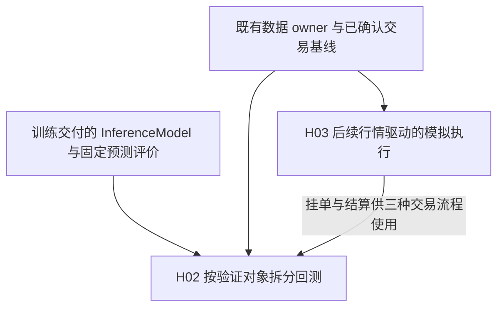
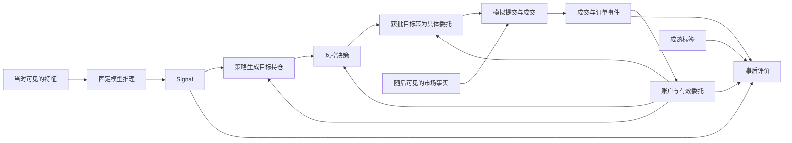

# 回测架构与模拟执行

本卷宗拥有独立信号评价、固定风控、策略回放、价格模型、FakeExecution、FakeLive 与
多频率回测的设计、审查和验收条件。训练与模型交付由[训练研究](../training/README.md)拥有。

2026-10-09 用户要求训练与回测分开研究。本卷宗从原联合研究迁入交易基线及 H02/H03，
保留原编号、历史决定、代码示例、反例和验收范围，不把文档拆分当成设计采用或运行实现。
历史 Evidence 中的“本文/全文”及检查数量指当时的联合卷宗；迁移不改写历史结果。
研究治理继续遵循[研究工作流](../../docs/engineering/research_workflow.md)。

## 目标与边界

目标是让五种回测模式按验证对象独立运行，共用预测、策略、风险、执行和结算中相同的
业务计算，并形成可解释的完整回测。训练作为已有能力消费，本卷宗不实现拟合、模型保存
或另一套预处理；模型、特征和标签的含义沿用既有交付及数据 owner。

execution_eval 与 full_backtest 必须使用同一价格模型，tradable_alpha_eval 默认合法
委托按参考价成交；signal_eval 与 risk_eval 不运行撮合。分钟和日频共享核心时钟、委托、
账户与评价边界。实时输入和真实 broker 仅保留历史论证，本轮用 FakeLive/FakeExecution，
不继续展开实盘细节，不构造通用券商平台。

正式编排仍由[Offline 工作流契约](../../docs/offline_workflow_contract.md)及其引用的数据
owner 拥有；H02/H03 为尚未采用的研究草案。卷宗拆分本身未修改正式 owner、源码、配置或
测试，未改变已确认的交易规则、价格模型适用模式及原有未覆盖事项。

2026-10-09 用户先要求对照本卷宗与 `src/trading/` 重写代码级设计，暂不改运行代码；
随后要求编码，并明确本轮范围为“先完成 H03 模拟执行、结算与时钟”。因此 H02 继续保留
设计，H03 在独立 `feature/backtest-h03` 分支实现及验证候选，不接入新的 CLI、配置或
五种模式组合，不改变正式 owner 或采用状态。设计入口见[代码级设计](#五种模式的代码级设计)、
[执行接口](#执行接口与单一结算入口)及[实施映射](#实施映射与候选验收)；当前实现与限制见
[H03 独立实施](#h03-独立实施与验收2026-10-09)。

## 对训练能力的依赖

回测依赖[训练的交付边界](../training/README.md#与回测的交付边界)，不依赖训练 workflow
或其 Context。需要新预测时，回测准备侧加载指定模型，交付可直接消费的 InferenceModel，
按自己的日程提供当时可见特征；不在回测启动、换日或每次预测时隐式训练。

读取固定预测时沿用[预测记录与身份](../training/README.md#事实记录日志与验证边界)，
独立评价复用[固定结果评价](../training/README.md#评价独立消费固定结果)。固定风险案例
和冻结委托入口无需模型。训练完成程度、模型的具体使用依据和回测自身的工程验收分别
判断，不能因为共用 InferenceModel 就共用一个完成状态。

## 当前背景与依据

2026-10-08 用户进一步要求重新设计回测，使信号价值、风控和成交可行性能够分别验证，
也能组合成完整回测，并澄清代码中的五种 mode 正是其想法的具体表达。本轮保留五种模式，
设计见 H02、H03；两者是尚未采用的候选，沿用原联合研究已确认的计算复用与交易基线约束，
不把此前对训练实施的授权或对五种模式的确认解释为对全部新增细节的采用决定。
同日用户将训练视为已完成能力，要求本轮聚焦独立信号评价、固定风控、多频率回测与完整
流程，以 FakeLive / FakeExecution 代替真实接入和执行。2026-10-09 用户要求“记录到文档”，
本卷宗据此将审查发现、修正方案、业务代码和验收边界整合进 H02、H03；此次只授权记录，
不表示候选已采用或运行代码已实施。
随后用户指出缺少“按买入价格能否买到”的价格模型，并明确 execution_eval、full_backtest
必须按价格模型执行；因资金体量小，其余模式默认价格可成交。下文按此修正模式契约，
将基础报价约束纳入 Fake 范围；具体成交公式仍是候选设计，不将模式选择解释为全部细节已采用。

训练侧最初的联合源码核查和交付整改证据保留在
[训练卷宗](../training/README.md#当前背景与依据)；回测现状、目标分支 owner 对照与
候选审查见本卷宗的[重设计事实依据](#重设计的事实依据)。迁移不重跑或改写这些历史结果。

## 依赖图



## 研究索引

- [对训练能力的依赖](#对训练能力的依赖)
- [已确认的交易与运行边界](#已确认的交易与运行边界)
- [固定规则交易基线](#固定规则交易基线)
- [既定交易与复演验收](#既定交易与复演验收)
- [回测任务输入](#回测任务输入)
- [H02 按验证对象拆分回测](#h02-按验证对象拆分回测)
- [H03 后续行情驱动的模拟执行](#h03-后续行情驱动的模拟执行)
- [H03 独立实施与验收](#h03-独立实施与验收2026-10-09)
- [定时风控只减少现有承诺](#定时风控只减少现有承诺)
- [评价采样与运行推进分开](#评价采样与运行推进分开)
- [FakeLive 与 FakeExecution 的本轮边界](#fakelive-与-fakeexecution-的本轮边界)
- [报价、成交价格与可成交数量](#报价成交价格与可成交数量)
- [实时输入与历史复演](#实时输入与历史复演)
- [单一 broker 的真实执行边界](#单一-broker-的真实执行边界)
- [结构数据流](#结构数据流)
- [训练研究](../training/README.md)

## 已确认的交易与运行边界

以下来自原联合研究 H01，保留 2026-10-03 至 2026-10-05 的决定和论证。原共同假设是：
三个入口分别负责运行组织和外部输入，共用数据、推理和交易计算，每种业务语义只有一个
实现归属，未来标签只进入训练和事后评价；重复实现或未来数据进入决策都会否定该边界。
拆分后，训练能力详见训练卷宗，交易与运行内容仅在这里维护。历史实时/broker 部分不因
迁移而进入当前实现范围；H02/H03 对当前 Fake 模式的修正见后文。

### 共用交易计算与各自运行

共用交易计算消费当时可见的输入、本次明确使用的就绪模型、当前决策可用的账户事实，
以及策略自身需要延续的状态，执行同一份推理、组合与风控逻辑。每次运行拥有自己的状态。

| 能力 | 唯一实现位置 | 调用关系 |
| --- | --- | --- |
| 历史特征读取、资格与特征计算 | 数据侧 | 各入口消费所需能力；历史读取与实时接入保留各自必要差异 |
| 预处理拟合与变换 | 共用预处理实现 | 训练拟合状态，InferenceModel 使用已拟合状态；各 family 不重复实现 |
| 算法拟合与就绪模型构造 | 训练侧 | 同一 family 的配置变化复用训练实现，每次训练独立交付 |
| 模型保存与加载 | 共用产物能力 | 训练保存具体 ref，评价、回测、live 按明确 ref 加载 |
| 预测与输出行对应 | InferenceModel | 评价、回测、live 直接消费等长同序结果，不在各消费侧恢复被删行 |
| 选池、组合与风控决策 | 交易侧 | 回测、live 共用 |
| 历史输入推进与模拟成交 | 回测侧 | 推进可见输入，按已产生的委托与随后市场路径形成模拟执行事实 |
| 实时输入接收与运行调度〔最后处理〕 | live 侧 | 将实际可用输入交给共用计算，消费真实执行事实 |
| 真实订单与账户交互〔最后处理〕 | 所选 broker 的执行侧〔待明确〕 | 按具体 API 提供已确认的订单、成交和账户事实 |
| 指标计算 | 评价侧 | 消费固定结果与后验数据 |

具体业务计算可以由普通函数表达，并按上表归位；此前八层 Step 图的层数不构成新增
业务实体的理由。表中每行是责任归属，不要求分别新增模块、类或转发函数。现行 Pipeline、
Context、Step 及统一测量仍遵循 Offline owner，本次训练实施保留这些边界；归并计算实现
不能自行推出删除编排，也不能以研究方向替代正式契约。

订阅名单与持仓目标分别表达。订阅某只股票的某个 topic 表示选择观察它，
研究中的 Top50 观察名单不能直接解释为买入名单。本轮不预设必须使用两个模型。

真实执行仍停在外部接口边界；不把现有同步模拟成交接口推广成统一的 live 执行接口。

#### 固定规则交易基线

缺口是预测怎样成为可执行的交易：买哪些、买多少、何时买卖，以及无法成交时如何处理。
次日最高价机会标签没有定义退出策略；其价格只能事后识别。正式
[日频标签契约](../../docs/data/daily_feature_label_contract.md)也不拥有入场、退出和成本语义。

固定规则便于辨认预测与简单执行的作用；引入盘中信号则同时改变信号、实时观察和交易
行为，需要额外证据。因此用户于 2026-10-03 在缺口讨论中确认，在模型与训练及预测比较
基础确定后先用固定规则：固定时点决策、固定目标持仓数量、等权分配，下一正式交易日
固定时点退出，检验模型在固定交易行为下的价值。等权减少仓位优化变量，固定目标数量
不保证实际全部成交。
此决定没有指定股票、资金、持仓数量的具体数值、买卖时点或订单类型，也没有把 Top50
观察名单变成持仓名单。

**已确认的选择、数量与资金规则。** 2026-10-05 用户在待澄清契约讨论中确认：从当时合格
且已有预测的证券中按预测降序选择，同分按 `symbol` 升序。有效候选不足目标数量时接受
不足，保留未用现金，不加入无预测证券。
延续持仓占用目标数量和资金，新买入结合剩余名额及当时可用现金；只有已确认成交产生的
卖出所得才能用于后续买入，不提前使用计划卖出所得。

委托数量使用决策时可见价格及对应证券的数量约束计算，不能根据未来成交均价反推当时
本应下多少单。交易任务仍须明确目标数量、初始资金、买卖时点、入场窗口、订单类型及
适用数量和风险约束；必需参数缺失时拒绝启动该交易任务，不填入旧实现的数值。

**已确认的未成交与期末处理。** 2026-10-04 确认处理方向，2026-10-05 进一步确定期末
价格口径；具体时点及数值由交易任务给出。本节讨论历史回测，不依赖真实 broker 先行接入。

| 情形 | 处理约定 |
| --- | --- |
| 入场窗口结束仍有未成交买入部分 | 撤销剩余部分，当次不补选 |
| 计划退出未全部成交 | 未完成部分继续作为持仓，在后续正式交易日的固定退出时点继续尝试 |
| 回测结束仍有持仓 | 保留未平仓事实，以期末正式日频不复权收盘价估值，不伪造强制成交 |

未成交必须反映在现金、持仓与后续可用资金中；计划退出没有成交，不能在账面上当作已卖出。
规则在交易任务处明确，由模拟执行反映结果，不由模拟器自行补充选股、资金或风险规则。
旧草案的 top-20、95% 资金和 5bp 滑点不自动成为本次参数，依据见原研究的
[训练与执行边界](../subscription-training/README.md#训练与执行边界)。费用和滑点使用
显式场景参数及来源依据，不自动将旧费率当作实际净收益成本。工程测试可以明确设为
零费用，但该结果仅属于毛收益场景，不能据此宣称真实净收益。

比较交易方案时固定预测与其他条件，后续比较模型时固定交易规则及成本假设，使结果变化
有明确解释。盘中 L2 的行动价值在此基线上另行研究，不能由机会命中指标推导。

**已确认的首轮模拟假设。** 同次讨论确认委托产生后逐分钟推进，使用随后可见分钟的 VWAP
作为粗略成交价格。每分钟可成交数量受剩余委托量、当时可用现金、可卖数量及该分钟观察成交量
限制；没有可执行观察时保持未成交，入场窗口结束按上表撤销剩余买入。不先读取整个
窗口均价再倒算委托数量。

这是明确的粗略成交假设，不包含队列位置或市场冲击的证明。现有即时模拟尚不满足这些
逐步推进与部分成交规则。订单只能由当时可见输入生成，随后市场路径由模拟侧用于判断
成交，不返回过去的决策输入；改变未来价格可以改变之后成交，不能改变之前已生成的委托。

#### 单一 broker 的真实执行边界

本节保留此前讨论，按[当前范围](#目标与边界)暂不推进，不继续选型或细化 API。

缺口是提交之后如何确认实际订单、成交和账户状态：提交成功不等于全部成交，超时不等于
没有下单，当前持仓也不包含有效挂单。例如目标买入 1000 股、已成交 400 股但仍有
600 股有效挂单时，只看持仓再次提交 600 股可能形成 1600 股持仓。因此尚未完成的有效订单
是执行判断需要的事实，现有同步模拟成交不能替代它。int4 行情文档没有提供下单与成交回报契约。

2026-10-03 用户在缺口讨论中确认先绑定一个实际要使用的 broker，按其具体 API 建立执行
边界，不提前建立多 broker 抽象。共用交易计算产生目标；执行侧负责提交、查询、回报处理
以及向决策提供执行事实。

- 请求、订单和成交身份使用 broker 明确保证的关联方式。
- 提交结果不明确时，使用其查询能力确认；超时不直接视为失败并重新提交。
- 持仓、现金按确认的成交与账户事实变化，尚未完成的有效订单进入后续执行判断。
- 成交去重依据 broker 的成交身份，不以股票、价格、数量和时间猜测唯一性。
- 启动和恢复按实际 API 核对账户、订单与成交；无法关联或查询而不能自动恢复时，
  明确停止受影响的自动提交，不承诺没有依据的恢复保证。

部分成交、提交结果不明、撤单竞争、重复回报和启动恢复直接影响是否重复下单及账户是否
正确，属于当前必要问题；多 broker 抽象没有当前业务必要性。查询、去重和账户核对办法
必须由所选 broker 的能力决定，不能提前发明通用答案。

用户于 2026-10-04 明确回复真实下单使用的券商、平台或 SDK“未定”。因此具体状态、
失败 API、费用事实和同步规则仍待所选 broker 的契约明确，不依据行情供应商或旧模拟器
代选 broker；这不妨碍按既定顺序推进模型、训练和交易基线。可控接口替身或测试环境只能
验证其覆盖的执行情景，不能据此或仅凭行情接收与决策记录声称真实成交或实盘启用。

### 既定交易与复演验收

以下原验收条件在 2026-10-05 已记录，现与对应交易设计放在一起。它们不属于训练完成的
条件；未运行的实时与 broker 场景仍未运行。当前 Fake 回测的具体候选验收见 H02/H03，
历史材料及范围不因迁移变成新的通过证据。

| 边界 | 验收材料与通过条件 |
| --- | --- |
| 交易账本 | 用少量证券和正式交易日构造未成交、延迟退出、费用及期末持仓场景，逐笔核对现金与数量；按既定委托及后续分钟判断成交，选择顺序、资金约束、剩余买入撤销和期末估值符合上文规则 |
| 实时输入〔最后处理〕 | 保留此前验证方向：同一合法输入前缀产生一致结果；晚到消息不改变过去决策；中断不冒充零成交；当前不要求执行 |
| broker 执行〔最后处理〕 | 保留此前验证方向：按具体 API 覆盖部分成交、结果不明、撤单竞争、重复回报及账户恢复；当前不要求执行 |

### 回测任务输入

这部分从原待澄清问题表迁入，属于具体回测任务准备，不重新要求训练用户提交交易参数。
已确认的规则与尚待提供的实际数值继续分开。

| 边界 | 尚待明确或验证 |
| --- | --- |
| [交易基线](#固定规则交易基线) | 具体交易范围、目标数量、初始资金、买卖时点、入场窗口、订单类型、证券数量及风险约束；费用和滑点场景的参数与来源、分钟成交与期末价格的实际数据依据；按已确认规则验证账本 |

### 实时输入与历史复演

本节保留此前讨论，按[当前范围](#目标与边界)暂不推进。

共用特征函数不保证输入相同：历史全量数据与实际订阅的覆盖范围、接收时刻及字段含义
可能不同，即使函数和模型一致，也可能产生不同预测，不能把这些差异误判为模型变化。
事件时间、数据库落地时间、本进程接收时间和特征生成时间分别证明不同事实；例如
14:29:59 的成交于 14:30:02 才收到，不能进入已经作出的 14:30 决策。

2026-10-03 用户在缺口讨论中确认以实际收到的数据为共同输入依据：live 接入侧保留必要
消息及接收过程，回测回放相同输入记录，再进入共用计算。没有接收记录的历史只可开展明确
假设的条件研究，不能通过补写时间戳声称真实复演。连续收到消息也不能单独证明供应商没有遗漏。

| 边界 | 已确认的处理方向 |
| --- | --- |
| 字段映射 | 按供应商定义在接入边界映射单位和含义；同名字段不自动等价 |
| 时间可见性 | 记录实际接收依据，决策只消费当时已经生成的输入 |
| 订阅生效 | 按接口实际保证记录订阅状态，并保留实际收到的数据；请求成功不自行解释为完整观察 |
| 乱序与重复 | 使用已确认的排序和身份语义，不按相同时间戳自行去重 |
| 中断与恢复 | 明确受影响的计算状态及恢复所需输入，重连本身不证明已补齐中断数据 |
| 观察充分性 | 所选特征拥有必要观察条件，数据侧交付可用或明确不可用的结果；缺少观测不补成零成交 |
| 股票资格 | 使用具有历史可用依据和生效含义的状态输入，沿用[订阅研究 H08](../subscription-training/README.md#h08-统一股票资格过滤与时间边界)；日终观察集合不能替代盘前资格 |

**建议及理由。** 先依据所选模型和交易基线列出必要字段、topic、观察条件与资格事实，
核对供应商保证，接通最小输入并记录实际接收，再验证同一合法输入前缀产生一致特征和
预测。这样直接检验当前目标，无需先建设覆盖所有数据的实时平台。无法满足所选特征的
观察条件时，说明缺口，再决定补充输入或另行研究特征，不能静默改变含义。

上述方向未定义新的实时去重键、排序规则、等待时长或恢复算法；[订阅研究 H03](../subscription-training/README.md#h03-已收逐笔的分批与离线特征一致性)的人工接收情景不能
直接升级为生产保证。现有分钟契约保留输入重复行的多重性，也不因这次记录而改变。

昨日已经可得的全市场排名可按原口径消费；当日有限订阅不能产生同口径的全市场排名。
需要这种输入时，须获得完整所需信息，或另行定义和验证受限观察特征，不能直接换成池内排名。

公开文档于 2026-10-03 只读核对：[int4 使用说明](https://int4.tech/downloads/STOCK_L2_GUIDE.md)
定义 NATS 行情订阅、股票价格 ×10000 及源端 `bs_flag`；`etl_ms` 属于数据库落地字段，
不在 NATS 实时负载中。本地分钟的 `trade_side` 则由
[分钟事实契约](../../docs/data/level2_minute_contract.md#聚合)定义为 tick-rule 方向代理，
不能与源端方向互换。[Core NATS 文档](https://docs.nats.io/learn/core-nats/)说明其不保存
离线期间消息；供应商是否另有历史恢复能力仍须依据其具体承诺。本轮没有连接行情服务或验证恢复。

### 结构数据流

2026-10-03 用户在缺口讨论中回复“同意你的方案。记录到文档”，确认三入口共用结构及
模型绑定、实际接收复演、交易基线、单一 broker、评价和记录方向。
2026-10-04 用户阅读完整方案后回复“同意你的建议，记录到文档。然后针对待明确的契约，
给出解决方案，以及你的建议”，确认以下数据流及[共用能力归属](#共用交易计算与各自运行)；
该次确认尚未包含随后提出的具体契约建议，后续决定已归入各自主题。

```text
训练
历史可见输入 → 数据侧交付特征 ─┐
拟合前已成熟且可用的标签 ──────┴→ 拟合预处理与模型
                                  → 就绪 InferenceModel → 独立保存 → 具体 ref

模型使用
本次运行指定 ref → 共用加载 → 按运行依据显式绑定就绪模型

回测与 live 的共用计算
回测推进历史输入 / live 接收实时输入 → 数据侧交付当时可用特征
    + 本次绑定模型 → 等长同序预测
    + 当前决策可用的账户事实 + 本次运行的策略状态
    → 共用选池、组合与风控 → 交易目标

各自执行
回测：交易目标 → 模拟执行 → 模拟订单、成交和账户事实 → 后续决策
live〔最后处理〕：交易目标 → 单一 broker 执行〔具体 API 待定〕
              → 已确认的订单、成交和账户事实 → 后续决策

评价
固定预测 / 名单 / 交易事实 + 后验数据 → 共用指标计算 → 展示
```

训练、回测与 live 分别组织运行，每次运行拥有自己的策略状态、输入进度和执行事实。
评价不向此前的预测或交易决策回传未来标签；模拟成交使用的随后市场路径同样不进入此前
决策。箭头只表达依赖，不要求为每个箭头增加接口类、Context、Result 或转发函数。

## H02 按验证对象拆分回测

- Status: open。
- 用户约束：2026-10-08 本次请求给出 `Signal = model(x)`、`Orders = strategy(signal)`、
  `execute(orders)`，要求分别验证信号价值、风控拦截与策略通过情况、交易能否成交，
  并允许成熟策略组合全部验证。用户随后澄清“代码层面的5种模式就是我的想法，具体的表示”，
  因此保留 `signal_eval`、`tradable_alpha_eval`、`risk_eval`、`execution_eval`、`full_backtest`。
  三项是验证问题，五种 mode 是具体组织方式；此前以四种任务替换五种 mode 的草案基于
  对用户意图的错误理解，已在本节整合修正。下文职责细化仍是候选，不将保留五种模式
  解释为全部新增设计已获采用。
  用户随后要求按五种模式细化代码，并明确选择“代码级设计：具体接口、调用链、关键代码
  与改动清单”，要求符合 Python 编码入口及细则；本轮据此交付代码级设计，不修改运行代码。
  用户进一步明确：入口可以不同，内部相同组件必须复用，`full_backtest` 按确定顺序组合
  单项模式使用的能力。“独立”仅表示可单独运行，不能解释为五套独立业务实现。
  用户同意按需省略风险 Step 的方向，并要求对照旧 Components / NoOp 方案确认可行性、
  给出理由及最终建议。本轮据此补充历史源码对照、现状依赖核查和有限测试，仍不实施候选。
- Decision: 2026-10-08 用户在审阅业务代码后明确“同意这些内容。记录到文档”。确认范围是
  共享策略、真实风险计算与执行器，通过 Step 组合表达五种模式，以及原始目标、风险决策、
  委托和成交分别留存的数据传递方案；下文整合已展示的关键代码和组装方式。此次授权为
  记录设计，不是实施或合入授权。2026-10-09 用户再次要求记录本轮完整审查及解决方案；
  下文据此修正定时风控动作、Fake 执行边界及评价采样，Status 保持 open。冻结及恢复机制
  不在首轮范围，不能把此次记录授权解释为对未知规则的采用。
- Hypothesis: 围绕既有五种 mode 区分信号统计价值、策略收益价值、风控、成交与完整闭环，
  复用同一份策略、风控及结算计算，可以独立定位问题，也能形成完整交易回测；
  不需要为每个模式复制引擎。
- Why: 单项结果只能回答自身问题。信号排序有效、风控发出减仓要求、订单被接纳，分别不能
  代替策略盈利、风险已经消除、订单已经成交的证据。
- Scope: 设计上述任务的最小输入、计算边界、结果解释、比较方法、具体 Python 接口、
  调用链、关键代码、状态所有权、文件改动及工程验收。
  拟正式化范围是回测的验证任务及编排、事实消费和报告语义。
- Not included: 本轮不修改运行代码或正式 owner，不训练模型、不选策略或风险阈值、不运行
  真实历史实验；不接入 broker。具体模拟成交机制由 H03 独立拥有，不能因为 H02 通过就采用 H03。
- Depends on: 本卷宗已确认的[共用交易计算](#共用交易计算与各自运行)和
  [交易基线](#固定规则交易基线)，以及训练交付的[固定结果评价](../training/README.md#评价独立消费固定结果)。
  模型及预测能力的实现和正式状态以[训练卷宗](../training/README.md#设计与仓库状态)为准，
  不把训练的历史工程验收视为回测已经完成。
  独立信号与固定风控案例评价可先实施；下文三种交易流程的代码依赖 H03 的挂单、推进与
  结算接口，不能把整份 H02 实现称为完全独立于 H03。
- Acceptance: 实施前固定下文验收场景；独立任务不读取无关输入、不创建无关交易状态，
  完整回放使用同一份计算，报告明确已运行项目、假设及未覆盖项。代码验收尚未执行。
- Stop: 本轮在现状核查、边界设计、实施映射、有限工程检查和文档验证完成后停止；没有收益实验或方案搜索。
  后续若必须新增业务规则而缺少 owner 或决定，停止相应正式化，不从旧代码默认值补出规则。
- Next: 按本节[实施映射与候选验收](#实施映射与候选验收)落实独立评价、Fake 账户闭环、
  多频率交易流程及 FakeLive 一致性验证。五种模式和共享组装方向已确认；新增动作与场景
  细节随本轮建议审查，具体规则参数由任务提供。获得实施范围授权后，在独立 feature
  工作树中同步 owner、入口、实现和测试，按实际依赖审查 H02、H03 的采用边界。

### 重设计的事实依据

本次源码阅读绑定 `feature/training_infer` 的
`76c25a279685b6961cda69143f542e8ec3936f51`。下表列出的源码、测试及分钟 owner 在检查时
与该 commit 相同；工作树另外已有训练和数据修改，不能把整个工作树描述为 clean。
正式编排核对的是本地可见 `dev` / `origin/dev` 的
`197f4bc3878bf4d6a495f3fce211e21b61ac6ba0`，没有查询远端最新状态。
工作树中的拟议 Offline owner 不替代该目标分支快照。

2026-10-09 按用户“阅读 backtest、trading，根据现有代码进行重新设计编码”的要求，
再次逐模块核对 `src/trading/` 的 67 个 Python 文件及请求、workflow、预测评价和相关测试。
本次 HEAD 为 `26c10185493c1085d4cdc0a9fe1ba54872a70707`，开始时工作树干净；
`src/trading/`、backtest workflow/config 及其已有测试相对上述 `76c25a2` 没有差异。
本地目标分支仍是上述 `197f4bc`，没有查询远端。以下新增的接口收敛是候选编码设计，
不能由基线测试通过推出新流程已经实施。

| 可定位的实现事实 | 对本次目标的影响 |
| --- | --- |
| `run_daily_alpha_backtest` 在所有 mode 下组装同一套八个逐日 Step，见 [workflow](../../src/workflows/backtest.py) | 信号评价也依赖策略、现金、执行和账户，任务没有真正分离 |
| [build_components](../../src/trading/sim/components.py) 只按 mode 切换 IdealExecution / ExecutionOrchestrator，risk 始终是 NoOpRiskManager | `risk_eval` 名称不能证明启用过风险规则；[现有组件测试](../../tests/trading/sim/test_components.py)还明确验证这种固定映射 |
| [TradableAlphaEvalStep](../../src/trading/backtest/steps/backtest_layers.py) 调用基于两期价格及固定成本扣减的 [tradable_alpha_frame](../../src/trading/engines/backtest_eval.py)，没有委托、成交量或盘口输入 | 它是条件收益诊断，不能证明可交易性；当前调用也没有传入非零成本 |
| [SimImmediateVenue](../../src/trading/execution/venue/sim_immediate.py) 对有价格的 intent 一次生成全量 fill | 没有部分成交、有效挂单和跨时点等待，不能回答价格出现时自己的订单能否完成 |
| [metrics persist](../../src/trading/backtest/steps/metrics_persist.py) 总是写入全部五类结果 | “有指标字段”会掩盖实际只使用了理想执行或空风控 |
| [SettlementEngine](../../src/trading/execution/settlement.py) 在账户处理成交后无条件追加账本，账户内单独去重 | 重复处理同一成交时，持仓与账本可能不一致；H03 的唯一结算入口须覆盖全部副作用 |
| [SignalStep](../../src/trading/backtest/steps/backtest_layers.py) 按日期生成预测文件名；[汇总](../../src/training/evaluation.py) 以观察条数填充 date_count | 同日多次决策须区分记录身份、决策次数与交易日数，不能直接沿用日频消费假设 |
| [PerformanceReport](../../src/trading/reporting/performance.py) 对相邻事件权益计算收益，调用侧固定年化因子；[EquityCurve](../../src/trading/core/equity.py) 每次 append 扫描历史回撤 | 增加无变化唤醒也能改变 Sharpe；分钟路径还需增量维护权益统计，不能把事件数量当作等间隔报告样本 |
| `SignalStep` 每次预测调用 `on_trading_day_start`，后者无条件清空 `buy_qty_today` | 直接扩展为同日多次信号会重置当日可卖限制；日切必须由交易日程拥有，初始快照和同日后续唤醒均不得清空它 |
| `IdealExecution` 自行调用 `PortfolioState.apply_fill` 并写 ledger，没有经过结算，也不约束资金或 T+1 | 不能把它直接当作新 tradable 的参考执行；应只替换价格处理，三种交易流程共用接纳、占用和结算 |
| `BehaviorReport` 与 `execution_quality_frame` 均以 fill 条数除以 submit 条数 | 一笔订单分两次成交会被报为 200%；新报告须按 order_id 和累计数量汇总，原目标差量不能代替冻结订单数量 |
| `MaxGrossExposureRule` 只计算最终目标市值，缺价格按 0 计；`RiskManager` 只保存最后 reason | 现有规则不能直接证明在途敞口合规或各规则覆盖；候选须补齐价格责任、当前持仓及买单占用，并保留每条实际计算的观察 |
| Threshold / TopKHysteresis 只输出固定股数目标，没有固定等权入场及下一交易日退出计划 | 复用构造器不等于实现了交易基线；需显式区分既有目标策略与尚待落地的固定期限策略，不能让模拟器补出退出行为 |

上述结构判断来自静态阅读；重复成交和采样问题另有本节 Evidence 中的合成复现。
不能将相对本次目标的能力缺口直接描述为实现违反当前正式 owner；目标分支
Offline owner 本来就规定所有 mode 跑完整链、使用 NoOpRiskManager。调整运行行为属于
设计变更；这些实现局限不构成删除或重命名用户既有五种模式的理由。

审查结论是保留五个入口、共享计算和单一交易闭环，但不能直接按旧草稿实施。候选本身还
需修正以下问题：定时风控不能从最后一次策略目标恢复过期买入；`blocked` 不能兼任拒绝与
清仓动作；允许行情晚到与订单到期立即终结不能同时声称覆盖最后区间成交。前两项在
[风控设计](#风控正确性与策略通过情况)处理，后一项通过 H03 的首轮 Fake 时间范围解决。
随后关于价格模型的澄清还修正了过度收窄：Fake 可以省略实盘接入与盘口队列，但不能
删除 execution_eval、full_backtest 对委托报价能否成交的判断。

### 旧方案对照与最终建议

用户提供的 [master 路径](https://github.com/UlricWu/min_quant/blob/master/src/trading/pipeline/pipeline.py#L21)
首次读取返回 404，初查使用了本地历史 `eaffe5c8475968006981e59e7fb2c7377a6052bf`。
用户随后将仓库公开，本次已通过 GitHub Raw 和 API 成功读取。最终对照固定到 API 返回的
远端 master `011aec22d9d4082b3e6fd74c181347e310e7e5d7`（提交日期 2026-07-20）；
相关文件均以该完整 SHA 再次读取核对。外部旧仓库、本地历史和当前工作树 `76c25a2`
是不同版本，不能混用实现状态或正式 owner。

该快照中的实际链路为：`build_components` 构造完整 `Components`，workflow 将各组件
绑定给同一套八个 Step，`TradingPipeline` 按 timing 执行这些 Step。`SignalStep` 内部
调用 `BacktestKernel` 获得行情 bar；Kernel 只推进时钟、更新 DataView、产生 BarContext，
并不接收 Components 或统一执行策略与风控。依据为固定版本的
[workflow](https://github.com/UlricWu/min_quant/blob/011aec22d9d4082b3e6fd74c181347e310e7e5d7/src/workflows/backtest.py#L83)、
[Pipeline](https://github.com/UlricWu/min_quant/blob/011aec22d9d4082b3e6fd74c181347e310e7e5d7/src/trading/pipeline/pipeline.py#L21)、
[Components](https://github.com/UlricWu/min_quant/blob/011aec22d9d4082b3e6fd74c181347e310e7e5d7/src/trading/sim/components.py#L28)、
[Kernel](https://github.com/UlricWu/min_quant/blob/011aec22d9d4082b3e6fd74c181347e310e7e5d7/src/trading/sim/kernel.py#L60)。
尤其是 TradingPipeline 本身已经接收外部传入的 Step 列表，没有强制包含风险步骤；
需要改变的是 workflow 的固定组合与组件依赖，不必为省略风控重建一个新调度框架。

旧代码确实使用 `NoOpRiskManager` 补齐 risk 槽位；在这个快照中五种 mode 的 risk 都是
NoOp，主要按 mode 切换 IdealExecution 与 ExecutionOrchestrator。它保证了固定 Step 图
可以统一调用 `risk.apply`，但这个实现事实不能证明当时已经检验了真实风控。

此前对话把 NoOp 直接概括为“多此一举”需要限定适用范围：在固定、始终完整的交易链中，
直通策略能维持稳定接口，具有实际用途。第一性原理应对照本次验证目标检查必要性，不能
仅凭类名否定 Null Object，也不能把旧结构强制要求存在的槽位当作业务必需。
本次五种模式的输入和验证范围确实不同，因此最终建议使用按需组装的共享 Step。

| 比较项 | 完整 Components + 固定 Step 图 + NoOp | 按需绑定组件 + 固定的五种 Step 组合 |
| --- | --- | --- |
| 复用边界 | 业务组件可复用，所有模式经过相同阶段 | 同一业务组件和需要的 Step 都复用，各模式只执行有关阶段 |
| 编排复杂度 | 主链固定，调用位置不分支；差异集中在组件替换 | Pipeline 同样只顺序执行；差异在五个可直接阅读的组装入口 |
| 信号单项评价 | 仍需补齐策略、risk、execution 槽位；旧实现还创建账户和交易事实 | 只准备信号和标签评价依赖，无交易状态 |
| 风控单项检验 | 固定交易链不自然接受一组已有风控案例 | 案例直接调用同一 `RiskManager.apply`，不重跑模型与成交 |
| 数据依赖 | 固定图容易要求无关阶段的输入；空组件不能自动消除其上游准备 | 输入边界与所选能力一致；前提是下游消费业务数据而非强制依赖上一步类型 |
| 验证含义 | 必须额外区分 NoOp 与真实检查，原样输出不证明检查通过 | 缺席 Step 直接表示该能力未运行；真实执行且没有样本另行报告 |
| 主要约束 | 槽位越来越多时可能增加更多占位组件 | 组装者必须保证必需步骤与合法顺序，不能开放任意删改的步骤配置 |
| 合适范围 | 各场景都运行完整交易链，仅某个算法选择直通时合理 | 本次独立信号、固定风控、固定委托及完整闭环的需求更合适 |

本次选择不以微小函数调用开销为理由，也没有进行性能基准。依据是职责与依赖范围：
删除纯信号任务的账户、风控和成交仍能完成信号检验，因此这些实体不是该任务的必要输入。
另一方面，共用循环、真实风控、执行与结算仍然必要，继续各保留一份实现。

可行性已有调度层依据，但不是从当前代码删除一个 Step 即可。远端旧版的
[执行 Step](https://github.com/UlricWu/min_quant/blob/011aec22d9d4082b3e6fd74c181347e310e7e5d7/src/trading/pipeline/steps/backtest_layers.py#L274)
读取 `ctx.current_targets`，策略先写、风控可再调整，已经体现可选变换的数据流；
当前 `76c25a2` 的 [ExecutionEvalStep](../../src/trading/backtest/steps/backtest_layers.py)
反而强制读取 `RiskResult`，缺失即失败。两个版本必须区分，不能用旧版可省略的输入形状
冒充当前实现已经支持省略。

还需同时解除三处隐藏职责：旧版与当前版本的 target tape 记录都放在风险 Step 中；当前
执行和估值依赖 SignalResult 内的行情，妨碍冻结委托独立运行；现有 `NoOpRiskManager`
并非严格 identity。远端与本地的
[NoOp 实现](https://github.com/UlricWu/min_quant/blob/011aec22d9d4082b3e6fd74c181347e310e7e5d7/src/trading/risk/engine.py)
均调用 `_normalize_adjusted_targets`，检查负数和非有限值并转为整数；本地版本还显式
排除非法类型。例如 `100.9` 变成 `100`。省略风险不能顺带丢失必要不变量，也不能把
这类转换继续伪装成一次真实风险检查。

最终建议是：保留五个只负责组合的 workflow、共享 `run_steps`，三种交易任务共用
`BacktestPipeline`；按需绑定同一组领域组件，使用下文规定的目标数据契约消除风险
前置依赖。完整 Components 包及 `NoOpRiskManager` 不再作为五种模式的公共前置条件。
在本次调用链替换完毕、确认没有独立调用方后删除失效实现，不为保持外形一致而建立
五份 Components、空风控类或充满可选字段的组件包。

`BacktestKernel` 的名称并不决定是否需要保留。所需的时钟推进与行情可见性能力继续复用；
H03 的交易回放统一由 BacktestPipeline 拥有时点、账户和挂单生命周期，不再让另一个
Kernel 同时推进同一交易账户。输入侧仅有的 bar 遍历可以保留自己的职责，不能承担第二套
交易编排。此处是最终设计建议，正式 owner 与运行代码尚未同步。

### 共用交易闭环与独立评价

用户公式中的 `Orders` 表示想要提交的委托，不等于实际成交。沿用当前仓库已有的目标持仓
表示，最小交易过程如下；箭头表达职责，不要求新增同名类或包装函数。



策略拥有信号组合、选股、仓位和入退场意图；风控拥有明确规则下的允许、缩减、拒绝或减仓
要求；执行侧把获批目标与当前持仓、有效挂单比较，形成委托并判断能否成交。继续使用
现有目标持仓和风控计算边界，无需为了匹配公式把所有策略改成直接构造 broker 请求。
市场数量、价格、可卖及资金占用等委托合法性约束由执行边界负责，不另复制成一套业务风控。

风险规则若要求观察持仓变化或价格变化，回放必须在相应事件上调用它，不能只在模型有新
分数时运行。没有新信号仍可有持仓风险、到期订单和计划退出。风控要求清仓只产生减仓
意图；卖不出时原持仓及其风险继续存在。

模型与训练分开：回测消费明确模型或已有预测记录，不隐式重新训练。已有预测记录带有
模型与输入关联时直接复用，不再要求调用者重复指定另一份模型。不同策略消费同一份固定
信号，各自拥有账户、策略状态与有效委托；不共享可变回放状态。
多个信号参与组合时，使用各自当时可用的值，按证券及决策时点对齐；不能读取更晚信号
补齐缺失。组合规则属于策略；需要拟合的组合权重属于训练，不能在最终验证集上学习。

### 五种模式对应三个验证问题

保留现有五种 mode 和一个面向用户的 backtest 命令，按各模式明确所需输入与实际运行内容。
五种 mode 表达同一组业务组件的五种组合。Python 层的五个 workflow 入口只负责选择输入、
绑定组件和声明顺序；相同策略、风控、执行、结算与指标逻辑各自只有一份实现。命令适配
边界只解析和路由，领域计算不再接收 mode。
`signal_eval` 与 `tradable_alpha_eval` 分别研究信号本身和将信号用于交易后的收益价值，
共同回答第一个问题；`risk_eval`、`execution_eval` 对应第二、第三个问题；
`full_backtest` 组合全部验证。以下是职责细化建议，具体业务判据仍需在相应任务中明确。
共用回放是这些模式按需调用的内部执行能力，不新增 `replay` 公共模式或任意开关组合。

| 模式 | 最小输入 | 实际运行 | 主要结果与结论边界 |
| --- | --- | --- | --- |
| `signal_eval` | 固定预测记录、明确标签及评价区间；需要新预测时才使用模型与特征 | 独立评价预测与成熟标签 | 模型目标 IC/Rank IC、样本与缺失覆盖、分期表现；不构造策略、风控、执行器或账户 |
| `tradable_alpha_eval` | 固定信号、明确的组合/持仓规则、初始账户、参考成交及成本假设 | 默认合法委托可按声明的参考价成交，不运行价格可成交性模型 | 组合毛收益、成本后收益、换手及相对基线表现；验证信号如何转成策略收益，不代替实际成交可行性检验 |
| `risk_eval` | 风控前目标、当时账户/估值/有效委托、所选风险规则与参数 | 调用真实风险实现，保留每条命中规则及调整 | 该输入被允许、缩减还是拒绝，调整后是否符合该规则；不依赖模型或模拟成交 |
| `execution_eval` | 带报价、产生及生效时间的具体委托、初始账户、后续市场数据、价格模型及执行假设 | 按价格模型判断是否成交，再推进委托、成交和账户 | 价格未满足、拒单、部分成交、等待、撤销、费用和未完成量；不重新运行模型、策略或业务风控 |
| `full_backtest` | 固定信号或模型及特征、策略及报价规则、所选风控、初始账户、日程、市场、价格模型及执行假设、评价标签 | 共用交易闭环，执行必经价格模型；结束后评价其已保存事实 | 同一策略路径下的信号价值、风控影响、执行结果和账户净值，组合前三个验证问题 |

`risk_eval` 可以使用人工构造的边界情景，也可以读取历史回放保存的风控输入；因此还没有
模型时也能验证拦截能力。`execution_eval` 的委托可来自独立夹具或已有运行，但必须具有
明确数量、方向、委托报价、首轮 Fake 成交条件、有效期及初始账户依据，不能再按未来成交价反推。
单项 `execution_eval` 的“已批准”仅表示输入边界，不代表本次已经验证风控。

2026-10-09 用户明确价格模型只用于 execution_eval 和 full_backtest，其余模式默认买得到。
signal_eval、risk_eval 本身没有成交动作，不为这个假设创建执行器或虚假 fill；固定风险
案例中的账户和挂单仍是案例输入，不能被“默认买得到”改写。
策略组合的早期检验归入 tradable_alpha_eval：在首个符合日程的参考价格上，将已接纳的
合法剩余数量按账户约束成交，不因报价触及或市场成交量不足而等待；未来参考价在到时后
才可用于结算，不能回填过去。参考价/数据缺失仍按输入契约处理，不能编造价格。
它保持同一账户与结算规则、当时可知的现金、数量及可卖约束，不能靠无限现金制造收益。
零成本是可选的毛收益场景，不能自动绕过账户约束。它回答“在这些简化条件下，信号如何
组成有收益价值的策略”，不能获得成交
可行性通过结论；保留该模式，正是为了区分预测统计效果与组合交易价值。

`risk_eval` 和 `execution_eval` 的独立计算可以消费已保存的边界输入；需要评价某个具体
策略时，也可由共用策略与回放能力生成这些输入，而不另建模式。输入产生过程及使用的
参考执行假设须随结果记录，不能将冻结输入检验与动态闭环的结论混用。

完整回测需要同一闭环实际启用所选风控、按声明的 Fake 执行假设模拟成交，并评价同批信号。
结果分别报告信号、风控与成交三项证据；某项未运行、无样本或数据不足，不能把该项写成通过。
工程运行成功、评价有定义和业务达到预设门槛是三个不同判断。即使三项都完成，结论仍限于
所用数据和执行假设。本轮 `execution_eval` 和 `full_backtest` 只验证 Fake 条件下的委托、
资源与账户结果，不产生“真实成交可行性已通过”的结论；名称 full 不扩大实际覆盖范围。

### 信号价值与策略价值的判定

评价标签首先使用模型声明的目标。Rank IC 表达排序关系；分组收益只有在评价对象确实是
明确期限、价格口径的收益时才这样命名。收益 rank 的平均值不能称为收益，次日最高价
机会标签也不能当作可成交退出价格。额外收益诊断须明确另一个评价目标，不覆盖模型目标。

沿用共用 `rank_ic` 与预测评价能力，保留无定义原因、有效配对数和覆盖率，不为回测再实现
一份指标公式。信号缺失及标签缺失留在覆盖统计中，不用未来标签补选交易对象。
有 IC 不能推出一定盈利；组合持有、换手、资金约束和交易成本的影响由策略回放检验。
价值判断还需预先选定比较基线，例如同一历史合格集合、同一持有规则下的无信号等权方案；
保持账户与成本条件一致，报告相对基线的增量、分期稳定性、有效样本量和不确定性。
不能仅凭平均 IC 大于零或历史总收益为正，就判定信号具有足以采用的交易价值。

用实验决定信号组合或策略时，运行前冻结候选、选择区间、最终验证区间、收益与风险判据
及停止条件；训练与标签成熟边界沿用已有契约。跨期标签重叠须按真实观察区间隔离，不能
让训练标签覆盖到被宣称未见的验证时段。组合调参只用选择区间，保留失败候选，最终区间
不反复用于挑策略。预处理和模型选择不能使用测试集信息，这一点也与
[scikit-learn 的数据泄漏说明](https://scikit-learn.org/stable/common_pitfalls.html#data-leakage)
一致。本轮没有选择实际模型、数据区间、显著性门槛或收益门槛，不作信号有效结论。

### 风控正确性与策略通过情况

风控检验分别回答两件事：

- 对已声明的规则，安全、触边和越界情景是否产生预期动作；正常目标应允许，需调整或
  拒绝的目标不能漏过。预期来自规则 owner，不能用当前输出反写测试期待。
- 实际策略的目标有多少被允许、缩减、拒绝，哪些规则导致差异；拒绝后还剩多少可执行
  交易机会，风险动作最终是否落实到持仓。

风险上下文含已成交持仓及有效委托的占用。禁止新增风险的规则必须阻止相关新委托，并
按规则处理仍有效的增仓委托；把新目标改为零却放任旧买单继续成交，不构成有效拦截。
首轮可使用现有单证券敞口、总敞口和回撤减仓能力，实际启用项及参数在本次运行前固定，
不由本设计代选阈值。持续冻结及恢复机制未纳入首轮，不因为存在 kill-switch 类名就补出
另一套状态机。

当前 `blocked` 同时表达拒绝与清仓，无法确定是否应提交零目标。修正后的 RiskDecision
使用明确的 `adjusted: Mapping[str, int] | None`、`cancel_order_ids: tuple[int, ...]`、
`reason: str` 及规则观察。`adjusted` 是本次需要提交的完整目标，None 表示没有待提交目标；
究竟是拒绝新请求还是已有状态无需新动作，由原始案例和规则观察区分。它不表示未运行
风险检查。旧 blocked / scaled 不再作为候选动作 API 的字段或分支条件，变化量由原始
输入和输出直接恢复。

| 风控结果 | 委托侧动作 |
| --- | --- |
| 允许 | 提交明确目标 |
| 裁剪 | 提交调整目标，并对账冲突旧单 |
| 拒绝当前请求 | 不提交该请求；旧单是否撤销由明确的撤单列表决定 |
| 减仓或清仓 | 撤销冲突增仓单，提交减仓或显式零目标；未成交持仓继续存在 |
| 已有状态无需新动作 | 保存实际检查记录，不生成新目标 |

本轮非负持仓下，未完成卖出前的敞口上界为“当前持仓市值＋有效买单可能增加的市值”。
挂着卖单不能提前降低敞口，也不能提前释放新买入的风险预算。规则既检查最终目标，也
约束新买增量在执行路径上的敞口；所建议撤单的占用只有执行确认后才能复用。否则，例如
已有仓位仍未卖出时，再买入另一组证券，可能在最终目标合规的同时突破过程中的总敞口。

规则正确性不能仅用“回撤变小”证明。历史路径未触发某条规则，只能报告未覆盖；需要明确
的触边或压力情景补验。回撤触发阈值也不等于损失保证上限，价格跳变或卖出未完成必须在
完整回放中保留其实际后果。

#### 定时风控只减少现有承诺

旧 RiskDecisionStep 在没有新目标时读取 target_tape 最后一项，再把风险调整结果交给
submit_targets。若入场原目标为 400、只成交 360、剩余 40 已经到期，这条链会在下一次
风控检查时重新补买 40。历史记录由此被错误地当成持续有效的交易意图。

修正为 RiskCase.target 可以为 None，唯一表示“没有新策略请求，检查当前持仓与有效挂单”。
RiskManager.apply 同样接收可空目标，在同一个计算入口内完成规则判断与动作生成。
风险输入从当时账户和挂单构造，不读取历史 target tape。独立 risk_eval 保存并复用相同
案例形状，因此与 full 的定时检查也能得到一致决策，不在两个入口复制转换算法。

检查风险上界时不扣除未成交卖单；生成减风险动作时，保留原有买卖承诺的净目标。
下面是 RiskManager 定时分支中的动作计算片段，risk_limits 是同一次规则链已经算好的
各证券允许数量，覆盖当前持仓及挂单证券。该片段不是新增 helper、另一次规则执行或
完整的 RiskManager 实现：

```python
committed = dict(positions)
for pending in pending_orders:
    order = pending.intent
    signed_qty = (
        pending.remaining_qty
        if order.side == Side.BUY
        else -pending.remaining_qty
    )
    committed[order.symbol] = committed.get(order.symbol, 0) + signed_qty

reviewed = {
    symbol: min(quantity, risk_limits[symbol])
    for symbol, quantity in committed.items()
}
adjusted = None if reviewed == committed else reviewed
```

例如仍有卖单时，净承诺低于当前持仓，定时检查不因规则允许更高仓位而反向补买。缩减旧
买单确需撤销重发时，新单生效不得早于本次提交，且必须保留原到期时刻；不能重开入场
窗口。撤单列表和目标必须一致，后续对账不能复活刚被风险禁止的增仓意图。

以下单证券合成算例只验证上述动作计算，不决定风险阈值或证券数量制度：

| 当前持仓 | 有效委托剩余量 | 规则允许数量 | 待执行目标 |
| --- | --- | --- | --- |
| 360 | 无，入场余单已到期 | 400 | None，不恢复买入 |
| 600 | 买 400 | 1,000 | None，旧单保持 |
| 600 | 买 400 | 800 | 800，只缩减已有承诺 |
| 600 | 卖 400 | 500 | None，不反向补买 |
| 600 | 卖 400 | 100 | 100，进一步减仓 |
| 600 | 买 400 | 0 | 0，撤销增仓并请求清仓 |

策略状态继续拥有有效入场窗口和退出计划，历史目标只是记录。窗口内若需要在卖出到账后
继续买入，由明确的策略日程触发对固定名单的目标重算，使用已经结算的现金；不重复推理
或补选，不借定时风控隐式实现。窗口结束后不再补买，计划退出仍按自己的日程执行。

### 可解释的比较与结果事实

以下配对只改变表中列出的变量，其余信号、市场输入、配置和初始账户保持一致；这是调用
同一回放的实验组织方式，不新增对照引擎。参考成交与市场成交使用同一估值、账户制度
和明确的成本口径，改变哪些执行参数必须列明。本轮所谓市场成交场景仍是使用市场观察的
Fake，不表示接入券商。按用户明确的模式边界，tradable 默认成交，full 同时包含价格模型
和真实风控，两者之差不能再解释为单独的风控效果。

| 比较 | 变化项 | 解释 |
| --- | --- | --- |
| 策略 A 与策略 B | 信号组合或交易规则 | 固定模型及执行条件后的策略差异 |
| full 内风控方案 A 与 B | 所选规则或参数，价格模型固定 | 比较两套明确风险规则对闭环路径的影响；单项判断可另用相同 RiskCase 验证 |
| execution 内相同冻结委托、不同价格模型参数 | 成交假设或滑点参数 | 比较价格未满足、成交数量、等待和成本；不重新生成报价或订单 |
| tradable 与 full | 价格可成交性与风控共同变化 | 参考策略到完整回放的总体差异，不能全归因于风控或滑点 |

每个闭环独立推进账户。改变成交后，后续持仓、风控输入和策略订单可能改变，因此两条净值
之差是路径比较，不能自动当作可加总的精确损失归因。固定同一份风控输入或同一份委托
可以做局部对照，但不能把这类冻结输入的结果冒充另一条自洽策略路径。

结果沿用现有 experiment、预测记录、ledger、tape 和 metrics；补充能够解释本次任务的
必要事实，不建立新的全局注册表。至少能恢复：任务和实际启用能力；代码及 dirty patch、
模型/信号和数据的可恢复版本；策略、风控、成本、成交、日程及随机条件；风控前后目标；
具体委托、成交与未完成原因；账户及估值。已有事实能推出的汇总不重复成为第二个权威。
未运行项目在报告中明确列出原因，不伪造全零结果；无定义指标按现有评价规则处理。

#### 评价采样与运行推进分开

现有预测文件按日期命名，同日多次预测会发生路径冲突；回测侧改为在本次运行的日期目录
下按 decision_ts_us 区分记录，例如 `predictions/2026-07-03/1783056600000000.parquet`。
仍保留原始样本键和实际模型关联，不重新定义 Feature/Label 身份，也不创建全局预测 registry。

逐决策 IC 复用现有公式和 ICObservation。现有 summarize_observations 将条目数写入
date_count，其调用前提是日频评价，不能把分钟观察直接传入后将结果解释为交易日数。
本轮回测报告分别记录决策次数、交易日数及有效覆盖；建议先对同一交易日内有定义的 IC
等权汇总，再对有定义的交易日等权展示，同时保留逐时观察与无定义原因。无值日期不能
填零。交易日取输入准备时保留的决策与交易日对应关系，不从 UTC 自然日猜测。
回测的 MetricsPersistStep 保存原始 ICObservation 和上述汇总，signal 与 full 使用同一
报告计算；现有 save_evaluation 内部仍调用日频 summarize_observations，不能直接用于
分钟观察的汇总写出。该消费侧变化不改写训练已有的单日评价含义，也不复制 Rank IC 公式。

组合报告的采样与事件推进分开：运行开始先保存初始权益，避免遗漏第一笔成本；风控按
实际事件更新权益与峰值，日收益、波动率和 Sharpe 则从正式交易日期末权益计算。年化
假设随报告记录，不从 Pipeline 的推进次数推导。盘中观察到的最大回撤另行明确采样范围。
同一净值路径增加不改变账户的定时唤醒，不应改变日收益或 Sharpe。

这不是仅修改年化常数：现有 PerformanceReport 使用相邻事件权益作为收益样本，增加空
唤醒已经改变其样本分布；必须先统一报告采样，再使用相应统计公式。成交数量比例与订单
完成比例也须按订单身份计算，不能以 fill 条数除以 submit 条数；一次订单分两笔成交不
代表完成两个订单。无样本或数学无定义的报告项继续保留原因，不用 0 冒充可定义指标。

### 五种模式的代码级设计

本节是 2026-10-08 用户明确要求的设计交付。所有拟新增名称均是候选 API，不代表它们
已经存在或可以从当前 `src/` 导入。代码块给出接口或关键函数的拟议内容，不创建空实现
文件、`NotImplementedError` 占位或新的研究运行平台。

设计依据是 [Python 编码规范入口](../../docs/engineering/python_coding_style_for_ai.md)及其
[细则](../../docs/engineering/references/python_coding_style_rules.md)。重点落实 PY-004～013、
PY-016～021、PY-025～027：公开类型完整，业务动作独立，容器所有权明确，决策计算唯一，
没有隐藏 I/O、无意义转发类或模式大函数；测试验证公开结果而不是 helper 存在。

#### 共享组件与组合方式

先确定共享业务组件，再由 mode 选择输入和组合方式。下表的“复用”表示调用同一函数或
同一类的实现；每次独立运行仍有自己的可变状态。不能为不同 mode 各写一个内容相似的
策略、风控或执行类，再把这种复制称为组合。

| 共享组件或计算 | signal_eval | tradable_alpha_eval | risk_eval | execution_eval | full_backtest |
| --- | --- | --- | --- | --- | --- |
| 固定预测读取/模型推理、`SignalEvent` | 使用 | 使用 | 输入已经固定 | 输入已经固定 | 使用 |
| 同一策略实现及 `PortfolioStep` | — | 复用 | 消费风控前目标 | 消费具体委托 | 复用 |
| `RiskManager.apply` | — | — | 复用 | — | 复用 |
| `ExecutionOrchestrator` 的委托接纳、挂单推进、撤单 | — | 复用 | — | 复用 | 复用 |
| Fake 的价格处理 | — | 默认按参考价成交 | — | 必须运行价格模型 | 与 execution 共用价格模型 |
| `SettlementEngine`、`PortfolioState`、估值与账本 | — | 复用 | 消费账户快照 | 复用 | 复用 |
| `evaluate_prediction_records` | 复用 | — | — | — | 复用 |
| 组合收益、费用、换手的评价计算 | — | 复用 | — | — | 复用 |
| 风控观察的汇总计算 | — | — | 复用 | — | 复用 |
| 委托/成交事实的评价计算 | — | — | — | 复用 | 复用 |

表中的指标计算分别归已有预测评价、风险评价及 `src/trading/engines/backtest_eval.py`
所属职责，消费稳定的观察、ledger 和权益事实；不按 mode 复制公式。参考成交和价格模型
由 workflow 固定组装，委托生命周期、账户和结算仍使用同一实现。核心不知道 mode，
也不为信号或风险单项模式构造一个 NoOp 价格模型。

`full_backtest` 将这些组件接成同一条反馈闭环：策略生成目标，真实风险计算调整目标，
执行组件提交委托并随行情产生成交，共用结算更新账户；下一次策略及风险计算读取更新后
的账户。结束后，同一批事实交给各项共用评价函数，组合为完整报告。因此它组装的是组件，
不依次启动其他四个顶层 workflow；后者会分别初始化账户、重放交易，无法得到同一条路径。

其中，full 与 tradable 复用组合收益评价，但各自使用本次执行假设产生的账户事实。
若要得到“参考成交与市场成交”的差值，再以固定输入分别运行两个场景；不在一次 full
闭环中重复成交同一订单以凑齐两份结果。mode 决定验证范围，指标结果由实际运行事实决定。

#### 入口与请求类型

CLI 仍保留 `backtest --mode ...`。在已有 CLI/请求构造边界一次完成校验，将外部参数转换
为以下五种互斥 submission，随后直接调用对应 workflow。HTTP 复用相同构造边界后交给
现有 Job/CLI 执行，不新增一份请求规则。`mode` 不传给策略、风险规则、撮合或指标函数。

| 现有 mode | 拟议 Python 入口，位于 `src/workflows/backtest.py` | Submission 类型 | 该模式独有的必要内容 |
| --- | --- | --- | --- |
| `signal_eval` | `run_signal_evaluation` | `SignalEvalSubmission` | 信号来源；评价使用信号记录关联的模型目标 |
| `tradable_alpha_eval` | `run_tradable_alpha_evaluation` | `TradableAlphaEvalSubmission` | 信号来源、策略、初始账户、参考成交和费用配置 |
| `risk_eval` | `run_risk_evaluation` | `RiskEvalSubmission` | 风控输入记录、风险规则与参数 |
| `execution_eval` | `run_execution_evaluation` | `ExecutionEvalSubmission` | 委托及撤单时间序列、初始账户、执行观察、Fake 和费用配置 |
| `full_backtest` | `run_full_backtest` | `FullBacktestSubmission` | 信号来源、策略、初始账户、所选风控、执行观察、Fake 和费用配置 |

每个 submission 保留任务实际需要的日期范围；`experiment_id` 和 `PathManager` 继续由
composition root 显式传入。记录输入的 `start/end` 选择决策时点或委托产生时点，撮合数据
另需覆盖已选订单的有效窗口，评价数据另需覆盖标签成熟范围；不能统一截到 `end` 而截掉
最后一笔交易或标签。执行配置另明确模拟终点，停止产生新入场意图后，已有订单与退出
计划仍按日程处理到该终点；不能为了补全最后一笔交易而无限延长回放。期末估值所需的
价格也须在约定报告时点可见，不能把收盘价倒写为更早的盘中估值。
`BacktestSubmission` 改为这五种类型的联合别名，不增加
带大量 `None` 字段的公共基类。五种类型之间允许重复少量 `start/end` 字段，不为此引入
继承、字段混入或反射构造。拒绝该模式不接受的字段，避免传入的风险参数被默默忽略。

请求中的稳定结构按以下边界表达；类型名只对应当前确有两种来源或业务事实的差异：

| 类型/事实 | 必要内容与所有权 |
| --- | --- |
| `ModelSignalInput` | 具体 `model_ref` 与现有 `ModelUse`；加载绑定及历史可用性核对沿用[训练交付边界](../training/README.md#显式模型绑定与可用性)，不隐式训练 |
| `RecordedSignalInput` | `prediction_refs: tuple[Path, ...]` 与 `binding_refs: tuple[Path, ...]`；前者有序定位固定预测，后者引用已有模型绑定记录。纯事后 signal 评价可明确传空绑定序列；用于 tradable/full 的每个模型必须有可核对的历史使用依据 |
| `SignalInput` | 上述两种类型的联合；由来源准备边界分别处理，交易计算只看到同一 `SignalEvent`，不识别来源类型 |
| 初始账户 | 快照时刻与账户交易日、现金、持仓数量、可卖数量、持仓成本和计算所需的既有权益状态；全现金起步明确给空持仓，不能把已有仓位假装为零成本；运行时构造本次独占的 `PortfolioState` |
| 风控输入记录 | `case_id`、风控前目标或表示定时检查的 None、当时 `RiskContext`；必要的历史峰值、估值和挂单占用属于输入，不能在离线复验时用后来账户补齐 |
| Fake 成交配置 | 交易日程、模拟终点、执行观察与价格来源、资金/数量约束、明确费用及滑点；tradable 固定为参考成交，execution/full 必须声明 H03 的价格模型及适用数量假设，不能缺失后回退参考成交；小资金假设不推导未知冲击或排队模型 |
| 报价规则或固定报价 | full 在原有策略配置中声明买卖报价来源与参数，由现有目标转委托计算根据最终方向生成 limit_price；execution 直接读取订单上的报价；tradable 无报价可成交性要求，不要求提供无用参数 |
| 风控配置 | 有序的具名规则和对应有类型参数；解析为现有 `RiskManager` 使用的规则实例，不在核心传递 `dict[str, object]` 或另建动态插件 registry |

初始账户、费用、风控及执行配置应使用明确模型。业务数值仍由具体任务和已确定规则给出，
不能为使构造方便而发明默认现金、风险阈值、交易时点或物理单位。现有 `StrategyConfig`
及其两个具名参数模型继续复用。所选规则缺少正式语义时，保留具体待定项，不从代码常量
反推已采用的规则。

固定预测的 `PredictionInputs` 当前只关联模型内容、特征摘要和决策时刻，不含
`ModelUse` 的历史可用证据。读取记录仍复用现有身份校验；用于交易时，再读取显式提供的
绑定记录，按模型引用及内容摘要关联其 `ModelUse`、`TrainingRunRecord` 和训练数据定义，
沿用现有成熟时间与生效时间检查，并以这批记录实际首次决策时刻核对。绑定引用缺失或
不匹配时准备失败，不从文件名猜测，也不因为文件今天已存在就允许过去交易。
这复用当前 workflow 写出的 `binding.json` 所含事实，不创建模型或 Signal registry，
也不重新指定另一份推理模型。纯事后信号统计不据此声称历史可交易。

具体 submission 字段如下。`InitialAccount`、`FakeExecutionConfig`、`RiskConfig` 是上表
所述配置的拟议名称，放在现有
`src/config/backtest_config.py`；来源类型及 submission 放在现有 `src/jobs/requests.py`。
读取 JSON 的边界校验后产生这些有类型对象，不让文件路径充当运行时领域参数。
原草稿的 ReferenceExecutionConfig / MarketExecutionConfig 收敛为同一 Fake 配置；
场景的不同不再暗示两套执行能力，也不预留真实券商配置。

| Submission | 必需字段，所有字段均不设业务默认值 |
| --- | --- |
| `SignalEvalSubmission` | `start: str`、`end: str`、`signal: SignalInput` |
| `TradableAlphaEvalSubmission` | `start: str`、`end: str`、`signal: SignalInput`、`strategy: StrategyConfig`、`initial_account: InitialAccount`、`execution: FakeExecutionConfig` |
| `RiskEvalSubmission` | `case_refs: tuple[Path, ...]`、`risk: RiskConfig`；评价全部所选案例，时间覆盖从案例事实取得，不再要求不相干的交易日期范围 |
| `ExecutionEvalSubmission` | `start: str`、`end: str`、`order_refs: tuple[Path, ...]`、`initial_account: InitialAccount`、`execution: FakeExecutionConfig` |
| `FullBacktestSubmission` | `start: str`、`end: str`、`signal: SignalInput`、`strategy: StrategyConfig`、`initial_account: InitialAccount`、`risk: RiskConfig`、`execution: FakeExecutionConfig` |

三种交易 submission 都通过提供侧取得构造完成的账户、行情、模型和依赖，使用侧直接
消费。参考与成交量受限场景都有账户约束。`InitialAccount` 的快照时刻必须对应本次回放
起点，不能裁剪掉区间前的订单却沿用更早账户；第一轮调度也不能清空快照中的当日买入
或可卖限制。首轮初始挂单为空；需要接续已有
挂单的场景须明确提供其原始提交和占用事实，本轮不靠默认值假装支持恢复运行。
上述 union 在请求解析边界路由；现有 experiment 命名若需要日期，风险任务从已校验案例
取得覆盖范围，不能生成虚假的模型日期。任务适配变化同时列入 CLI/Job API 验收。

五个 workflow 都是显式编排并返回 `None`，结果写入本次 experiment。它们的共同调用形状
如下；这是签名设计，省略号表示尚未实施的函数体，不作为 public API 的使用示例：

```python
# filepath: src/workflows/backtest.py
def run_signal_evaluation(
    *,
    submission: SignalEvalSubmission,
    path_manager: PathManager,
    experiment_id: str,
) -> None: ...

def run_tradable_alpha_evaluation(
    *,
    submission: TradableAlphaEvalSubmission,
    path_manager: PathManager,
    experiment_id: str,
) -> None: ...

def run_risk_evaluation(
    *,
    submission: RiskEvalSubmission,
    path_manager: PathManager,
    experiment_id: str,
) -> None: ...

def run_execution_evaluation(
    *,
    submission: ExecutionEvalSubmission,
    path_manager: PathManager,
    experiment_id: str,
) -> None: ...

def run_full_backtest(
    *,
    submission: FullBacktestSubmission,
    path_manager: PathManager,
    experiment_id: str,
) -> None: ...
```

实施时每个公开入口自身都需有 `Example:`，使用其实际 submission 构造和上述当前参数
完成正常调用，不能用这段签名清单代替 docstring。入口只选择依赖和执行顺序，不实现
收益、风控、数量或成交公式。PY-009 要求不同工作流各有清晰入口，同时要求抽取真正共享
的逻辑；它不要求把内部实现也拆成五份。保留现有共享 Step 和领域组件，不创建五个
Manager、五个引擎或只有转发职责的 `BacktestService`。

#### 每种模式的具体调用链

| 模式 | 调用顺序 | 明确不会发生的工作 |
| --- | --- | --- |
| `signal_eval` | 准备/读取固定预测记录 → `evaluate_prediction_records` → 共用回测指标持久化与信号报告 | 不构造策略、账户、风控或执行器；不为收益诊断自动换标签 |
| `tradable_alpha_eval` | 准备固定信号 → 新建本次账户 → 策略目标 → 委托 → 参考撮合与共用结算 → 组合收益、换手与成本报告 | 不把 NoOp 风控或参考成交记成验证通过；不执行未来标签驱动的选择 |
| `risk_eval` | 读取已记录的 `RiskCase` → 真实 `RiskManager.apply` → 风控前后差异及规则命中报告 | 不重新推理或成交；不改写输入中的历史账户 |
| `execution_eval` | 读取委托/撤单及初始账户 → 按时间提交和推进 Fake → 共用结算 → 执行报告 | 不重新选股、重算目标或重新批准原委托 |
| `full_backtest` | 准备固定信号 → 按时间推进策略、风险决策、委托和 Fake 成交 → 结算/估值 → 完成后评价同批信号与交易事实 | 未来标签不参与交易循环；风险要求减仓不直接改变持仓 |

这些调用链中的相同动作直接引用上表的同一组件。单项模式在相应输入边界提供固定事实，
full 则由上游组件在本次运行中产生同类型事实；输入来源不同不产生第二份下游业务逻辑。

这区分了两种合法的风控研究：固定输入检验由 `risk_eval` 拥有，能验证规则对同一事实的
判断；风控对策略未来账户路径的影响由完整回放及配对实验验证。策略能否通过风控，先
将该策略实际产生的风控前目标和上下文记录下来供 `risk_eval` 使用。不能用风控后目标
替代原始输入，否则测试的已经不是该策略原本的风险请求。

#### 编排与状态：两个生命周期

`BacktestPipeline` 只负责需要推进时间和账户的三种模式：`tradable_alpha_eval`、
`execution_eval`、`full_backtest`。Workflow 绑定具体策略/风控/执行实现并给出不可变 Step
顺序，Pipeline 推进日程、建立逐时 Context、调用 `run_steps`，拥有 Instrumentation 的
作用域；它不读取 mode，不排序或发现 Step，不计算策略或成交公式。三种模式使用同一个
`BacktestPipeline` 类、同一套共用 Step 实现，仅传入的组件组合与 venue 不同。

固定预测评价和固定风控输入检验都是单次事实评价，不创建交易用 `BacktestState`。
其 workflow 使用一个最小评价 Context 和显式的单段 `run_steps`，并在本次 workflow
作用域管理 Instrumentation；不再为了空账户循环而构造 BacktestPipeline，也不增加两个
只转调 `run_steps` 的 Pipeline 类。此处是对既有 Offline 编排 owner 的**拟议限定修改**：
将“所有 backtest 都使用时间回放 Pipeline”缩小到需要时间回放的三种模式；Data、Training
以及共享保序、Context 串联、每 Step 一次测量和异常传播规则保持其原 owner。采用时必须
同步修改该条，不能把这段草案直接当作现行正式规则。

| 对象 | 生命周期与允许保存的值 |
| --- | --- |
| 信号评价 Context | 本次评价的预测引用、已有 `ICObservation` 序列；不含现金、策略和执行依赖 |
| 风控评价 Context | 本次固定案例及评价观察；原始 `RiskContext` 是输入快照，不成为可变交易账户 |
| `BacktestState` | 跨时点账户、`pending_orders`、ledger、signal/target tape、权益曲线；有效订单各自保存剩余量和占用，不另存第二份全局占用总额；不存本时点特征或未来标签 |
| `BacktestContext` | 当前时点、可见输入及相邻 Step 的命名结果；每次推进新建，不承担依赖发现或结果注册 |
| 策略自身状态 | 当前有效的入场/退出计划及必要策略记忆；历史 target tape 不拥有持续下单权限，不再建立第二份持仓账本 |
| 模型、策略、风控、执行器、Access、PathManager | 在具体 workflow 构造并绑定给需要的 Step；不塞进 Context 或全局单例 |

Context 的可选值必须逐字段明确：评价结果的 `None` 表示尚未执行，空序列表示已经执行
但没有条目；下节 `execution_target` 的 `None` 表示本时点没有待提交目标。固定的 Step
链保证内部调用顺序，不能在每层重复检查
入口已保证的日期、JSON 字段或模型类型。预测记录与市场对象的独立存储/身份责任仍在
其读取边界检查。各次运行必须新建有状态策略、账户和执行器，不能缓存后跨模式复用。

#### 省略风险 Step 所需的数据契约

执行输入使用现有 `TargetEvent` 的领域语义。拟在 `BacktestContext` 中用
`execution_target: TargetEvent | None` 表示本时点待提交的目标；执行组件不接收
`RiskResult`，也不判断目标来自策略还是风险调整。原始策略目标与风险观察分别保存，
避免原地改写以后无法解释“策略原本想做什么”。

整合本轮修正后的候选字段如下。沿用已有 Context、State 和事实类型，不新增全量
Components 容器；其中挂单、订单条款和新时间字段依赖 H03 的拟议接口。

| 位置 | 字段 | 含义与准备责任 |
| --- | --- | --- |
| Context | `execution_target: TargetEvent \| None` | 本时点待提交目标；每个新 Context 初始化为 None，提交后清空 |
| Context | `cancel_order_ids: tuple[int, ...]` | 本时点风险要求撤销的旧单，初始为空；与目标一起交给执行边界对账，仅撤单时也必须消费，不使报告成为下单入口 |
| Context | `mark_prices: Mapping[str, float]` | 当前可见且覆盖估值及所选风险规则所需证券的价格，由前置事实准备步骤取得独立只读映射 |
| Context | `market: MarketDataView` | 当前时点的市场查询视图；历史案例保存取出的事实快照，不保存会继续推进的视图引用 |
| Context | `order_terms: Mapping[str, OrderTerms]` | 本时点适用的委托条款；从已校验日程及执行配置准备，不把首笔订单的绝对生效/到期时刻用于所有时点 |
| Context 的 timing | `ts_us: int`、`trade_date: str`、`signal_due: bool`、`portfolio_due: bool`、`risk_check_due: bool` | 当前推进时点、账户交易日及此时到期的决策动作；H03 给出具体类型，不按 mode 切换工作流 |
| Context | `requested_wakeup_ts_us: set[int]` | 本时点 Step 请求加入时钟的新截止时刻；每个 Context 内新建空集合，Pipeline 消费它，不承载下单动作 |
| State | `target_tape` | 风控前策略目标历史；复用现有 TargetTape |
| State | `risk_cases: list[RiskCase]`、`risk_observations: list[RiskObservation]` | 本次运行独占的风险输入快照及决策；容器在 State 内新建，事实本身不可变 |
| State | `pending_orders` | 本次运行的有效挂单；H03 执行器为唯一写入方，风险只取得不可变快照 |

| 阶段 | 对目标和事实的具体责任 |
| --- | --- |
| `PortfolioStep` | 由当前信号或有效策略计划产生并记录风控前 TargetEvent，将其设为本时点 `execution_target`；历史目标只用于解释，不供定时风控恢复请求 |
| `RiskDecisionStep`，仅需要时组装 | 对原始目标或表示定时检查的 None 及当前事实调用 `RiskManager.apply`，记录案例与决策，取得明确撤单要求及待提交目标 |
| `SubmitTargetsStep` | 有目标时将目标与撤单要求一起交给 `submit_targets`，由执行边界在撤销前保留替代单所需的原条件；仅有撤单时调用 `cancel_orders`。不依赖风险 Step 补记原始策略目标，拒绝后不恢复原目标 |
| `RecordedOrdersStep` | 固定委托直接进入同一 `submit_orders/cancel_orders`，不虚构目标或 RiskResult |

例如策略希望持有 1,000 股：参考回放省略风险 Step，执行接收到的目标仍是 1,000 股；
完整回放中同一风险实现将其调整到 400 股，执行收到 400 股。若随后只成交 300 股，账户
记录 300 股，原始目标、调整目标与实际成交分别保留。这里的数值仅说明数据传递。

每次 timing 新建 Context，`None` 明确表示本时点没有待提交目标；不能复用上个时点的
值或在执行中写 `risk.targets if risk else portfolio.targets` 作为自动兜底。风险拒绝、撤单
与清仓按具体规则分别处理；拒绝不能意外落回原始目标，风控异常按 `run_steps` 原样传播，
后续提交不得继续。纯信号评价使用自己的 Context，连这个执行字段也不需要。

TargetEvent 表示完整的总持仓目标，覆盖本次受控的持仓、挂单和目标证券；清仓显式写零，
不能以缺键同时表达保持与清仓。策略输出和外部记录各自在自己的提供边界建立此契约；
已有 make_executable_targets 在实施时增加 pending_orders 输入，覆盖挂单证券；下方
示例同步展示该拟议参数，不在每个下游 Step 再补一遍键。

策略输出的股数不变量由其领域计算建立，外部记录的同一契约在读取边界建立；真实风险
输出的股数由风险边界负责。当前浮点截断行为不因删除 NoOp 而自动采用或取消，需要按
已明确的规则量化后形成 TargetEvent；内部执行不重复验证同一可信目标。执行边界原有
资金、可卖和委托合法性职责仍然保留，独立于是否启用业务风控。

省略某个能力只能发生在明确允许的 workflow 组合中：`signal_eval`、`tradable_alpha_eval`
不组装风险 Step；`risk_eval`、`full_backtest` 必须提供真实、非空的所选规则。
完整入口不能把配置缺失、规则构造失败或空规则集解释为“无需风控”。由入口的固定组合、
请求校验和行为测试保证这一点，不给 Pipeline 增加 mode 判断、运行时反射或通用依赖图。

#### 关键代码：复用已有预测评价

`evaluate_prediction_record` 和 `ICObservation` 已经存在于 `src/training/evaluation.py`。
拟在同一模块增加下面的批次操作，供独立信号评价与完整回测完成后的评价共同调用；
它不复制 Rank IC，也不执行模型预测。结果由上文多频率报告路径消费，不直接套用训练
日频制品的汇总语义。

```python
# filepath: src/training/evaluation.py
def evaluate_prediction_records(
    prediction_refs: Sequence[Path],
    *,
    pm: PathManager,
) -> tuple[ICObservation, ...]:
    """Evaluate the supplied fixed records in their declared order.

    Example:
        observations = evaluate_prediction_records(
            (Path("/data/run/predictions/2026-07-03/1783056600000000.parquet"),),
            pm=path_manager,
        )
        assert len(observations) == 1
    """
    observations: list[ICObservation] = []
    for prediction_ref in prediction_refs:
        observation = evaluate_prediction_record(prediction_ref, pm=pm)
        observations.append(observation)
    return tuple(observations)
```

`Sequence`、`Path`、`ICObservation` 及单条评价函数都是现有类型/导入。该函数具有明确的
批次行为和两个实际调用场景，不是给单条 API 改名的薄包装。返回不可变、有序的观察序列；
空序列表示没有评价条目，不表示文件读取失败。输入引用的范围、重复选择和排序在任务
准备边界解决；读取失败由现有读取边界原样传播。

独立评价只是“不重新推理”，不承诺完全不读取模型：现有单条评价需要恢复模型以核对
模型目标和关联信息。这次设计沿用真实 API，不把其当前依赖误报为已经消除。

#### 关键代码：直接验证真实风险计算

拟新增 `src/trading/risk/evaluation.py`，只拥有固定风控输入的批次评价。
`TargetEvent`、`RiskContext`、`RiskDecision` 和 `RiskManager` 复用现有类型；目标和上下文
已有只读映射所有权，不再复制一份风险公式或伪造零现金账户。下例使用本轮拟议的可空
目标及明确动作字段，现有源码尚未具备这些签名；原静态风险计算证据仍只适用于旧 API。

```python
# filepath: src/trading/risk/evaluation.py
from collections.abc import Sequence
from dataclasses import dataclass

from src.trading.core.events import TargetEvent
from src.trading.risk.base import RiskContext, RiskDecision
from src.trading.risk.engine import RiskManager


@dataclass(frozen=True, slots=True)
class RiskCase:
    """Keep a strategy request or periodic review and its exact context.

    Example:
        case = RiskCase(
            case_id="single-name-cap",
            target=TargetEvent(ts_us=1, targets={"600000": 1000}),
            context=RiskContext(
                ts_us=1, prices={"600000": 10.0}, equity=20000.0,
                cash=20000.0, peak_equity=20000.0, positions={},
                pending_orders=(),
            ),
        )
        assert case.target.targets["600000"] == 1000
    """

    case_id: str
    target: TargetEvent | None
    context: RiskContext


@dataclass(frozen=True, slots=True)
class RiskObservation:
    """Associate a risk decision with the exact evaluated case.

    Example:
        decision = risk_manager.apply(
            target=case.target.targets, ctx=case.context,
        )
        observation = RiskObservation(case_id=case.case_id, decision=decision)
        assert observation.decision.adjusted["600000"] == 400
    """

    case_id: str
    decision: RiskDecision


def evaluate_risk_cases(
    cases: Sequence[RiskCase],
    *,
    risk: RiskManager,
) -> tuple[RiskObservation, ...]:
    """Evaluate fixed inputs with the same rules used by trading.

    Example:
        observations = evaluate_risk_cases((case,), risk=risk_manager)
        approved_targets = observations[0].decision.adjusted
    """
    observations: list[RiskObservation] = []
    for case in cases:
        requested = None if case.target is None else case.target.targets
        decision = risk.apply(target=requested, ctx=case.context)
        observations.append(
            RiskObservation(case_id=case.case_id, decision=decision)
        )
    return tuple(observations)
```

数值仅展示单证券上限 20% 的合成调用，不决定实际风险阈值。记录读取边界负责案例身份、
存在目标时其时刻与上下文时刻一致、数量/价格单位以及所选规则必需输入的完整性；批次
函数不重复校验可信案例。target=None 的定时案例也必须保留完整的账户与挂单快照。
它返回实际决策，不自动判定测试通过。预期结果来自对应风险契约，由场景测试比较。
完整回放的 `RiskDecisionStep` 也调用同一个 `RiskManager.apply`，保存相同类型的
`RiskCase` 与 `RiskObservation`。完整报告直接汇总当时已经产生的观察，不为了使用
`evaluate_risk_cases` 再决策一次；该批次函数只是固定案例输入的遍历边界。两条路径的
规则计算和观察汇总分别共用，执行次数由各自输入生命周期决定。

现有 `RiskManager` 只保留最终 reason；拟在 `risk/base.py` 定义 `RiskRuleObservation`，
字段为 `rule_name: str`、`input_targets: Mapping[str, int]`、
`adjusted_targets: Mapping[str, int] | None`、
`action: Literal["allow", "resize", "reject", "reduce"]`、`reason: str`，
输入/输出映射在观察构造时取得不可变所有权。`RiskDecision` 使用上文的明确动作字段及
`rule_observations: tuple[RiskRuleObservation, ...]`；单条规则的决策不含链路观察，
`RiskManager` 在现有循环内按顺序收集一次，并随最终决策返回。中止后没有执行的规则
保持未覆盖，不生成虚假的允许记录。不得在报告里再跑一次风险链，也不得由新增
evaluation 模块重新实现规则循环。None 拒绝结果中止当前请求的后续规则；零目标仍表示
需要减仓，不能作为“不提交”的同义词。

目标整数单位应在风险边界统一到现有 `TargetEvent` 的股数契约；当前规则的 float 计算
及 `int` 归一化必须在具体规则正式化时核对，不能将截断行为静默当作新规则。涉及挂单的
规则上下文按 H03 增补实际占用事实；上述代码不宣称当前 RiskContext 已支持全部挂单
风险，也不宣称可空请求、动作字段或规则追踪已在源码实现。

#### 关键代码：策略目标、风险决策与委托提交

以下整合此前共享组装方向及 2026-10-09 要求记录的修正。它们是拟议的现有模块修改，尚未写入运行源码；
不把能够解析代码块等同于新接口已经可导入。示例沿用既有组合构造和持仓处理，省略其他
Step、Context 容器及输入准备的定义，所需字段由上文数据契约列明。

策略负责保存风控前目标，风险步骤只在被组装时调整待执行目标，执行步骤只消费目标。
PortfolioStep 展示有新信号时的策略分支；计划退出仍须在其对应日程生成 TargetEvent，
不能以没有新信号为由取消已声明的退出任务。

RiskDecisionStep 保存原始请求或定时检查事实，再调用同一风险入口取得动作；不再读取
target_tape 最后一项作为新请求。SubmitTargetsStep 将目标与撤单要求同时交给执行边界，
由该边界先计算对账动作、再撤销和提交；只有撤单时也必须执行。原示例在 Step 先删除
挂单，再要求 submit_targets 继承旧报价和期限，丢失了继承依据，不能直接编码。
持续冻结与恢复不在示例范围；清仓目标自身不等于清仓成交。

```python
# filepath: src/trading/backtest/steps/backtest_layers.py
from dataclasses import dataclass

from src.trading.backtest.context import BacktestContext
from src.trading.core.events import TargetEvent
from src.trading.engines.replay import make_executable_targets
from src.trading.execution.engine import ExecutionOrchestrator
from src.trading.portfolio.constructors.base import PortfolioConstructor
from src.trading.risk.base import RiskContext
from src.trading.risk.engine import RiskManager
from src.trading.risk.evaluation import RiskCase, RiskObservation


@dataclass(frozen=True, slots=True)
class PortfolioStep:
    """根据本时点信号生成并记录风控前目标。

    Example:
        step = PortfolioStep(constructor=strategy, target_capacity=None)
        context = step.run(context)
    """

    constructor: PortfolioConstructor
    target_capacity: int | None

    def run(self, context: BacktestContext) -> BacktestContext:
        """处理有新信号的策略决策时点。

        Example:
            context = step.run(context)
        """
        signal = context.signal
        if signal is None:
            return context

        account = context.state.portfolio_state
        raw_targets = self.constructor.targets(
            ts_us=context.timing.ts_us,
            scores=signal.scores,
            state=account,
        )
        targets = make_executable_targets(
            raw_targets=raw_targets,
            positions=account.positions,
            pending_orders=tuple(context.state.pending_orders.values()),
            current_raw_prices=signal.raw_prices,
            hold_symbols=signal.skipped_symbols,
            max_positions=self.target_capacity,
        )
        target = TargetEvent(ts_us=context.timing.ts_us, targets=targets)

        context.state.target_tape.append(target)
        context.execution_target = target
        return context


@dataclass(frozen=True, slots=True)
class RiskDecisionStep:
    """检查目标，记录风险输入与决策，更新待执行目标。

    Example:
        step = RiskDecisionStep(risk=risk_manager)
        context = step.run(context)
    """

    risk: RiskManager

    def run(self, context: BacktestContext) -> BacktestContext:
        """使用当前账户事实执行一次风险决策。

        Example:
            context = step.run(context)
        """
        state = context.state
        account = state.portfolio_state
        ts_us = context.timing.ts_us
        target = context.execution_target

        if target is None and not context.timing.risk_check_due:
            return context

        # AccountingStep 已在本时点完成估值。
        valuation = state.equity_curve.points[-1]
        case = RiskCase(
            case_id=f"risk:{ts_us}",
            target=target,
            context=RiskContext(
                ts_us=ts_us,
                prices=context.mark_prices,
                equity=valuation.equity,
                cash=account.cash,
                peak_equity=valuation.peak_equity,
                positions=account.positions,
                pending_orders=tuple(state.pending_orders.values()),
            ),
        )
        state.risk_cases.append(case)

        decision = self.risk.apply(
            target=None if case.target is None else case.target.targets,
            ctx=case.context,
        )
        state.risk_observations.append(
            RiskObservation(case_id=case.case_id, decision=decision)
        )
        context.cancel_order_ids = decision.cancel_order_ids
        context.execution_target = (
            None
            if decision.adjusted is None
            else TargetEvent(ts_us=ts_us, targets=decision.adjusted)
        )
        return context


@dataclass(frozen=True, slots=True)
class SubmitTargetsStep:
    """将本时点目标提交给本次运行的执行器。

    Example:
        step = SubmitTargetsStep(execution=execution)
        context = step.run(context)
    """

    execution: ExecutionOrchestrator

    def run(self, context: BacktestContext) -> BacktestContext:
        """提交目标；成交由后续市场推进产生。

        Example:
            context = step.run(context)
        """
        target = context.execution_target
        if target is None:
            if not context.cancel_order_ids:
                return context
            self.execution.cancel_orders(
                ts_us=context.timing.ts_us,
                order_ids=context.cancel_order_ids,
            )
        else:
            self.execution.submit_targets(
                target=target,
                cancel_order_ids=context.cancel_order_ids,
                terms=context.order_terms,
                market=context.market,
            )
        context.cancel_order_ids = ()
        context.execution_target = None
        context.requested_wakeup_ts_us.update(
            pending.intent.expires_ts_us
            for pending in context.state.pending_orders.values()
        )
        return context
```

策略目标的时刻取当前 timing.ts_us，不取输入行情 bar 的起点或收盘标签。例如今天使用
昨天已经完成的日频特征时，今天产生的目标不能被记录为昨天。此处随 H03 的 Bar 时间
细化修正原示例的 signal.bar.ts_us 依赖；共享策略计算与原始目标留存职责不变。

Case 身份在本次运行内按合并后的唯一推进时点生成；同一时点的策略目标与定时风险检查
合并为一次决策。原始目标仍留在 target tape 中，风险案例记录这次实际检查的目标和当时
账户；没有新策略目标时保留 None，由风险入口按上文算法检查现有承诺。RiskContext 的
映射沿用只读所有权，新增 pending_orders 保存不可变挂单快照；
后续成交不能修改已保存案例。AccountingStep 在风险之前提供本时点权益，不回退到虚构
的全现金账户。风险异常由 Pipeline 原样传播，SubmitTargetsStep 不继续执行。

submit_targets 仅接纳委托、处理占用和记录订单事实。后续 AdvanceExecutionStep 调用
advance，按新可见观察撮合并通过唯一结算入口更新账户；返回的成交已经入账，Step 不再
重复结算。示例没有实现撮合器，也没有用立即全量成交替代 H03 的市场假设。
当前 order_terms 对于策略新请求来自有效计划；定时风险缩减旧买单时则必须继承该单的
原到期时刻。条款准备不能一律使用“当前时刻加一个新窗口”，否则会重新引入过期补买。
提交后将仍有效订单的到期时刻加入 `requested_wakeup_ts_us`，Pipeline 才能在没有行情
时继续处理到期。`RecordedOrdersStep` 接纳固定订单后承担相同的调度职责；重复时刻由
时钟合并，已撤单留下的唤醒不会恢复订单。这里遍历当前挂单的明确事实，不另存一份
到期状态；这些订单在前置 advance 后仍有效，截止时刻均晚于当前时刻。

#### 关键代码：五种模式只改变组装

以下五段分别位于各自 workflow 中，展示其计算部分，不是一次执行全部段落的脚本。
依赖根据该入口的 submission 构造；每次运行独占有状态策略、账户和执行器，复用的是类
和函数实现。SignalEvaluationStep 与 RiskEvaluationStep 分别使用前文定义的最小评价
Context，将 evaluate_prediction_records 与 evaluate_risk_cases 的批次结果写回 observations；
不再复制一份预测评价或风险规则循环。下列 Context/Step 名称均为拟议接口。

```python
# filepath: src/workflows/backtest.py

# signal_eval
signal_eval_steps: tuple[PipelineStep[SignalEvaluationContext], ...] = (
    SignalEvaluationStep(pm=path_manager),
)

# risk_eval
risk_eval_steps: tuple[PipelineStep[RiskEvaluationContext], ...] = (
    RiskEvaluationStep(risk=risk_manager),
)

# tradable_alpha_eval
tradable_alpha_steps: tuple[PipelineStep[BacktestContext], ...] = (
    AdvanceExecutionStep(execution=reference_execution, market=market),
    AccountingStep(market=market),
    SignalStep(signals=signals),
    PortfolioStep(constructor=strategy, target_capacity=target_capacity),
    SubmitTargetsStep(execution=reference_execution),
)

# execution_eval
execution_eval_steps: tuple[PipelineStep[BacktestContext], ...] = (
    AdvanceExecutionStep(execution=fake_execution, market=market),
    AccountingStep(market=market),
    RecordedOrdersStep(execution=fake_execution, orders=recorded_orders),
)

# full_backtest
full_backtest_steps: tuple[PipelineStep[BacktestContext], ...] = (
    AdvanceExecutionStep(execution=fake_execution, market=market),
    AccountingStep(market=market),
    SignalStep(signals=signals),
    PortfolioStep(constructor=strategy, target_capacity=target_capacity),
    RiskDecisionStep(risk=risk_manager),
    SubmitTargetsStep(execution=fake_execution),
)
```

reference_execution 与 fake_execution 都是 ExecutionOrchestrator 的本次运行实例，绑定
各场景明示的 Fake 参数、费用和独占账户。前者使用默认可成交的参考规则，后者在
execution/full 中使用同一价格模型；它们不对应两套结算算法，也不是新包装类。
RecordedOrdersStep 的输入包含按原顺序排列的委托及撤单命令，不能把撤单流省略后宣称
重放一致。成交、拒单、到期属于待复现输出，不能与输入命令混喂再次执行。

两个单次评价 workflow 通过现有 run_steps 执行各自 Step tuple，并负责其 Instrumentation
作用域；三种交易模式传入同一个 BacktestPipeline，见 H03 的
[运行示例](#三种交易回放的具体-step-顺序)。完整回测结束后，预测评价消费本次保存的记录，
风险报告汇总本次已经产生的观察，执行与组合报告消费同一账户路径的订单、成交和权益。
事实持久化和报告仍属各 workflow 的完成条件，不能将这里省略其代码理解为可以不交付。

#### 五种输出与失败语义

| 模式 | 返回给报告的主要事实 | 指标或结论 |
| --- | --- | --- |
| `signal_eval` | 已有 `ICObservation` / `ICEvaluation`，保留样本键及预测/标签版本 | 预测关系、覆盖、无定义原因和分期表现 |
| `tradable_alpha_eval` | 实际组合目标、参考成交、费用、账户及权益曲线 | 毛/净收益、换手、相对基线表现；明确参考成交假设 |
| `risk_eval` | `RiskObservation`、对应原始案例及真实规则观察 | 允许/调整/拒绝数量、目标变化、规则覆盖；未触发规则列为未覆盖 |
| `execution_eval` | 提交、拒绝、撤销、成交、剩余量、费用和账户事实 | 接纳率、成交数量比例、订单完成率、等待及未完成原因 |
| `full_backtest` | 同一运行的以上相关事实和最终账户 | 三类验证证据及整体收益、回撤、未平仓和未完成情况 |

不再把全部五类 metrics 初始化后无条件输出。命名数据模型拥有稳定结构，只有写 JSON
的边界可以使用序列化映射。未执行的验证写明范围与原因；指标数学无定义使用已有
`None + reason` 语义，不能把它与“能力未运行”混成一个值。执行拒单和合法未成交属于
业务结果；配置错误、对象损坏、I/O 失败属于异常。两个类别不共用空结果兜底。

### 实施映射与候选验收

编码时沿用现有模块的领域职责，整合后的改动清单如下。这里描述替换完成后的代码结构，
不要求先创建新目录或同时维护旧、新两套流程；没有 `src/` 前缀的位置均相对
`src/trading/`。执行、事件与结算属于 H03 的独立采用边界，具体时序见该节。

| 代码单元 | 保留及修改后的职责 | 替换完成后删除的内容 |
| --- | --- | --- |
| `src/jobs/requests.py`、`src/config/backtest_config.py`、`src/cli.py` | 保留五种 mode；解析为各自有类型 submission，仅在适配边界路由，参数按实际能力提供 | 模型、策略、资金对所有模式一律必填的假设；核心中的 mode 分支 |
| `src/workflows/backtest.py` | 五个具名入口；各自直接列出 Step tuple，复用现有 experiment 身份、Access 与 Instrumentation；模型绑定准备由信号来源消费方共同调用 | `run_daily_alpha_backtest` 的全模式八层组装；已无调用方的全量 Components |
| `backtest/pipeline.py`、`context.py` | 三种交易模式共用时间和账户生命周期；两个单次评价 Context；交易 Context 传当前可见事实、execution_target 和撤单要求，State 延续账户、挂单及原始事实 | `SignalEvaluationResult` 对未来价格的交易 Context 依赖；运行中累积的五套评价 frame；单项评价的空账户 |
| `backtest/steps/backtest_layers.py`、`sim/components.py` | 共享信号、组合、风控、提交、推进、估值动作；日切由推进拥有，目标由策略记录；执行直接消费 TargetEvent，评价消费固定结果；`run` 本身就是 Step 边界 | RiskResult 前置依赖、NoOp、日切依赖信号及风险步骤代记目标的副作用；没有独立计算用途、仅被 `run` 转调的 `__call__` |
| `src/training/evaluation.py` | 增加有序批次评价，复用已有记录读取及 Rank IC 公式 | 将训练日频汇总直接用于同日多次决策的调用 |
| 拟新增 `risk/evaluation.py`，已有 `risk/engine.py`、`risk/base.py` | 固定案例与 full 共用风险链和动作计算；可空请求表示定时检查，输出明确目标、撤单及规则观察 | 用历史目标恢复过期意图；blocked 混指拒绝和清仓；报告中另跑一遍风险规则 |
| `engines/replay.py` | 完整目标的领域归一和估值；有效挂单、缺分数持仓与容量共同参与目标形成 | 下游再按缺键推断清仓、保持或新增仓位的逻辑 |
| `portfolio/constructors` | 保留 Threshold / TopKHysteresis 的信号到目标计算；有状态构造器每次运行新建 | 无调用方的 `name()` 转发用途、仅为反射日志保留的类型结构；不凭目录大小做清理 |
| `execution/engine.py` | 订单接纳、挂单生命周期和结算顺序；目标路径和冻结订单路径汇合到同一接纳方法 | 同次调用即撮合的 `execute_targets`；强制平仓时跳过 T+1 的开关 |
| `execution/venue`、`ideal.py` | 参考成交计算与报价/观察量计算共用订单和成交类型，venue 不记账；参考规则不调用报价模型 | IdealExecution 中另一份现金、持仓、费用与 ledger 路径；即时全量 fill 假设 |
| `execution/policies` | 目标差量、报价和数量形成属于 constraints；外部具体订单合法性属于 validation | clipping 后对相同可信数量、价格、T+1 条件反复执行相同检查 |
| `core/events.py`、`core/ledger.py` | 保存委托窗口、报价、状态与稳定成交身份；同时用于固定委托复演和 full，ledger 拥有结算身份索引 | 关键交易字段藏在 meta 中；只保存提交与即时全量成交的记录形状 |
| `execution/settlement.py`、`portfolio/state.py` | settlement 唯一协调费用、账户和 ledger；portfolio 只应用已经认可的精确成交数量 | 以价格/数量拼接的 FillKey；卖出不足时偷偷 `min(qty, position)` 后仍将原数量写入账本 |
| `sim/kernel.py`、`session.py`、`core/time.py` | 时间和可见性归 ReplayClock、行情准备与交易 Pipeline；按剩余独立调用方决定 Kernel/Session 是否仍必要 | 只为一条日线构造 Session → Kernel → BarContext 的多层往返；由 frequency 推断执行许可 |
| `reporting`、`engines/backtest_eval.py`、`backtest/steps/metrics_persist.py`、`report.py` | 固定事实上的纯评价、持久化与展示；tradable/full 共用组合评价，execution/full 共用成交评价；逐决策及按日 IC 分开、收益按日终采样、成交按订单及数量计算，输出实际覆盖 | 用两期价格诊断冒充策略收益；fill 条数当订单数；五类成功占位指标；把无定义值统一改成 0 或把非法值改成成功的 null |

固定等权、固定期限策略不能伪装成现有 Threshold / TopKHysteresis 的一个参数组合。
它需要保存本轮固定名单、仍有效的入场窗口和退出计划；数量按当时现金、延续持仓、
可见价格及证券数量规则产生。该策略计算放在 `portfolio/constructors` 的具名实现内，
退出计划与窗口也是策略自身状态；订单器只处理已经生成的目标。是否采用这一具体策略
由对应交易任务决定；当前两个构造器仍可作为分别具名的对照策略，不据此声称固定基线
已经实现。固定期限的起算、失败后的下一正式日重试按 H03 日程处理，不能借更换类名
改变已有用户决定。

输入准备遵循上文预测来源与绑定契约。模型推理只接收按决策时点准备的特征，signal
来源不能顺便提供未来标签或执行区间。Full 的标签读取严格在交易完成之后；相同固定
记录交给单项评价得到相同逐条结果。

拟采用时，[Offline owner](../../docs/offline_workflow_contract.md#backtest-workflow) 扩充其
Backtest 章节，唯一拥有验证任务、编排、状态与输出解释；
[CLI owner](../../docs/engineering/cli_contract.md) 拥有参数和提交校验，
[Job API owner](../../docs/engineering/job_api_contract.md) 拥有 HTTP 请求映射。
数据含义、标签成熟、价格口径与存储仍归已有 owner。具体策略及风险规则不能因为已有代码
就被视为正式契约；正式纳入时须在所属 owner 明确规则及参数责任。本轮不另建业务 owner 文件。

按实际依赖安排实施：先完成独立信号评价与固定风险案例及其报告，再完成 H03 的 Fake
委托、唯一结算和账户不变量，随后接通共用时钟与三种交易流程，先验证日频信号加分钟
执行，再覆盖日线及分钟决策；最后通过 FakeLive 逐批交付验证与离线结果一致。每一步
同步受影响 owner 与行为证据，不以 H02、H03 的编号顺序掩盖接口依赖。若正式采用范围
无法独立成立，应据此重划采用边界，不能假装尚未采用的前置能力已经存在。

架构收敛后，仍需在具体任务处落实以下输入与限制；它们不要求新增永久平台：

| 剩余问题 | 处理位置与办法 |
| --- | --- |
| 实际分钟数量单位、数量制度、费用来源 | 数据和执行准备边界建立；不足时拒绝对应真实数据回放，不阻止隔离合成验收 |
| 公司行动期间的持仓 | 使用明确现金/股数事件；缺少契约时不能把机械除权当策略损失，也不能事后删除证券来改善结果 |
| 分钟规模下的读取和权益更新 | 按日或必要窗口读取，权益统计增量维护；不为此建立分布式平台 |
| 最后一批信号的成交和标签覆盖 | 决策结束、模拟终点、标签成熟范围分别明确；期末保留未完成事实 |
| 报价可成交性与小资金假设 | execution/full 必须经过同一价格模型；tradable 固定按参考价成交合法数量；没有盘口数据时仅报告所声明模型的条件结果 |
| 冻结命令复演 | 保存输入委托/撤单的原始顺序及全部条件；成交、拒单和到期作为输出比较 |
| 模型或策略是否值得采用 | 另行固定比较基线、选择数据和最终验证数据；本轮工程验收不作盈利结论 |
| 首轮风险规则的精确输入与动作 | 单证券/总敞口和回撤候选须给出完整目标、有效买卖单、所需价格及参数；缺少价格不能按零敞口通过，拒绝与显式减仓分别编码；非正权益及数量量化等未明确条件在正式化前确定，不继承旧实现的 pass 或 int 截断 |
| 金额、报价与部分成交收费精度 | 根据任务费用和价格步长给出舍入及累计收费口径；不默认二进制浮点足以履行现金与报价不变量。工程夹具可使用精确、可人工核算的数值，不把其精度假设推为真实市场契约 |

实施验收固定为：五种 mode 名称保留，不增加或用 `replay` 替换；信号模式没有策略/资金
仍能评价，且不创建交易事实；`tradable_alpha_eval` 确实消费声明的组合规则与成本，改变
它们可以影响组合收益但不改写固定预测或模型目标 IC；风控的独立计算没有模型仍能覆盖
允许/缩减/拒绝；冻结委托检验不回调策略；相同信号的两个策略状态独立；NoOp 风控或
参考成交不能产生对应验证已通过的报告；改变标签或决策之后的行情不改变此前信号、
目标与已提交委托；单项规则输入与完整回放中相同输入得到一致风控结果；无触发不冒充
规则测试通过。受影响入口和报告的失败也必须保持原始错误，不能转换为空成功。

复用关系通过可观察结果验收：取 full 的预测记录交给 signal 模式，逐条评价一致；取 full
的风控前案例交给 risk 模式，在相同规则下决策及规则观察一致；固定 full 的完整委托/撤单
流、初始账户、市场、交易日程和费用，交给 execution 模式后成交及账户事实一致。
组合收益评价对相同 ledger、权益和成本事实给出相同结果，无论事实来自 tradable 还是 full。
这些场景验证共用语义，不只检查类名或对象身份；任一业务计算修正应自然作用于其全部
使用模式，不得另维护 mode 专用公式。

省略风控的专项验收还包括：无风险组合的执行输入来自真实策略目标，目标 tape 仍完整；
完整组合的风险缩量必须改变提交数量，拒绝和异常不得落回原始目标；完整请求缺少或未
配置任何风险规则时在入口失败；没有决策时报告无样本，省略风险时报告未运行。
这些检查同时约束组装、数据依赖和报告，不靠增加一个 NoOp 来消除失败。
价格组装还须验证：相同固定订单和观察，在 execution/full 中得到相同报价判断；两种
模式缺少模型或报价时准备失败；tradable 不调用价格可成交性模型、不需要报价参数，
但不能绕过现金或可卖约束。signal/risk 不因“默认买得到”产生订单或成交。

新增修正还须验证：入场余单到期后，定时检查不能恢复历史买入；没有新信号或行情时
仍能处理风险、退出与到期；已有卖单未完成不能提前释放风险预算或现金；同日多次预测
不冲突、不误报交易日数；增加无变化唤醒不改变按日报告；相同时刻和顺序的 FakeLive
输入与离线批量输入得到相同事实。结算重复、部分成交、最后分钟与模拟终点的验收集中
在 H03，不将独立规则算例当成账户闭环已经通过。

测试布局按 PY-026 镜像源码：五种入口及跨模块链路归
`tests/workflows/test_backtest.py`；请求边界归 `tests/jobs/test_requests.py` 与 CLI 测试；
批次信号评价归 `tests/training/test_evaluation.py`；固定风险案例归拟新增的
`tests/trading/risk/test_evaluation.py`；风险链追踪归 `tests/trading/risk/test_engine.py`；
回放时序归 `tests/trading/backtest/test_pipeline.py`；撮合和结算分别归对应 execution 模块。
这些是拟议改动位置，不是已创建文件。删除失效的“所有 mode 都使用空风控/输出全指标”
断言时，必须先由新契约的可观察结果断言替代，不能通过减少覆盖取得通过。

人类可读性验收同时检查：从一个 workflow 能直接读到完整阶段顺序；核心模块不知道
mode 或 CLI；没有 `getattr`/反射发现组件、动态 Step registry、全能参数对象、只有转发
职责的类或多层继承；类型明确区分输入快照、可变运行状态和事后结果；公开 API 有真实
调用示例，注释只解释非显然边界；只在责任边界校验，失败保持可追踪。

- Evidence: 本节表格对应的源码静态阅读与目标分支 owner 对照。以下原文档与 API 检查
  均早于 2026-10-09 的动作接口整合，保留为历史证据，不代表当前新字段已可导入。
  2026-10-08 业务代码与
  Bar 时间设计整合后的文档检查中，H02/H03 的 26 个不同本地链接及锚点全部有效，
  8 个 Python 代码块通过 AST 语法解析，非占位函数的参数/返回注解及 15 个公开定义的
  Example docstring 检查通过；五种 mode
  名称与当前枚举一致，代码围栏配对、`git diff --check` 通过。H02 候选交易 Step、执行
  接口及组装片段没有导入或执行；H03 另有纯时间函数的合成检查，见该节 Evidence。
  不声称通过候选代码的类型检查、API 集成或完整回测测试。表中实现与所绑定 commit 一致；
  用户对模式和交付范围的澄清是设计约束，不是运行证据。不复用 H01 的历史通过数作为新方案证据。
  旧方案最终依据已公开远端 `011aec22d9d4082b3e6fd74c181347e310e7e5d7`；此前已在
  本地 `76c25a279685b6961cda69143f542e8ec3936f51`、Python 3.13.13 上执行
  `.venv/bin/python -m pytest -q tests/trading/backtest/test_pipeline.py`，结果为
  `1 passed in 0.72s`。所测 Pipeline、Context、Step、风险、Kernel 及测试文件与该 HEAD
  相同；工作树其他已有改动仍存在。该测试证明已有调度器保序、逐时新建 Context、跨时点
  延续 State 和最终步骤语义，不证明候选五种模式已经实现。
  三项现状 API 核查也通过：现金/权益/峰值均为 20,000、空持仓、`ts_us=1`、证券
  `600000` 价格 10 的合成 RiskContext 下，NoOp 将数量 100.9 转为 100，并对 -1 抛错；
  `MaxSingleNameNotionalRule(max_ratio=0.2)` 经真实 RiskManager 将 1,000 调整为 400；
  具有合法合成 SignalResult、1,000 股 PortfolioResult、初始现金 20,000 的当前 Context
  在 `risk=None` 时由 ExecutionEvalStep 报缺少风险结果，且 ledger 仍为空、现金未变。
  最后一项在访问行情前失败，信号日期为 2026-07-03、forward 日期为 2026-07-06，
  MarketDataView 使用 Mock、预测路径为未读取的 `/unused/prediction.parquet`，没有模型
  推理或外部数据输入。这些是现状依赖与转换的核查，不是新目标契约的运行通过证据。
  展示业务代码时另用同一源码基线完成合成数值核查：SignalEvent 的 ts_us=1、证券 600000
  分数 0.8，ThresholdConstructor(threshold=0.5, target_quantity=1000)，初始现金 20,000、
  空持仓；make_executable_targets 使用价格 10、空 hold_symbols、max_positions=None。
  策略目标为 1,000；在上述权益/峰值/价格上下文及 max_ratio=0.2 下，两次真实 apply
  决策一致，调整目标为 400，原始目标仍为 1,000，现金与持仓未改变。没有执行候选 Step、
  新增挂单接口、模式集成或市场成交；该核查不证明这些能力已实现。
  2026-10-08 本轮只读审查再次确认相关 `src/trading/`、backtest workflow、预测评价和
  分钟 owner 与 `76c25a279685b6961cda69143f542e8ec3936f51` 一致，工作树其他修改
  保持存在；Python 3.13.13 下执行
  `PYTHONDONTWRITEBYTECODE=1 .venv/bin/python -B -m pytest -q -p no:cacheprovider tests/trading/backtest/test_pipeline.py`，
  结果为 `1 passed in 0.71s`，仍只证明现有调度器行为。同一源码上的单证券 20% 上限，
  输入现金/权益/峰值 20,000、空持仓、600000 价格 10、目标 1,000，输出再次为 400。
  定时动作另用临时 Python 的轻量订单夹具运行[六个合成算例](#定时风控只减少现有承诺)，
  逐项结果与表相同；只验证净承诺与允许数量取最小值的算法，没有执行候选 RiskManager、
  撤单重发、窗口继承或 Pipeline 集成。该次审查读取的 README SHA-256 为
  `52a168c63edc6c1b799496693a2f4884addbc22c4b6782d840fdf0acc9373f57`，此摘要只标识
  修正前文本，不冒充已冻结制品或正式采用依据。
  报告采样反例使用现有 EquityCurve / PerformanceReport：在 ts_us 为 1、3、5、7 时
  依次追加 cash 为 100、101、100、103，market_value 均为 0；对照另在 2、4、6 追加
  前一值不变的观察。两者 total_return 都是 0.03，max_drawdown 都是
  0.009900990099009901，但 `sharpe(annual_factor=252.0)` 分别为 7.983201718818805
  和 5.786321477502188。时间仅为合成微秒序列，不代表实际交易日；该反例证明现有
  事件采样依赖，不证明新的日终报告已实现。重复成交反例与结算修正见 H03 Evidence。
  2026-10-09 首次文档整合后、补充价格模型之前，导言/索引及 H02/H03 的 66 个不同本地文件与锚点引用检查通过，
  全文 37 对代码围栏配对，H02/H03 的 9 个 Python 代码块通过 AST 解析；非占位函数的
  参数/返回注解及 15 个公开定义的 Example docstring 检查通过。H01 主体与修改前快照
  一致，表格列数和 `git diff --check` 通过。该次只修改文档，没有执行拟议业务代码，
  也没有重跑运行源码测试；这些历史静态检查不替代候选接口、账户闭环或真实数据验收。
  2026-10-09 按用户最新的代码级设计要求，以本节所列 `26c1018` HEAD 及 Python 3.13.13
  核查现状，运行
  `PYTHONDONTWRITEBYTECODE=1 .venv/bin/python -B -m pytest -q -p no:cacheprovider tests/trading tests/workflows/test_backtest.py tests/config/test_backtest_config.py`，
  结果为 52 passed、42 warnings；警告来自 joblib 对 NumPy shape 的弃用调用。测试输入为
  该 HEAD 的既有夹具及临时目录，没有历史行情实验或生产写入，只证明现有实现的覆盖。
  同一源码的额外合成反例：现金 20,000、空持仓，先以 `2026-07-03` 调用日切，再应用
  `FillEvent(ts_us=1, symbol="600000", side=Side.BUY, qty=100, price=10, order_id=1)`，
  cost=None；可卖数量为 0，再用相同日期日切后变为 100。另在空 ledger 中记录一笔
  200 股买单、ts_us=1、order_id=1，再分别于 2、3 记录该单各 100 股、价格 10 的成交，
  将其与空 EquityCurve 交给 BehaviorReport，fill_rate 为 2.0。两例分别定位同日日切
  与按成交条数计算完成率的问题，不把暴露缺口的检查称为修复通过。
  本次整合后的本卷宗有 60 个不同本地文件/锚点引用、14 对代码围栏、10 个 Python
  代码块；链接、围栏、AST、表格列数、非占位函数注解及 15 个公开定义的 Example
  检查通过，67 个 trading 模块 AST 与 `git diff --check` 通过。历史已确认交易边界
  与 HEAD 原文一致。仅本 README 有工作树差异；关键代码是文档草案，未执行新 API、
  报价撮合、订单对账、动态调度或候选闭环，相关验收仍待实施后运行。
- Conclusion: 已交付保留五种 mode 的代码级设计，包含共享组件及组合矩阵、编排入口、
  请求字段、调用链、状态所有权、预测评价、风险计算与目标传递的关键代码、五种组装、
  执行接口、改动清单及可证伪验收。
  用户关于内部复用的澄清已落实为 full 的组件组合与单项模式结果一致性验收；此前改为四种任务
  的推导已撤回。远端源码支持继续使用可组合 Pipeline；最终建议同时调整组装、目标数据
  契约、隐藏副作用和能力报告，不能仅从当前代码删除风险 Step。用户已确认业务代码及
  共享组装的设计方向；正式化仍未进行。独立运行、策略收益评价、真实风控接线和新报告
  尚未实现，不能声明这些验证能力已经交付。本轮进一步将训练作为已有能力，收窄到 Fake
  执行，修正定时风控恢复历史目标、含混风险动作及多频率报告采样，补齐残余问题和实际
  实施依赖。现有调度测试及六个动作算例不足以证明候选闭环完成。
  随后的用户澄清明确两种执行验证模式必须采用价格模型，其余默认价格可成交；已同步
  模式输入、共享组装、比较归因及 H03 报价设计，未将旧成交假设的检查视为新模型通过。
  最新源码复核将字段和改动位置落到现有模块，补齐固定预测的历史绑定、撤单前对账及
  到期唤醒；52 项既有测试通过不代表这些候选接口已经落地。
- 状态：设计为 open draft；2026-10-09 用户授权提交本次代码级设计记录，本提交仅包含
  本卷宗。运行代码、配置、测试与正式 owner 未修改；未 push、merge、release、deploy
  或写入外部状态。

## H03 后续行情驱动的模拟执行

- Status: open。
- 用户约束与 Decision：2026-10-08 用户确认继续复用策略、RiskManager.apply、执行器及
  同一账户，要求在 bar 中明确时间间隔与交易日。随后明确“持有三分钟”只累计可交易
  时段，跳过午休和休市。本节按此细化时间字段和计算；具体 Bar 类型、起算约定及调度
  接口仍为本次设计建议，不将该计时选择解释为全部候选已正式采用。同日用户要求本轮
  排除实盘细节，以 FakeLive / FakeExecution 聚焦完整回测；2026-10-09 要求将审查及
  解决方案记录到文档。同日用户指出缺少价格模型，明确 execution_eval、full_backtest
  按价格模型执行，其余模式因小资金假设默认买得到；本节据此恢复基础报价与成交判断。
  模式边界已明确；当时的报价字段、公式及验收记录为设计草案，未包含运行代码实施。
  此后用户明确授权先实施 H03 的模拟执行、结算与时钟；本轮据此编码及进行隔离工程
  验收。该授权不包含 H02 的五种模式重构、正式采用、commit、merge 或发布部署。
- Hypothesis: 委托提交与成交拆开，以订单生效后的市场观察推进、记录剩余委托并逐笔更新
  账户，可以验证价格与数量约束下的条件成交结果，也能使未成交影响后续策略和风控。
- Why: 当前同步 `execute_targets -> fills` 省略了等待与部分成交；它无法表达用户要求的
  “该价格能否买入/卖出”，也不能落实 原联合研究已确认的入场窗口、失败退出与期末持仓约定。
- Scope: 在现有股票、非负持仓和明确交易任务内，设计并独立实现完整观察驱动的模拟执行、
  Bar 时间、交易分钟/交易日期限、动态时钟、委托报价与占用、订单生命周期及唯一结算，
  使用冻结的合成场景验收。三种交易回放的 Step 调用链仍是 H02 的后续接入设计。
  拟正式化范围是模拟执行契约；不采用新选股或风控规则。
- Not included: 真实 broker、生产下单、盘口队列重建、未知市场冲击模型、复杂订单类型、
  延迟成交回补、撤单在途竞态及跨资产交易。
  本轮不重构五种 mode、CLI/HTTP 或 BacktestPipeline，不实现真实市场读取与单位换算，
  不选择风险规则或策略，不把分钟场景视为实盘保证。
- Depends on: 本卷宗的[已确认交易及首轮模拟假设](#固定规则交易基线)，以及现有分钟、价格、
  数据访问 owner。与 H02 共用本轮[源码阅读基线](#重设计的事实依据)。H03 的执行与结算
  能力可单独验证，H02 的独立信号和固定风险案例也可先实施；H02 所展示的三种交易流程
  则明确依赖本节接口。正式采用时按这个依赖组织，不再将整份 H02 称为与 H03 无关。
- Acceptance: 实施前固定下文账本、时序、数据与归因场景，所有结果由订单和成交事实解释；
  不用未来价格决定过去下单数量，不把无法观察解释为确定未成交。本轮验收独立执行器、
  结算、时钟及冻结命令/FakeLive 交付一致性；策略、风险、信号的完整组合验收仍属于 H02。
- Stop: 在本轮已授权的独立接口、合成场景、受影响旧调用方和文档检查完成后停止。
  真实实验前若单位、数量制度、费用、价格或数据覆盖无法建立，则停止对应市场回放。
- Next: 按 H02 的请求、Context 和 Step 设计接入这份挂单能力，替换仍有正式入口调用的
  同步组合；随后补充真实输入准备及完整策略/风控路径验收。正式采用前同步 Offline owner、
  实际受影响的入口契约和研究状态，并取得对应采用及 Git 操作授权。

### FakeLive 与 FakeExecution 的本轮边界

FakeExecution 表示本轮的确定性委托、成交及资源占用能力，可以在现有
ExecutionOrchestrator 和模拟 venue 中完成，不在外面增加只转发的同名包装类。三种交易
流程共用生命周期，价格计算按 H02 的固定组合接入：tradable 默认按参考价成交，
execution/full 必须调用同一价格模型，账户和结算不变。缺少价格模型或报价是准备失败，
不能在后两种模式自动改成默认成交。

FakeLive 是本地场景驱动：按给定时刻逐批交付输入，展示同一 FakeExecution 的订单及
成交通知。首轮放在集成测试夹具即可；交付节奏控制是其独立职责，没有第二套策略、风险
或账户算法，也不建立正式券商协议、恢复管理器或通用事件平台。

其验收是固定输入、可用时刻和命令顺序后，离线批量读取与 FakeLive 逐批驱动得到相同
信号、目标、风险决策、成交和账户。仅改变批次切分不能改变结果；同一时点所有应可见
输入先合并，再运行一次对应决策，不能每收到一只证券的 bar 就重新做全市场选股。
主动改变可用时刻已经改变业务输入，不能再要求两个场景结果相同。

本轮以小资金为场景前提，不引入盘口排队、随机成交概率或未经依据的冲击模型。
execution/full 仍保留价格不满足导致的等待、明确数量限制下的部分成交，以及撤余和期末
持仓；资金与可卖约束在三种交易流程中共同存在。它验证账户闭环及声明条件下的结果，
不验证真实券商或盘口可成交性。

### 以可见时间推进，并保留无行情时的交易日程

回放轴由实际市场观察的可用时刻、策略决策、入退场窗口边界和规则要求的风控检查时点
共同构成。计时触发不伪造行情行；当天没有成交分钟，也必须能执行到期撤单或计划退出。
现有 [ReplayClock](../../src/trading/core/time.py) 仅合并 DataView 的 bar 时间，不能直接
承担这些新的交易日程语义；在现有 backtest Pipeline 内明确组织，不另建通用事件平台。

对分钟区间 `[m, m+1min)`，完整 VWAP 与成交量只在该区间结束且数据可用后交给模拟侧。
分钟起点是数据 key，不是完整分钟结果的可见时刻。生效时间不晚于区间起点、且在整个
区间有效的委托才能使用该完整区间进行首轮粗略撮合；区间中途才生效或失效的委托不使用
该不完整区间，不能在缺少分钟内先后证据时分摊其成交量。
14:30 决策不能用 `[14:29,14:30)` 的成交量成交，14:30 才产生的信号更不能回填到 14:29。

**首轮执行可用性。** 拟限定用于撮合的完整 bar 满足 `available_ts_us == end_ts_us`，
即区间结束后立即可用于本次条件模拟。原因是旧草稿一方面允许数据晚到，另一方面在
窗口结束立即删除到期订单：例如有效窗口至 14:32，而最后完整分钟 14:32:02 才到，
若仍要承认其窗口内成交，就需要额外的成交确认与终态处理；当前接口没有该能力。
首轮通过明确范围解决，不新增历史成交回补状态机，也不能静默漏掉最后一分钟后宣称
覆盖了延迟场景。

这是执行场景假设，不是对真实源可用时间的证明。准备边界拒绝已明确晚到却要求用于
首轮撮合的观察，不能改写其时间以满足条件；没有历史接收证据的输入保留条件假设。
特征与估值输入仍按自身 available_ts_us 暴露，BarTime 的通用事实模型继续允许晚到；
“信息可晚到”与“首轮 Fake 不模拟延迟成交回补”是不同边界。

每个推进时点先处理已生效委托在此前区间产生的成交并结算，再处理到期剩余量、更新可见
估值，随后运行该时点的策略/风控与新委托提交。同一时刻的新委托不参加刚结束区间的撮合。
窗口 `[start,end)` 允许使用窗口内最后一个完整区间，结算后在 `end` 撤销剩余量。
首轮模拟的撤单在处理时点生效并记录，不模拟撤单在途竞态；它不能撤回此前区间的成交。
费用与卖出所得按各次已确认成交更新；新买入不能预支尚未成交的卖单收入，也不能借用
同一分钟内未知的交易先后假定自己已经先卖后买。

特征只消费当时可见输入；训练模型也须满足既有成熟与使用边界。没有真实接收记录时，
只能使用记录清楚的历史可用性及延迟假设，不能由文件时间或今天加载成功推出历史已可用。
事后指标独立消费完成的信号、订单、成交和估值记录，不能把标签或未来行情交回决策侧。

### Bar 时间与持有期限的代码级设计

2026-10-08 用户要求进一步设计 bar 中的时间间隔与交易日，并确认分钟持有时间只累计
可交易时段。以下细化数据契约、计算和调用链，不新增 H、频率专用引擎或另一组 mode。
下文保留设计及调用示例；共享时间类型和计算已按[本轮实施](#h03-独立实施与验收2026-10-09)
落到源码。日线 Fake 参考规则见下文，真实时段配置和多频率 workflow 集成尚未实施。

结构上可以共用核心组件，但“回测频率”至少涉及以下不同时间含义，不能由一个 daily/minute
开关同时决定。五种 mode 选择验证范围，日程与市场数据选择运行的时间分辨率。

| 时间含义 | 具体问题 | 对共享组件的影响 |
| --- | --- | --- |
| 特征与预测目标 | 模型使用日频还是分钟特征，预测何时到何时的结果 | SignalStep 按声明的模型输入和可用性取得数据；不能只改变调用频率就改变模型或标签语义 |
| 策略决策日程 | 每天一次、每五分钟一次，还是明确的入退场时刻 | 到期才产生新目标；未到期不重新推理或重复提交上次目标 |
| 执行观察粒度 | 使用日线事实、分钟成交事实，还是更细观察 | 同一订单生命周期接收不同区间和可用时间的观察；撮合假设必须与事实能证明的内容一致 |
| 风控检查日程 | 新目标、价格变化、成交后或指定时刻是否需要检查 | 同一个 RiskManager 消费当时账户、价格与挂单；日频策略也可需要盘中风险检查 |
| 估值与报告采样 | 何时更新风险所需权益，最后以什么间隔展示净值 | 决策所需估值按实际日程更新；按日出报告不能抹掉实际参与风险计算的盘中事实 |

因此应能表达以下三种组合；它们共用目标、风险、委托、成交、账户和结算，不要求不同
观察粒度得到相同成交或收益：

| 组合 | 信号与策略日程 | 首轮 Fake 观察与价格 |
| --- | --- | --- |
| 日频决策、日线执行 | 按日产生信号与目标 | 决策后下一符合委托有效窗口的完整交易日，使用该日不复权收盘参考价；不代表开盘成交 |
| 日频信号、分钟执行 | 每天产生信号，按入场/退出计划进行策略动作 | 后续完整分钟的 VWAP，逐分钟推进挂单 |
| 分钟决策、分钟执行 | 按分钟或明确的分钟间隔产生信号与目标 | 后续完整分钟的 VWAP，不使用刚产生信号所依赖的已结束区间成交 |

日频信号加分钟执行时，执行推进和风险检查不要求重复推理；策略仍可在明确的退出或
有效入场计划时点行动。日线和分钟的价格都必须有源端口径、单位及时间依据，不能把
只有日线日期的对象自动包装成精确可用的开盘事实。

Pipeline 所需的时间轴仍是上节定义的可用观察时刻与交易日程的有序合并。它不用逐微秒
扫描，也不能只迭代实际存在的行情行而漏掉到期、计划退出和风险检查。共享核心消费 ts_us、
区间起止、available_ts_us、当前事实及实际到期动作；无需在策略、风险或结算中加入
frequency == daily/minute 的工作流分支。按日结转仍由交易日历/日切触发，不随每根分钟
bar 重置。确实依赖时间尺度的规则须显式声明窗口、持有期限、检查日程和指标口径，共享
实现不表示把“20 个交易日”静默改成“20 根分钟 bar”。

例如只在 14:30 决策、使用分钟行情执行：14:30 时处理此前有效订单及当前已可见事实，
随后推理、生成目标、检查风险并提交；假设下一完整分钟结束后数据即可用，14:31 时才
用 [14:30,14:31) 的观察推进符合有效窗口条件的订单。此时可以再次估值或按日程检查
风险，而不重新计算日频信号。延迟、区间资格及同刻先后关系沿用上节，不额外发明一套。

仅有日线不能恢复盘中高低价的先后、分钟成交量分配或排队。用当日收盘信息生成的委托
不能回填到同日更早价格；后续开盘成交也须明确开盘事实如何在当时可用，不能把下一整天
OHLC 一并暴露给开盘决策。由日线推导的结果必须标明成交假设，不能因此声称通过分钟
级别的执行验证；将同一日线值填成多条分钟行不会增加证据。

实施前源码的支持边界如下，均为上述本地源码基线的静态阅读结论：

| 实现位置 | 已有能力与需要解除的限制 |
| --- | --- |
| [ReplayClock](../../src/trading/core/time.py) | 能遍历显式给出的时间戳，不要求固定间隔；当前 from_data_view 只取得 bar 时间，尚未合并交易日程 |
| [BacktestTiming](../../src/trading/backtest/timing.py) | 目前只有 signal_date/forward_date，须落实 H03 的时点与到期动作；标签日期不能继续充当交易时钟 |
| [SignalStep](../../src/trading/backtest/steps/backtest_layers.py) | 当前读取日频对象、构造 DailyView、要求单个交易 bar，并按日期保存预测；分钟决策需按决策时点保存事实，消费与汇总修正见 H02 的评价采样章节 |
| [MinuteFeatureDataView](../../src/trading/market/minute_feature_view.py) | 已有分钟特征/价格矩阵与 on_time 查询；默认时间列为 ts_utc，并按输入时间戳暴露对应行，不能据此保证完整分钟结束前不可见 |
| [分钟事实 owner](../../docs/data/level2_minute_contract.md#分钟身份与稀疏关系) | 正式数据是 minute_start_ts_utc 加 phase 的稀疏成交事实，当前不定义 Feature/Label；不能仅替换 DataView 类就假装完成 schema、可用时刻、数量单位和模型输入接线 |

分钟路径的数据读取按日或必要窗口组织，不以全区间的稠密特征立方体作为必须的公共
输入。基线 EquityCurve.append 每次扫描历史回撤，累计成本随事件数呈平方增长；
本轮已增量维护权益峰值和最大回撤。这里修正直接影响当前分钟需求的路径，
不引入分布式平台。报告采样沿用 H02，与更频繁的账户估值分开。

#### Bar 描述观察区间，持有期限描述策略意图

Bar 必须携带时间粒度、真实区间与所属交易日，但不能仅靠这些字段自动决定卖出时刻。
“持有三根实际读到的 bar”会受到缺行、停牌、多证券和不同数据来源影响；三根分钟 bar
不保证经过三分钟，三根日线也不保证经过三个正式交易日。持有期限使用明确的交易分钟
或交易日口径，不默认引入 holding_bars。若后续策略确实按 bar 数运行，须另行明确所数
的是哪条序列、是否计入入场所在 bar 以及缺行规则，不能把 pipeline 运行次数当作 bar 数。

同一份 BarTime 可以嵌入行情事实、模型输入记录和 ExecutionObservation；价格与数量仍
归各自事实类型。BarTime 不保存策略、风控、账户或交易日历对象，也不承担自动下单职责。
时间数据只保留一个权威位置，不同时维护 frequency 字符串、可变 duration 和另一组
起止时间。当前范围使用 minute 与单个 trading_day；size 表示名义聚合粒度，不预先增加
周、月、夜盘或跨市场规则。

| BarTime 字段 | 类型 | 唯一含义 |
| --- | --- | --- |
| unit | Literal["minute", "trading_day"] | 聚合口径：分钟或正式交易日 |
| size | int | 名义粒度的正整数数量；一分钟为 1 minute，日线首轮为 1 trading_day |
| trade_date | str | 行情事实所属的正式交易日，使用现有 YYYY-MM-DD 口径 |
| start_ts_us | int | 该观察区间起点，UTC epoch microseconds |
| end_ts_us | int | 区间结束边界；完整观察覆盖 [start_ts_us, end_ts_us) |
| available_ts_us | int | 完整观察最早可以被本次历史回放消费的时刻 |

BarTime 的事实构造边界负责建立 start < end、完整 bar 的 available >= end，以及粒度、
交易日和数据源区间口径的一致性；下游可信 Step 不重复校验这些值。分钟区间沿用分钟
owner 的 key；日线区间须来自明确的源端聚合口径与对应交易日程，不能把一天固定成
86,400 秒，也不能从 daily 标签猜测实际开始/结束时刻。源只给出 trade_date 却没有确定
可用时刻或区间依据时，不得补造精确时间以获得成交可行性结论。

区间跨度与有效交易时长不同：日线的外部起止范围可以跨过午休，累计交易分钟时只取
下文 TradingWindow 的有效部分。完整 bar 的可用时间也不等于其结束时间，处理或发布
延迟必须明确；没有证据时只能记录为场景假设。用于首轮执行的观察另受上文等时可用
限制，不能用通用 BarTime 支持 available >= end 反推执行器支持所有延迟。开盘价等在日内较早可见的单独事实不能
伪装成当日完整 OHLC 已经可见。本模型先表达完整区间观察，不增加未完成 bar 的状态机。

trade_date 是市场事实身份，不由 UTC 时间取 date() 得到。回放当前所属交易日与一条
迟到行情的 trade_date 也可能不同；后者不能倒退当前账户的交易日。一个场景绑定明确
版本的交易日历、市场时区和适用交易时段，绑定信息归任务输入与 lineage，不把整个日历
复制到每根 bar。BarTime 本身不是行情唯一 key，证券、数据集、phase 等原身份仍保留在
原事实中；不同来源同一时段的观察不能因此重复获得可分配成交量。

#### 交易日历与日内计时窗口

正式日期序列继续来自 [Access 的交易日查询](../../docs/engineering/access.md#正式交易日与日频对象)，
其权威仍是 [trade_calendar](../../docs/data/source_contract.md#正式交易日历)。不得用
周一至周五、实际读到的日线日期或固定秒数替代。窗口缺少所需日历覆盖时失败，不缩短
持有期、不静默换成自然日。source / Access 已建立的完整性不在每个计算函数重复检查。

trade_calendar 只有开市日期，不提供日内时间段。因此需要由本次任务明确适用且带来源
依据的 TradingWindow 序列：每项是一段计入持有时间的 [start,end) 区间及其 trade_date。
准备边界把已有时区转换工具与明确日程结合，输出排序、不重叠的 UTC 微秒窗口；完整
覆盖输入的要求由这一步负责。交易计算只消费窗口，不在执行热路径读取日历文件。

[MarketPhase](../../docs/data/market_phase.md#身份与归属) 只归属日内成交事实，正式 owner
明确它不是仿真执行许可。不能从 CONTINUOUS 推导全部可交易窗口，也不向日线添加虚构
phase。哪些机制计入本场景持有时间、哪些时段允许哪类委托，由相应业务规则明确；计时
窗口也不意味着该证券当时必然有流动性或可卖数量。下文窗口只用于合成设计验证，不作为
所有证券、所有日期的交易所时段定义。

用户已经选定跳过午休和休市。因此，交易分钟的累计与是否出现成交 bar 无关：区间内
没有该证券的新观察，时间仍按声明的市场窗口累计。到期时该证券无法交易，保留退出
目标及未成交事实，由执行规则处理，不能通过暂停计时把失败从结果中消除。

#### 时间类型与两个直接计算

拟在现有 src/trading/core/time.py 增补以下领域类型和函数。US_PER_MINUTE 复用该模块
已有常量，UTC / 时区转换复用 DateTimeUtils，不增加 public utility 或日历 Manager。
下面的参数来自已校验任务与正式日历：分钟/日数量为正整数，日期序列完整有序，窗口
有序且不重叠。函数只新增自身能判断的覆盖不足错误，不把缺少未来日历转换为成功。

```python
# filepath: src/trading/core/time.py
from collections.abc import Sequence
from dataclasses import dataclass
from datetime import date, time
from typing import Literal
from zoneinfo import ZoneInfo

from src.utils.datetime_utils import DateTimeUtils


@dataclass(frozen=True, slots=True)
class BarTime:
    """描述完整行情观察的时间口径。

    Example:
        bar_time = BarTime(
            unit="minute", size=1, trade_date="2026-07-03",
            start_ts_us=minute_start_us, end_ts_us=minute_end_us,
            available_ts_us=minute_end_us,
        )
        observable_at = bar_time.available_ts_us
    """

    unit: Literal["minute", "trading_day"]
    size: int
    trade_date: str
    start_ts_us: int
    end_ts_us: int
    available_ts_us: int


@dataclass(frozen=True, slots=True)
class TradingWindow:
    """描述一段计入持有时间的市场交易区间。

    Example:
        morning = TradingWindow(
            trade_date="2026-07-03",
            start_ts_us=morning_open_us,
            end_ts_us=morning_close_us,
        )
        window_end = morning.end_ts_us
    """

    trade_date: str
    start_ts_us: int
    end_ts_us: int


def advance_trading_minutes(
    *,
    start_ts_us: int,
    minutes: int,
    windows: Sequence[TradingWindow],
) -> int:
    """从明确起点累计交易分钟，跳过窗口之间的间隔。

    Example:
        exit_due_ts_us = advance_trading_minutes(
            start_ts_us=entry_fill.ts_us,
            minutes=3,
            windows=trading_windows,
        )
    """
    remaining_us = minutes * US_PER_MINUTE
    for window in windows:
        cursor_us = max(start_ts_us, window.start_ts_us)
        if cursor_us >= window.end_ts_us:
            continue

        available_us = window.end_ts_us - cursor_us
        if remaining_us <= available_us:
            return cursor_us + remaining_us
        remaining_us -= available_us

    raise ValueError("trading windows do not cover the holding period")


def trading_day_exit_ts(
    *,
    entry_trade_date: str,
    holding_days: int,
    exit_time: time,
    open_dates: Sequence[str],
    timezone: ZoneInfo,
) -> int:
    """解析入场日之后第 N 个正式交易日的明确退出时刻。

    Example:
        exit_due_ts_us = trading_day_exit_ts(
            entry_trade_date="2026-07-03",
            holding_days=3,
            exit_time=time(14, 30),
            open_dates=(
                "2026-07-03", "2026-07-06", "2026-07-07", "2026-07-08",
            ),
            timezone=ZoneInfo("Asia/Shanghai"),
        )
    """
    exit_index = open_dates.index(entry_trade_date) + holding_days
    if exit_index >= len(open_dates):
        raise ValueError("trade calendar does not cover the holding period")

    return DateTimeUtils.local_time_to_utc_epoch_us(
        local_time=exit_time,
        trade_date=date.fromisoformat(open_dates[exit_index]),
        timezone=timezone,
    )
```

这两个计算不使用行情行数，也不判断当前是 signal_eval 还是 full_backtest。分钟计算
保留起点的微秒精度，不把 11:29:30 自动取整到 11:29；刚好在时段结束完成累计时，截止
时间就是该边界，不自动推迟到下一个开市时刻。发出退出意图与何时能执行仍是两个动作。

trading_day_exit_ts 明确采用“入场交易日为第 0 日，其后第 N 个正式交易日”的计算口径，
且调用者必须提供 exit_time；它不是 N×24 小时，也不是 N×每日分钟数。该口径是本次
具体 API 建议，不静默将已有任务改成含入场日计数或固定收盘退出。退出时刻是否允许
提交该类委托，由任务准备与执行规则负责，函数本身不推断交易许可。

#### 当前推进时点与动态退出日程

行情 bar 与 Pipeline 推进时点分开。一个时点可以有多只证券、多种粒度的新观察，也可以
没有新观察、只有订单到期或计划退出。此时观察序列为空，不制造 NoBar、零成交量 bar 或
虚假的时间区间。旧 BarContext 中的 ts_us、frequency、should_trade 不能兼任完整 bar
身份、策略日程和执行许可；新链路分别交给 BarTime、BacktestTiming 和执行规则。

BacktestTiming 的拟议最小字段如下。trade_date 是当前调度所属的账户交易日，来自本次
交易日程；BarTime.trade_date 则属于那条观察。signal_due、portfolio_due、risk_check_due
分别由明确日程产生，是业务动作是否到期，不是模式开关。计划退出可以在没有新信号时
单独使 portfolio_due 为 True。

```python
# filepath: src/trading/backtest/timing.py
from dataclasses import dataclass


@dataclass(frozen=True, slots=True)
class BacktestTiming:
    """描述当前时点以及应运行的决策动作。

    Example:
        timing = BacktestTiming(
            ts_us=exit_due_ts_us, trade_date="2026-07-03",
            signal_due=False, portfolio_due=True, risk_check_due=True,
        )
        should_decide = timing.portfolio_due
    """

    ts_us: int
    trade_date: str
    signal_due: bool
    portfolio_due: bool
    risk_check_due: bool
```

持有期限的起点属于策略契约，不能由 bar 的时间字段暗中决定。API 显式接收起点：若
策略按实际持仓时长定义，可从首次建仓成交开始；若按信号后的固定交易日定义，则使用
明确的信号/入场计划日。原联合研究已确认的下一交易日固定退出计划保持其原有口径，本节不
把它自动改成首次成交后计时。加仓、部分成交或再次入场是否重置起点同样属于具体策略，
本轮不发明全局默认。起算依据和解析后的 exit_due_ts_us 保存在策略运行事实中，不再
建立一套现金或持仓账本。

实际成交起算的截止时间可能在回放过程中才产生，当前 BacktestPipeline 将全部 timings
冻结成 tuple 的方式不足以覆盖它。最小调整是在现有 ReplayClock 中加入按时刻调度的
能力，合并静态可用观察、既定决策日程以及新生成的退出/订单到期时刻：

- ReplayClock.schedule(*, ts_us: int) -> None 接纳严格晚于当前时点的唤醒时刻；同一
  时刻只推进一次，不提供通用事件类型、回调 registry 或依赖图。
- Step 在产生新的截止时间时写入本时点 Context 独占的
  requested_wakeup_ts_us: set[int]；Pipeline 在执行完本时点 Step 链后逐项调用
  clock.schedule(ts_us=due_ts_us)。它只搬运已经算好的时刻，不计算持有期限。
- 订单/策略事实是截止时间的权威，时钟仅保存派生的调度索引。订单取消或计划失效后，
  已排定的时点即使被唤醒，也不能让已失效意图重新下单；Step 读取当时仍有效的事实。
- 到期触发当前时点的退出目标；失败后的重试按对应策略既定规则另排时间，不能把同一个
  已到期时刻无限重新入队。达到回放终点后仍保留未平仓/未完成事实，不提前伪造退出成交。

当前 BacktestPipeline 构造参数 timings 相应改为绑定本次 ReplayClock，运行中按它给出
的严格递增时刻创建 BacktestTiming；每个当前时点到期的动作由已准备日程和有效计划
明确确定。三种交易模式仍共用同一个 Pipeline，五个 workflow 的业务 Step 组合不变。
持有期限和委托有效期分别产生各自截止时刻，不能共用一个模糊的 duration 字段。

同一时点的顺序仍为：推进此前有效订单的可用观察并结算/到期 → 估值 → 到期信号与
策略动作 → 到期风控 → 提交新委托。BarTime.available_ts_us <= 当前 ts_us 只说明
输入已经可见；还需满足订单在该观察区间内有效等撮合条件，不能用刚结束区间完成刚
产生的新单。延迟到达的特征或估值观察不能倒写过去决策；首轮执行观察的可用性由
上文准备边界限制，不接纳后再静默跳过跨订单终态的历史成交。

交易日切换独立于 bar 数量，在本次日程进入新账户交易日时执行一次。休市期间的定时
唤醒不自行推进账户交易日，直到下一个声明的交易日开始才日切。分钟 bar、集合
竞价和连续成交的同刻观察、缺行，以及上一交易日迟到的观察均不能再次清空当日买入
数量。初始账户快照已带当前交易日和当日买入限制时，第一轮也不能重置这些事实。
T+1 可卖与其他执行约束不因持有三分钟到期而被豁免。

#### 时间设计的例子与验收边界

以下仅使用合成场景：Asia/Shanghai、日期序列 2026-07-03、07-06、07-07、07-08，
每个日期计时窗口为 [09:30,11:30)、[13:00,15:00)。日期和窗口直接作为输入，不表示
读取或核验了实际交易所日历；它们只验证时间算法。只有所选窗口才计入交易分钟。

| 场景 | 应得到的结果 |
| --- | --- |
| 07-03 10:00 起累计 3 个交易分钟 | 07-03 10:03 |
| 07-03 11:29 起累计 3 个交易分钟 | 07-03 13:02 |
| 07-03 11:29:30 起累计 3 个交易分钟 | 07-03 13:02:30，不取整 |
| 07-03 14:59 起累计 3 个交易分钟 | 下一输入交易日 07-06 09:32 |
| 07-03 11:27 起累计 3 个交易分钟 | 07-03 11:30；到期不保证该时刻可以成交 |
| 07-03 起，之后第 3 个交易日 14:30 退出 | 07-08 14:30，不按 72 小时计算 |
| 中途缺少某证券的分钟或日线行 | 不改变上述日历计数；行情读取/成交结论按其数据边界处理 |
| 起点之后的窗口或所需日历不足 | 明确失败，不返回区间末尾或缩短后的期限 |
| 只有退出到期，没有新 bar | Pipeline 仍唤醒策略并产生退出意图，不生成行情事实 |
| 同刻多个市场观察、订单到期和风险检查 | 合并为一个推进时点，观察及成交不重复处理 |
| 前一日特征或估值观察较晚才可见 | 其 BarTime.trade_date 保持不变，不回退账户交易日或读取未来值；已明确晚到的撮合观察在首轮准备边界拒绝 |

纯时间计算与端到端回放分开验证。前六行和覆盖不足可以直接检验本节纯函数；动态唤醒、
可见性、日切、无信号退出及订单成交还需在未来实现中验证。不能用时间算术通过代替这些
集成证据。实际联调仍建议先选每天决策一次、按分钟模拟执行的场景，以同时覆盖两种尺度。

### 委托状态、资源占用与结算

复用现有 `OrderIntent`、`FillEvent`、`ExecutionLedger`、`PortfolioState` 等能表达的事实，
只补充首轮 Fake 需要的字段：产生/生效/失效时间、报价、剩余数量与可追踪的成交身份。
上一版以简化 Fake 为由排除了基础限价判断，无法回答用户明确的价格问题，现予修正。
买入报价表达最高可接受价格，卖出报价表达最低可接受价格；它不要求扩展通用订单类型。
不支持的订单条件在输入边界拒绝，不能接收后降级为 Fake 的普通成交条件。
订单提交和 `advance` 后产生事件是两个动作，不再要求提交当次就返回全部成交。

最小状态为待成交、部分成交、全部成交、拒绝、撤销/到期；已成交数量与剩余数量由具体
事件确定，不用“fill 记录数 / submit 记录数”计算订单完成率。一次订单可有多笔成交，
必须以订单身份汇总；数量完成率、全部完成的订单比例、成交均价和等待时间分别计算。
“因风险未获批的意图”“执行边界拒单”“获接纳但未完成”分开统计，避免把分母混在一起。

有效买单占用资金，卖单占用可卖数量，撤销或成交后按确认事实释放或消耗；风控与后续
委托生成消费同一份占用事实。目标表示期望最终总持仓，不是追加量：已持有 600、另有
有效买单剩余 400、目标 1,000 时不产生新买单。目标改变需要撤销相冲突的旧单时，先记录
撤销及资源释放，再按当前持仓和仍有效的订单计算新委托。
多个订单按生效时刻及原始提交顺序分配资源，不能分别使用同一笔现金或同一分钟成交量。
具体可买数量、最小数量/步长、费用预留及可卖规则使用本次证券和日期适用的契约。
价格跳变后的可成交数量仍受实际费用和有效占用约束，不能让多个订单分别花掉同一笔
现金；卖出收入只有结算后才成为可用资金。待成交目标量与最终完成量可以不同。
价格模型中的买单按报价及对应费用预留，实际成交再按成交价和费用消耗；不能只按更低的
当前参考价预留，却承诺所有买单都能同时在各自最高报价成交。参考模式没有报价上限，
按其明确的资金估计价预留，成交时仍重新计算实际可负担量。

只有确认成交及明确的账户事件改变现金和持仓；拒单、挂单、风险清仓要求均不等于成交。
成交事件具有运行内确定身份，结算不重复应用同一事件，也不以价格、数量等恰好相同的
字段拼接来合并不同成交。原 `PortfolioState` 的实现是否满足这些不变量需在实施中逐项
核对，不能因复用类名就视为通过。

入场撤余、退出重试及期末估值沿用本卷宗的[未成交与期末处理](#固定规则交易基线)，不另定
一套规则。原订单到期后重试是新的委托，关联前次退出意图，不能保留旧有效卖单同时重复
卖出。估值使用的价格不自动具有撮合资格；允许沿用的历史估值也不能用来填新订单。
缺少约定期末价格不得静默使用另一口径宣称完整净值。

### 报价、成交价格与可成交数量

需要分别回答“愿意付多少”“随后市场观察支持怎样的模拟成交价格”“在该价格上能成交
多少”。报价、成交价格和成交数量是同一订单上的不同事实；把某个行情价加滑点后直接
全量记账，没有完成报价可成交性判断。价格模型归 Fake venue 内的实际业务计算，
execution_eval 与 full_backtest 共用；不新增 PriceModelManager、注册表或多层接口。

| 事实 | 提供责任 | 使用方式 |
| --- | --- | --- |
| `OrderIntent.limit_price` | full 的固定报价规则，或 execution 的原始订单记录 | 买入最高接受价、卖出最低接受价；一经提交固定，不能用未来行情改写 |
| `ExecutionObservation.price` | 数据准备侧 | 本轮为随后完整分钟 VWAP，或随后完整交易日不复权收盘参考价；仅在可用时刻进入模型 |
| 候选成交价 | Fake 中同一滑点计算 | 在观察价格上施加明确滑点，再检查是否满足订单报价 |
| `FillEvent.price/qty` | Fake 在价格及数量条件都满足后产生 | 唯一结算入口只消费真实产生的模拟成交；没有通过条件就不创建 fill |

full 的报价参数归现有策略配置，目标转具体委托时由现有 execution/policies 计算，
不由 venue 根据后来行情猜报价。一个最小的固定规则是：以提交时明确可见的未复权价格
P 为依据，买入上限为 P × (1 + buy_offset_bp / 10000)，卖出下限为
P × (1 - sell_offset_bp / 10000)，再按本次证券的价格步长向不突破该边界的方向量化。
来源、偏移参数和适用价格步长必须由任务明确；零偏移可用于合成例子，不成为隐藏默认。
数量和报价都在最终风险目标确定后，按实际买卖方向生成，不能把风控减仓产生的卖单套用
策略原本买单的报价。execution_eval 直接消费冻结报价，不调用此规则重新出价。
tradable 不要求这些报价参数，内部参考委托的 limit_price 明确为 None。

首轮建议沿用已讨论的 VWAP/日线参考场景，增加明确的报价筛选：买单候选成交价不高于
limit_price、卖单不低于 limit_price 时才允许该次模拟成交。相等时本轮假设允许，不能
将此解释为已经模拟排队优先级。以下为现有 venue 内价格模型的关键片段；进入该分支的
订单已有有效报价，观察已有完整时间资格。参考模式不进入这个分支，不把 None 报价
偷偷视为在 execution/full 中无条件成交：

```python
reference_price = observation.price
candidate_price = slippage_model.apply(
    side=order.side.value,
    price=reference_price,
)
if order.side == Side.BUY:
    price_matches = candidate_price <= order.limit_price
else:
    price_matches = candidate_price >= order.limit_price

fill_price = candidate_price if price_matches else None
```

滑点沿用现有计算，先计入候选价，再检查报价。不能先认为成交，再用 min(候选价, 买入上限)
或 max(候选价, 卖出下限) 把越界价夹回报价；在这个 VWAP 模型中，这会凭空制造一个
没有按所声明假设产生的成交价格。费用单独影响现金和净收益，不混入证券报价比较。

价格允许后，数量计算仍复用现有资源与数量规则：成交量取剩余委托量、当次可分配观察量、
实际成交价及费用下可负担量或可卖量的共同上限，并服从适用数量制度。小资金场景可以
省去本轮未建模的盘口排队与冲击，但不让每个订单重新使用一整份观察量预算。
tradable 固定忽略市场量预算，按参考价成交合法可执行余量。
price_matches=False 只表示本次观察不成交，保持有效委托等待后续观察；它不是拒单，
也不会释放占用。到期才按既有规则撤余。因资金/可卖约束无可成交量，与价格不匹配分别
记录，不用一条“失败”吞掉原因。

报价不随每个 advance 自动追价；只有明确的新策略动作或退出重试才生成新的委托条件。
纯风险缩量保留旧单报价与原到期时间。风险新发的减仓单使用已声明的卖出报价规则，
不能为保证清仓而临时去掉价格约束；卖不出时账户继续持仓。基础价格合法性在报价构造或
外部订单读取处建立，内部 Step 不重复检查；与随后观察比较则是每次撮合的业务判断。

以买入上限 10.00、剩余 1,000 股、零费用、资源充足为例；数量均为合成夹具：

| 随后观察与假设 | 价格模型结果 | 账户与委托 |
| --- | --- | --- |
| VWAP 10.05，零滑点 | 超过买入上限 | 不成交，继续等待 |
| VWAP 9.98，零滑点，当次可分配 300 股 | 报价允许，按 9.98 成交 300 股 | 现金减少 2,994，剩余 700 仍有效 |
| VWAP 10.00，10bp 买入滑点 | 候选价 10.01，超过上限 | 不成交，不能夹回 10.00 |
| 到期前一直没有允许价格 | 没有 fill | 撤销剩余数量，持仓与现金不因撤单而发生交易变化 |

同样一条参考价格为 10.05 的观察，在 tradable 中可以按其参考成交假设结算合法数量；
这是用户明确选择的“默认买得到”对照，报告必须标明没有检验报价可成交性。
卖出规则对称：下限 10.00、候选价 9.98 时不成交，候选价 10.02 时才进入数量判断。

### 成交假设必须与数据支持的结论一致

首轮沿用本卷宗已确认的随后分钟 VWAP 场景：`price = notional_sum / volume_sum`；execution/full
经报价判断后，成交数量同时受委托剩余量、可用现金、可卖量及可用观察成交量约束；
tradable 只保留参考价及账户条件。参与率上限、提交延迟、费用和
滑点若用于具体场景，必须明确参数及依据，不从旧代码自动继承 5bp、零费用或无限流动性。
部分成交的收费依据具体费用契约，不能把整单最低费用任意按每个分钟重复收取。
日线场景使用上文的随后完整交易日不复权收盘参考价，不把分钟 VWAP 公式强加给只声明
收盘参考价格的数据。两个场景都遵守新单不回填过去区间和本轮完整 bar 可用性假设。

| 数据/假设 | 能支持的判断 | 不能由此推出的判断 |
| --- | --- | --- |
| 信号及标签、明示参考价格 | 预测关系与参考成交条件下的策略表现 | 实际该价格可以买卖 |
| 后续稀疏成交分钟、VWAP、成交量及订单报价 | 本轮价格模型下的报价匹配、部分成交和未完成结果 | 报价深度、自己的排队位置或确定的真实限价成交 |
| 逐笔成交 | 更细的价格、数量及先后约束 | 没有订单簿及自身顺序信息时的确定排队结果 |

分钟 owner 已有 OHLC，但“价格触及”和“有足够成交量让自己的委托成交”仍然不同。
例如两段成交都可能具有开/低价 9.90、高/收价 10.10、总量 200 和 VWAP 10.00：一段在
9.90 与 10.10 各成交 100，另一段分别成交 1，另有 198 在 10.00 成交。对于买价 9.95，
这两段低于报价的历史数量分别为 100 与 1；相同 OHLC、VWAP、总量不能恢复价格处分量，
更不能证明自己的排队成交。即使资金小，这个信息差也存在。

因此本轮建议是有报价约束的参考价格模型：VWAP 高于买价时，可能仍有少量低价成交，
模型却保持未成交；报告只能写“该模型下价格未满足”，不能写成“真实市场从未触及”。
只按 low/high 触价就全量成交是另一种假设，不与本轮 VWAP 规则混用，也不因字段存在
就默认为真实成交。需要更精确的价格处分量判断时，须使用逐笔价格/数量及明确撮合假设；
本轮不据此追加盘口或券商实现。成熟回测仍须标明所用执行假设及未覆盖项；需要队列或冲击
结论时，先另行确定数据和可验证模型，不把本轮扩大成通用撮合平台。
成交模型应确定价格和数量、部分成交需要专门建模，这与
[QuantConnect 的成交模型说明](https://www.quantconnect.com/docs/v2/writing-algorithms/reality-modeling/trade-fills/key-concepts)
中的边界一致。其[股票限价模型](https://www.quantconnect.com/docs/v2/writing-algorithms/reality-modeling/trade-fills/supported-models/equity-model)
也分别定义触发条件和成交价格；该参考不决定本仓库的公式、费率、市场规则或模型选型。

[分钟 owner](../../docs/data/level2_minute_contract.md#分钟身份与稀疏关系)规定缺行不等于零成交。
区间无可执行观察时，模拟账本不产生 fill，同时保留“无观察，无法判断实际成交”的原因；
不能把这个结果计为已证实的市场零流动性。所需整日对象缺失或无效则按数据契约失败，
不能吞错为未成交。停牌、涨跌停、交易时段及数量制度须来自明确数据或规则，不从稀疏
成交表的缺行、phase 名称或一个有效价格自行推断。

数据可用还不等于物理单位已经适合账本：分钟 `volume/notional` 沿用 source 数值尺度，
成交量与订单股数比较前需由来源契约明确相同单位，不能在回测内猜手数换算。成交与账户
使用约定真实价格口径，标签复权公式不自动改变现金或股数。跨公司行动持仓需要相应
现金/股数事件契约；缺失时不能把机械除权损失当作策略损失，也不能事后删掉这类证券。
这些是具体市场运行前的数据与业务前提，不阻塞本轮结构设计或隔离合成夹具的工程验证。

### 执行接口与单一结算入口

以下接口是 H03 的候选形状，配合 H02 的五个 workflow 使用。本轮已在
`execution/fake.py` 实施独立挂单生命周期；当前正式入口仍调用同步 `execute_targets`，
其替换随 H02 的 workflow 接入完成。两个入口复用费用、可负担数量和唯一结算，不新增
公共 mode，也不为尚未接入的 broker 设计客户端层。

先扩充已有事实类型，再增加确实缺少的运行状态；核心字段不放入 `meta`：

| 类型及位置 | 具体字段或变更 | 所有权与约束 |
| --- | --- | --- |
| `OrderIntent`，`core/events.py` | 保留 `ts_us/symbol/side/qty/order_id`；增加 `active_ts_us: int`、`expires_ts_us: int`、`limit_price: Decimal \| None` | `ts_us` 是产生时刻，生效不早于产生，到期晚于生效；execution/full 的报价必填且合法，None 只表达 tradable 的参考委托，不是缺参后的兜底 |
| `OrderTerms`，`core/events.py`，拟新增 | `active_ts_us: int`、`expires_ts_us: int` | 目标生成委托前所需的不可变执行窗口，按证券提供；只保留被目标提交与具体委托构造共同消费的时间，不是另一个订单状态或通用条款框架 |
| `PendingOrder`，`core/events.py` | `intent: OrderIntent`、`remaining_qty: int`、`reserved_cash: Decimal`、`reserved_sell_qty: int`、`reservation_price: Decimal` | 不可变快照；执行器替换调用方拥有的挂单容器中的条目，终态删除。资金估计价用于部分成交后重算余量及累计费用，不能从含最低佣金的占用金额反推单价；H02 接入后容器由 BacktestState 持有 |
| `OrderEvent`，`core/events.py` | `ts_us: int`、`order_id: int`、`status: OrderStatus`、`remaining_qty: int`、`reason: str`；撮合观察字段 `observation_id: str \| None`、`candidate_price: Decimal \| None` | 报价检查未满足时保持待成交/部分成交状态，记录观察与候选价及原因；提交、撤单、到期没有撮合观察时两字段为 None。合法订单等待不冒充拒单 |
| `FillEvent`，`core/events.py` | 增加 `fill_id: str`、`observation_id: str` 和 `reference_price: Decimal`，保留订单、方向、数量，成交价格同样为 Decimal | `fill_id` 在运行内唯一且可确定复现；关联观察解释价格和量预算，参考价用于记录偏离，不用随后价格重算本次事实 |
| `ExecutionObservation`，`market/data_view.py` | `observation_id: str`、`symbol: str`、`time: BarTime`、`price: Decimal`、`volume_qty: int \| None` | 时间统一使用 BarTime；分钟价格为单位已核实的区间 VWAP，日线为已声明的不复权收盘参考价；仅参考场景可用 None 明示不限制观察量，需要数量约束的场景缺量不能写成无限量；只消费本次新可用观察 |

`OrderStatus` 对应上节生命周期，不引入暂不支持的撮合种类或 OrderType 枚举。
`OrderTerms` 不增加 builder；`PendingOrder` 对外以只读映射或有序 tuple 提供，报告不能
改写挂单。时间窗口和 Fake 场景支持范围在原始委托/条款读取边界建立，内部不逐 Step
重复验证。风险缩减旧单的条款保留原到期时刻，不能用新窗口延长过期入场意图。
OrderTerms 继续只保存窗口；报价在目标转委托已确定买卖方向后产生，最终仅存于
OrderIntent。只缩减已有委托时同时继承其报价，不能因重新构造对象而自动追价。
`RiskContext` 增加 `pending_orders: tuple[PendingOrder, ...]`，与账户现金和持仓一起保存
输入快照；空 tuple 明确表示当时没有挂单。该字段引用 core 的事实类型，风险模块不依赖
模拟执行器。可用现金/可卖量从账户及这些占用计算，不在风险层维护第二份可变余额。

执行器在 workflow 内绑定本次独占的账户、ledger 与 `pending_orders` 容器，以及现有
clipping、validation、settlement 和选定 venue。容器仍由 `BacktestState` 持有，执行器是
挂单变化的唯一写入方；绑定的是同一对象，不再复制账户或占用。它按顺序调用领域组件，
数量、费用和成交公式分别留在现有 policies、cost model 和 venue，不能塞进编排方法。
目标转委托的 policies 同时绑定本次报价规则或明示的参考成交规则；只有目标路径生成
报价，冻结订单路径原样消费。venue 内参考计算和价格模型各自只有一份，按 workflow
选择，不新增识别 mode 的分支或仅返回成功的空价格模型。

| `ExecutionOrchestrator` 拟议方法，均为 keyword-only 参数 | 返回与副作用 |
| --- | --- |
| `submit_targets(target: TargetEvent, cancel_order_ids: Sequence[int], terms: Mapping[str, OrderTerms], market: MarketDataView) -> tuple[OrderEvent, ...]` | 对账撤销前的持仓与有效委托，保留纯缩减替代单的原条件；确认所需撤单后，再根据已释放资源共用数量与报价规则形成 intent 并调用 submit_orders。只记录订单事实和占用，不产生 fill |
| `submit_orders(orders: Sequence[OrderIntent], market: MarketDataView) -> tuple[OrderEvent, ...]` | 校验具体委托、记录接纳/拒绝、占用资源；固定委托回放保持输入数量，合法性失败明确拒绝，不暗中缩量后冒充原订单成交 |
| `advance(ts_us: int, observations: Sequence[ExecutionObservation]) -> tuple[FillEvent, ...]` | 撮合此前有效订单，依次结算新成交、更新剩余量及占用，再使到期剩余量失效；返回本次已结算成交；空观察仍处理到期 |
| `cancel_orders(ts_us: int, order_ids: Sequence[int]) -> tuple[OrderEvent, ...]` | 处理已记录撤单请求并释放剩余占用；不回滚成交；对已终结订单的请求记录明确未执行原因 |

目标到委托的差量及数量规则扩充现有 `execution/policies/constraints.py`，使其显式消费
有效委托，不在 `SubmitTargetsStep` 或 workflow 复制一份。目标路径可以在产生具体
intent 前按既定规则约束数量；冻结委托路径则评价原订单是否合法及能成交多少，不能
把已经明确的请求改小以提高完成率。具体订单的接纳和所有后续生命周期共用同一实现。

**撤单与替代单必须在同一对账边界内计算。** H02 的目标提交 Step 不能先删掉旧单，
再要求执行器从空挂单集合推断继承关系。submit_targets 在修改状态前保存本次涉及的
PendingOrder 快照，据此区分保留、完全取消、纯缩量替换和新的反向委托；这些是本次
调用的局部计算，不建立另一个长期订单状态。真正可复用的资金和可卖量仍在确认撤单后
从账户与剩余挂单计算，预先生成的对账意图不能提前释放资源。

例如持仓 600、旧买单余量 400、报价 10、到期 14:32，14:31 风险目标降到 800：
先从原快照算出仅需保留买入 200；记录旧单撤销后，新单生效不得早于 14:31、报价仍为
10、到期仍为 14:32。即使当前行情已涨到 10.20，也不能借缩量重新报价。若目标降到
500，则旧买单完全撤销，新卖单数量为 100，报价按本次明确的卖出规则生成；两种动作
不能共用“沿用旧报价”的分支。仅撤单而无目标时使用 cancel_orders；目标存在时，
传入的撤单要求与目标须在同一边界对账，不得原样重发被明确禁止的增仓。

目标等于当前持仓加净挂单承诺时不新建委托。存在多个同证券挂单时，按生效时间和原始
提交顺序处理，每个替代量保留对应旧单的条件，不能把不同报价或期限合成一个新窗口。
对应取消与新委托依次进入本次原始命令记录，execution 模式读取该顺序复演；只保存
最终目标无法复现报价、窗口及部分成交路径。

同一 Fake 实现以当前挂单和新可用观察产生 `FillEvent`，venue 不写账户或账本。
tradable 在后续参考价格上默认成交，忽略价格可达性及市场量限制，仍保留账户和委托
条件；使用的价格时刻须单列。execution/full 先按价格模型判断，再按既定观察量与资源
限制计算数量，不因此增加真实盘口结论。
观察在本时点只能分配一次，按已定义顺序共享预算；不得对每个订单重新获得整根分钟量。
每个证券选择明确的执行观察序列；日线与分钟可同时参与特征和估值，但同一批底层成交
不能同时作为两份撮合流动性。仅保证 observation_id 不同不能防止重叠聚合重复计量，
因此这一选择由输入准备边界建立，不让 venue 猜测两个数据集是否重复。
实际费用下的可负担数量复用同一数量和费用计算，不因资金估计价低于未来成交价而透支。

唯一入账路径为：

```text
venue 产生 FillEvent
  → ExecutionOrchestrator.advance
  → SettlementEngine.settle_fill
  → PortfolioState.apply_fill + ExecutionLedger.record_fill
  → 更新挂单剩余量/占用，记录订单状态
```

Step 和报告不能再对 `advance` 返回的成交调用结算。唯一入账路径根据 fill_id 确认本次
是否首次应用；SettlementEngine 负责费用、账户和账本，执行组件只对首次成功应用的
成交更新挂单余量及占用。去重覆盖整条路径，不只是现金。不同身份的两笔成交即使所有
数值相同也分别入账，不能使用当前 PortfolioState 的价格/数量组合键替代成交身份；
重复处理不得再次扣减剩余量或释放资源。

具体将 `SettlementEngine.settle_fill` 改为
`settle_fill(*, fill: FillEvent, portfolio: PortfolioState, ledger: ExecutionLedger) -> bool`：
首次完成账户与账本写入返回 True；已完成且全部事实一致返回 False。相同 fill_id 对应
不同内容属于事实冲突，抛错并中止；False 不能兼指拒单、无持仓或结算失败。该返回值由
advance 消费，仅在 True 时递减订单余量和重算占用，返回给 Step 的也只有首次结算的
成交。成交身份索引由已有 ledger 持有并与记录同时更新，不再由 portfolio 独立维护
一份去重状态。ledger 的 FILL 记录保留 fill_id、observation_id、reference_price 及
实际费用，不能将这些用于复演的字段藏在无约束 meta 中。

未知的内部不变量错误中止本次回放，不在更新了一半账户后返回成功。这里不设计跨进程
恢复或数据库事务平台；失败后的内存状态不能继续推进或输出成功报告，重新运行从同一
初始输入开始。账户只应用已接纳的精确成交数量，不能把超量卖出截小后留下不同数量的
账本。成本模型由 settlement 持有，数量预估使用同一费用定义；部分成交
所需的订单累计金额/已收费用从同一 ledger 获取，不能每笔成交都重置整单最低收费。
例如夹具规定每单佣金为 `max(成交累计金额 × 0.0003, 5)`，其余费用为零，同单两笔
各 100 股、价格均为 10：两次增量佣金分别为 5 和 0，合计为 5；不是每笔都收 5。
该数值仅验证明确的累计收费规则，真实费用和舍入参数由任务提供。
当前 `settle_fill(fill, market_price, portfolio, ledger)` 的独立参考价参数改从
`fill.reference_price` 读取，避免回调者把当前新价格代入过去成交。

### 三种交易回放的具体 Step 顺序

当前 `BacktestTiming` 只有 `signal_date/forward_date`，不能表示分钟观察和无行情的定时
动作。它按上文时间类型改为当前 `ts_us`、账户交易日及具名动作是否到期；观察可用时刻、
策略决策、窗口结束和风险检查由日程及运行中新加入的截止时间合并。未来标签日期退出交易时钟，归事后评价。
某 Step 本时点没有到期动作可以直接返回 Context；这是同一动作的日程条件，不是 mode
选择另一套工作流。新的 Context 不能残留上一时点已提交过的目标。

| 顺序 | 具体 Step 与职责 | 使用模式 |
| --- | --- | --- |
| 1 | `AdvanceExecutionStep`：处理日切，读取刚可用观察，调用 `advance` 完成旧订单成交/结算/到期 | 三种交易回放 |
| 2 | `AccountingStep`：根据已结算账户和当前可见价格更新估值、权益及历史峰值 | 三种交易回放 |
| 3 | `SignalStep`：在声明的决策时点产生或读取固定信号，保存预测记录 | tradable、full |
| 4 | `PortfolioStep`：调用同一策略产生目标，记录风控前原始目标；计划退出不依赖新信号 | tradable、full |
| 5 | `RiskDecisionStep`：在策略目标或风险日程触发时保存真实上下文并调用风险链，记录调整与旧单处置要求 | full |
| 6 | `SubmitTargetsStep`：将目标、撤单要求及条款一起交给 `submit_targets`；仅撤单时调用 `cancel_orders`，接纳后登记到期唤醒 | tradable、full |
| 3，替代策略阶段 | `RecordedOrdersStep`：按记录顺序消费本时点撤单/委托，调用 `cancel_orders/submit_orders` | execution |

本时点 `execution_target` 的读写和原始事实保存沿用 H02 的目标数据契约。
纯风险定时检查以 None 表示没有新策略请求，使用当前账户与有效挂单，按 H02 的
[动作算法](#定时风控只减少现有承诺)只减少已有承诺，不恢复历史策略目标。
撤单和清仓使用明确的动作结果；持续冻结与恢复未纳入首轮，不能靠 blocked 布尔值猜测。
风险上下文中的占用是当前 `pending_orders` 的只读快照，不能再从昨天目标估算一份。

Workflow 使用 H02 的[五种组装](#关键代码五种模式只改变组装)，不按 mode 在循环中
临时筛选。依赖根据已校验 submission 构造；类名对应上表的共用组件。以下以其中的
full_backtest_steps 展示同一个 Pipeline 的调用及事后信号评价：

```python
# filepath: src/workflows/backtest.py
pipeline = BacktestPipeline(
    clock=clock,
    per_timing_steps=full_backtest_steps,
    final_steps=(),
    instrumentation=instrumentation,
)
pipeline.run(state)
observations = evaluate_prediction_records(prediction_refs, pm=path_manager)
```

例子展示交易与标签评价的先后关系，省略已有事实持久化与报告 Step 的组装；正式实现
随后由共用回测指标持久化步骤消费 observations 和决策交易日对应关系，按 H02 的
多频率口径写出；不能在这里直接调用训练日频 save_evaluation。必须在完成报告后才
结束 experiment，不能把上例最后一行视为所有制品已经落盘。
`prediction_refs` 是本次 SignalStep 实际记录的引用，不能另读与交易无关的一批预测。
传入 `BacktestPipeline` 的依然是现有 `PipelineStep[BacktestContext]` 契约，不新增另一套
Step 基类、装饰器注册或依赖图。最终指标从已经保存的交易事实计算，缺少委托也可以报告
无样本；不能因此补发虚构订单。

### 可复现的验收场景与改动位置

以下数量仅为工程夹具，不是默认资金、订单量或真实市场参数。每个夹具使用明确且一致
的价格、数量单位、数量步长及费用，按这些规则算出期待结果。

| 场景 | 必须观察到的结果 |
| --- | --- |
| 买入上限 10，候选成交价 10.05；卖出下限 10，候选价 9.98 | execution/full 均不成交，订单继续有效；不能夹回报价、改价或记成拒单 |
| 候选价恰好等于报价；滑点后越过报价 | 前者按本轮假设进入数量判断，后者等待；两种模式使用相同规则 |
| tradable 的参考价为 10.05，账户及时间条件满足 | 按参考价成交合法数量，不调用报价筛选；signal/risk 不生成 fill |
| full 风控将原买入目标降到当前持仓以下 | 新减仓单使用卖出报价规则；纯缩量的旧单保留原报价及到期时间 |
| 持仓 600、旧买单余量 400/报价 10/到期 14:32，14:31 目标降为 800，当前价 10.20 | 撤销旧单后只重发 200，报价仍为 10、到期仍为 14:32；撤销前保留的条件可查，冻结命令包含按序的撤单与替代单 |
| 任意后续行情改变；冻结委托交给 execution 复演 | 不改写已提交报价；同输入下与 full 的价格判断、成交及未完成原因一致 |
| 14:30 才提交委托，修改 14:30 后行情或标签 | 此前信号、目标和委托不变；随后成交可随行情变化；不能使用刚结束分钟完成新单 |
| 零费率夹具，现金 20,000、买入 1,000 单位，随后价格均为 10，两分钟可分配量各 300 | 只成交 600，现金 14,000、持仓 600；窗口结束撤销余下 400，不出现 1,000 的虚拟持仓 |
| 同一证券两个有效委托竞争一分钟可分配量 | 两单合计不超过该分钟预算；相同输入及顺序产生相同分配 |
| 同一目标连续出现，前一订单尚未完成 | 不重复提交已经被有效委托覆盖的数量；撤销后才按新可用状态生成后续委托 |
| 入场余单到期后再次定时风控 | 不从 target tape 恢复目标；需要缩减仍有效旧单时不延长原期限 |
| 卖单未成交，新买单依赖该笔卖出收入 | 不透支未来收入；卖出逐笔确认后才释放相应可用资金 |
| 无新信号时触发持仓风险，或已有增仓挂单 | 风控仍被调度；按明确规则处理旧单和减仓；减仓未成交继续报告持仓风险 |
| 缺少分钟行、缺少完整数据对象 | 前者报告观察不足，后者按 owner 失败；二者都不能变成“已验证成交/零成交” |
| 同一成交事件重复处理，与两笔属性相同但身份不同的成交 | 前者只结算一次，后者均入账 |
| 相同 fill_id 的价格或数量被改变 | 明确失败，账户、账本或余量不得被当作一次合法重放继续处理 |
| 当日可卖、首轮支持范围、到期边界与费用 | 按夹具契约执行；不支持的订单条件在入口拒绝；无行情也到期；部分成交费用与整单规则一致 |
| 当日买入 100 后再次产生信号；从当日快照启动 | 同日后续信号及首次调度均保留当日买入限制；仅进入下一个正式账户交易日才更新可卖事实 |
| 一笔 200 股订单分两次各成交 100，按上文佣金夹具 | 数量完成率与订单完成率均为 100%，佣金累计 5；不能报告 200% 或累计佣金 10 |
| 最后完整分钟恰好在窗口结束可用；执行观察明确晚到 | 前者先撮合再撤余；后者在首轮准备边界拒绝，不吞掉观察并宣称已覆盖延迟回补 |
| 同一底层成交同时形成日线和分钟聚合 | 可分别用于特征或估值，不能作为两份执行量预算 |
| FakeLive 仅改变交付批次，保持可用时刻及命令顺序 | 与离线回放的信号、目标、风险、成交及账户一致 |
| 期末仍有持仓，或计划退出后连续无法成交 | 保留持仓、现金和退出失败事实；按约定估值，不生成强制平仓或提前释放资金 |

一个贯穿策略、风险、部分成交与窗口结束的具体期待轨迹如下。全部价格为 10、初始现金
20,000、零费用及滑点、空持仓、数量单位一致，14:30 新目标为 1,000、买入报价为 10，单证券上限为权益的 20%，
入场窗口在 14:32 结束；这些数值仅是合成验收输入：

| 时点 | 期待事实 |
| --- | --- |
| 14:30 | 风控将目标裁为 400，提交买单；本时点不使用此前分钟成交 |
| 14:31 | 后续第一个完整分钟的可分配量为 300，成交 300 |
| 14:32 | 第二个完整分钟可分配 60，先成交 60，再撤销剩余 40 |
| 14:33 | 定时风控不恢复过期买入意图，持仓仍为 360 |

最终现金为 16,400；若估值价格仍为 10，权益为 20,000。原始策略目标 1,000、风险目标
400、实际持仓 360 分别可查。这仍是候选集成期待值；本轮从明确的目标 400 开始，已通过
新执行器验证成交 300＋60、到期余量 40、现金 16,400 及持仓 360。原目标 1,000 到风险
目标 400 的计算和 14:33 定时风控属于 H02，未以该执行器测试宣称完整策略/风控路径通过。

执行实施集中在 `src/trading/execution/fake.py`、`venue`、`settlement.py`、`core/events.py`、
`execution/policies/constraints.py`、`core/ledger.py`、`portfolio/state.py` 及回测日程/Context/Step；
沿用本卷宗已确认的策略和风险计算边界，报价参数进入现有策略配置，价格公式归现有 venue。
日程/Context/Step 与策略配置仍待 H02 接入。现有正式入口仍调用同步 `ExecutionOrchestrator`，
因此本轮保留其调用路径并改用共用资金计算及结算；独立 `FakeExecution` 拥有挂单生命周期，
不另建账户算法。H02 接入时删除被替代且没有独立用途的同步路径。

时间设计的实施边界及本轮状态如下：

| 位置 | 所需修改 |
| --- | --- |
| `core/time.py` | 已增加 BarTime、TradingWindow、两个期限计算及 ReplayClock 动态唤醒；动态时点去重且不能扩展明示模拟终点。MarketDataView 移入 TYPE_CHECKING，避免循环导入 |
| `backtest/timing.py`、`pipeline.py`、`context.py` | 待 H02：以当前微秒时刻与账户交易日推进，合并到期动作并消费 requested_wakeup_ts_us；Pipeline 绑定时钟，不预先冻结所有未来 timing |
| `market/data_view.py` 及行情读取 | 已增加带 BarTime、身份和明确价格/数量的 ExecutionObservation；待源适配按 available_ts_us 暴露原事实及版本，按日线/分钟源契约换算单位，不重建已缺失事实 |
| `backtest/steps/backtest_layers.py` | 待 H02：策略事件使用当前 timing.ts_us；信号、退出、风险独立调度，日切脱离信号，实际截止时刻请求唤醒 |
| `workflows/backtest.py` | 待 H02：通过已有 Access 绑定真实日历、时区、观察与日程，构造同一时钟并选择 Step 组合 |
| `core/equity.py`、`reporting` | 已增量维护事件权益峰值/回撤，按 order_id 与累计成交量修正订单完成率；日终收益采样与完整指标持久化仍待 H02 |

BarTime、交易窗口及持有期限规则拟由 Offline owner 的回测章节定义；原行情时间/日期
身份、日历数据和 phase 继续分别由其既有数据 owner 拥有。只有接口与语义确实改变时
同步所属 owner，不把研究代码或合成交易窗口提升成正式数据定义。

拟正式化时扩展 [Offline owner 的 Backtest 章节](../../docs/offline_workflow_contract.md#backtest-workflow)，
明确拥有模拟时序、订单与账户变化、期末处理及结论边界；引用数据 owner 的单位、phase、
价格和缺失规则，不在该章节复制或改写它们。实际 CLI/HTTP 形状只在需要暴露参数时同步
对应 owner。H02 对验证任务的改动与 H03 对模拟器的改动按独立采用边界审查。

### H03 独立实施与验收（2026-10-09）

本轮交付独立 Python 执行接口及受影响的既有调用方，范围以本节 Scope 为准。
[FakeExecution](../../src/trading/execution/fake.py) 的目标提交和冻结命令提交共用委托、
占用及结算，提交不产生成交；随后完整观察按生效时间及提交次序分配资源。
同刻的不同证券观察须先合并再推进一次，交付批次不能改变全局委托优先级或到期结果；
相同身份的相同观察可重放，冲突、晚到及重叠执行区间失败。分钟和日线只改变输入区间，
不复制撮合循环。同一区间的卖出收入不能提前资助该区间已有买单。

金额、报价、手续费与成本账使用 Decimal；现有 float 行情在责任边界转换，原报告的数值
字段继续由已结算事实生成。合成费用场景使用明确费率、最低佣金和数量单位，不选择真实
市场的货币舍入制度；本轮按十进制累计计算，不能据此声称已支持实际账单舍入。
`PendingOrder.reservation_price` 保留提交时的资金计算基价，部分成交后据此计算剩余
占用及累计费用；参考成交遇到跳价时，余量占用不超过扣除其他订单占用后的实际现金。
这避免丢失原始基价或凭空增加资金。最低佣金按同一 order_id 的累计成交金额计算差额，
成交身份由账本统一去重；账户、费用与账本不再各自认定一次成交。

账户日切仍需调用方提供正式交易日，并调用 `PortfolioState.on_trading_day_start`。
同日重复唤醒保留当日买入限制，从带 current_day 的快照启动也不清空；只有后续交易日
解除上一日限制。时钟不从行情猜测账户日历；模拟终点保留实际持仓和未到期挂单。

| 证据项 | 准确代码状态、输入与结果 |
| --- | --- |
| 代码状态 | 本地 `feature/backtest-h03`，基线 HEAD `ea3414873c6132adf17d3df70b0bec574adfa4fd`；候选为未提交工作树。目标 owner 只读对照本地 dev `197f4bc3878bf4d6a495f3fce211e21b61ac6ba0`，未查询远端状态 |
| 源码指纹 | 本次修改及新增的 25 个 Python 源码/测试文件，路径排序后依次拼接 `UTF-8 相对路径 + NUL + 文件字节 + NUL` 的 SHA-256 为 `d30a6cf3362a64316a56aca205aae59b9ed4255de9d7e028d9752a023516981b`；卷宗文档不计入该代码指纹 |
| 验证环境 | 仓库 `.venv`，Python 3.13.13、pytest 9.0.3、numpy 2.5.1、pandas 3.0.2；无新增依赖 |
| 可复现输入 | [执行场景](../../tests/trading/execution/test_fake.py) 明列账户、报价、量价、费用、条款和命令；[时间场景](../../tests/trading/core/test_time.py) 使用 2026-07-03/06/07/08 四个合成交易日、Asia/Shanghai 及每日 09:30–11:30、13:00–15:00 窗口。其余回归输入在同次测试文件中，无真实市场数据或生产凭证 |
| 验证命令 | `.venv/bin/python -m pytest tests/trading tests/workflows/test_backtest.py -q --tb=short`：94 项通过，42 条既有 joblib/numpy 弃用警告；未运行全仓库测试或真实历史回测 |
| 缺陷与修复证据 | 修改前复现相同成交重复记账、超额卖出被静默截断、同日唤醒清空当日买入限制三个失败；[结算](../../tests/trading/execution/test_settlement.py)及[账户](../../tests/trading/portfolio/test_state.py)回归现通过。另从基线加载行为报告复现一单两次成交得到 200% 完成率，[订单报告](../../tests/trading/reporting/test_behavior.py)现验证为 100% |
| 生命周期验收 | 验证报价相等/越界、滑点后判断、共享成交量及跨证券优先级、冻结量拒单、撤单释放占用、纯缩量继承原报价/到期、反向目标新报价、T+1、逐笔费用、身份重放/冲突、完整区间资格、无行情到期、终点留仓及日线复用；既有日频调用使用同一资金计算与结算的回归通过 |
| 时间及复演验收 | 交易分钟跳过午休/休市并保留微秒，交易日以入场日为 0，覆盖不足失败；动态唤醒去重且不越终点。冻结命令复演得到相同成交/账户；FakeLive 场景仅改变交付批次，合并同刻观察后得到相同执行事实 |

上述为当前工作树的工程验收草稿，包含新增未跟踪文件；尚未形成可跨任务引用的提交或
归档证据，不构成 adoption。测试固定输入验证本节假设，未用数据搜索或筛选策略。
H02 的信号、策略、定时风控、五模式组装、日终收益报告及真实行情/日历准备未接入新
执行器，所以完整 FakeLive 信号/目标/风险一致性和真实历史表现未验收。单位转换、真实
费率/舍入、公司行为、盘口队列、延迟回补与 broker 也不在本轮证据范围内。

- Evidence: 原联合研究 H01 已记录、现移入本卷宗的用户决定及 2026-10-08 用户对交易分钟计时的明确选择；本轮对
  即时执行、账本、回放时钟、分钟、日历与 phase owner 的静态核查；正式日历职责另与
  本地 dev 的 197f4bc3878bf4d6a495f3fce211e21b61ac6ba0 对照。代码级接口和组装示例
  经过 H02 所列历史文档检查，组装示例不能从当前源码直接执行。
  同日使用 Python 3.13.13 临时加载本文 core/time.py 代码块，仅执行两个纯时间函数；
  US_PER_MINUTE 和 DateTimeUtils 来自本地 76c25a279685b6961cda69143f542e8ec3936f51，
  相关源文件与 HEAD 一致。没有读取真实市场或日历对象，也没有新增源码或测试文件。
  输入为上文四个合成交易日、每日两段窗口和 Asia/Shanghai。11 项检查通过：8 个分钟
  案例分别从首日 10:00、11:29、11:29:30、11:29:30.123456、14:59、11:27、11:30、
  12:00 累计 3 分钟，结果依次为同日 10:03、13:02、13:02:30、13:02:30.123456、
  下一输入交易日 09:32、同日 11:30、13:03、13:03；1 个交易日案例为首日之后第 3 日
  14:30，得到 07-08 14:30；最后一日 14:59 起累计 3 分钟及请求首日之后第 4 个交易日
  的 2 个覆盖不足案例均按设计抛 ValueError。该证据只对应本文当前 draft 的时间计算，
  不证明动态时钟、Bar 可见性、实际时段、计划退出、日切或订单/账户集成已经通过。
  2026-10-08 同一源码和 Python 版本的重复成交反例：构造初始现金及现金均为 20,000、
  空持仓的 PortfolioState 与空 ExecutionLedger；用没有 cost_model 的 SettlementEngine，
  对同一个 `FillEvent(ts_us=1, symbol="600000", side=Side.BUY, qty=100, price=10.0, order_id=1)`
  连续两次调用 settle_fill，market_price 均为 10。结果现金为 19,000、持仓为 100，
  但账本有两条 FILL、数量合计 200。账户已经去重而账本仍追加，说明沿用当前类名不能
  证明唯一结算成立；当时新 fill_id、全部副作用去重和部分成交账户集成尚未实现。
  2026-10-09 按用户明确的价格模型适用模式修正文档后，导言/索引及 H02/H03 的 67 个
  不同本地文件与锚点引用、全文 38 对代码围栏、H02/H03 的 10 个 Python 代码块 AST、
  非占位函数注解及 15 个公开定义的 Example 检查通过；表格列数及 `git diff --check`
  通过。H01 与既有训练验收内容未改变。此次未运行价格模型、数量分配或交易闭环，
  报价数值表与新增场景是候选期待值；前述旧检查不证明新的价格模型已经实现。本轮编码的
  独立验收及其准确工作树状态见上节，不覆盖或改写这些历史结果。
- Conclusion: 已给出条件模拟的事实类型、提交/推进/撤单接口、唯一结算路径和三种交易
  回放的 Step 顺序，并按用户选择细化 BarTime、交易窗口、持有期限和动态唤醒。共享核心
  不按日频/分钟复制。本轮将首轮范围明确为完整 bar 的 Fake，区分日线收盘参考与分钟
  VWAP，保留基础报价模型，省略复杂订单、盘口及延迟回补，定义 FakeLive 交付一致性与
  具体账户轨迹。按用户澄清，价格模型只用于 execution/full，tradable 默认成交；
  报价来源、滑点前后判断、资金占用、风险减仓报价和模型结论边界均已补齐。
  最新代码级设计将目标与撤单要求交给同一次对账，撤销前保存继承条件；结算返回是否
  首次应用，约束身份冲突、部分成交收费与全部副作用，并将日切及完成率反例列入验收。
  本轮已实现独立订单生命周期、唯一结算、账户日切修复、动态时钟与期限计算，并以 94 项
  相关工程测试验证；真实数据与 H02 集成尚未运行，不能将独立执行验收当作完整回测完成。
- 状态：设计仍为 open draft，正式 owner 未修改；工作树在 `feature/backtest-h03` 包含
  候选源码、测试及本卷宗修改。本轮未 commit、push、merge、release、deploy、真实下单
  或写入权威外部状态。
