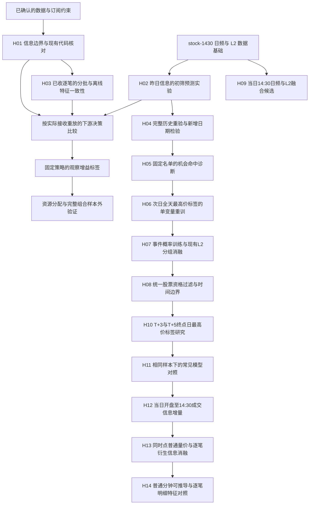

# 有限 L2 订阅下的机器学习训练与实盘对齐

## 目标与背景

研究始于2026-09-19：在有限实时 L2 订阅下，检验昨日信息能否改善盘前选池，并为后续
“分配—观察—决策—执行”验证建立信息边界。本卷宗保存候选及结论，研究治理见
[research_workflow](../../docs/engineering/research_workflow.md)；正式语义仍由 `docs/` owner 拥有。
背景见[标签讨论](../label-design/README.md#24-盘后全市场数据与实时订阅约束)、
[假设设计](../hypothesis-design/README.md)及[14:30 卷宗](../stock-1430/README.md)。

已确认：P 为 T 的前一正式交易日，P 21:00 获取全市场历史 L2 与日频数据；实时订阅按
`(symbol, topic)` 收费/限额，切换不补历史。交易目标、决策/持有期、资金与风险、套餐及
topic 组合仍待定。信息正确、预测改善、可实现净收益和运行可用性须分别验证。

先通过下列索引定位假设，再按 Evidence 读取对应 Notebook 的说明单元。需要复现时使用
说明中绑定的冻结版本；当前文件与历史归档的代码、输入不能互相替代。读取方式见
[研究工作流](../../docs/engineering/research_workflow.md#写入与按需读取)。

## 依赖与研究索引



本卷宗复用 [stock-1430 的数据基础](../stock-1430/README.md)：日频 Feature、分钟事实、
14:30 L2 Feature 与原 VWAP Rank Label。初筛使用 P 日 L2 和日频，区别于原融合候选
的 L2 T + daily P；共享 39 列来源不表示样本、时间边界或数据集相同。
H01–H08及H10–H14是同一目标下的信息边界、目标及方法研究记录，不逐项设置采用状态。
融合候选从原 stock-1430 H04 迁入本卷宗 H09，具有独立正式化边界，不作为当前初筛实验的上游。
H01/H02 可独立判断；本卷宗的实验不表示原固定训练及受限执行方案已经实现或采用。
尚未形成可执行假设的后续环节只保留为研究方向。

- [H01 信息边界的可执行验证](#h01-信息边界的可执行验证)
- [H02 昨日信息能否改善初筛](#h02-昨日信息能否改善初筛)
- [H03 已收逐笔的分批与离线特征一致性](#h03-已收逐笔的分批与离线特征一致性)
- [H04 完整历史重验与新增日期检验](#h04-完整历史重验与新增日期检验)
- [H05 固定名单的机会命中诊断](#h05-固定名单的机会命中诊断)
- [H06 次日全天最高价标签的单变量重训](#h06-次日全天最高价标签的单变量重训)
- [H06 补充：重训改善原因、L2 局限与后续研究方向](#h06-cause-l2-diagnostics)
- [H07 事件概率训练与现有L2分组消融](#h07-事件概率训练与现有l2分组消融)
- [H08 统一股票资格过滤与时间边界](#h08-统一股票资格过滤与时间边界)
- [H08 通过 POST /jobs 执行一次训练](#h08-post-jobs)
- [H08 固定划分的日频/L2 对照与新日期确认方案](#h08-fixed-split-comparison)
- [H09 14:30 日频与 Level2 Feature 融合](#h09)
- [H10 T+3与T+5终点日最高价标签研究](#h10)
- [H08/H10 预测诊断与共同训练行对照](#h10-prediction-diagnostics)
- [H11 相同样本下的常见模型对照](#h11)
- [H12 当日开盘至14:30成交信息增量](#h12)
- [H13 同时点普通量价与逐笔衍生信息消融](#h13)
- [H14 普通分钟可推导与逐笔明细特征对照](#h14)
- [五类 L2 交付数据与建模用途](#level2-delivery-modeling)
- [深圳撤单的利用边界与后续建议](#level2-cancel-modeling)

## 共同研究边界

预测改善、实际接收一致性、观察价值与可实现净收益分别验证；价格或排名代理不证明成交。
选池只用决策时可见的信息，未来标签缺失不改变推理候选；预处理、拟合与模型就绪遵守当时
的时间边界。历史修订数据与假设接收时间不能冒充当时实际可得的版本。
按完整日期区分开发与最终验证；已查看区间的复跑、修复和补录不增加独立确认次数。
共同方案、时钟约束、样本定义及早期接口核对见
[原研究边界](validation.ipynb#research-boundaries)，L2 覆盖见 [H06 核对](next_day_high.ipynb#h06-l2-coverage)。
正式编排仍以 [offline_workflow_contract](../../docs/offline_workflow_contract.md) 为准。
Notebook 中当时“保持 open”等表述属于历史说明，当前采用候选状态只由本卷宗对应段落
维护；本次整理不回写冻结证据，也不产生新的实验或采用决定。

## H01 信息边界的可执行验证

- Hypothesis: 完整 key、可用时间及生效订阅裁剪可拒绝不可见信息，并保持合法事件前缀
  不受未来数据改变；现有日期/全市场分钟视图不足以证明这一点。
- Scope: 自包含反例、现有公开 API 复现与候选断言；不含 MQTT、生产修复、真实 SLA 或交易。
- Acceptance（运行前固定）: 展示日频两 key 接口不验证 decision timestamp；候选三 key
  拒绝错位；拒绝晚标签/晚模型及未订阅/确认前/晚到消息；同股三 topic 占三份额度；
  状态未建立不能冒充完整观察；未来 label 缺失不改变选池；训练/推理复用预处理状态。
- Evidence（2026-09-19，本地 draft）: [`validation.ipynb`](validation.ipynb) 的8组断言全部
  通过，覆盖冷启动、窗口中断和未来污染。两 key 行为符合现有日频职责，不构成其缺陷。
  观察窗口/订单簿只验证可用性谓词；源码及恢复基线见 H02 归档。
- Conclusion: 本轮自包含边界验证已完成，反例通过；生产链路、订单簿重建与真实历史
  接收一致性未验证。
- Next: 后续研究：获得实际接收、订阅、处理及模型就绪日志和确定的盘中策略后，验证
  同事件前缀的 batch/stream 输出及故障复演；假设到达时间不能升级为观测事实。

## H02 昨日信息能否改善初筛

- Hypothesis: 仅用 P 的日频及历史 L2，预注册学习器能相对简单规则改善次日池的未来排名。
- Depends on: 日频输入及 [stock-1430 H03 特征/标签](../stock-1430/README.md#h03)；
  实际输入、版本及历史适用边界以冻结证据为准。
- Scope: 固定机会代理和50个 trans topic 的预测/名单诊断；不含真实成交、净收益、观察
  价值、套餐采用、全日 L2 或长期稳定性。
- Acceptance: 至少50个最终日、两方 pooled 标签覆盖各≥98%、保守均值差≥0.02，且
  5-session circular block bootstrap 单侧95%下界>0；完整参数与停止条件见冻结方案。
- Evidence: [冻结方案与停止条件](validation.ipynb#h02-protocol)、
  [79日失败结果及冻结归档](validation.ipynb#h02-evidence)、[精确复跑](validation.ipynb#h02-reproduce)。
- Conclusion: 本轮固定初筛实验已完成且可恢复，冻结候选未通过样本外初筛门槛；这不构成
  所有 L2 无效或正式 rejection。实际接收、观察价值及净 alpha 未验证。
- Next: 后续研究：历史扩展、命中诊断和目标变更分别见 H04–H06；已消费79日只可用于开发，
  新的确认性主张须预注册并使用未消费信息。

## H03 已收逐笔的分批与离线特征一致性

- Depends on: H01 信息边界，不依赖 H02 预测有效。
- Hypothesis: 按订阅/接收截止裁剪，在连续接收段内重建 tick-rule，可使分批输入与离线
  重放的分钟事实相同，且后续消息不改变过去快照；不能继承全日方向或按到达顺序定方向。
- Scope: 复用 `Access.trades` 和分钟 builder，隔离检查 `2026-08-25` 的600000/000001
  正成交及 `14:00..14:30`；价格/量真实，接收/订阅为人工情景。不含供应商实时解析、
  真实延迟、order/market、订单簿、预测价值或部署。
- Acceptance: 固定情景的分批/离线事实一致、守恒及污染反例通过；批次、容差和
  截止点按[原验收条件](reception_validation.ipynb#h03-scenarios)，不改变既定精度。
- Stop: 技术失败保留并同验收重跑，不改变 H02 的预测或 alpha 门槛。
- Evidence: [人工接收情景](reception_validation.ipynb#h03-scenarios)、
  [90次对照、反例及归档恢复](reception_validation.ipynb#h03-evidence)。
- Conclusion: 本轮固定接收情景验证已完成，同前缀一致性成立；裁剪、重置与事件排序须在
  聚合前完成。
  研究实现缓存前缀并重算，未验证生产吞吐/内存/恢复、真实接收或经济价值，其输出不能
  冒充正式全日分钟对象。
- Next: 后续研究：取得实际日志并固定字段、乱序/丢包/重复/恢复规则后复演；交易目标及
  新验证数据就绪后再接入完整训练—分配—决策实验。

## H04 完整历史重验与新增日期检验

- Depends on: H02 的样本、目标及算法，以及9月21日数据接入/发布。
- Hypothesis: 完整可用历史中有限比较 last60/expanding，再冻结配置检验新增17日，
  能判断训练窗是否改善初筛；H02 的50日门槛不作为停止后续研究的通用条件。
- Scope: 用户要求的隔离重训、预测和统计；沿用39列、K=50、14:30参考标签，不含新特征、
  观察价值、真实接收、成交账本或净 alpha。
- Acceptance: 输入/时序/推理一致性和旧预测恢复通过；新增两方覆盖各≥98%、保守均值
  差≥0.02且单侧95%下界>0时，仅称17日短期支持；没有新增50日硬门槛。
  修复重验沿用 H05 的均值差>0且5日区块单侧95%下界>0，仅作探索性支持；
  工程验收及两组各执行一次的停止条件见 [2026-09-22 方案](revalidation.ipynb#h04-protocol-20260922)。
- Evidence: [原冻结方案](revalidation.ipynb#h04-protocol-20260921)、
  [原结果](revalidation.ipynb#h04-evidence-20260921)、[修复重验](revalidation.ipynb#h04-evidence-20260922)。
- Conclusion: 本轮原范围重验及修复重验已完成。扩展训练窗改善旧开发段模型排名，
  新增段点估计略正但未通过预设条件；
  H02 失败保留，不自动采用/拒绝模型。
  修复及增加更早历史后，原主候选后续17日命中为38/850与34/850，成交额为146/850，
  固定模型仍未通过机会命中条件；修复未产生新的独立最终验证集。
- Next: 后续研究：目标/特征新主张可在已看历史开发，独立确认须用新验证信息或预先设计
  的检验程序，原17日不得再次称为未见最终集。事件目标与收益、风险及观察价值的关系仍须明确。

## H05 固定名单的机会命中诊断

- Depends on: H04 冻结面板、预测、名单和选择。
- Hypothesis: 平均排名接近0.5仍可能富集前部机会；固定名单的 Precision@K/Lift 可直接
  检验，Recall/F1 补充覆盖。用户于2026-09-22同意按机会命中评价。
- Scope: 原102日开发段与17日后续段只读补算，不重训或改名单/策略；结果后的质量补查
  另读六个正式对象并隔离复制。不含分类训练、原始/净收益标签、观察价值、真实接收及成交。
- Acceptance: 名单、计数、缺失边界及执行检查按[冻结方案](opportunity_metrics.ipynb#h05-protocol)；
  主差均值>0且5日区块单侧95%下界>0，至多称探索性支持；两段已查看且未校正多重比较。
- Stop: 固定范围补算一次；技术错误同口径修复，不随结果调整 K、阈值或候选。
- Evidence: [指标及验收](opportunity_metrics.ipynb#h05-protocol)、
  [原结果、质量补查与归档](opportunity_metrics.ipynb#h05-evidence)；修复后重验见 H04。
- Conclusion: 本轮固定名单诊断已完成。命中指标提供了平均排名之外的重要信息：
  H04 原主候选未能富集前10%收益机会，当前八候选在开发段也未显示该目标的机会密度优势。
  训练时优化排名回归与评价时
  捕获尾部事件是不同目标；这解释了为何需要另提事件概率候选，但不是已经验证的失败机制。
  用户同意执行指标研究，不表示已采用机会标签、K、模型、交易策略或套餐。
  H04 的冻结选择与失败记录保留，经济解释受新增质量发现限制；
  净 alpha 和观察价值未验证。
- Next: 后续独立问题：旧重复文件的生成或转存环节仍待追溯。事件概率有限对照已形成
  H07，泛化仍须新验证信息；交易机会和观察价值须先明确执行、成本、风险及有/无L2策略。

## H06 次日全天最高价标签的单变量重训

- Depends on: H04/H05 的修复后冻结面板、训练方案和命中指标。
- Hypothesis: 保持买入基准、特征与训练方法不变，将退出参考价改为下一交易日全天
  最高成交价后，重训模型可以更好地捕获当日横截面前10%收益机会。
- Scope: 只读既有输入，在隔离研究目录生成候选标签、模型、预测与评价；正式标签仍由
  [`stock_1430_feature_label_contract.md`](../../docs/data/stock_1430_feature_label_contract.md)
  拥有，当前候选定义和结论由本段拥有。
- Not included: 改为分类器、新特征、调参、重新选择主候选、卖出时机预测、成交可行性、
  成本或实盘收益；不发布新正式 Label、模型或运行入口。
- Acceptance: 输入、标签边界、训练时序、特征不变及模型/指标恢复按[冻结方案](next_day_high.ipynb#h06-protocol)；
  主差均值>0且5日区块单侧95%下界>0，至多称探索性支持，全部历史区间已查看。
- Stop: 两组固定重训各执行一次；技术错误保留记录并在相同口径修复，不按结果更改
  日期、模型、阈值或 K。全部已查看历史上的区间均为探索性名义区间，不自动 adoption。
- Evidence: [冻结方案](next_day_high.ipynb#h06-protocol)、
  [两组结果、失败记录与归档](next_day_high.ipynb#h06-evidence)、[精确复跑](next_day_high.ipynb#h06-reproduce)。
- Conclusion: 本轮单变量重训已完成。当前历史情景支持“同样的昨日信息和模型，改学次日
  最高价收益排名后，能富集前10%上行机会”。原主候选后续约每50只命中16只，超过随机与成交额对照。
  不能据此断言L2增量、优于所有简单规则、独立泛化或能够按最高价卖出；也没有证明
  原固定退出目标只因噪声而失败。未采用新的正式Label或模型。
- Next: 后续研究：使用尚未查看的新日期前，先固定其日期范围与同一候选的确认方案；
  如要判断可交易性，须另行明确退出规则。新的模型、特征或分类目标不混入本次单变量实验。

<a id="h06-cause-l2-diagnostics"></a>

补充判断：现有证据不支持“L2 本身没有用”；日频可能已经提供主要模式，现有 L2 的
信息重复、表达和时效性贡献仍未被独立识别。[诊断说明](next_day_high.ipynb#h06-cause-l2-diagnostics)、
[模型行为](next_day_high.ipynb#h06-model-diagnostics)及[统计复算](next_day_high.ipynb#h06-diagnostics-reproduce)
保存当时证据；其中事件概率与现有分组消融方向已形成 H07。

## H07 事件概率训练与现有L2分组消融

- Depends on: H06 的 B 组冻结面板、最高价标签及训练时间边界。
- Hypothesis: 在相同昨日信息上直接学习前10%事件概率，或只加入特定 L2 组，能够产生
  排名回归未显示的条件预测增量；若只改善日频，则不支持“原加入方式掩盖 L2 增量”。
- Scope: 自包含研究 Notebook、隔离输入/模型/预测及本段记录。复用正式
  `FittedPreprocessor`、现有特征公式及 H06 冻结标签，不改共享代码、配置或正式入口。
- Not included: 完整昨日新特征、盘口/委托/撤单恢复、当日实时行动效用及净收益。
  后两项缺少已定义的事件恢复/执行策略和实际接收边界；本轮不能据此区分其价值。
- Acceptance: 输入、原日程、H06锚点、模型/指标恢复、边界反例及执行检查按[冻结方案](event_probability.ipynb#h07-protocol)。
  最低有用增量为两分类器各自全部L2减日频的 Precision +2个百分点；两段均达到保守
  均值门槛且 Bonferroni 单侧97.5%下界>0，才称值得独立确认的稳定候选。
- Stop: 固定20配置各按既定月度日程运行一次；只修技术错误并保存失败证据，不按结果追加
  配置、数据或门槛。无新独立信息时停止在探索性判断，不宣称确认或自动采用。
- Evidence: [固定20配置、主比较及停止条件](event_probability.ipynb#h07-protocol)、
  [结果、分组诊断与归档](event_probability.ipynb#h07-evidence)、[精确复跑](event_probability.ipynb#h07-reproduce)。
- Conclusion: 本轮固定20配置研究已完成。对最高价前10%任务，事件目标和非线性日频对照
  值得继续验证；“分类有效”与“L2有稳定额外价值”不是同一个结论。现有整组L2没有达到本轮最低增量条件；
  活跃度组对Ridge有局部探索性支持，但尚未形成跨方法、跨时期的一般解释。
  未采用分类器、特征组或正式Label，也未将统计未通过视为正式rejection。
- Next: 后续研究：独立确认前先冻结未消费日期、候选及停止条件；历史复核17日仍只能用于开发。
  完整昨日覆盖、原值/历史异常表达、盘口/委托信息和当日行动效用均未在本轮实施，
  各自需要独立对照，不能由上述结果判断其价值。旧固定时点退出目标的失败原因也未被
  最高价标签上的本轮分类实验单独识别。

## H08 统一股票资格过滤与时间边界

- 研究约束（2026-09-23，用户要求）: 日频与Level2基线在数据准备层统一排除ST、停牌和
  摘牌证券；训练和推理采用同一资格规则。此决定不等于已完成正式入口切换或模型采用。
- 研究约束（2026-09-24，用户补充）: 两步同时使用：盘前先按当日已知停牌状态筛选，
  14:30再要求当日截至该时点的累计成交量大于0。第二步使用已完成分钟，不能使用收盘日线
  或14:30之后的成交；缺少观测与零成交分别记录，不能据此推断停牌。
- 研究约束（2026-09-25，用户指定）: 训练剔除未知标签；推理只使用决策时已知资格，
  缺失原因不得进入当日模型输入。先固定原推理名单，再从评价池和入选评价分母中扣除无有效
  标签样本，不补选。当前主命中率为命中数/有效入选数；Recall、F1、Lift同步使用可评价样本，
  保留原数量、剔除数与覆盖率。已知标签的未命中不得剔除；不将次日停牌延后到复牌日改标签。
- Hypothesis: 先按每个样本决策时已经可知且有效的证券状态构造共同候选池，再连接特征与
  标签，可以保证日频/L2及训练/推理的资格口径一致，不需要按未来标签是否完整选择股票。
- Scope: 研究内的共同筛选谓词、时间边界反例、H06冻结面板的状态交叉核查、VWAP缺失
  实例、2026-09-24授权的前日状态条件重训、两阶段筛选核查及冻结名单的可评价样本指标复算；不修改正式source、Feature/Label v1、Access
  或训练/推理入口。164日股票列表修复属于源契约维护，发布事实见下文。
- Depends on: H06/H07冻结输入。正式Access已有相近过滤，但
  [Access owner](../../docs/engineering/access.md#universe)明确其为“当日相关正式对象
  提交后的观察集合，不表示盘前可知集合”，且现有接口排除全部停复牌事件；不能直接用于
  本研究的盘前资格回放，也不能把复牌事件一律解释为仍在停牌。
- Acceptance（执行前固定）: 资格、时序、输入守恒及执行检查按[严格方案](universe_filter.ipynb#h08-strict-protocol)；
  未来或未知可用时间被拒绝，标签不改变资格，日频/L2候选一致。没有盘前证据不声称真实
  时点回放；9月24日条件研究另按冻结方案执行，不视为严格验收通过。新增两步按
  [两阶段时间边界方案](universe_filter.ipynb#h08-two-stage-protocol)验证；不改变原模型证据。
  当前评价按[固定名单后的可评价样本方案](universe_filter.ipynb#h08-evaluable-protocol)执行：
  恢复全部原名单、不补选、独立复算计数和指标，分母为0返回NA；不重训或新选模型。
- Stop: 仅验证这套用户指定的资格规则及既有窗口，不试多个过滤阈值或窗口，不根据未知
  数量改标签；历史日终状态不能证明盘前可知时，不进入声称实际可执行的历史回放。
- Evidence: [共同资格规则](universe_filter.ipynb#h08-strict-protocol)、
  [前日状态条件方案](universe_filter.ipynb#h08-protocol-20260924)、
  [源核查失败](universe_filter.ipynb#h08-source-audit-20260923)、[共同面板重训及归档](universe_filter.ipynb#h08-evidence-20260924)、
  [盘前停牌与14:30成交量的两阶段验证](universe_filter.ipynb#两阶段核查结果)、
  [当前可评价样本指标](universe_filter.ipynb#h08-evaluable-results)。17日收益机会与指数对照见
  [冻结统计](/home/wsw/.codex/visualizations/2026/09/24/01a0d133-043c-7303-b557-d5327fa84b18/hs300-august-backfill-20260930/completed-comparison-inputs.csv)、
  [输入、口径及复算记录](/home/wsw/.codex/visualizations/2026/09/24/01a0d133-043c-7303-b557-d5327fa84b18/hs300-august-backfill-20260930/completed-analysis-audit.json)、
  [代码与制品清单](/home/wsw/.codex/visualizations/2026/09/24/01a0d133-043c-7303-b557-d5327fa84b18/hs300-august-backfill-20260930/final-artifact-manifest.json)；
  日期等权汇总及逐日模型对照见[2026-10-01解读复算](/home/wsw/.codex/visualizations/2026/10/01/01a0f563-126f-7e23-8248-141f4b9b5ef5/seventeen-day-result-sources.json)。
  上述证据与H08原冻结输入一并保留至后续独立确认及结论审查完成，不回写原制品。
  当前代码的完整重训及逐值对照见
  [2026-10-06 复验](universe_filter.ipynb#h08-current-code-retrain-20261006)：同一冻结输入下重新拟合，
  当前评价明确绑定新训练输出。
- Conclusion（2026-09-24旧评价）: 在P日状态于22:00已可用的未验证假设下，共同候选为
  1,062,525行，719个未知标签；旧上下界评价下两分类器未达到预定的稳定L2增量条件。
  此统计结论不自动迁移为新指标结论。严格历史可用性与完整上市覆盖仍未通过；
  不能证明已排除当天新增风险，也不构成可交易性验收。
- Conclusion（2026-09-25当前评价）: 25种方法、151日的3,775个原名单全部恢复一致，
  188,750个入选位置独立复算通过。原预测评价池753,258个股票日扣除504个未知标签，
  有效752,754个；这不是下述213日最终停牌表的事后诊断池。浅树事件模型日频/全部L2的
  日期等权命中率为开发段36.53%/37.13%、历史复核39.05%/40.99%；复核有效入选数848/849，
  剔除2/1。原预测、名单和命中数均不变；旧上下界保留为历史记录。未重训或新选模型，
  未作新口径显著性检验；条件命中率不等于真实成交率或策略收益。精确输入与恢复见
  [本次执行事实](universe_filter.ipynb#h08-evaluable-recovery)。
- Conclusion（2026-10-01，17日结果解读；本地 draft）: 2026-08-26至2026-09-17的
  17个买入日，按相同的上海时间 `[14:31,14:36)` 入场窗口至各自次交易日全天最高价或最高点计算，
  事后原收益排名>0.9股票的每日均值等权平均为7.66%，每日中位数的等权平均为6.94%，
  沪深300标签等权平均为0.36%；每日中位数的平均不是合并全部股票日后的中位数。
  股票入场为原复权VWAP，指数入场为同窗口分钟末点位TWAP，两个最高点不要求同时出现。
  7.66%属于事后前10%集合，描述本段市场提供的收益机会，不是模型Top50的平均收益；
  模型名单收益相对指数的直接对照尚未统计。模型选股能力的证据是原Top50命中率约
  39%—41%，高于同池日期等权随机基准9.93%，支持本段对前10%收益事件的富集能力。
  L2增量指特征增量，收益标签不变：仅就本次浅树事件模型，只用日频39.05%至日频加全部L2的
  40.99%增加1.94个百分点，17日中8日提高、5日持平、4日下降。因此可表述为
  “本次平均改善超过1个百分点”，不能据此保证每天或未来至少提升1个百分点，也未证明跨方法
  或未查看日期的泛化。指数历史档案于2026-09-30采集，仅用于事后评价；本次解读没有
  重训、新增显著性检验或独立确认，不改变原Acceptance，也不构成模型采用。
  该集合依赖次日结果事后确定，不能用命中率乘7.66%推算模型收益；计算过程、例子及
  收益边界见[7.66%机会收益说明](universe_filter.ipynb#h08-opportunity-return-interpretation)。
- 复验结论（2026-10-06，本地 draft）：在 `76c25a279685b6961cda69143f542e8ec3936f51`
  的当前共享实现和锁定依赖上，使用H08原冻结输入完成20配置、160次真实月度拟合及151日预测。
  3,020组模型日预测、3,775组Top50名单、旧口径指标与区间、当前可评价样本指标均与原证据
  精确一致；上文36.53%/37.13%及39.05%/40.99%的结果得到复现。修复了研究Notebook
  顺序重跑时当前评价仍读取旧归档的问题，评价改为显式绑定本次训练目录，回归场景通过。
  原两分类器的稳定L2增量判据仍未通过；本次没有新增独立日期、历史接收证据或可实现收益
  验证，不改变原研究判断、资格限制或模型采用状态。正式训练入口仍只支持其owner列明的
  模型和标签，本次复验通过研究Notebook执行，未将H08接入正式入口。
- 两阶段补充：共用筛选函数及时间反例通过，213日分钟前缀核查完成。仅作事后诊断时，
  T日最终S表排除341行，14:30前正成交检查再排除1行，剩余1,062,183行、380个未知标签
  （43个买入窗口缺失、337个次日最高价缺失）。最终S表中还包含3个标签有效的盘中临停样本，
  不能把该事后排除数当作盘前已知数量；缺少历史接收证据的213日均被严格入口拒绝，未重训。
- Next: 通过现有训练入口执行固定训练/验证与最终评估的实现及证据见[下节](#h08-post-jobs)。真实时间边界仍需
  取得决策前接收的状态快照及有效时间，并核对下单时最新资格；正式推理接入尚未实施。
  模型增量须新独立数据确认，不继续在已消费日期上选模型；重取日表不能证明盘前可用。

<a id="h08-post-jobs"></a>

### 通过 POST /jobs 执行一次训练（2026-10-07，本地 draft）

用户明确接受 H08 的模型与数据定义，要求在现有训练代码中实施，拒绝研究专用
`"recipe": "subscription_h08_v1"`。随后明确一次 POST 只能创建一个训练任务，并纠正日期
用途：134 个交易日用于训练及内部验证，训练完成后的模型在最后17日上评估；不要求月度
重训，也不把4模型×5特征组展开为20个 Job。训练与最终评估的间隔按中间跳过的正式交易日
数计算，不含两端。这些用户约束取代本节此前的月度日程和多区间草案。

**研究事实与本次执行目标。** 原 Notebook 将134日开发段及17日复核段都作为滚动预测的
样本外评价日期，从2025-11-06开始扩展拟合，按8个时点进行月度拟合。那是原实验的设计，
不是普通训练 API 必须继承的行为。本次用户指定固定训练/验证区间，再冻结模型评估17日，
因此保留 H08 特征、资格、标签、权重及模型参数，但不要求新预测逐值等于原月度预测。
不能用前134日完成的模型回头声称重现这134日的原样本外表现；原月度结果只保留为历史
比较，不能迁移其显著性结论。历史 Scope、Acceptance 与上文结论保持原适用范围。

用户原请求为：

```json
{
  "kind": "train",
  "train_range": {"start": "2026-07-01", "end": "2026-07-31"},
  "eval_range": {"start": "2026-08-10", "end": "2026-08-31"},
  "model": "sgd_regression",
  "dataset": {
    "feature_group": "daily_basic_selected_v1",
    "label_group": "daily_close_return_rank_d1/v1"
  }
}
```

代码基线为 `76c25a279685b6961cda69143f542e8ec3936f51`。原代码表达“用7月日频原值拟合
一次 SGD，再用固定模型评价8月”，缺少 H08 需要的模型、数据和指标。改动接入已有
[requests.py](../../src/jobs/requests.py)、[模型配置](../../src/config/base.yml)与
[训练 workflow](../../src/workflows/offline_training.py)，不读取 Notebook，也不把旧预测当作新结果。

| 信息 | 原代码 | 本次需要的能力 |
| --- | --- | --- |
| `kind` | 普通训练 | 保留 train；一次 POST、一 Job、一个模型 |
| `train_range` | 单次拟合样本区间 | 整个开发区间，134日内按时间划分拟合及验证 |
| `validation_sessions` | 不支持 | 非负整数，区间末尾 N 个交易日作为内部验证；默认0。本次暂取27日，可由请求调整 |
| `eval_range` | 固定模型评价区间 | 最后17日最终评估，完全隔离于拟合和内部验证 |
| `eval_gap_sessions` | 仅检查标签成熟 | 默认0，要求两个请求区间之间至少跳过指定交易日；不改写显式日期，标签成熟约束另行检查 |
| `model` | SGD 排名回归，一次 partial_fit | 增加 Ridge、Logistic、浅层直方图梯度提升回归与分类；一次请求只选择一种 |
| `dataset.feature_group` | T 日7个日频原值 | P 日日频7个排名列加 P 日 L2；日频、价格、活跃度、方向、全部5组为7/15/23/15/39列 |
| `dataset.label_group` | 收盘到下一交易日收盘的排名 | T 日 `[14:31,14:36)` VWAP 到 T+1 全天最高价的复权收益排名；事件为严格排名>0.9 |
| 预处理、权重 | 填0、无权重 | 新模型固定填0.5、不缩放；拟合样本按日期等权、权重均值为1 |
| 预测、评价 | 排名分数与 Rank IC | 分类器正例概率；先固定 Top50 再按有效标签计算 Precision、Recall、F1、Lift、覆盖率及随机对照 |

请求要求当前 API 服务的实际 ZERO_STORAGE_ROOT 已有对应特征及标签；首次使用先执行
[CLI 数据初始化说明](../../docs/engineering/cli_contract.md)中的 data-previous-day-backfill
命令。此前隔离目录中的成功训练不代表 `/home/wsw/app/data` 已初始化。数据准备完成后，
一次 POST 的请求为：

```json
{
  "kind": "train",
  "train_range": {"start": "2026-02-03", "end": "2026-08-24"},
  "validation_sessions": 27,
  "eval_range": {"start": "2026-08-26", "end": "2026-09-17"},
  "eval_gap_sessions": 1,
  "model": "hist_gradient_boosting_classifier",
  "dataset": {
    "feature_group": "previous_day_daily_l2_v1",
    "label_group": "next_day_high_top_decile/v1"
  }
}
```

27日是内部验证比例尚未指定时采用的显式运行参数，不是 H08 原实验规定，也不是服务端
默认比例。当前日历上134日为02-03至08-24；最后27日为07-17至08-24。标签在下一交易日
22:00才成熟，验证决策在09:00，因此07-16隔离，实际拟合02-03至07-15共106日。
最后17日为08-26至09-17，08-25是两个请求区间之间跳过的1个交易日。
日期划分和隔离日期全部落入 schedule.json，134与17不硬编码在服务端。

模型参数沿用[H08 冻结参数](/home/wsw/app/research-evidence/subscription-qualified-2026-09-24-fyg_q9_u/parameters.json)，
本次不做超参数搜索、早停、验证后全区间重拟合或跨月再训练。内部验证与最终评估使用同一个
冻结模型并分别报告，后续指标不会反向进入模型。若未来要根据验证结果选择参数，需另行
明确选择程序，不能使用最后17日反复调参。

数据及评价保持这些必要约束：

- P 是 T 的前一正式 session。日频排名在原 P 日 L2 横截面计算；收益排名在原 T 日有效
  标签横截面计算，资格过滤后不重排。P 日32列 L2 来自截至 P 14:30 的5/15/30/60分钟窗口，
  并非昨日全日特征；H09 的 T 日 L2 + P 日日频不能代替此处 P 日 L2 + P 日日频。
- 资格按 P 日证券成员、有效上市日期、ST、停复牌状态决定。单独复牌和已结束临停保留，
  冲突及不能解释的状态排除；源未覆盖不称作摘牌。不增加上市120日限制，不混入后来
  T 日最终停牌表或14:30正成交量诊断。
- P 日输入及状态沿用 P 22:00可用的条件假设，T 09:00选池，T+1 22:00标签成熟。
  真实接收时间未知，保存理论时点不能补足严格历史 point-in-time 证明。
- 拟合只取资格通过且标签已知行；日权重先设为该日有效训练数的倒数，再归一到全局
  均值1。预处理仅拟合训练行。推理保留所有合格行，包括未知标签。
- 分类预测用 predict_proba 的正例概率，不用0/1类别排序。按分数降序及 symbol升序固定
  Top50，然后剔除未知标签计算有效分母，不补选。五种规则对照来自同日数据，不增加
  模型拟合或 Job。旧固定分母的上下界单列保存，不迁移旧显著性结论。

**实施边界及验收。** 训练行为归入[训练 owner](../../docs/offline_workflow_contract.md#training-workflow)，
请求归入[Job API owner](../../docs/engineering/job_api_contract.md)及
[CLI owner](../../docs/engineering/cli_contract.md)，物理制品归入
[存储 owner](../../docs/data/storage_layout.md#experiments)，新数据身份、计算及资格归入
[前日数据 owner](../../docs/data/previous_day_feature_label_contract.md)。这些都是本地同步修改，
尚未合入目标分支，不声称已经成为当前正式契约。

验收要求真实 HTTP POST 经 Job → CLI → workflow 新训练，仅创建1个 Job及1个模型，
绑定请求、源码、环境和冻结输入。输入重建与 H08 同源面板逐列精确比对；新固定划分模型
与同参数、同训练行的独立参考拟合比较预测和 Top50，验证及17日指标分开保存。
修改验证/评估标签不得改变模型或预测。每种固定方案只执行一次完整训练，不依据最终评估
结果调参；保留技术失败。完整20配置、160次原实验拟合不属于本次 API 验收范围。
运行方案及准备材料位于
[本次证据目录](/home/wsw/app/research-evidence/subscription-api-2026-10-07-j213jl20/)。

**真实 API 运行及结果。** 2026-10-07 在隔离存储、本地 HTTP 服务和无生产凭证的子进程中，
上述请求创建 Job `ed3581c7-4229-4c93-b041-6d635a46f9b6`，18秒后 SUCCESS。
106日实际拟合527,875行，保存一个模型；27日验证和17日最终评估共享该模型。
输入重建的213日、1,062,525个合格样本及719个未知标签与原 H08 面板精确一致。
独立参考拟合直接读取原面板及冻结参数，44日共219,985条预测逐值一致；模型与五种规则
共264份名单及评价指标全部通过独立复算。验证/最终标签修改不影响模型的回归测试通过。

| 阶段 | 日期数 | 日均 Precision@50 | 日均随机 Precision | 日均 Lift | 名单有效标签 |
| --- | ---: | ---: | ---: | ---: | ---: |
| 内部验证 | 27 | 33.1247% | 9.9185% | 3.3328 | 1346/1350 |
| 最终评估 | 17 | 39.9352% | 9.9289% | 4.0321 | 849/850 |

最后17日命中339个，1个未知标签未补选；表中 Precision 按日期等权，不能用合计命中数
除以合计有效数替代。原 H08 `hist_event__all` 同17日为40.9892%，本次低1.0540个百分点。
该差异是不同训练划分的描述性比较，不是对同一拟合的复现失败，也不证明 L2 相对日频模型
存在稳定增量。本次采用 H08 的数据及训练定义，按用户的新日期协议执行通过；没有逐值复现
原月度实验，也没有把已使用的17个历史日期当作新增独立验证。

证据入口为[实际 HTTP 请求与响应](/home/wsw/app/research-evidence/subscription-api-2026-10-07-j213jl20/http-post.json)、
[完成状态](/home/wsw/app/research-evidence/subscription-api-2026-10-07-j213jl20/http-status.json)、
[独立复核结果](/home/wsw/app/research-evidence/subscription-api-2026-10-07-j213jl20/reference-verification.json)及
[训练报告](/home/wsw/app/research-evidence/subscription-api-2026-10-07-j213jl20/storage/experiments/training_2026-02-03_2026-09-17_ed3581c7-4229-4c93-b041-6d635a46f9b6/report/training_report.html)。
`api-source/`、源码及输入 manifest、environment.json 和 job-logs 保存具体运行状态。
API 运行后仅修正文案、日志格式及直接依赖声明，未改变拟合、划分或指标算法；最终工作树
与运行快照的差异另有记录。受影响测试383项及训练记录消费侧回归12项均通过；锁文件检查通过。
未运行生产数据接入、严格历史接收验证或部署；冻结上游分钟数据缺少完整逐笔父制品，本次
用纯 builder 在隔离存储恢复并逐值比对，新物化入口另以本地合成完整输入验证。

随后用户 Job `432f0524-dc1f-4605-a0ed-77e0e0990f45` 于09:32在 DatasetBuildStep 失败：
其服务根为 `/home/wsw/app/data`，新增四类分区尚未初始化，首个缺失对象是02-03的盘前
Feature Meta。前述隔离训练成功不能代表这个服务根已经就绪。核对当前根的1221个直接
上游对象均有效后，使用同一数据初始化 CLI 在临时根重建152日、608个分区，并重新通过
真实 POST 完成 Job `acea4e80-5105-4810-889b-e6db1682476d`。219,985条预测与前次结果
精确一致，17日 Precision 仍为39.9352%；2440份直接输入文件哈希与当前根一致。
[故障及修复验证证据](/home/wsw/app/research-evidence/subscription-missing-data-2026-10-07-uxg8ucc6/verification.json)
绑定原日志、运行源码、输入检查、隔离数据初始化日志和 HTTP 结果。

用户明确授权后，使用同一 CLI 将这608个缺失分区补建到 `/home/wsw/app/data`；
1216个文件共228,980,005字节，全部哈希与隔离验证清单一致，Meta 校验通过。
随后向原开发服务 `http://127.0.0.1:5051/jobs` 提交一次相同请求，新 Job
`907055ec-bd1b-48b4-8ba3-dcbb149e2531` 于09:53:55成功完成，约18秒。
只生成一个模型；134个开发交易日划分为106日拟合、1日标签成熟隔离及27日内部验证，
中间跳过1个交易日，最后17日最终评估。44日共219,985条预测、全部选股名单和指标
与隔离验证精确一致；使用共享根中的模型与特征重放预测也精确一致，最终 Precision
仍为39.9352%。原失败 Job 保留，未改写为成功。
[共享目录补建及原服务复跑证据](/home/wsw/app/research-evidence/subscription-missing-data-2026-10-07-uxg8ucc6/publication/verification.json)
绑定授权范围、文件校验、真实请求与状态、Job 日志及制品哈希；
[本次训练报告](/home/wsw/app/data/experiments/training_2026-02-03_2026-09-17_907055ec-bd1b-48b4-8ba3-dcbb149e2531/report/training_report.html)
位于原服务的 experiment 目录。补建与重跑未改动训练源码或日期协议，未调用外部数据
provider 或 broker。


<a id="h08-fixed-split-comparison"></a>

### 固定划分的日频/L2 对照与新日期确认方案（2026-10-07，本地 draft）

用户在上述结果分析后要求“执行”后续验证。本轮补齐同一固定训练划分下的日频分类器对照，
检验32列昨日L2在7列日频之外的条件预测增量；随机及规则对照不能回答这个问题。
沿用上节的数据、资格、标签、权重、模型参数及106/1/27/17划分，只将特征组改为
`previous_day_daily_v1`。原39列模型直接冻结使用，不重新拟合，不比较不同月度训练协议。
这是H08的补充研究，不改变正式owner或自动决定模型采用。

详细参数、输入及停止条件在读取新对照结果前写入
[冻结方案](/home/wsw/app/research-evidence/subscription-fixed-split-2026-10-07-qu5v5rx2/protocol.json)。
主要差值为同日39列减7列的Precision@50，两段分别计算；5日循环区块bootstrap使用
20,000次重采样、seed=20261007，保存双侧95%名义区间及单侧95%下界。
本轮事前固定的探索性关注判据为两段均值差各≥2个百分点且单侧95%下界各>0；2个百分点
是本轮采用的实际改善尺度，不迁移H07旧Acceptance。只执行一个日频API训练及一个独立
参考拟合，不按结果追加模型、参数、seed、K或窗口。全部历史日期已消费，区间仅作探索性
诊断；满足该判据也不构成新增独立确认。

隔离HTTP服务成功创建Job `e3557768-ffbb-4f9b-8a45-3c707680c7df`，约14秒完成，
仅产生一个任务模型。新日频模型的219,985条预测与独立参考拟合逐值一致；两个保存模型
重放一致，308份模型/规则日名单、全部指标及88个日IC独立复算通过。912份Feature/Label
文件与原`907055ec`实际使用的发布清单逐字节一致，169份源码/依赖文件与冻结运行状态一致。
首次隔离API因遗漏日历父对象在拟合前失败；Notebook两次准备失败分别来自pandas只读数组
的原地归一化及误用更早隔离实验的物理文件清单。均已修正并保留现场，没有改变参数、样本
或判据；最终Notebook全部7个代码单元顺序执行通过。具体过程及复跑方式见
[对照Notebook](fixed_split_comparison.ipynb)，输入、环境、失败和结果保留在
[证据目录](/home/wsw/app/research-evidence/subscription-fixed-split-2026-10-07-qu5v5rx2/)，
保留至独立确认与结论审查完成。

| 阶段 | 日频7列 Precision@50 | 日频+L2 39列 | 增量（百分点） | 增量双侧95%名义区间（百分点） | L2胜/平/负日数 |
| --- | ---: | ---: | ---: | --- | --- |
| 内部验证27日 | 32.0484% | 33.1247% | +1.0763 | [-0.1421, +2.4611] | 12 / 5 / 10 |
| 最终评估17日 | 37.6423% | 39.9352% | +2.2929 | [+1.2941, +3.4118] | 9 / 3 / 5 |

日频模型两段分别命中432/1348及319/848个有效位置；39列模型为446/1346及339/849。
Precision仍按日期等权。最终17日多命中20个股票日，平均约每天多1.18个；这不是增加20只
不同股票，也不是收益增加。两段单侧95%下界分别为+0.0227和+1.4166个百分点。
**本轮结论：** 日频信息已提供大部分历史选池能力，当前L2加入方式有小幅探索性增量；
验证期均值未达到2个百分点，因此两段共同判据未通过。验证期高波动率规则36.00%仍高于
两个模型，不能据此宣布稳定优于简单规则。此结论不证明L2无效，不触发rejection，也不将
17日名义区间升级为确认性证据。完整结果见
[配对复算](/home/wsw/app/research-evidence/subscription-fixed-split-2026-10-07-qu5v5rx2/comparison-verification.json)。

**新日期确认与前向观察。** 同一冻结方案已在本轮结果出来前登记2026-10-08起60个正式
交易日，按当前冻结日历至2026-12-30。60日是本轮预先选择的固定观察长度，以扩大17日
历史诊断的时间覆盖，不继承H02的最低50日要求，也不保证统计效能。保持这两个模型冻结，
不重训、不按本轮结果改选候选；唯一主要比较为39列减7列的日均Precision@50，最低改善
2个百分点且5日区块bootstrap单侧95%下界>0，两模型各自入选标签覆盖≥98%。
所有60日都须有决策前预测记录；缺输入或预测不能删日、补日或缩小范围。规则对照、Recall、
Lift及概率诊断只作描述。最后一日的次日22:00标签成熟后统一评价，不中途查看效果或提前
停止；即使统计条件通过，采用仍需用户决定。该方案检验固定模型的持续有效性，不代表
定期重训系统的表现。

前向记录须绑定实际接收时间、输入版本/哈希、原P日资格快照、模型就绪时间及模型/预处理
版本、完整候选及Top50，均不得晚于T 09:00决策；理论22:00字段不能代替实际接收证据。
保持原P日资格语义，当日最新交易资格属于后续执行边界。2026-10-08补查本地正式存储和
研究证据根，未发现首日09:00前的有效记录；原窗口未建立严格确认，不能事后补算该日。
[就绪核查](/home/wsw/app/research-evidence/subscription-prediction-validation-2026-10-08-4ombbzta/forward-readiness.json)
保留所查范围和源数据进度，不据此推断其他机器的状态。前一日特征/资格仍止于09-17，
L2及主要processed输入止于09-30，实际独立验证日仍为0。

在尚未查看后续结果时，另登记[未来60日方案](/home/wsw/app/research-evidence/subscription-prediction-validation-2026-10-08-4ombbzta/forward-study/protocol.json)：
2026-10-09至12-31，沿用原两个H08模型及上述主要判据，不使用下节共同训练行的新模型。
12-31标签的终点须等待正式2027年日历确定的下一交易日，不能猜测自然次日；该交易日
22:00后一次评价。源码及环境绑定在首次真实预测前完成，准备期间的登记版本均保留。
缺日、晚到或失败均保留，不补日、不缩短窗口、不按结果重启；任一必需日缺记录就不能
宣称完整60日严格确认。

[研究记录器](forward_capture.py)只在隔离证据目录保存每日快照。它复制P日L2与资格，以及
重建P日日频特征所需的62日历史输入，复用原builder，再冻结两模型全池分数和七份Top50
名单（含五条原规则）。现有物化步骤需要T日及未来标签，不能直接用于盘前；因此这里
只复用其无标签计算，不修改共享步骤。实际时间是研究观察进程读完本地字节的时间，
不能冒充provider首次接收时间。源码、依赖、模型、日历、输入和结果均绑定哈希及实际时间；
晚启动、晚输入、晚发布、缺输入或版本不符不产生有效记录，已有记录不覆盖。
[边界验证](/home/wsw/app/research-evidence/subscription-prediction-validation-2026-10-08-4ombbzta/forward-boundary-tests/run03/verification.json)
用模拟时钟完成十项检查，精确恢复09-17的5,008行特征及10,016条原预测，且仅凭捕获输入
即可复演，无需T日数据或标签。这些是工程演练，不是新增前向日期。
采集程序和运行命令已准备，尚未安装调度或启动持续采集；后续必须在每个T日09:00前获得
已提交的P日输入并实际完成记录。命令、协议和验证入口见[预测诊断Notebook](prediction_diagnostics.ipynb)。

用户于2026-10-08选择“先完成预测验证”，收益回放及实时订阅比较暂缓。收益回放尚缺退出、
费用、未成交及持仓约束，实时比较尚缺topic与额度。现有回测入口拥有15:00日频决策契约，
不能直接承接此处09:00选池及14:31入场目标；原5bp、Top20及资金比例不作为本轮默认设计，
也不以次日最高价模拟卖出。

<a id="h09"></a>

## H09 14:30 日频与 Level2 Feature 融合

- **Status**：`open`
- **Origin**：原 stock-1430 H04；迁移前的方案、运行及判断仍绑定原版本。
- **Hypothesis**：以 T 日 14:30 L2 universe 为唯一行集合，只连接前一正式 session P
  的 daily Feature，可形成固定 39 列、时间可见且可追溯的模型输入。
- **Scope**：`stock_1430_daily_l2/v1` 完整保留 L2 T 三 key、行序和 32 列，追加
  daily P 七列在 T universe 内的 ascending/average-tie/valid-only rank；
  各列独立有效分母，缺 daily symbol 保留行并为 null。无 upstream Meta、CLI-only
  回填；有效 Meta 免读上游，无效 Meta 失败不覆盖，缺 P 不 fallback，同版本修订不
  动态失效。七列映射与版本规则见[拟议契约](../../docs/data/stock_1430_daily_l2_contract.md)。
  不含上游修改、Label、模型、因子选择、填充、中性化、HTTP/cron 或实时源。
- **Depends on**：[stock-1430 H01](../stock-1430/README.md#h01)、
  [stock-1430 H03](../stock-1430/README.md#h03)；后者同时提供原 VWAP Rank Label。
  当前初筛实验不依赖本候选的物化结果，P 日历史 L2 与 T 日全市场 L2 不可互换。
- **Acceptance**：[事前冻结方案](../stock-1430/h04-validation.ipynb#h04-protocol)要求跨周末/长假/
  年度的 P/T 正确，daily T 删除/损坏不影响新建，P 缺失失败；三 key/32 列精确继承，
  七列映射、null/tie/分母和顺序手算通过；固定四组 P/T、两个新根逐值一致，
  每组七列各至少一个有效值，只报告 coverage、不加事后门槛；上游缺失/变化仍复用
  且文件身份不变，无效 Meta 不覆盖，任一必要断言失败即停止并保留。
  采用须同步 owner、实现、测试并由用户决定。
- **Evidence**：[2026-09-13 运行与归档](../stock-1430/h04-validation.ipynb#h04-evidence)绑定
  H03 基线 `62078a4ed313ea97b2d332ef564d5fa921352e66` 上的 dirty 候选快照、24 个输入文件、
  锁定环境及 `validation-ygivxka9/result.json`；保存 calendar 归档不完整等准备失败。
  四组共 20,698 行，28 个排名列与独立重算精确一致；8 次新建、8 次复用、2 次预设失败
  符合断言，163 项定向/674 项全量回归通过。视觉检查未完成，静态检查仍有明确限制。
  [2026-09-14 集成重验](../stock-1430/h04-validation.ipynb#h04-integration-20260914)固定同一输入和断言，
  H03/H04 结果精确一致，最终全量 699 项通过；缺 `7zz` 的首轮失败保留。
- **Conclusion**：固定基线和四组隔离输入上的融合、对齐/排名、缺失、发布及复用
  技术验收通过；不证明七列增量价值、全历史 coverage、历史实时就绪或生产容量。
  采用/正式化尚未完成，保持 `open`。
- **Decision（2026-09-13）**：用户确认无 upstream、有效对象直接复用的候选方向，
  并授权隔离实施/验收；该决定不表示采用，2026-09-14 集成验证也未改变状态。
- **Decision（2026-10-01）**：用户明确将本候选迁入 subscription-training，继续保持 open；
  本次只迁移记录归属，不构成采用、拒绝、新实验或原训练/回放方案完成。
- **Next**：由用户审阅拟议契约和证据，明确当前策略是否需要当日 14:30 全市场融合数据集，
  再决定是否采用；有限实时订阅下的输入可见性另行验证，不能由历史融合验收推出。
  采用时同步目标分支 owner、实现、测试及卷宗；基线、计算或输入实质变化后重验，
  预注册增量比较前不选删七列。

<a id="h10"></a>

## H10 T+3与T+5终点日最高价标签研究

- 用户约束（2026-10-08）：保持特征和方法不变，将T+1标签延伸至T+3、T+5。
  沿用H08的终点日口径：T日`[14:31,14:36)`入场参考VWAP，到第3或第5个正式交易日
  **当天**所有有效分钟（含竞价）的最高价；不是中间多日累计最高价，也不改成收盘价。
- Hypothesis：在相同昨日信息和浅树事件分类方法下，改变标签期限后，日频加L2相对纯日频
  的Top50事件命中增量可能不同。先比较每个期限内的39列与7列，再描述期限间结果。
- Depends on：[H08固定划分对照](#h08-fixed-split-comparison)的冻结特征、资格、参数、
  预处理、日期等权及名单评价方法；[H06](#h06-次日全天最高价标签的单变量重训)的冻结价格
  充分输入。09-21至09-24的额外终点价格只从本地正式分钟及复权因子复制到隔离目录。
- Scope：同一134日开发区间、27日内部验证及17日历史评估，T+1/3/5各拟合日频7列及
  日频加L2 39列模型；T+1两次拟合只用于精确恢复锚点，新增研究为T+3/T+5四次拟合。
  标签仍在原T日L2横截面排名后对齐合格P日样本，严格排名`>0.9`为事件，未知不补选。
  模型和预处理参数不变，须按新标签成熟时间隔离：T+1/3/5实际拟合106/104/102日，
  分别截至07-15/07-13/07-09；各隔离1/3/5日后于07-17开始验证。若强行保持原拟合尾部，
  会使用验证决策时尚未成熟的标签。因此期限间绝对指标仅作描述，不能把拟合样本差异
  造成的影响全部归因于期限；每个期限内的日频/L2对照保持同一训练行。
  原验证与评估间的08-25间隔保留，T+3/T+5验证尾部的标签会在评估开始后成熟。本轮没有
  用验证结果选参数或重拟合，两段只是同一冻结模型的分段诊断，不能称为先用完整验证期
  选模型、再进入独立最终测试的流程。
- Not included：共享代码、正式Label/registry/API、正式库写入、真实订阅或下单、交易退出及
  净收益；原期限实验不修改或启动H08的T+1前向确认方案，随后获授权的准备工作见H08补记。
- Acceptance：运行前[冻结方案](/home/wsw/app/research-evidence/subscription-horizons-2026-10-08-mhbp58xm/protocol.json)
  要求输入/源码哈希不变，151日T+1标签及两模型预测精确恢复，T+3/T+5交易日偏移、复权、
  排名、缺失及成熟边界独立核验；全部特征和推理候选不变，六个保存模型恢复预测，924份
  方法日名单和指标独立复算，Notebook顺序执行并检查图表。每个新增期限沿用两段均值
  增量各≥2个百分点且5日循环区块单侧95%下界各>0的探索性关注条件；20,000次重采样、
  seed=20261007，另列两期限Bonferroni单侧97.5%下界。历史日期已消费，较长期限收益窗口
  重叠，区间均为探索性名义区间，不按结果选择期限或声明独立确认。
- Stop：固定六次完整拟合，不追加超参数、seed、K、特征组或窗口；技术失败保留并按相同
  方案修复，必要分区缺失时停止，不缩短验证日期。
- Evidence：[执行Notebook](horizon_comparison.ipynb)的9个代码单元顺序执行通过；
  [本轮证据目录](/home/wsw/app/research-evidence/subscription-horizons-2026-10-08-mhbp58xm/)
  保存方案、169份源码/依赖、1047份输入、环境、模型、预测、名单及失败记录。
  151日T+1标签和两个锚点模型共439,970条预测与原API证据精确一致；T+3/T+5每个模型
  分别拟合517,742/507,655行，各有569/692个训练期未知标签。三个期限共用753,258行
  原特征，每模型保留44日、219,985条完整预测；六个保存模型的1,319,910条预测重载一致，
  924份方法日名单及指标独立复算通过。
  [核验结果](/home/wsw/app/research-evidence/subscription-horizons-2026-10-08-mhbp58xm/verification.json)
  绑定输入哈希、成熟边界、特征不变和评价标签不影响拟合行/目标的检查。首轮在拟合前因
  pandas连接将证券代码StringDtype改为object而失败；修复为保留原键并映射标签列，未放宽
  键、参数或日期断言，失败现场保留于`failed-attempt-01/`。

| 标签期限 | 阶段 | 日频7列 Precision@50 | 日频+L2 39列 | 增量（百分点） | 双侧95%名义区间（百分点） | L2胜/平/负日数 |
| --- | --- | ---: | ---: | ---: | --- | --- |
| T+1恢复锚点 | 验证27日 | 32.0484% | 33.1247% | +1.0763 | [-0.1421, +2.4611] | 12 / 5 / 10 |
| T+1恢复锚点 | 评估17日 | 37.6423% | 39.9352% | +2.2929 | [+1.2941, +3.4118] | 9 / 3 / 5 |
| T+3 | 验证27日 | 21.1459% | 25.0295% | +3.8836 | [-0.5926, +8.4339] | 15 / 1 / 11 |
| T+3 | 评估17日 | 28.7059% | 25.7647% | -2.9412 | [-5.6471, +0.3529] | 5 / 2 / 10 |
| T+5 | 验证27日 | 18.5926% | 21.1716% | +2.5790 | [-1.1988, +6.7483] | 15 / 2 / 10 |
| T+5 | 评估17日 | 25.6471% | 24.9412% | -0.7059 | [-3.5294, +2.8235] | 6 / 2 / 9 |

- Conclusion：本轮固定范围研究完成。T+3/T+5验证期均值增量为正，历史评估期均值转负，
  两个新增期限均未通过两段共同的探索性关注条件，Bonferroni条件也未通过；四个新增
  比较的双侧95%名义区间均跨0。T+3在评估期日频/L2分别命中244/219个股票日，T+5为
  218/212个，四组有效入选分母均为850；当前证据不支持延长期限能使这组L2特征产生
  稳定Top50增量，也不证明真实增量必为零或负。
  高波动率规则在T+3验证/评估为30.5185%/28.6411%，T+5为29.4286%/30.0456%，
  四段均高于对应L2模型，T+5两段也高于日频模型，不能宣称复杂模型稳定优于该规则。
  全池AUC仍有小幅描述性改善：评估期T+3为0.6802→0.6847，T+5为0.6722→0.6784；
  全池区分能力与Top50前部命中不是同一指标，不能以次要指标替代失败的主判据。
  结果仅适用于固定历史、终点日最高价标签、当前特征及拟合方法；没有新增独立预测日期、
  实际历史接收证明或净收益验证，不自动采用新标签或模型。
- Next：原六次拟合已停止。用户随后要求执行诊断建议，并选择先完成预测验证；下节单独
  冻结六次共同训练行对照，不改变原实验的停止条件或将补充诊断升级为独立确认。

<a id="h10-prediction-diagnostics"></a>

### 预测诊断与共同训练行对照（2026-10-08，本地 draft）

本轮检验三个具体解释：负增量是否只是期限间训练样本不同，是否来自L2换入名单的排序，
以及是否仅由某一个坏日造成。历史结果已查看，实验用于解释已有现象；不选择新模型或期限。
[事前冻结方案](/home/wsw/app/research-evidence/subscription-prediction-validation-2026-10-08-4ombbzta/protocol.json)
限定原六模型诊断、固定分数带/波动率分组、按决策时可知变量匹配替换名单，以及一次六模型
共同训练行对照。原27日验证和17日评估不变，5日区块为主要描述，预定10日区块只作敏感性
检查，不根据区间是否有利更换主口径。技术验收与“两段均增量≥2个百分点且单侧95%下界>0”
的探索性关注条件分开；所有日期均已消费。

**共同训练行的结果。** 三个期限统一采用02-03至07-09的102个拟合日，且只保留三个标签
在首次验证决策前已成熟、均已知的507,397行，去掉其中任一期限未知的950行。六模型使用
相同训练键和日期等权权重，沿用原填充、模型及参数；预测池仍为每模型219,985行。
这样控制了训练日期和训练行差异，但也改变了原T+1/T+3的拟合输入，因此是对照实验，
不是原模型复现。下表增量均为39列减7列的日均Precision@50，单位为百分点。

| 标签 | 原模型验证增量 | 共同训练行验证增量 | 原模型评估增量 | 共同训练行评估增量 | 共同训练行评估双侧95%名义区间 |
| --- | ---: | ---: | ---: | ---: | --- |
| T+1 | +1.0763 | +0.2978 | +2.2929 | +0.7635 | [-0.8836, +2.4706] |
| T+3 | +3.8836 | +4.3779 | -2.9412 | -1.8583 | [-4.2113, +0.9412] |
| T+5 | +2.5790 | +3.0038 | -0.7059 | -1.7647 | [-4.0000, +0.8235] |

三个期限仍均未通过两段共同判据。T+3/T+5的“验证正、评估负”在相同训练行下仍然存在，
所以原106/104/102日差异不能单独解释该现象；T+1评估增量降至+0.7635，说明原+2.2929
对训练样本也敏感。这不能进一步分离少训练几日与训练行交集各自的影响，也不证明真实
增量为零；本轮不再追加模型把两种影响拆开。

**名单与目标诊断。** 原评估17日的T+1/T+3/T+5分别替换214/366/470个股票日位置。
T+1换入84次命中、换出64次；T+3换入88次、换出113次；T+5换入121次、换出127次。
因此较长期限的损失直接体现于实际换入的Top50位置，不能用全池AUC上升代替这一结果。
进一步在每日相同日频分数百分位、波动率排名和成交额排名附近做一对一匹配，三项最大
距离预定为0.05/0.10/0.10；先匹配，再读取标签。T+1/T+3/T+5评估可匹配覆盖分别为
66.82%/79.51%/89.79%，匹配替换子集的日期等权命中差分别为-1.7295/-7.4291/-1.6595
个百分点。它们是“换入对换出”子集的差，不是全Top50增量；匹配遗漏仍存在，也没有随机
分配，不能据此给出L2的因果效应。原T+1正增量至少未在该可比子集复现。

终点标签改变的幅度很大：在共同已知标签的评估池，原T+1事件到T+3/T+5仍为事件的日期
平均比例仅45.57%/35.22%。这不是把同一事件多等待几天，因为目标是第h日当天最高价，
不存在累计最高价随期限单调增长的性质。较远目标与P日短窗口信息之间的联系可能减弱，
但本实验不能识别衰减机制。原L2名单落在最高波动率10%中的位置比例，从T+1的51.53%
升至T+3的78.35%、T+5的81.65%；最高波动率20%人群的事件率约19%–20%，最低20%
约3%，说明选池和该目标都具有显著波动率暴露，不代表已经找到可执行超额收益。

排序前部也未稳定保持分数对应的优势。例如T+3评估期L2前50平均预测概率为29.77%，
实际命中25.76%；第51–100位命中26.51%。全池分类改善与极前部选股改善可以分离，
这种现象在当前训练目标与评价指标下并不矛盾。逐日删除一个评估日后，原T+3增量范围
仍为[-3.8750,-1.8750]个百分点、T+5为[-1.3750,-0.1250]，负号并非仅靠某个坏日维持。
同时三期限L2名单的相邻日重合率升至37.50%/47.75%/58.63%，850个股票日仅对应
365/295/234只不同股票；重复入选与重叠标签限制了有效信息量，不能把850当作850个独立
市场观察。分组和逐日诊断支持“目标变化、前部排序与样本不稳定”的解释，不足以确认单一原因。

**证据与后续。** [Notebook](prediction_diagnostics.ipynb)全部10个计算单元顺序执行通过，
[核验结果](/home/wsw/app/research-evidence/subscription-prediction-validation-2026-10-08-4ombbzta/verification.json)
绑定173份冻结输入、169份运行源码/依赖、六个模型和全部输出。原264份模型日名单及指标
独立恢复，新增264份同样独立复算，六模型重载的1,319,910条预测逐值一致；标签成熟时间、
未来评价标签不影响训练行及推理候选的检查通过。准备阶段项目环境缺少nbformat的失败
保留，完成后使用已有开发环境补做nbformat校验及HTML导出，未改变依赖、候选范围、
参数或判据。图表与详细分组结果保存在
[证据目录](/home/wsw/app/research-evidence/subscription-prediction-validation-2026-10-08-4ombbzta/)，
至少保留至前向确认和结论审查完成。

当前结论是：尚无稳定的L2条件增量证据，延长期限也没有解决这一点；工程验收通过不改变
该统计结论。本轮固定范围已结束；用户随后明确要求更换常见模型，以检验模型因素，见H11。
H08真实前向方案仍保持原两个模型，先满足输入及决策记录的时间边界，再在完整窗口结束后
评价。收益及订阅比较按用户选择暂缓；没有自动采用、拒绝或部署任何模型。

<a id="h11"></a>

## H11 相同样本下的常见模型对照

- 用户约束（2026-10-08）：更换常见机器学习模型，使用同一套验证，判断H08/H10结果是否
  对模型敏感。这是新授权的有限模型对照，不回写H10原实验范围或停止条件。
- Hypothesis：固定共同训练行、权重、特征、标签及预测日期后，算法和固定参数组合可能
  改变L2相对日频的增量方向、幅度和跨期表现；较高的模型绝对命中率不自动表示L2增量更高。
- Depends on：[共同训练行对照](#h10-prediction-diagnostics)的102日、507,397行、原7/39列、
  T+1/3/5标签及27/17日划分。两段均已消费，结果是历史模型敏感性分析，不是独立最终测试。
- Scope：逻辑回归、线性SVM、RBF近似核SVM、GaussianNB、决策树、随机森林、Extra Trees、
  AdaBoost、传统GBDT、XGBoost、LightGBM、CatBoost、MLP及KNN，并复用原HGB六个模型为
  锚点。每个替代配置产生3期限×2特征组结果。RBF使用256维随机傅里叶近似，不冒充精确核；
  KNN保留全部训练行，以100个精确近邻的原日期权重计算事件比例。缺失值仍填0.5，不缩放，
  不改变评价池，不用未来标签过滤推理候选。
- Acceptance：[运行前方案](/home/wsw/app/research-evidence/subscription-model-comparison-2026-10-08-stutfi_l/protocol.json)
  冻结模型参数、数据、验证及停止条件。核对训练键/权重和标签成熟边界，恢复全部保存预测、
  名单、分子分母及随机期望；复用锚点必须精确恢复。主要描述仍为两段L2日均增量各≥2个
  百分点且单侧95%下界各>0；5日区块20,000次bootstrap，另列10日敏感性以及45个模型/期限
  比较的Bonferroni下界。并比较各模型L2增量减HGB增量的逐日配对差，42个交互比较另行
  校正；这些都是已消费历史上的名义诊断，不据此宣布确认或采用。
- Stop：14个固定替代配置，共84份新模型输出；其中78次有参数拟合，另建2个不读标签的
  近邻索引并绑定6份目标。仅一个seed，不调参、不按验证早停、不校准或事后重训。失败和
  不收敛候选保留，不能删掉、缩小训练数据或降低验收要求来制造通过。
- 执行边界：使用隔离研究环境的pyproject/uv.lock；共享环境、源码、registry及正式数据
  不变。收益、实时订阅及前向模型替换不在本轮范围。

**结果。** 15种固定配置全部完成，84组新结果和6组原HGB锚点均保留。下表是日频+L2
减日频的日期等权Precision@50增量，单位为**百分点**；每格按“验证27日 / 评估17日”
排列。训练期为2026-02-03至07-09的共同102日，验证期为07-17至08-24，评估期为
08-26至09-17。Top50固定后才评价已知标签，不补选；命中指目标日收益排名前10%，
不是盈利概率或收益率。

| 固定模型配置 | T+1：验证 / 评估 | T+3：验证 / 评估 | T+5：验证 / 评估 |
| --- | ---: | ---: | ---: |
| 逻辑回归 | +5.12 / +2.71 | +5.05 / -0.35 | +2.76 / -0.59 |
| 线性SVM | +4.44 / +2.24 | +2.54 / +0.59 | +2.58 / +0.47 |
| RBF近似核SVM | -0.20 / -0.76 | +2.71 / -2.86 | +4.67 / +0.31 |
| GaussianNB | 0.00 / -1.86 | -1.11 / -6.20 | -1.76 / -6.69 |
| 决策树 | +2.43 / +1.67 | +1.76 / -0.06 | +0.74 / -0.61 |
| 随机森林 | +4.53 / +0.60 | +3.59 / -3.65 | +3.48 / -4.81 |
| Extra Trees | +4.27 / +2.60 | +3.23 / -4.83 | +3.85 / -3.63 |
| AdaBoost | +0.90 / +3.02 | +1.42 / -1.50 | +1.73 / -0.60 |
| 传统GBDT | +1.42 / +1.06 | +2.96 / -4.03 | +4.19 / -1.76 |
| 原HistGBDT | +0.30 / +0.76 | +4.38 / -1.86 | +3.00 / -1.76 |
| XGBoost | +1.85 / +0.24 | +4.74 / -3.06 | +2.80 / -2.00 |
| LightGBM | +1.37 / -0.18 | +3.26 / -2.24 | +3.17 / -1.06 |
| CatBoost | +1.25 / +0.52 | +3.32 / -0.68 | +3.88 / 0.00 |
| MLP | +5.87 / -1.52 | +3.16 / +1.97 | +4.26 / +2.50 |
| KNN（日期加权） | +2.29 / +6.33 | -1.64 / +0.59 | +1.56 / -1.20 |

[完整90行对照表](/home/wsw/app/research-evidence/subscription-model-comparison-2026-10-08-stutfi_l/完整模型对照.csv)
逐项列出15配置×3期限×2阶段的日频、日频+L2、随机期望、增量及区间；
[全部指标](/home/wsw/app/research-evidence/subscription-model-comparison-2026-10-08-stutfi_l/complete-summary.csv)
另含Precision、Recall、Lift、AUC、概率模型Brier、命中数、已知标签数与覆盖率。
随机项使用同一候选池均匀抽取的解析期望，不是一次抽签结果：T+1/T+3/T+5验证期分别
为9.9185%/9.9057%/9.8739%，评估期为9.9289%/9.9264%/9.9180%，对所有模型相同。
各模型/期限/阶段的Top50平均标签覆盖率均不低于99.5556%。

**模型影响与不确定性。** 固定数据后，模型配置会改变所观察到的L2增量。例如T+1评估
从GaussianNB的-1.86到KNN的+6.33个百分点；T+3从-6.20到MLP的+1.97，T+5从-6.69
到MLP的+2.50。因此不能把原HGB的结果推广为“所有模型都无法利用L2”。但也不能把原
现象仅归因于HGB：T+3评估15种中12种增量为负，T+5为11种负、1种零；XGBoost、
LightGBM、传统GBDT等替代配置同样没有保持较远期限的正增量。

预定5日区块主口径下，只有逻辑回归T+1和KNN T+1同时满足两段均值≥2个百分点且单侧
95%下界>0。逻辑回归验证/评估增量为+5.1217/+2.7059个百分点，名义双侧95%区间分别
为[3.4392, 6.6772]/[0.5882, 4.8235]；KNN为+2.2933/+6.3289，区间分别为
[0.7241, 3.8186]/[3.6735, 8.7491]。45个模型/期限比较校正后，没有组合两段同时通过：
逻辑回归评估的校正下界为-0.2353，KNN验证为-0.1532。相对HGB的逐日“增量之差”也
只有这两个组合在两段的名义单侧下界均为正，42个交互比较校正后没有组合两段均为正。

预定10日区块敏感性给出不同的通过集合：逻辑回归、KNN、线性SVM及Extra Trees的
T+1通过两段名义门槛，其中逻辑回归和KNN也通过45项校正；交互比较校正后仍没有两段
均为正的组合。[5/10日全部区间](/home/wsw/app/research-evidence/subscription-model-comparison-2026-10-08-stutfi_l/paired-comparison.csv)
均保留，不能事后改用较有利的区块口径。仅17个评估日时，10日循环区块每次只需拼接
两个起点，且区块包含大部分原序列；较长区块不保证区间更宽。这种口径敏感性进一步
限制了“稳定通过”的声明，而不是新增独立市场证据。

MLP的T+3/T+5评估增量虽转正，双侧95%区间分别为[-2.1013, 6.2366]和
[-2.5882, 8.0264]个百分点，且两者验证期区间也跨零；T+3均值实际为1.9664，不能
四舍五入到2后判为达标。线性SVM和Extra Trees的T+1两段均值均超过2，但在主口径下
评估期单侧下界仍为负。结果支持继续区分模型敏感性与跨期稳定性，尚不足以确认较远
期限的问题已经由换模型解决。

**绝对命中率、随机基线与L2条件增量。** 在T+1的17日评估期（2026-08-26至09-17），
传统GBDT+L2的日期等权Precision@50为40.9484%，是本轮15种配置中最高的；同一候选池
随机选择的期望为9.9289%。两者相差31.0195个百分点，期间平均命中率之比约为4.12倍
（该比值不等同于逐日Lift的平均值）。这支持模型与特征组合在当前历史窗口具有选股
区分能力：所选Top50包含更多目标日收益排名前10%的股票；Precision@50量化的是固定
名单中已知标签样本的命中比例。该结论限于本轮候选池、标签与日期，不能把40.95%当作
未来长期命中率，也没有证明该模型最稳定或交易收益可实现；同一配置在27日验证期的
命中率为34.2948%。

同一传统GBDT只有日频时已达到39.8872%，加入L2后提高1.0612个百分点。因此，相对
随机的大部分优势在日频模型中已经存在；“模型组合的历史选股效果优于随机”与“L2有
稳定的额外贡献”需要分别判断。T+1评估，KNN为29.6471%→35.9760%，原HGB为
37.9928%→38.7563%。KNN的较大增量伴随它自身较低的日频起点，不能仅凭增量称为
最佳模型。逻辑回归和KNN通过的是原两段L2增量门槛，不表示绝对命中率最高或每日
波动最小。T+3评估最高的39列结果是MLP的28.8235%，仍低于传统GBDT仅日频的
29.2053%；这些都是当前历史窗口的描述，不能据此选择未来赢家。

可能解释是模型对新增32列的组合、容量、正则化和前部排序反应不同；这与本轮观测
相容，但没有通过新的消融实验分离机制。每种算法仅一个固定参数组合、一个seed，
算法与容量等设置共同变化，不能声称已经排除调参影响或穷尽某个模型家族。H10中目标日
变化、波动率暴露、标签重叠和Top50排序的解释仍适用；本轮也没有证明L2普遍无效。

**完成证据。** [Notebook](model_comparison.ipynb)全部9个计算单元顺序执行完成；
[核验记录](/home/wsw/app/research-evidence/subscription-model-comparison-2026-10-08-stutfi_l/verification.json)
绑定HEAD `76c25a279685b6961cda69143f542e8ec3936f51`、169份冻结运行源码/依赖和175份
冻结输入；研究代码由运行前Notebook及执行绑定记录另行固定，不能仅凭HEAD重建工作树。
共同训练键SHA-256为`1e7e8ef798e297f6e0931af4c14c11533dc42d4416834507b5e7f9e5ebc53c04`，
协议SHA-256为`52310d16f46e8748bc20f322769dd941c47c20a9c95a372ad197bc43cfd46b97`。
78次参数拟合及2个KNN索引均完成；原6组锚点的1,319,910条分数精确恢复。90组共
19,798,650条预测保留，保存模型重载、KNN完整索引/目标重放、3,960份模型日名单及指标
独立复算通过。训练标签成熟、未来评价标签不改变训练和推理候选、输入与源码哈希守恒
均通过。

隔离环境锁定Python 3.13.13、scikit-learn 1.8.0、XGBoost CPU 3.4.1、LightGBM 4.7.0、
CatBoost 1.2.10及全部依赖；共享环境与依赖文件未因H11改变。joblib曾报告worker停止
警告，原因未确认，原日志保留；全部预定任务均返回、无拟合失败或不收敛记录、没有结果
缺口。展示检查后仅重放绘图单元以移开遮挡图例、修正近零显示，拟合、评价与统计代码
均未改动。三张PNG已逐图检查；HTML内嵌图片逐字节核验，完整HTML页面尚未进行
浏览器视觉检查。[证据目录](/home/wsw/app/research-evidence/subscription-model-comparison-2026-10-08-stutfi_l/)
保留协议、原完整执行Notebook、展示重放、环境锁、模型、逐行预测、全部名单、指标和日志。

**结论与Next。** T+1传统GBDT+L2相对同池随机期望的差距支持本轮历史样本上的选股
区分能力；其绝对命中率领先不等于已经确认未来稳定性或L2的稳定增益。模型配置是
影响本轮结果的一个因素，原HGB不是唯一出现较远期限L2负增量的模型；T+1逻辑回归和
KNN有值得保留的L2增量历史信号，尚没有对统计口径稳健且在新日期确认的结论。
固定模型对照已结束，不继续在这44日上搜索赢家。用户随后明确要求检验T日14:30的信息
增量，见H12；这不增加独立确认日期。若要确认模型差异，应另行冻结候选和未消费日期，
分别评价绝对命中率与L2条件增量；不能用本轮结果
替换H08已经固定的前向模型，也没有自动采用、拒绝、注册或部署模型。收益及订阅比较
继续按用户选择暂缓。

<a id="h12"></a>

## H12 当日开盘至14:30成交信息增量

- 用户约束（2026-10-08）：决策移至T日14:30，检验T日开盘至截止点的L2对T+1/3/5
  终点日最高价收益前10%的预测增量。沿用原`[14:31,14:36)`入场VWAP和终点日最高价
  标签，未把14:30表述为已实现成交，也不是未来数日累计最高价。原L2实际截止P日14:30，
  并未覆盖P日全部收盘信息；原日频与L2重叠是可能解释，尚未被证明为主要原因。
- Hypothesis：当日成交提供P日收盘日频不含的新状态，可能改善固定Top50的事件命中率。
  另分离“相同公式更新到T日”与“新增上午及午后累计覆盖”的作用。
- Depends on：H11共同102日、507,397行、日期权重、原标签及27/17日划分；保持原P日
  资格池，不用当日成交缺失或未来标签改变推理名单。两段日期已消费，仍是历史诊断。
- Scope：固定传统GBDT为主模型，HistGBDT、逻辑回归检查模型敏感性；三期限各比较
  P日频7列、P日频+P L2共39列、P日频+T短窗口L2共39列、再加T累计8列共47列、
  保留两日L2共79列。短窗口仍为截止14:30的5/15/30/60分钟；累计覆盖
  `[09:30,11:30)`和`[13:00,14:30)`，210个交易分钟。只有正成交分钟，不含盘口、委托和撤单。
- Acceptance：[运行前冻结协议](/home/wsw/app/research-evidence/subscription-intraday-l2-2026-10-08-eh8k410x/protocol.json)
  固定五组、三个模型、三个期限、五类配对差及停止条件。主比较为GBDT的47列减7列，
  两段日均增量各≥2个百分点且5日循环区块bootstrap单侧95%下界各>0；另列10日敏感性
  和45项Bonferroni校正。检查共同训练键/权重、标签成熟、截止边界、整数聚合、缺失语义、
  146日现有短窗口恢复、18组旧模型分数/指标精确恢复，以及所有名单和保存模型重放。
- Stop：18组冻结基线复用、27次新拟合，共45组输出；固定参数和seed，不调参、不按
  验证早停、不按结果扩大候选；失败和不收敛保留。新增实验不替换H08前向模型或正式契约。
- Evidence：[Notebook](intraday_l2_comparison.ipynb)全部9个计算单元顺序执行完成，27次
  新拟合和18组旧模型恢复均通过，无拟合失败或收敛警告。详细绑定及准备失败见下文。

**完整时点对照。** 以下为传统GBDT的日期等权Precision@50，单位为%；每格按
“验证27日 / 评估17日”排列。两段分别为2026-07-17至08-24、08-26至09-17；所有组
使用原候选池、标签和共同训练行，先固定Top50，再评价已知标签，不补选。

| 输入组 | T+1：验证 / 评估 | T+3：验证 / 评估 | T+5：验证 / 评估 |
| --- | ---: | ---: | ---: |
| P日频7列 | 32.8768 / 39.8872 | 22.5627 / 29.2053 | 17.7037 / 25.8824 |
| P日频＋P短窗口L2，39列 | 34.2948 / 40.9484 | 25.5268 / 25.1765 | 21.8896 / 24.1176 |
| P日频＋T短窗口L2，39列 | 46.9690 / 54.4922 | 31.2215 / 29.2917 | 23.8942 / 25.1765 |
| P日频＋T短窗口及累计L2，47列 | 49.6493 / 55.6014 | 31.4356 / 30.1945 | 23.2774 / 28.0312 |
| P日频＋P/T两日L2，79列 | 50.7543 / 54.9436 | 31.5794 / 29.8415 | 23.6523 / 28.2353 |
| 同池随机期望 | 9.9185 / 9.9289 | 9.9057 / 9.9264 | 9.8739 / 9.9180 |

32列短窗口由七项统计的5/15/30/60分钟百分位及四个观测分钟比例组成；累计8列为开盘
至14:30的两端VWAP收益、振幅、成交额、成交笔数、笔均金额、tick-rule有符号成交量比、
有符号成交额比的七个百分位，以及观测分钟数/210。累计收益必须有09:30和14:29两端
分钟，缺失不替代；排名在完整T日可见股票域计算，再连接P日资格池，缺失仍填0.5。
这里的“完整”仅指该时段的成交覆盖及这些固定摘要，不表示保留全部逐笔路径或全部L2 topic。

[三个模型的完整对照表](/home/wsw/app/research-evidence/subscription-intraday-l2-2026-10-08-eh8k410x/完整时点对照_命中率百分比.csv)
保存18个模型/期限/阶段组合的五组结果及随机期望；
[90行完整指标](/home/wsw/app/research-evidence/subscription-intraday-l2-2026-10-08-eh8k410x/complete-summary.csv)
另含命中数、已知标签数、覆盖率、Recall、Lift、AUC和Brier。

**主比较与模型敏感性。** 下表为47列减纯日频7列的日均增量，单位为百分点；每格仍为
“验证 / 评估”。T+1在三种固定模型、两段日期均有明显正增量。

| 模型 | T+1 | T+3 | T+5 |
| --- | ---: | ---: | ---: |
| 传统GBDT | +16.7725 / +15.7143 | +8.8729 / +0.9892 | +5.5737 / +2.1489 |
| HistGBDT | +15.7868 / +14.9484 | +8.4652 / +2.0600 | +5.9244 / +1.3181 |
| 逻辑回归 | +10.0359 / +9.8776 | +2.8573 / +3.1573 | +1.8746 / +0.7323 |

传统GBDT的T+1增量，验证/评估名义双侧95%区间为[13.8972,20.0907]和
[12.0000,20.0096]个百分点，45项校正后的单侧下界为12.8178和10.6031。验证期24胜3负，
评估期17日全部优于纯日频。三模型的T+1主比较均通过两段≥2个百分点及校正下界为正
的门槛，5日主口径与10日敏感性结论一致。这里的“通过”只描述预注册的历史判据，
不能把反复使用的44日升级为独立确认。

较远期限须保留差别。GBDT的T+3评估增量只有0.9892个百分点，区间[-1.3806,3.2941]；
T+5为2.1489，名义区间[0.2977,4.1176]，通过两段名义门槛，但评估期45项校正下界
为-0.6366。HistGBDT的T+3也只通过两段名义门槛，逻辑回归T+3的验证区间跨零；
两种敏感性模型的T+5评估增量均不足2个百分点。10日区块下GBDT T+5和HistGBDT T+3
主比较转为通过校正，不能事后用它替换5日主口径。全部正负结果和口径敏感性见
[配对差与区间](/home/wsw/app/research-evidence/subscription-intraday-l2-2026-10-08-eh8k410x/全部配对差_百分点.csv)。

**信息日期、覆盖范围与对照基线。** 对传统GBDT的T+1，保持32列公式相同，仅从P日
更新到T日，验证/评估相对旧39列增加12.6742/13.5438个百分点，两段校正下界均为正。
在T短窗口上再加累计8列，增量为2.6803/1.1092，评估区间[-3.1885,5.5294]，未通过
两段门槛。这支持“当前交易日信息有较大价值”，尚不支持“GBDT必须依靠上午累计
才能提高”。逻辑回归不同：T短窗口的T+1评估命中率33.7023%，加入累计后43.1717%，
累计增量通过两段校正门槛。因此覆盖范围与模型表达方式的作用不能混为一谈。

保留P日L2后加入T日信息，也得到正的T+1结果：GBDT的79列相对旧39列增加
16.4596/13.9952个百分点，两段校正下界均为正。其评估命中率54.9436%，略低于47列的
55.6014%；验证期则79列较高，不能据单段结果宣称保留或删除昨日L2必然更好。

相对旧39列改善还不能代替相对纯日频的比较。例如GBDT的T+3评估，47列比旧39列高
5.0180个百分点，但只比纯日频高0.9892。HistGBDT的T+5“79列减旧39列”通过两段
45项校正门槛，是必须保留的正结果；然而79列评估为27.6471%，相比纯日频26.0000%
只增加1.6471个百分点。不同对照回答不同问题，不能统一归纳成远期没有价值或已稳定改善。

**14:30的目标股票画像。** 以下为T+1评估期的开盘至截止点累计特征。前两列是逐日
平均百分位（0至100），后两列是相应特征高/低20%桶内的目标事件比例（%），不等同于
模型Top50，也不是未来赢家必须达到的阈值。

| 累计特征 | 目标前10%股票平均百分位 | 其他股票平均百分位 | 高20%桶事件比例 | 低20%桶事件比例 |
| --- | ---: | ---: | ---: | ---: |
| 区间振幅 | 70.05 | 47.85 | 22.97% | 2.86% |
| 成交额 | 65.82 | 49.60 | 18.27% | 3.81% |
| 平均每笔成交金额 | 62.12 | 47.38 | 17.54% | 4.45% |
| tick-rule有符号成交额比 | 52.78 | 49.86 | 11.35% | 8.78% |

验证期目标股票的振幅/成交额平均百分位也为69.88/65.60，方向相同。当前画像更接近
“波动大、成交活跃、笔均金额较大”，买卖方向代理的单变量差异较小；不能称为已确认的
净资金流入或真实主动买盘。[全部画像](/home/wsw/app/research-evidence/subscription-intraday-l2-2026-10-08-eh8k410x/portrait-summary.csv)
保留三个期限、两阶段、累计及60分钟特征。画像没有控制行业、规模和日频波动暴露，
只能描述相关性，不能据此证明哪项特征独立造成模型增量。

**完成证据与边界。** [核验记录](/home/wsw/app/research-evidence/subscription-intraday-l2-2026-10-08-eh8k410x/verification.json)
绑定HEAD `76c25a279685b6961cda69143f542e8ec3936f51`、169份冻结源码/依赖、1,069份输入
和运行前Notebook；当前dirty工作树不能仅凭HEAD恢复。协议SHA-256为
`75b5c05bcebbcb9aa3696b116c09ece687a87277e562f77f4d6e63e3c773dfe4`，原训练键哈希
与H11完全相同，本轮14:30训练键另存为`42e379aa3da42ea222bc951249e5bf1f3852a52893235368793f88518dd6a4d6`。
全部146日短窗口分区精确恢复，18组原模型3,959,730条分数及日指标精确恢复；45组共
9,899,325条预测、1,980份模型日名单和保存模型重载分数核验通过。缺失、午休、截止后
数据、整数聚合及标签成熟检查通过；验证/评估中当日特征整体缺失的22/20行均保留。
各模型/期限/阶段Top50平均标签覆盖率最低99.11%。GBDT T+1评估若一律以50作分母，
47列和纯日频仍分别为55.5294%和39.7647%，改善并非来自剔除未知标签。

首次准备因Pandas合并后symbol由扩展字符串变为object而停止；728,332个键值完全一致。
在拟合前恢复原类型后从头执行，原断言保留，方案、样本、参数未变；失败Notebook、日志
与诊断归档。PNG逐图检查，HTML补嵌本地中文字体后完成浏览器检查；仅修复展示，无重训。
[证据目录](/home/wsw/app/research-evidence/subscription-intraday-l2-2026-10-08-eh8k410x/)
保存锁定环境、输入、模型、逐行预测、CSV、图表、日志和可恢复代码，保留至结论审查及
后续确认完成。本轮只读复用H11研究环境，未修改共享环境、正式数据、registry或前向模型。

**Conclusion / Next。** 历史对照支持T日成交信息对T+1有明显且跨这两段日期、三个模型的
预测增量；原P日摘要仅增加约1个百分点，不能推广为T日L2没有意义。T+3/T+5保留较弱、
依赖基线和统计口径的信号，尚无同等强度的结论。本轮45组固定范围已结束，不在这44日
继续搜索更高命中率。研究未作采用或拒绝决定；工作树新增Notebook并更新本节，
尚未commit、merge、release或deploy。

用户已授权按H13区分时效价值与逐笔衍生信息的额外价值：固定T14:30普通量价基线，再
比较成交笔数、笔均金额和方向信息。H12的纯日频基线只有P日信息，不能回答这个同时间
截点的问题；普通行情能否提供等价字段另行核对。盘口、委托和撤单应另定有限候选与输入边界，
不能从本轮正成交摘要推断其贡献。若进入确认，应另行冻结H12模型及未消费日期，实际
保存14:30前已接收的特征和预测，并等待三期限标签成熟，不能替换H08既定前向方案。
当前使用全市场历史成交及全市场截面排名；有限实时订阅能否获得相同输入、实际处理
就绪、成交和最高价卖出、费用与净收益均未验证，收益及订阅比较继续按用户选择暂缓。

<a id="h13"></a>

## H13 同时点普通量价与逐笔衍生信息消融

- 用户约束（2026-10-08）：按H12建议继续预测验证，区分信息更新到T14:30的价值与额外
  逐笔信息的价值；收益及有限订阅比较继续暂缓。
- Hypothesis：在同一T14:30截点、相同P日日频与T日普通量价基础上，成交粒度及方向
  摘要仍能改善T+1/3/5终点日最高价前10%的Top50命中率。
- Depends on：H12冻结分钟、标签、共同102日507,397行、日期权重、原P资格池及27/17日
  划分；两段日期已消费，本轮是历史信息消融，不是独立确认。
- Scope：三个固定模型各比较六组：P日频7列、H12原47列、P日频＋T普通量价32列、
  量价＋成交粒度42列、量价＋方向42列、全部52列。普通量价由五窗口的收益、振幅、
  成交额、成交量百分位及观测分钟比例构成；成交粒度为笔数与笔均金额，方向为tick-rule
  有符号量/额比。五窗口为截止14:30的5/15/30/60分钟及210交易分钟累计。
- Acceptance：[运行前冻结协议](/home/wsw/app/research-evidence/subscription-intraday-ablation-2026-10-08-8phsjgoc/protocol.json)
  固定特征列、顺序、三模型参数、七项配对差和63项校正。主比较为传统GBDT的52列减
  普通量价32列；两段日均增量各≥2个百分点且5日循环区块bootstrap单侧95%下界各>0，
  另列家族校正及10日敏感性。复核146日20列共有量价特征、严格截止点、整数聚合、
  训练键/权重/成熟标签、18组旧模型分数及全部模型名单。
- Stop：18组冻结锚点复用、36次新拟合，共54组输出；单seed、固定参数，不按表现
  调参、重跑或扩大范围，保留失败和不收敛。协议SHA-256为
  `6a0b74755dd8a23b8b19d2bf2f5606c9eb424be2f781cf58361a985efad220b1`。
- Evidence：[Notebook](intraday_information_ablation.ipynb)全部8个计算单元顺序执行完成，
  36次新拟合与18组锚点恢复均通过，无拟合失败或收敛警告。普通量价计算仅接收同一
  冻结分钟的价格、量、额字段；原有20列在146日全部精确恢复，五个新成交量百分位
  先精确求和再排名。全部结果与输入绑定见下文。


**同时点完整对照。** 以下为传统GBDT日期等权Precision@50，单位为%；每格为“验证27日 /
评估17日”。普通量价已包含P日频，新增组保留相同普通量价列。原47列只用来恢复H12并
检查本轮新增成交量的影响；它缺少新成交量五列，与普通量价32列不是单纯的包含关系。

| 输入组 | T+1：验证 / 评估 | T+3：验证 / 评估 | T+5：验证 / 评估 |
| --- | ---: | ---: | ---: |
| P日频7列 | 32.8768 / 39.8872 | 22.5627 / 29.2053 | 17.7037 / 25.8824 |
| H12原47列 | 49.6493 / 55.6014 | 31.4356 / 30.1945 | 23.2774 / 28.0312 |
| P日频＋T普通量价32列 | 49.1398 / 55.1285 | 32.7317 / 33.2365 | 27.1731 / 30.8715 |
| 量价＋成交粒度42列 | 49.3469 / 54.8908 | 30.8339 / 31.4982 | 23.7067 / 28.3866 |
| 量价＋方向42列 | 49.2910 / 54.6579 | 32.4339 / 33.0012 | 27.0234 / 30.6339 |
| 全部52列 | 49.1791 / 54.8932 | 30.7235 / 30.5546 | 22.8042 / 28.0312 |
| 同池随机期望 | 9.9185 / 9.9289 | 9.9057 / 9.9264 | 9.8739 / 9.9180 |

三模型、三期限、两阶段及随机期望的[完整中文表](/home/wsw/app/research-evidence/subscription-intraday-ablation-2026-10-08-8phsjgoc/同时点完整对照_命中率百分比.csv)
保存18行横向比较；[完整108行指标](/home/wsw/app/research-evidence/subscription-intraday-ablation-2026-10-08-8phsjgoc/complete-summary.csv)
另含分子分母、覆盖率、Recall、Lift、AUC和Brier，所有正负结果均保留。

**逐笔摘要的条件增量。** 下表是全部52列减普通量价32列，单位为百分点；每格仍为
“验证 / 评估”。同截点控制后，没有任何模型/期限通过事前规定的两段增量各≥2个百分点
且单侧95%下界为正的主口径门槛。两类细节分别加入、控制另一类后加入的对照也没有
通过两段门槛；10日区块敏感性不改变这一点。

| 模型 | T+1 | T+3 | T+5 |
| --- | ---: | ---: | ---: |
| 传统GBDT | +0.0393 / -0.2353 | -2.0081 / -2.6819 | -4.3689 / -2.8403 |
| HistGBDT | +1.4452 / +1.5294 | -0.8605 / -1.5414 | -0.2978 / -2.7227 |
| 逻辑回归 | +1.6583 / -0.3049 | +0.1829 / +0.0720 | -0.2901 / +0.2449 |

传统GBDT的T+1配对增量几乎为零，验证/评估的名义双侧95%区间分别为
[-1.2396,1.2245]和[-1.1765,0.7059]个百分点。T+3/T+5则两段均下降：评估区间分别为
[-4.9508,-0.2348]与[-4.9748,-0.7059]。这些是预注册主比较的名义区间，不把未经预注册
的“显著有害”检验写成家族校正结论，也不能据此证明更多信息在任何模型下都必然有害。

必须保留HistGBDT的正结果：T+1验证/评估增加1.4452/1.5294个百分点，名义区间分别为
[0.1345,2.6772]、[0.1176,3.1765]。其两段均值不足2个百分点，63项校正后的单侧下界
为-0.7075/-0.5882；因此是小幅历史信号，不能表述为完全没有增量，也不足以满足本轮
稳健改善判据。逻辑回归T+1只在验证期增加1.6583，评估期反降0.3049；T+3/T+5评估
只有0.0720/0.2449。完整252行[配对差与区间](/home/wsw/app/research-evidence/subscription-intraday-ablation-2026-10-08-8phsjgoc/全部配对差_百分点.csv)
保留5/10日区块及各阶段判据。

**此前的大幅提升来自哪一层信息。** 对传统GBDT，从P日频增加到T普通量价，T+1
验证/评估增加16.2630/15.2413个百分点；再加全部逐笔摘要只有+0.0393/-0.2353。
例如评估期从39.8872%提高到55.1285%，仅普通量价就已接近H12原47列的55.6014%。
因此，H12相对“只有昨日信息”的优势，大部分已经能够用当日普通量价摘要复现，不能
把它整体归因为逐笔细节或L2套餐的独有价值。这是固定模型与信息组的对照，不是因果
贡献率，两个逐笔分组的独立增量也不能相加当成总贡献。

较远期限的认识也应更新：普通量价在GBDT的T+3/T+5评估期，比纯日频分别高
4.0312/4.9892个百分点；GBDT和HistGBDT的三个期限，普通量价相对纯日频均通过两段
门槛及63项校正，5/10日口径一致。因此H12的较远期限改善较弱，不等于T日信息本身对
远期没有价值；加入本轮逐笔摘要后，较远期限的效果反而变弱。

分组能定位这种变化，却不能直接证明机制。例如GBDT的T+5评估，单加成交粒度下降
2.4850个百分点，单加方向下降0.2377，二者都加下降2.8403；方向摘要本身没有提供稳定
额外改善。相关冗余、噪声和固定模型容量下的分裂选择变化，都与这些结果相容，但本轮
没有进一步分离它们，不能断言笔数本身无用或已经证明过拟合。笔均金额本就是额/笔数的
派生量；本轮的tick-rule比率也不是盘口供需、真实主动买卖或净流入。

补成交量也不是单调改善：GBDT的全部52列相对H12原47列，T+1评估下降0.7083个百分点，
T+3增加0.3601，T+5不变。保留此对照，是为了避免把这次补入成交量的变化误归入逐笔
细节的贡献。固定模型可以因增加字段改变拟合路径；更多列不保证本轮Top50更好。

**完成证据与适用边界。** [核验记录](/home/wsw/app/research-evidence/subscription-intraday-ablation-2026-10-08-8phsjgoc/verification.json)
绑定HEAD `76c25a279685b6961cda69143f542e8ec3936f51`、169份冻结源码/依赖、923份冻结输入、
锁定环境和运行前Notebook。全部输入复制前后对照H12输入/制品哈希，结束后再次核对；
原09:00及新14:30训练键哈希均与H12相同。54组共11,879,190条预测、2,376份模型日
名单通过重放及独立排序/分子分母检查，18组锚点的全部分数和八项日指标精确恢复。
普通字段依赖、严格端点、午休/集合竞价/截止后数据排除、超过int64与float64精确范围的
成交量排名，以及标签成熟、缺失保留均通过。模型/期限/阶段平均Top50标签覆盖率最低
98.81%；GBDT T+1评估若统一以50为分母，普通量价/全部特征仍为55.0588%/54.8235%，
T+3/T+5的下降方向也不变，不是通过删去未知标签制造的结果。

[证据目录](/home/wsw/app/research-evidence/subscription-intraday-ablation-2026-10-08-8phsjgoc/)保存冻结代码、协议、输入、模型、逐行预测、CSV、日志和
可离线查看的[Notebook导出](/home/wsw/app/research-evidence/subscription-intraday-ablation-2026-10-08-8phsjgoc/intraday_information_ablation.html)。普通量价来自同一冻结
逐笔分钟的字段投影，尚未证明某个普通行情源能等价提供其成交量、成交额、分钟边界与
全市场覆盖；部分源也可能提供笔数，不能泛称本轮20列为L2独有字段。当前存储版本不
代表当时实际接收版本，历史日期已经消费；仍未覆盖盘口、委托、撤单、订阅额度、实际
14:30就绪及净收益。36次新拟合的参数、seed和候选范围未更改，未做失败重试或按表现调参。

**Conclusion / Next。** 当前证据支持“更新到T日14:30的普通量价很有价值”；对于这组
固定的成交粒度与tick方向摘要，在普通量价之上没有得到跨模型、跨两段日期的稳定额外
改善。这个结论比“整个Level2没有意义”更窄，也不能倒推“昨日的日频已涵盖L2”就是
旧实验弱增量的主要原因。三期限结果均应保留，不能只展示最高的T+1单格。

本轮54组固定范围已结束。用户于2026-10-09要求先分别比较两类信息，执行范围见H14。
实际普通分钟数据能否重建这25列当日特征仍待核对，须逐项
检查价、量、额、交易分钟、股票域和接收时间；通过后才具备讨论数据套餐替代的基础。
如进入独立预测确认，应事先固定GBDT普通量价32列与全部52列、未消费日期数量与停止
规则，逐日保存14:30前实收特征和预测，待T+1/3/5标签成熟后一次性评价，不再按这44日
选择参数或事后更换主对照。该确认不替换H08前向模型；盘口、委托和撤单需另有可得输入
与有限假设，不能从本轮结果推断。收益与受限订阅比较继续按用户选择暂缓。
本轮未作正式采用或拒绝决定；仅更新工作树研究卷宗及新增Notebook，未commit、push、
merge、release或deploy，未写入正式数据、registry或生产状态。

<a id="h14"></a>

## H14 普通分钟可推导与逐笔明细特征对照

- 用户约束（2026-10-09）：分别实验普通分钟可以推导和不能推导的特征，判断当前模型
  更依赖哪类信息；只做预测验证，收益和实时订阅比较继续暂缓。
- Hypothesis：在相同T14:30截点，普通分钟25列相对逐笔明细20列，对三个期限的Top50
  命中率有更大贡献；分别检验共同日频基线、两组单独训练和控制另一组后的条件增量。
- Depends on：H13的146日冻结特征、原P资格池、共同102日507,397行、日期权重和
  原终点日最高价标签；沿用27日验证/17日评估，二者已消费，不是独立确认。
- Scope：D为截至P可用的日频7列；B为普通分钟可推导25列；L为需要逐笔信息的20列。
  六组为D、B、L、D+B、D+L、D+B+L；三模型为传统GBDT、HistGBDT、逻辑回归，
  T+1/3/5分别训练。B和L列互斥，但信息相关；笔均金额和方向比率仍包含量价信息。
- Acceptance：[运行前协议](/home/wsw/app/research-evidence/subscription-information-groups-2026-10-09-t1_uzskw/protocol.json)
  固定列顺序、参数和八项配对差。主比较为GBDT的D+B减D+L；两段增量各≥2个百分点
  且5日区块bootstrap单侧95%下界各>0；另列72项家族校正和10日敏感性。复核冻结
  输入、共同键/权重/成熟标签、27组锚点全部分数与日指标、所有新模型重放和独立名单。
- Stop：27组H13锚点恢复加27次新拟合，共54组；参数和单seed固定，不按表现改分组、
  调参或重跑，失败和不收敛保留。协议SHA-256为
  `87a047f8f7b25624443063c783b2267d752f611f14e7506cfcded9a3f79121cb`。
- Evidence：[Notebook](minute_derivability_comparison.ipynb)全部6个计算单元顺序执行完成。
  27次新拟合、27组H13锚点的分数及八项日指标恢复均通过，无失败或收敛警告。
  三块特征为原52列的互斥列集合；146日当前特征按H13文件哈希直接复用，没有重新
  聚合、重新排名、改变股票域或剔除缺失行。完整输入与输出核验见本段末尾。

**信息分组与可推导边界。** B为5/15/30/60分钟及开盘至14:30五个窗口的端点分钟VWAP
收益、最高/最低振幅、成交额、成交量百分位和观测分钟比例，共25列。窗口严格排除
14:30及以后数据、集合竞价和午休，累计窗口为210个交易分钟；端点分钟缺失仍为空值。
L为相同五窗口的成交笔数、笔均金额、tick-rule有符号成交量比和有符号成交额比，
共20列；逐列归属见[52列分组明细](/home/wsw/app/research-evidence/subscription-information-groups-2026-10-09-t1_uzskw/特征分组明细.csv)。
这里“不能推导”指仅凭普通OHLC、volume和amount字段无法唯一还原，不表示所有供应商
都把这些字段作为L2独占，也不表示L含有盘口、委托、撤单或真实主动买卖方向。
B的覆盖率还需要统一分钟起止、零成交和缺失记录口径；本轮仍使用H13同源投影，
没有拉取Tushare实际分钟数据或验证其可替代性。三块列名互斥，但笔均额含金额、方向
比率含成交量/额，所以不是统计独立或没有量价内容的三个信息源。

**传统GBDT完整结果。** 下表为日期等权Precision@50，单位为%；每格为“验证27日 /
评估17日”。T+1/3/5仍是终点日最高价收益前10%，不是三日/五日累计最高价；推理先
在相同股票池确定Top50，再处理未来未知标签，不补位。

| 输入组 | T+1：验证 / 评估 | T+3：验证 / 评估 | T+5：验证 / 评估 |
| --- | ---: | ---: | ---: |
| D：昨日日频7列 | 32.8768 / 39.8872 | 22.5627 / 29.2053 | 17.7037 / 25.8824 |
| B：普通分钟25列 | 51.9940 / 55.3709 | 33.5208 / 32.1417 | 26.7060 / 27.5774 |
| L：逐笔明细20列 | 42.1481 / 48.1849 | 25.0809 / 24.0264 | 18.0922 / 20.9412 |
| D+B：32列 | 49.1398 / 55.1285 | 32.7317 / 33.2365 | 27.1731 / 30.8715 |
| D+L：27列 | 40.2328 / 46.4682 | 29.1534 / 28.2665 | 22.3976 / 26.3529 |
| D+B+L：52列 | 49.1791 / 54.8932 | 30.7235 / 30.5546 | 22.8042 / 28.0312 |
| 同池随机期望 | 9.9185 / 9.9289 | 9.9057 / 9.9264 | 9.8739 / 9.9180 |

三模型、三期限、两阶段的[完整18行中文表](/home/wsw/app/research-evidence/subscription-information-groups-2026-10-09-t1_uzskw/信息分组完整对照_命中率百分比.csv)
以及含命中分子、已知分母、覆盖率、Recall、Lift、AUC和Brier的[108行完整指标](/home/wsw/app/research-evidence/subscription-information-groups-2026-10-09-t1_uzskw/complete-summary.csv)
保留全部组合；随机为同日同池已知标签占比的解析期望，不是一次随机抽样。

**共同日频基线下，普通分钟与逐笔明细谁更有用。** 下表为D+B减D+L，单位为百分点，
每格仍为“验证 / 评估”；正值表示普通分钟更好。

| 模型 | T+1：验证 / 评估 | T+3：验证 / 评估 | T+5：验证 / 评估 |
| --- | ---: | ---: | ---: |
| 传统GBDT | +8.9070 / +8.6603 | +3.5782 / +4.9700 | +4.7755 / +4.5186 |
| HistGBDT | +8.0801 / +6.5882 | +5.0549 / +5.3397 | +3.3893 / +4.5162 |
| 逻辑回归 | -3.9168 / -2.6459 | -0.5541 / +0.4970 | +2.1790 / +0.3097 |

传统GBDT及HistGBDT的三个期限均是普通分钟更好，并全部通过两段各≥2个百分点和
单侧95%下界>0的名义门槛。以GBDT为例，T+1两段优势8.9070/8.6603个百分点，
双侧95%区间为[5.5344,12.1119]/[6.8235,10.6843]；评估17日有16日胜、1日负。
T+3的两段区间为[0.3491,6.0544]/[2.4994,7.3806]，T+5为
[2.6788,7.0355]/[2.1651,6.4970]。主5日区块下，72项校正后同时通过的是GBDT
的T+1/T+5及HistGBDT的T+1；其余不能写成全部通过校正。10日敏感性不改变六个
树模型对照的名义判断，HistGBDT的T+5在10日下才通过家族门槛，不能据此替换主口径。

不含日频的B与L单独训练，两个树模型同样在三个期限、两段日期均为B更高，六项比较
均通过名义门槛。GBDT的评估差为7.1861/8.1152/6.6363个百分点；5日区块的家族
门槛只有GBDT T+5未同时通过，10日敏感性才通过。因此，“普通分钟更重要”的证据
同时来自有/无日频两类对照，不只是日频把某一类额外信息掩盖了。

**逐笔明细有独立预测价值，模型差异也确实存在。** 不能把上述结果压缩为“L没有用”。
GBDT的T+1只用L为42.1481%/48.1849%，高于同池随机期望；在D上加入L则增加
7.3560/6.5810个百分点。后者两段各≥2个百分点，5日与10日的名义及72项家族门槛
都通过；同样的T+1增量在另外两个模型也通过这些门槛。这与“普通分钟之外增量弱”
并不矛盾：一个信息组自身能预测，不等于另一个组已经存在时还提供同样大的增量。
GBDT的T+3/T+5，D+L相对D在评估期仅为-0.9388/+0.4706个百分点，不能把T+1
结果推广到全部期限。

逻辑回归给出了不同方向的T+1结果：L单独为41.8836%/47.4118%，B单独为
37.5283%/41.8824%；相同D下，L也比B高3.9168/2.6459个百分点。两类比较的
名义双侧区间都排除零，但本轮预注册的家族单侧方向为B减L，不能将反方向结果包装
成另一次通过预注册家族门槛的发现。逻辑回归T+3/T+5在共同D下没有通过B优于L的
两段门槛；其T+3的L加入D只在5日名义口径通过、10日未通过。信息组的价值会随
学习器与期限变化，不能说所有传统机器学习都最需要同一组。

**已经有普通分钟后，逐笔摘要还剩多少增量。** 下表为D+B+L减D+B，单位为百分点；
这些是本轮精确恢复的H13锚点差，不是增加了新的独立市场验证。

| 模型 | T+1：验证 / 评估 | T+3：验证 / 评估 | T+5：验证 / 评估 |
| --- | ---: | ---: | ---: |
| 传统GBDT | +0.0393 / -0.2353 | -2.0081 / -2.6819 | -4.3689 / -2.8403 |
| HistGBDT | +1.4452 / +1.5294 | -0.8605 / -1.5414 | -0.2978 / -2.7227 |
| 逻辑回归 | +1.6583 / -0.3049 | +0.1829 / +0.0720 | -0.2901 / +0.2449 |

九项模型/期限均没有通过预设两段增量各≥2个百分点及单侧95%下界为正的门槛，
5/10日一致。HistGBDT的T+1仍有1.4452/1.5294个百分点的小幅正值，不能删去；
GBDT的T+3/T+5则两段为负。反过来，在D+L上加B，两个树模型的T+1都通过名义与
家族门槛；GBDT远期没有达到两段均值门槛。这说明两组之间有条件依赖和非加性，
不能把单独增量相加，或把“加上后不涨”直接认作该组只含噪声。

例如GBDT的T+1评估，从D出发，B增加15.2413个百分点，L增加6.5810；同时加入
二者却只比D高15.0060，而不是两项之和。它与交易活跃度、价格变化在不同摘要中
重复表达相容，也与固定容量/参数下的分裂选择、相关变量竞争和估计噪声相容。
本轮没有分离这些机制，没有证明信息重叠就是唯一原因，也没有证明L2整体无效。
B为25列、L为20列，结果比较的是这两套现有表达和固定模型，不代表所有可能特征的
信息上限，也没有通过重新调参求出各组能达到的最优表现。

**日频是否可以去掉。** GBDT T+1仅B达到51.9940%/55.3709%，是本轮该模型六组的
两段最高点估计；评估只比D+B高0.2425个百分点，不能据此立即删除D。T+5评估中
D+B为30.8715%，比B的27.5774%高3.2941个百分点，而验证只高0.4671；D加到B的
九项模型/期限均未通过两段≥2个百分点的门槛。当前只能保留这些期限差异，不能把
某一格最高值升级为新的模型采用决定。

**完成证据与边界。** [核验记录](/home/wsw/app/research-evidence/subscription-information-groups-2026-10-09-t1_uzskw/verification.json)
绑定HEAD `76c25a279685b6961cda69143f542e8ec3936f51`、169份冻结源码/依赖、
363份冻结输入及锁定环境；输入共547,501,665字节，复制前后逐项对照H13哈希，
结束时再次核对。原09:00及本轮14:30训练键、507,397行权重及成熟标签均与H13
完全一致；235个当日特征全缺失的股票日保留，未使用未知未来标签改变候选池。
54组共11,879,190条预测、2,376份模型日名单通过模型重放和独立排序/计数检查；
全部27次新训练一次完成，未改变参数、seed或候选范围。

模型/期限/阶段平均Top50标签覆盖率最低98.81%。统一用50作分母、把未知标签计为
未命中时，GBDT T+1评估的D+B/D+L仍为55.0588%/46.3529%；普通分钟优势不由
两组已知标签分母的微小差别造成。完整[未知标签边界](/home/wsw/app/research-evidence/subscription-information-groups-2026-10-09-t1_uzskw/coverage-bounds.csv)、
[288行配对差与区间](/home/wsw/app/research-evidence/subscription-information-groups-2026-10-09-t1_uzskw/全部配对差_百分点.csv)、[两段门槛](/home/wsw/app/research-evidence/subscription-information-groups-2026-10-09-t1_uzskw/both-periods-criteria.csv)
及[条件增量](/home/wsw/app/research-evidence/subscription-information-groups-2026-10-09-t1_uzskw/conditional-increments.csv)均保留。主5日和敏感性10日结果分别
报告，不依据结果选择区块长度。

[证据目录](/home/wsw/app/research-evidence/subscription-information-groups-2026-10-09-t1_uzskw/)及可离线阅读的[Notebook导出](/home/wsw/app/research-evidence/subscription-information-groups-2026-10-09-t1_uzskw/minute_derivability_comparison.html)
保存输入来源、执行代码、模型、逐行预测、名单、表格与图。研究特征复用H13冻结分区，
原始分钟重建过程仍由H13归档支撑，本轮未重复运行该聚合。P日频百分位、资格池、
T日横截面与标签均保留既有L2数据域的依赖，即使模型只输入B，也不等于全链路已经
不依赖L2。历史44日已被多次使用，当前存储数据不是实际接收日志；14:30的真实到达
与计算就绪、普通源替代、盘口/委托/撤单、真实卖出价格和净收益均未验证。

**Conclusion / Next。** 对当前两个树模型和这套固定表达，普通分钟量价是更重要的
预测输入；逐笔摘要有T+1预测信号，但已有普通分钟后，其跨阶段稳定的额外贡献不足。
逻辑回归T+1偏向逐笔摘要，是必须保留的模型差异。不能将这些结果表述为“逐笔信息
只有噪声”“所有模型结论一致”或“L2套餐已经没有意义”。本轮54组固定范围已完成。

后续若继续，优先核对真实普通分钟能否同口径重建B，再用预注册的未消费日期确认
B、D+B及逐笔增量的候选对照；不能继续用这44日选择参数后再称独立验证。L及逻辑
回归T+1结果应保留为有限候选，盘口/委托/撤单需要新的可得输入与独立假设。
收益与受限订阅比较继续暂缓。本轮没有正式采用或拒绝决定；工作树仅修改研究README
并新增Notebook，未commit、push、merge、release或deploy，未写入正式数据、registry
或生产状态。

## 数据维护证据

这些是已经授权执行的数据维护事实；当前正式库状态由
[source_contract](../../docs/data/source_contract.md) 拥有，冻结研究输入不随维护回写。

<a id="2026-09-21-数据接入与正式发布"></a>

- 2026-09-21：六个正式数据对象已发布；验证、失败、授权范围及发布记录见
  [数据接入与发布](data_update_validation.ipynb#data-publication-20260921)。

<a id="level2-duplicate-2026-06"></a>

- 2026-09-22：修复6月8/9日跨日重复，旧 raw 全文核验确认重复早于标准化；原生成或转存
  责任环节仍未查明。[修复、备份与核验](opportunity_metrics.ipynb#level2-duplicate-2026-06)。

<a id="level2-gap-2025-11-25"></a>

- 2026-09-22：补齐11月25日及受影响的 H03 分区；源端 FTP 可用性未复查。
  [入库、备份与读回证据](opportunity_metrics.ipynb#level2-gap-2025-11-25)。

<a id="stock-basic-repair-2026-09-23"></a>

- 2026-09-23：164日股票列表已按源契约修复；源名单仍有空上市日期和退市整理期覆盖
  限制，不能解释为完整资格验收通过。[修复、失败检查与备份](universe_filter.ipynb#stock-basic-repair-2026-09-23)。

## 复跑与证据检查

各 Notebook 的“证据说明索引”定位运行前方案、结果与恢复说明；旧版本实验须从相应归档
恢复源码、环境和输入，输出写入新的隔离目录。H04 的[原实验恢复](revalidation.ipynb#h04-reproduce-20260921)
与[修复重验恢复](revalidation.ipynb#h04-reproduce-20260922)分开；H05 的[指标复算](opportunity_metrics.ipynb#h05-reproduce)
不重训。H08 使用[冻结副本复跑](universe_filter.ipynb#h08-reproduce-20260924)，无需再次联网补取。
详细说明保留归档位置和保留期；当前 Notebook 的说明整理不构成新运行，原冻结版本不回写。

## 未来想法

尚未形成可执行研究问题的方向：完整昨日成交覆盖与表达改进分开比较；盘口、委托和撤单
作为独立信息增量；固定执行策略后比较当日实际收到的 L2 行动效用。各方向均须先明确
对照、有限候选和新验证信息，不构成排期或启动授权；[原讨论](next_day_high.ipynb#h06-research-directions)保留设计理由。

<a id="level2-delivery-modeling"></a>

### 五类 L2 交付数据与建模用途（2026-10-03）

用户要求记录 `2026-09-22-New` 的五类交付文件内容与作用。
[数据源说明](../../docs/data/source_contract.md#level2-delivery-contents)保存字段、当前正式消费范围、
精确输入身份及核查范围：`Index` 与 `Level2Market` 全量读取，另三包各取开头 100,000 行。
本节记录研究用途判断，不新增 H、采用候选或正式数据契约；单日字段核查不是预测或交易实验。

| 文件 | 对本研究的作用 | 当前认识及限制 |
|---|---|---|
| `Index.csv.7z` | 可研究 P 日市场收益、波动及走势背景、个股相对指数强弱，并提供事后收益基准 | 同日共享的单一指数值不提供股票间差异，需检验与个股特征的交互或条件作用；用于评价的指数窗口及价格口径须与股票口径明确区分 |
| `Level2Market.csv.7z` | 可研究价差、1/5/10 档深度不平衡、盘口厚度、形态及持续变化，补充成交摘要之外的供需状态 | 当前正式链路未接入盘口；间隔快照不能恢复完整队列或区分两帧间的成交与撤单，本日六个 `Withdraw*` 统计列全空 |
| `SH_Stock_OrderTrade.csv.7z` | 股票正成交已是沪市分钟及现有 L2 Feature 的输入；raw 中的委托、撤单和状态事件为新增研究提供原始材料 | 当前 processed 只消费正成交，不能把现有 trade 对象称为完整订单簿；使用其他事件前须固定编码、身份、顺序及恢复边界 |
| `SZ_Trade.csv.7z` | 股票正成交已是深市分钟及现有 L2 Feature 的输入，可支持成交路径、活跃度和规模分布研究；raw 撤单是另一类候选信息 | 新导出中 `ExecType=4` 为撤单，不能计入成交；正式深圳 `side` 为空，现有 tick-rule 方向不等于真实主动买卖方向 |
| `SZ_Order.csv.7z` | 可与深圳成交/撤单事件共同研究新增委托结构、报价位置、订单存续和补撤行为 | 当前仅在网盘保留、没有正式 order parser；`OrderNO` 与 `BuyNo/SellNo` 的关联及序号命名空间、完整性尚未验证，不保证能够完整恢复订单簿 |

**对现有模型的判断**：本卷宗初筛实验的 32 列 L2 来自截至 P 日 14:30 的 5/15/30/60 分钟成交摘要，
没有盘口价差、完整深度、委托及撤补特征；覆盖核对见
[H06 说明](next_day_high.ipynb#h06-l2-coverage)。`Level2Market` 值得作为独立信息增量方向，
`Index` 适合市场背景、交互及基准评价。H07/H08 对现有成交特征的结果不能推广为这两类
数据无效，也不能从字段丰富推导出它们能提升机会命中率、泛化或净收益。

使用边界：

- 盘前选池只用此前已可得的 P 及更早数据，不能加入 T 日盘口或指数结果。盘中候选须按
  生效订阅、实际接收和处理截止裁剪；历史全市场文件不能补看切换订阅前的数据，
  `LocalTimeStamp` 不能替代策略接收日志。`Index/Level2Market` 的时间及可用性映射尚未正式定义。
- 证券出现于文件不等于当时可交易；股票资格沿用 H08 的时间边界。非股票、盘前零价格、
  空盘口和同时间多帧需按相应来源语义处理，不能直接混入股票特征或按时间戳自动去重。
  截至决策时的累计量不能跨快照求和，未来全天高低点只能用于标签或事后评价。
- 委托、成交、撤单、盘口快照是互补观察，不是可直接互换的事实。恢复订单身份、撤单方向、
  事件顺序和初始状态前，不将挂单变化解释为逐单撤补、真实资金流或可成交队列。

后续若启动增量研究，先固定目标、模型、候选特征及开发/未消费验证日期，在相同观察窗口与
成交基线上分别加入盘口组、指数组；扩大到完整昨日另做比较，避免把时段覆盖与信息类型混为
同一增量。订单/撤单先验证恢复边界；当日 L2 的行动价值还需要固定执行策略、普通行情对照及
订阅预算，并按完整交易效用评价。上述方向尚未启动，未新增训练、回放或正式入口。

<a id="level2-cancel-modeling"></a>

#### 深圳撤单的利用边界与后续建议

2026-10-03 补充。现有成交链路排除撤单符合
[正成交契约及其原因说明](../../docs/data/level2_normalization.md#trade-cancel-filter)。
当前缺少的是撤单事件的独立消费和特征；可从原始 `SZ_Trade` 另行提取，不应通过放宽
成交过滤来实现。以下是未来研究建议，未形成可执行实验或采用决定，不新增 H、正式
dataset、parser 或训练入口。

基础撤单统计不要求先完整处理 `SZ_Order`；需要哪些数据取决于要回答的问题：

| 候选信息 | 是否需要关联 `SZ_Order` | 使用前提 |
|---|---|---|
| 窗口内撤单记录数 | 不必 | 核对撤单编码、事件时间、覆盖及重复情况；记录数不等于独立订单数 |
| 撤单数量及其相对成交数量 | 不必 | 确认撤单行数量的含义、单位和有效性，比较同一股票、同一窗口 |
| 买方与卖方撤单数量、不平衡 | 未必 | 验证 `BuyNo/SellNo` 哪侧有效能否可靠表示撤单方向；当前 processed 深圳 `side` 为空 |
| 某批委托的撤单比例、订单存续时间、撤补行为 | 需要 | 验证订单关联键、编号命名空间、事件顺序及完整性，并定义统计窗口或订单范围 |
| 逐单剩余量、队列和完整订单簿 | 需要委托与成交、撤单等完整事件 | 除可靠关联外，还须验证初始状态、通道及事件覆盖；文件和编号存在不等于可以完整恢复 |

解释与实现边界：

- 撤单数量除以成交数量表示撤单相对成交的活跃程度，不表示多少比例的委托被撤销。
  后者需要委托作为分母；撤单价格乘数量也不能称为成交额或资金净流出。
- 独立撤单解析不能直接沿用成交的 `price > 0` 筛选。先核查撤单数量与时间，使用价格的
  指标另行确认价格含义及有效性；未知价格可能仍伴随有效撤单数量，尚未定义正式处理规则。
- 订单关联沿用[归一化 owner 的限制](../../docs/data/level2_normalization.md)：
  `order_id=SubSeq` 不是订单身份或 join key，`MainSeq/SubSeq` 不提供已验证的全局唯一性，
  不能据此自动去重或宣称订单链恢复成功。
- 撤单可用于研究未成交意愿的变化，但买方撤单不直接证明看空或资金流出，卖方撤单也不
  直接证明看多；重新报价等行为需要结合后续委托研究，且不能把决策后的事件用于当时特征。

建议顺序：

1. 保留当前 32 列成交 L2 作为基线，不改变其定义或成交标签口径。
2. 完成源数据核查后，先在隔离研究中计算不依赖订单关联的撤单记录数、数量及相对成交
   活跃程度；沿用截至 P 日 14:30 的 5/15/30/60 分钟窗口，方向确认后再考虑买卖撤单不平衡。
3. 将撤单组与 `Level2Market` 盘口组分别加入相同成交基线，区分各自的信息增量。快照适合
   价差、深度和盘口不平衡；[已核查的 2026-09-22 文件](../../docs/data/source_contract.md#level2-delivery-contents)
   六个 `Withdraw*` 字段全空，不能替代逐笔撤单统计，快照变化也不能唯一恢复逐单撤补。
4. 需要订单存续、撤补或队列信息时，再验证 `SZ_Order` 的关联能力及重建成本，不将完整
   订单簿重建作为基础撤单特征的前置条件。

若启动比较，先固定模型、候选范围、选择数据、未消费的最终验证日期、判据和停止条件，
保持股票样本、观察窗口与信息可用时间一致。可先在深圳股票范围比较；上海尚未接入的
撤单信息不能填零来表示没有撤单。上述信息能补充观察维度，但尚无本研究的实验支持其
提高机会命中率、泛化或净收益。

实现核对基于 `0ab4b31d75741a91410e842cb7f7c89258ef24ca` 的
[归一化代码](../../src/data_system/normalize/level2.py)及
[现有测试](../../tests/data_system/normalize/test_level2.py)。本地运行
`test_normalize_baidu_delivery_preserves_milliseconds_and_source_multiplicity` 的沪深两例
均通过；深圳合成输入含正价格、正数量的 `ExecType=4`，输出仍只保留成交。
该证据仅覆盖现行过滤行为，不证明真实文件的撤单完整性、订单可关联性或预测价值。

### 训练与执行边界

2026-10-01 按用户要求，将后续研究集中于本卷宗，删除 stock-1430 中尚未实施、没有
实验证据的固定训练与回放草案。原 [H05 训练方案][original-h05]、[H06 回放方案][original-h06]
仅保留为可恢复的历史讨论基线，不再构成待实现的 Change，也没有被实验否定。

2026-10-07用户明确通过现有训练入口采用 H08 的模型与数据定义，并指定134日训练/验证、
17日最终评估；具体实现及结果见[H08 POST /jobs 说明](#h08-post-jobs)。
训练按完整标签成熟时间隔离边界样本，保存实际拟合日期及冻结模型与预处理状态，绑定
输入、源码和环境。若另行开展交易回放，先定义独立假设及采用边界，将信号与
未来执行窗口分开，明确 T+1 可卖数量、成本、未成交、最终持仓和公司行动处理。
当前机会命中、最高价标签及假设接收实验不能替代这些验证。原30日 SGD、top-20、
95%资金和5bp滑点参数不作为后续默认设计；模型、组合与执行策略须按实际目标重新明确。

### 数据版本边界

以下沿用 stock-1430 的条件性未来想法，不改变正式数据契约，也不构成实现承诺：

- Daily V2 可由 builder 唯一声明 `lookback_sessions=121`，读取 T 前 121 个正式
  session 加 T，共 122 个；warm-up 不生成目标 Feature，但显式目标缺历史/内部对象
  仍失败，不缩小范围或替代输入。V2 独立存储，不覆盖/迁移/别名 V1；不预设同一
  set 的多版本配置、自动发现或批量构建。
- L2 V2 若只新增 minute V1 可推导的 120 个计划连续竞价分钟，可继续使用 minute V1。
  14:30 的窗口为 `[11:00,11:30) + [13:00,14:30)`；午休不入分母，稀疏观察不向前扩张。
  经济目标、universe、key、entry/exit/maturity 不变时，Feature V2 可继续绑定 Label V1。
- Minute、L2 Feature、Label、daily Feature、fusion 独立版本化；每个 fusion 版本明确绑定
  具体 daily/L2 set/version，producer、consumer、artifact/replay 使用精确 identity，
  不从存储推断上游或自动升级/降级，不做跨版本列 union/交集/重排/补 null 兼容。

## 外部方法依据

下列资料用于核对方法，不拥有仓库正式语义，也不证明本市场存在 alpha：

- [scikit-learn 时间序列交叉验证](https://scikit-learn.org/stable/modules/cross_validation.html#cross-validation-of-time-series-data)：未来不能参与过去的模型拟合；本方案进一步处理日期组及标签可用时间。
- [SGDRegressor API](https://scikit-learn.org/stable/modules/generated/sklearn.linear_model.SGDRegressor.html)：partial_fit 一次不是收敛保证；实际实验锁定本机 1.8.0，不用网站最新版本替换环境。
- [The Probability of Backtest Overfitting](https://www.davidhbailey.com/dhbpapers/backtest-prob.pdf)：反复选择历史最好结果会污染验证；本文使用有限候选与冻结最终期。

## 设计、实现与外部状态

设计：递进研究、待采用融合候选和H08数据/模型接入现有训练API的本地实现；H08固定划分
为134日训练及内部验证、17日历史评估。H10沿用预测日期，按T+3/T+5标签成熟时间隔离
拟合尾部；随后补充共同训练行对照及固定名单诊断。H11完成相同数据下15种固定模型配置
的历史敏感性对照；H12比较当日成交信息，H13进一步控制同截点普通量价，均未改变原
前向候选或正式语义。工作树：此前owner、配置、代码、测试及H08复验修改保留；10-07
新增固定划分对照，10-08新增H10期限研究、预测诊断、H11模型对照、H12当日信息及H13
信息消融Notebook和隔离前向记录器并更新本卷宗，研究轮次没有新增共享实现或正式owner
修改。H11新增依赖仅安装到证据目录中的隔离研究环境，H12/H13只读复用该环境。
目标分支尚未采用这些修改，生产训练/推理
入口未部署；策略、套餐和真实交易接入未实施。数据维护范围和研究证据以各段落为准。

2026-10-06 的 Notebook 真训练及2026-10-07 的真实本地 POST 训练均有独立冻结证据，不能
互相替代。初次 API 验证及故障诊断写入隔离存储；随后经用户明确授权，已补建共享根中
缺失的四类数据，并在原开发服务重跑成功，实际写入范围见上述故障修复证据。
固定划分日频对照另在隔离服务和冻结输入中完成；H10原期限实验及共同训练行补充实验各自
在隔离Notebook中完成六次拟合，只读本地输入，均未向共享根发布新制品。新日期确认已经
重新冻结未来窗口并准备、验证记录器，尚未安装调度或启动真实采集；收益及实时订阅比较
暂缓。未调用生产provider/broker；真实接收时序、交易可实现性
及新增独立市场验证未覆盖。
保留技术失败、原实验限制及准确源码/输入版本。
本次没有 commit、push、merge、release 或 deploy。

[original-h05]: https://github.com/UlricWu/trading/blob/c2b84bc4533d1e38fe826f55c0cff91b5504bf94/research/stock-1430/README.md#h05
[original-h06]: https://github.com/UlricWu/trading/blob/c2b84bc4533d1e38fe826f55c0cff91b5504bf94/research/stock-1430/README.md#h06
