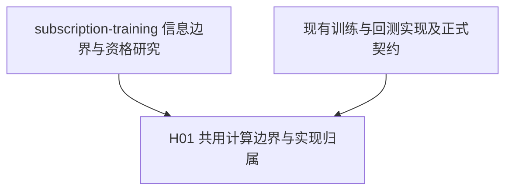

# 训练回测与 live 共用计算边界

本卷宗记录 2026-10-03 至 2026-10-05 用户确认的结构方案及缺口处理方向：保留训练、回测、live 三个入口，
把资格与特征计算、模型推理和交易决策分别收敛到唯一实现。入口负责组织运行和连接外部输入，
能力提供侧负责构造可直接消费的结果。

当前记录属于尚未合入目标分支的研究 draft。用户已确认结构方向及下述缺口处理决定，
并要求记录到本卷宗；本次授权范围是文档记录，未实施代码，也未改变正式 owner。研究治理遵循
[Research 工作流](../../docs/engineering/research_workflow.md)。

## 目标与边界

目标是禁止各模块重复实现同一种业务计算，得到满足当前需要的最小可运行语义。
遵循第一性原理和奥卡姆剃刀，不以建立最小领域模型为目标，不为未知需求补规则、预设扩展，
不增加没有直接业务必要性的抽象、helper、适配层或包装层。

本轮记录最小职责边界、身份归属、数据流及用户确认的缺口处理决定；
各主题保留问题解释、成因、解决方案和建议，尚未决定的建议不视为已确认设计。
2026-10-04 用户确认除实时输入与 broker 外的契约建议，并明确这两项涉及实盘、优先级最后。
2026-10-05 用户进一步确认训练时序、绑定表示、记录与评价 API、交易基线细则和工程验收方案。
当前推进训练、模型交付、历史回测、评价与相应验证要求；实时接入和真实执行保留既有讨论，
暂不继续细化，不作为当前工作的前置条件。
不展开完整实现，不预先设计兼容和迁移。
保留必要的边界检查，可信内部链路直接消费提供侧已经建立的契约。
字段语义、日志归属、错误语义、API 契约或测试边界没有现成定义时，停止受影响的具体设计并说明，
不通过默认值、重试、兜底或新规则补齐。

## 当前背景与依据

此前讨论的源码阅读基线为 `0ab4b31d75741a91410e842cb7f7c89258ef24ca`，位于 training 主机的
`feature/training_infer` 分支。2026-10-04 本轮在
`64b570e4ecc8c4fb43212d9e6c263f4729265317` 再次只读核对训练、回测和预测行对应实现；
下列实现事实及本轮核对不表示已经完成新方案的运行验证：

- [InferenceModel](../../src/training/inference_model.py) 已拥有模型、拟合后的预处理、
  特征身份和实际列顺序；[模型信号提供侧](../../src/trading/signal/model.py) 调用它进行预测。
- [训练入口](../../src/workflows/offline_training.py) 把持久化放在最终步骤，
  [训练流程](../../src/training/pipeline.py) 只把最后一个窗口的 Context 交给最终步骤。
  [回测组件构造](../../src/trading/sim/components.py) 加载单个训练产物。
- [回测入口](../../src/workflows/backtest.py) 把依赖未来价格的评价步骤放在组合和执行之间。
  这一编排不能直接作为 live 的运行链。
- [执行器](../../src/trading/execution/engine.py) 直接依赖即时模拟成交，并在同一次调用中
  处理成交和结算；这尚未定义真实订单的生命周期。
- [训练产物步骤](../../src/training/steps/artifact_persist.py) 将 `asof_day` 设为训练样本最后日期，
  该字段不表示标签已经成熟、模型已经完成训练或运行已经加载它。
- [训练评价](../../src/training/engines/rank_ic.py) 在样本不足或 Rank IC 非有限时失败；
  [回测评价](../../src/trading/engines/backtest_eval.py) 的相关系数可返回 `None`，
  [alpha 评价](../../src/trading/reporting/alpha.py) 可返回 `NaN`。拟议的统一语义见
  [评价中的无定义与错误](#评价中的无定义与错误)，现有实现尚未改变。

[subscription-training](../subscription-training/README.md) 提供信息边界、有限订阅、
历史模型可用性及资格过滤的研究依据。本卷宗单独记录三种运行方式的共用结构，
不迁移或重述其预测实验，不把研究中的模型、标签或策略视为已正式采用。

当前正式编排由 [Offline 工作流契约](../../docs/offline_workflow_contract.md) 拥有；
具体数据含义仍由其引用的数据 owner 拥有。本文只记录已确认的重设计方向，
不直接成为正式 API、配置或运行时依赖。

## 依赖图



## 研究索引

- [H01 共用计算边界与实现归属](#h01-共用计算边界与实现归属)
- [预测模型的层次与绑定对象](#预测模型的层次与绑定对象)
- [共用训练能力与具体任务](#共用训练能力与具体任务)
- [训练方案与时间边界](#训练方案与时间边界)
- [单次训练产物的必要内容](#单次训练产物的必要内容)
- [可复现性](#可复现性)
- [保存参数与单文件示例](#保存参数与单文件示例)
- [序列化格式与保存返回约定](#序列化格式与保存返回约定)
- [保存与加载边界](#保存与加载边界)
- [完整发布的具体机制](#完整发布的具体机制)
- [历史可用性证据与必要性修正](#历史可用性证据与必要性修正)
- [显式模型绑定与可用性](#显式模型绑定与可用性)
- [预测返回的行对应与缺失](#预测返回的行对应与缺失)
- [实时输入与历史复演](#实时输入与历史复演)
- [固定规则交易基线](#固定规则交易基线)
- [单一 broker 的真实执行边界](#单一-broker-的真实执行边界)
- [评价中的无定义与错误](#评价中的无定义与错误)
- [事实记录、日志与验证边界](#事实记录日志与验证边界)
- [待澄清问题](#待澄清问题)

## H01 共用计算边界与实现归属

- Hypothesis: 三个入口分别负责运行组织和外部输入，共用同一份数据计算、推理和交易决策，
  可以使同一业务语义只有一个实现归属，并把未来标签限制在训练和事后评价中。
  若某种运行方式必须复制同一业务计算，或决策必须依赖未来评价数据，则该结构未满足目标。
- Scope: 本轮记录职责、身份、数据流及用户确认的具体契约建议。具体任务参数、实际输入与
  历史可用性证据、实现验收仍需确定或验证；实时输入与 broker 最后处理，不创建完整实现或实验。
- Depends on: [原研究边界](../subscription-training/validation.ipynb#research-boundaries)、
  [H03 接收情景](../subscription-training/README.md#h03-已收逐笔的分批与离线特征一致性)、
  [H08 资格与时间边界](../subscription-training/README.md#h08-统一股票资格过滤与时间边界)
  及上述源码基线。

### 用户确认与修正依据

以下决定来自 2026-10-03 至 2026-10-05 的用户讨论，仅授权研究文档记录；具体论证集中在
对应章节。已被修正的方案不再作为当前要求，尚未决定的建议仍供后续讨论。

| 日期 | 讨论与决定来源 | 详细说明 |
| --- | --- | --- |
| 2026-10-03 | 确认三入口共用结构；在缺口讨论中回复“同意你的方案。记录到文档”，确认模型绑定、实际接收复演、交易基线、单一 broker、评价及记录方向 | [结构数据流](#结构数据流)及各职责章节 |
| 2026-10-03 | Rank IC 讨论中回复“同意你的建议，记录到文档” | [评价中的无定义与错误](#评价中的无定义与错误) |
| 2026-10-03 | 确认先模型与训练，再交易基线、实时输入和真实执行 | [当前结论](#当前结论) |
| 2026-10-03 | 确认模型术语；纠正“先统一预测任务”的前置要求，并确认逐次交付、可恢复且可追溯、就绪与决策可用性分开、显式绑定四项边界 | [模型层次](#预测模型的层次与绑定对象)、[共用能力与任务](#共用训练能力与具体任务) |
| 2026-10-03 | 确认训练产物及保存加载方向，后续纠正输入副本与代码环境归档要求，并同意来源并入模型，撤销独立来源容器、外层字典和第三个保存参数 | [产物内容及删除测试](#单次训练产物的必要内容) |
| 2026-10-03 | 曾确认独立 JSON 发布记录及公共加载；询问“为什么需要 confirmed_at”后，同意撤销该时间和仅为它增加的交付流程 | [历史可用性证据与必要性修正](#历史可用性证据与必要性修正) |
| 2026-10-03 | 确认完整发布机制及发布后清理失败的处理 | [完整发布的具体机制](#完整发布的具体机制) |
| 2026-10-03 | 确认序列化格式和保存返回约定；随后确认产物引用的表示及运行侧归属 | [序列化与返回](#序列化格式与保存返回约定)、[保存加载边界](#保存与加载边界) |
| 2026-10-04 | 确认 `train_dates` 的精确含义、类型和传递归属 | [训练日期及过滤示例](#单次训练产物的必要内容) |
| 2026-10-04 | 确认加载只检查模型类型、错误原样传播及终止边界一次记录，预测一致性由验收验证 | [保存与加载边界](#保存与加载边界) |
| 2026-10-04 | 询问 `keep_rows` 的必要性及能否用 NA／None 替代后，回复“同意”，要求先详细记录共识；确认预测结果与输入等长同序，以缺失位置表达按规则跳过的行，对外不再另返 `keep_rows` | [预测返回的行对应与缺失](#预测返回的行对应与缺失) |
| 2026-10-04 | 阅读完整方案后回复“同意你的建议，记录到文档。然后针对待明确的契约，给出解决方案，以及你的建议”，确认下述完整职责与数据流；其后对真实下单平台回复“未定” | [共用能力归属](#共用交易计算与各自运行)、[结构数据流](#结构数据流)、[真实执行边界](#单一-broker-的真实执行边界)；该次确认尚未包含随后提出的具体契约建议 |
| 2026-10-04 | 阅读九项契约建议后回复“实时输入与 broker先忽略，因为涉及到实盘，优先级是最后。其他的按照你的建议”，确认模型字段、预测返回、保存加载、训练绑定、运行记录、评价、交易基线及验证建议；实时输入与 broker 暂不推进 | 具体约定整合到下述所属章节；[当前推进顺序](#当前结论)及[剩余事项](#待澄清问题)同步更新，不把未给出的任务参数视为已经选定 |
| 2026-10-05 | 阅读五组待澄清契约的解决方案后回复“同意你的建议，记录到文档”，确认显式训练日期与信息截止、UTC 微秒绑定序列及入口错误、预测与评价记录格式、普通 tuple 评价 API、交易选择与模拟规则、固定材料的工程验收；实时输入与 broker 继续最后处理 | [训练时序](#训练方案与时间边界)、[绑定](#显式模型绑定与可用性)、[评价](#评价中的无定义与错误)、[交易基线](#固定规则交易基线)、[记录与验收](#事实记录日志与验证边界)；仅记录设计，未授权代码实施或正式采用 |

### 预测模型的层次与绑定对象

当前讨论的“模型确定”指以下数据流中的预测模型；选股、资金分配和执行行为由后续环节负责：

```text
Signal = model(x)
Orders = strategy(Signal)
execute(Orders)
```

同一个 family 可以有多套训练配置，每套配置可以产生多个已训练模型。
`model(x)` 中的 `model` 指某个确定的、可直接推理的已训练模型。

| 层次 | 含义 | 能否据此确定实际预测 |
| --- | --- | --- |
| 算法族 family | 使用哪类训练和预测方法，例如讨论中的 SGD 回归 | 不能，尚缺配置和训练结果 |
| 训练配置 | 使用哪些特征、预测什么标签、采用什么训练目标和超参数等 | 不能，尚缺实际训练结果 |
| 已训练模型 | 由具体训练产物和对应代码恢复的预测对象，包含推理所需的确定状态 | 给定符合约定的输入，可以执行预测 |

“参数不同”需要区分超参数与拟合所得参数：学习率、正则化强度等超参数不同，属于同一
family 下的不同训练配置，训练产物分别管理；系数、偏置等拟合所得参数不同，属于不同的
已训练模型状态。即使超参数完全相同，训练数据或训练窗口不同也可能产生不同结果，
不能仅凭配置相同认定实际使用的是同一个已训练模型。

权重文件可以简称为“模型文件”，但单独一组权重通常不足以恢复完整推理行为。还需要确定
预测代码、特征定义及顺序，以及使用到的已拟合预处理状态。例如相同权重配上不同的
标准化均值和方差，可能产生不同预测。提供侧负责从确定的训练产物和对应代码构造好
可直接推理的对象，回测与 live 直接消费。

这些层次用于消除术语歧义，不要求新增三套类或三层框架；实际决策绑定具体已训练产物。

### 共用训练能力与具体任务

共用训练能力的设计不以选定一个统一预测任务为前置条件。不同模型可以预测收益排名、
事件概率或其他已明确的目标，并共用训练组织、产物保存、恢复和绑定能力。删除“先选定
统一预测任务”的要求后，这些能力仍能表达和验证，因此该前置要求没有必要。

具体训练与使用仍须具备对应任务的可运行约定，但这些约定按各自职责确定：

| 内容 | 明确范围与归属 |
| --- | --- |
| 预测时点 | 具体运行的调度与数据可见性；同一模型可以在多个时点调用 |
| 预测对象 | 具体输入批次及资格规则；模型不必固定一份证券名单 |
| 输入特征 | 具体模型的输入约定与训练产物；不同模型可以使用不同特征 |
| 预测目标 | 具体训练任务；不同任务可以使用不同标签与训练目标 |
| 输出含义 | 具体预测能力与消费它的策略之间的约定；不要求全系统只有一种含义 |

上述内容不要求新增一套统一字段。能够从确定的代码、配置、数据引用和已有契约唯一恢复的，
直接使用这些依据，不重复维护描述。某个具体任务缺少约定时，在该任务处补齐；共用能力
不替它定义含义，也不因此要求其他任务采用相同目标。

具体任务拥有训练与预测语义，共用能力负责可靠地交付、恢复和使用训练结果。同一 family
的参数变化复用同一份训练实现；不同 family 必要的算法差异留在各自实现中。数据准备、
预处理、保存和加载中真正相同的计算只实现一次，不为不同模型含义重复实现整条链路。
更换任务、特征或参数可以产生新的训练结果，既有产物的来源与含义保持确定；是否修改共用
代码取决于是否出现新的必要能力，不由模型含义不同自动推出。

#### 预测任务与模型选择

**问题与成因。** 不同模型可以分别输出收益数值、收益排名分数或事件概率。它们不能
因为都返回一个数就共用未定义的 `score` 解释，但也不需要为了复用训练能力采用同一种
含义。[H06](../subscription-training/README.md#h06-次日全天最高价标签的单变量重训)研究
收益排名，[H07](../subscription-training/README.md#h07-事件概率训练与现有l2分组消融)研究
事件概率；这些研究没有采用正式模型，也没有证明某种预测可直接转化为净收益。现有训练
入口支持的模型同样只是当前实现，不能据此选择本次任务。

**建议及理由。** 在开展具体任务时明确其约定和适用范围，并固定该次比较的条件；更换
预测目标或模型需要相应比较，不能把不同任务的同名指标当作同一结论。无需现在选定全局
唯一的 family 或预测目标，也不自动选择 SGD、排名回归或事件分类器。

首轮工程验收使用[当前 SGD 训练实现](../../src/training/models/sgd_regression.py)和固定的小样本，
只验证共用训练、交付与恢复边界。这个测试材料选择不表示已经采用 SGD 为业务模型，
也不决定所有训练任务的预测目标或性能要求。

#### 训练方案与时间边界

**问题与成因。** 相同算法使用不同训练日期、窗口、预处理拟合范围或随机条件，可能得到
不同模型。若每次回测都隐式重训，修改交易规则的同时可能已经换了预测结果。另一个独立
问题是标签何时成熟：样本所属日期早于决策日，不足以证明拟合时已经能知道它的标签。

**解决方案。** 具体任务可以在限定研究期间显式使用一个固定产物，也可以按事先确定的
日程逐次训练和换模。前者少一个换模变量；后者表达随时间更新模型的需求，但每次训练
都需要独立产物及其可用性依据。两者都须明确训练样本范围、预处理拟合范围，以及标签
成熟和可用时间；存在模型选择或调参时，再明确选择日期和独立最终验证日期。

**已确认方案及理由。** 首轮交易比较固定一个明确产物，使交易规则变化不同时引入模型
变化。任务确有周期训练需求时，显式给出换模日程和每次绑定，不拖到交易阶段，也不通过
扫描目录选择“最新模型”。交易方案比较不触发未声明的重训。

一次训练由任务显式提供已有模型配置、`train_dates` 和训练信息截止时点。日期不默认取
最近 30、60 或 252 日；训练信息截止属于该次运行的时序约定及记录，不增加模型文件字段，
也不恢复已撤销的发布确认时间。训练入口核对所选日期与标签成熟、可用依据，显式日期违反
这个信息边界时抛出 `ValueError`，不静默缩短训练范围。未知标签仍按既有样本规则剔除，
不能借此将历史上尚不可见的标签用于拟合。

例如[现有 14:30 标签](../../docs/data/stock_1430_feature_label_contract.md#时间与可见性)
在下一正式交易日 14:36 才成熟，因此不能用于截止该日 14:30 的训练。今天已经能够读取
标签文件不能证明过去已经可知；成熟时点本身也不替代实际数据可用依据。

预处理只在本次训练样本上拟合，评价输入使用这个已拟合状态，不在评价区间重新拟合。
不选模、不调参的任务提供训练区间和评价区间即可；需要选择或调参时，事先给出选择区间，
并留下未消费的最终验证区间。原研究已经查看的日期只能继续作为开发数据，冻结候选后
再确定未消费日期；没有独立数据时，只报告开发结果，不宣称完成独立最终验证。
共用能力不替任务填入窗口长度、重训频率或随机条件，旧实现中的参数不作为默认值；
方案选择与最终验证遵循原研究的未消费数据和停止条件要求。

### 训练交付就绪模型

训练负责以下数据流：

```text
历史决策时可见的特征 + 拟合前已成熟且可用的标签
    → 拟合预处理
    → 训练模型
    → 构造就绪的 InferenceModel
    → 独立保存这一次训练的结果，交付具体 ref

固定预测 + 对应标签 → 共用评价 → 评价记录与报告
```

训练侧一次构造完整 `InferenceModel`，回测与 live 加载后直接使用。特征的含义、计算
口径和版本归特征提供侧，一次训练得到的预测器与预处理状态归训练产物；具体内容见下节。
评价与报告描述该次结果，不参与构造预测对象，也不成为模型保存的前置条件；模型发布与
后续评价、报告分别保留其事实及失败，不用评价成功替代模型交付成功。

一次实验可以组织多个 family、配置和训练窗口，但每次训练独立交付自己的就绪预测对象，
每次结果独立保留。实验只组织这些训练和评价，实验名称不能代替具体模型身份。历史决策
直接引用其中的具体产物，不从实验内部猜测使用哪个模型。现有循环训练只保存最后一个
窗口的模型，前面窗口的指标不能恢复对应预测，因此不满足逐次交付的要求。

产物发布后保持不变，以具体、不可被覆盖替换的产物引用承担身份，不另建模型身份体系。
后续绑定、预测、评价和验证记录通过该引用关联，不持续写回模型产物。引用的表示与归属见
[保存与加载边界](#保存与加载边界)。

#### 单次训练产物的必要内容

**内容归属与删除测试。** 当前的 `model` 指项目已有的就绪预测对象 `InferenceModel`，
内部包含具体预测器。训练日期及标签身份与预测状态在同一次训练中确定、属于同一个结果，
一起保存且发布后不变，没有独立更新或独立交付需求。删除独立来源容器后，保存、加载、
预测和追溯仍然成立，因此用户确认将必要来源直接并入该对象。

预测使用预测器与预处理，追溯读取日期和数据身份；用途不同不要求拆成两个对象。
不再单独保存 `provenance`，不在它下面保留 `training`、`dataset` 或 `inputs` 的配置副本，
也不增加一个外层字典包装模型。

| 模型内的内容 | 含义与唯一归属 | 提供侧 |
| --- | --- | --- |
| `model` | 内部的已训练预测器；当前 SGD 对象已持有超参数及训练所得状态 | 具体训练实现 |
| `preprocess` | 已拟合预处理，持有实际特征顺序与拟合状态；`feature_names` 继续从这里取得 | 共用预处理实现 |
| `feature_set: str`、`feature_version: str` | 本次实际使用的特征身份，保持现有类型 | 训练侧从实际使用的数据选择配置取得 |
| `train_dates: tuple[str, ...]` | 本次训练交给数据读取侧的完整训练日期序列，沿用 `TrainingWindow.train_dates` | 训练侧在构造模型时直接带入，不从过滤后的样本重新推导 |
| `label_set: str`、`label_version: str`、`label_column: str` | 本次实际使用的标签身份与列 | 训练侧从实际使用的标签配置取得 |

这里明确内容与归属，不新增统一预测含义；各 feature/label 身份的含义仍由对应提供侧契约
定义。2026-10-04 已确认新增标签字段沿用
[FeatureLabelConfig](../../src/config/model_config.py) 的 `str` 类型，从已经校验且本次实际
消费的配置直接传入；`train_dates` 沿用训练窗口的 `tuple[str, ...]`，特征顺序继续由
已拟合预处理持有。训练侧构造完整对象，保存、加载和消费侧不重复校验这些来源字段，
也不增加独立来源对象或配置副本。

**训练日期的精确含义。** 上表中的 `train_dates` 沿用已有训练窗口，而非从最终拟合样本反推。
[Training workflow 契约](../../docs/offline_workflow_contract.md#training-workflow)已经定义：
训练日程给出窗口，数据读取侧消费其中的完整日期序列，随后按既有规则过滤样本。
训练侧构造 `InferenceModel` 时直接带入同一个序列；模型、保存侧和加载侧不从最终样本
重新计算日期，也不新增日期排序、去重或空值兜底逻辑。

此前“实际训练日期”可能被理解为读取范围，也可能被理解为最终参与拟合的样本所属日期。
两者可能不同：既有数据处理会删除标签为 `NaN` 的行，预处理选择 `drop` 时还会删除特征
含 `NaN` 的行。某日被读取后，最终可能没有任何样本参与拟合。

以下例子只用于说明字段含义，未执行训练，也不增加新的过滤规则：

| 本次读取的日期 | 本例经过既有样本过滤后的结果 |
| --- | --- |
| `2026-07-01` | 全部样本被过滤，没有样本参与拟合 |
| `2026-07-02` | 保留 100 条样本参与拟合 |

模型仍记录：

```python
train_dates = ("2026-07-01", "2026-07-02")
```

选择读取范围，是因为该字段要保留本次训练的数据选择条件。重新读取相同数据并执行相同
过滤，可以重新构造训练输入；最终哪些样本留下由已有数据处理逻辑决定，不另存一份
“有效样本日期”或要求各 family 自行统计。该字段不保证列出的每一天都有样本参与拟合。
重取同一输入仍以既有数据内容保持一致为前提，重训结果的一致性继续独立验收。

日期记录不改写数据读取和样本过滤的现有失败行为，也不能证明标签已成熟或模型在某个
历史时点已可用；历史信息边界仍按对应任务和运行依据判断。

**已有数据直接消费。** 用户已明确特征与标签生成后储存在 `data/features` 与 `data/labels`。
训练根据数据身份、日期和列选择，通过已有数据提供侧读取并构造输入，不为每次训练
另存 `run-001.parquet`，也不增加训练输入目录或快照步骤。数据值继续由现有数据存储持有。

讨论中的 `dataset` 是运行配置，说明如何选择特征、标签和列；`inputs` 曾用来指本次
实际消费的数据。两者是选择配置与实际输入的关系，不要求成为两个持久化对象。
模型内的特征身份、实际列顺序、训练日期和标签身份共同描述这次读取条件，已有读取、
样本对应和预处理逻辑由提供侧负责，各 family 不再分别实现。

**项目提供代码与依赖。** 删除产物中的 `code`、`environment` 及逐次历史代码、环境归档
要求。模型训练与预测实现、Python 和库依赖由项目提供，训练产物不承担独立恢复历史代码
和环境的职责。该决定不要求把项目代码或 sklearn 实现序列化进模型文件。

**实际设置不重复维护。** 示例中的 sklearn 预测器已经持有超参数，预处理对象已经持有
实际特征顺序和拟合状态，直接保存这些对象。训练日期与标签身份来自本次实际执行内容，
不另写一份配置副本。固定训练调用由项目实现负责，训练运行配置组织日程；不把每项配置
都提升为模型字段，也不为所有 family 增加通用参数提取或训练记录框架。

**后续记录。** 运行绑定、预测、评价和验证事实由各自运行侧记录，通过具体产物引用关联，
不追加到已经发布的模型中。训练日期与标签身份已属于模型，加载后可以直接读取；
“来源用于追溯”不再作为把这些字段留在模型外的理由。评价数学无定义不阻止保存模型，
报告成功也不作为模型就绪条件，继续沿用[评价中的无定义与错误](#评价中的无定义与错误)。

#### 可复现性

**问题与成因。** 加载既有产物复演预测、按相同条件重新训练，以及证明模型在历史时点
可用，是不同要求。第一种通过，不保证重训得到相同结果；前两种通过，也不能证明过去
已经存在该产物。记录参数或随机种子也不能单独证明重训一致；当前不要求每份产物归档
历史代码、环境或输入副本。

| 要回答的问题 | 所需依据 |
| --- | --- |
| 加载同一产物能否复演预测 | 完整模型及其预处理、项目提供的推理实现与依赖、同一预测输入及原预测结果 |
| 相同条件能否重新训练 | 按模型的数据身份和日期读取内容保持一致的既有数据，以及本次采用的训练设置、随机条件和项目实现 |
| 历史决策能否使用这个模型 | 当时输入和标签的可用事实、指定产物及对应运行的实际加载和绑定记录；条件研究另列历史输入、训练及换模假设 |

**已确认精度与适用范围。** 既有产物的预测复演是基本交付能力，重训一致性独立验收，
历史可用性单独判断。代码与依赖由项目提供，特征和标签使用现有数据存储，模型持有必要
来源字段。重取相同训练输入以原分区内容保持一致为前提，不为该前提增加副本或快照步骤。

对当前确定性模型，在同一产物、同一代码与依赖、同一输入下，保存前后预测的形状、dtype、
缺失位置及有限数值要求精确一致，不为这项保存加载验收预设容差。可使用
[`np.testing.assert_array_equal(..., strict=True)`](https://numpy.org/doc/stable/reference/generated/numpy.testing.assert_array_equal.html)
检查形状、dtype 和元素值，并比较相同位置的 NaN。该验收只判断持久化是否改变既有模型
的预测，不把同一产物复演扩大为重新训练、任意算法或跨环境逐位一致的保证。
首轮保存加载验收使用实际 SGD 小模型。重训验收另用固定输入内容与顺序、随机种子和
训练调用，在同一代码及项目锁定环境中从新对象各训练一次，对照拟合状态和固定输入的
预测，要求该确定性案例精确一致。这不扩展为所有模型或跨环境重训都精确一致的承诺；
其他任务若需要重训保证，应事先明确相应条件和精度，不得根据失败结果事后扩大容差。
材料与环境的具体范围见[验证边界](#事实记录日志与验证边界)，这些验收尚未执行。

#### 保存参数与单文件示例

保存调用收敛为两项材料：

| 参数 | 具体指代 | 构造与使用归属 |
| --- | --- | --- |
| `ref` | 指向本次模型文件的绝对 `pathlib.Path` | 训练运行确定路径与文件名，保存、加载及后续使用消费同一个引用 |
| `model` | 已训练、能够直接预测且带有必要训练来源的完整 `InferenceModel` | 训练侧一次构造，保存侧保存，加载侧恢复，使用侧直接消费 |

**完整案例的范围。** 用户要求以完整案例解释 `dataset` 与实际输入、现有数据存储及模型
产物的联系。下例使用两个日期、两个已有特征和虚构股票 A、B；数据和模型路径均为演示。
假定开始训练时所用标签已经成熟可用，不表示已选定正式任务、修改默认训练窗或运行了实验。
具体目录与文件名由训练运行确定，下例路径不规定统一布局或命名规则。

训练运行给出以下数据选择：

```python
train_dates = ("2026-07-01", "2026-07-02")
dataset = {
    "feature_set": "tushare_daily_basic",
    "feature_version": "v1",
    "feature_columns": [
        "f_d_close_return_1d",
        "f_d_open_gap_1d",
    ],
    "label_set": "daily_close_return_rank_d1",
    "label_version": "v1",
    "label_column": "y_rank_return",
}
model_params = {"alpha": 0.0005, "l1_ratio": 0.0}
```

`dataset` 指导读取，`train_dates` 指定本次交给数据读取侧的完整训练日期序列。
本例选择 SGD 与缺失值补 0；当前
[训练配置](../../src/config/base.yml)及[训练实现](../../src/training/models/sgd_regression.py)
提供已有术语与算法调用依据，示例不为配置中未指定的随机种子补值。参数表不是实际训练
轮数的记录；当前实现新建预测器后调用一次 `partial_fit`。

数据提供侧从已有 `data/features` 与 `data/labels` 的对应分区读取。下表仅合并展示两边
读取结果的样本对应关系，是内存视图，不是新增的输入文件：

| symbol | trade_date | f_d_close_return_1d | f_d_open_gap_1d | y_rank_return |
| --- | --- | --- | --- | --- |
| A | 2026-07-01 | 0.02 | 0.01 | 1.0 |
| B | 2026-07-01 | -0.01 | 缺失 | 0.5 |
| A | 2026-07-02 | 0.03 | -0.01 | 0.5 |
| B | 2026-07-02 | 0.00 | 0.02 | 1.0 |

对应的预处理前输入为：

```text
X = [
    [ 0.02,  0.01],
    [-0.01,   NaN],
    [ 0.03, -0.01],
    [ 0.00,  0.02],
]
y = [1.0, 0.5, 0.5, 1.0]
```

预处理将第二行的缺失值填为 0，再交给预测器训练。特征含义和标签含义由对应数据身份
的契约提供；本例不重写定义。数据读取、对应和预处理完成后，训练侧一次构造：

```python
model = InferenceModel(
    model=trained_sgd,
    preprocess=fitted_preprocess,
    feature_set="tushare_daily_basic",
    feature_version="v1",
    train_dates=train_dates,
    label_set="daily_close_return_rank_d1",
    label_version="v1",
    label_column="y_rank_return",
)
```

这里的 `trained_sgd` 代表训练所得预测器，`fitted_preprocess` 持有上述两列的顺序、
缺失值处理方法及拟合状态；`train_dates` 直接使用上文交给数据读取侧的序列。
没有编造本例的训练系数或预测结果。当前
[InferenceModel 源码](../../src/training/inference_model.py)尚未加入训练日期和标签字段，
这段代码只表达已确认的结构，不是已实现的构造 API。

模型文件引用示例及消费过程为：

```text
ref = Path("/data/trading/models/run-001.joblib")

训练运行构造完整 model
    → save(ref, model)
    → joblib 文件直接保存这个对象
    → 正常返回 None

回测或 live
    → model = load(ref)
    → predictions = model.predict(x)
```

`x` 是当次预测输入，由当时的数据提供侧交付。预测返回遵循
[等长同序及缺失约定](#预测返回的行对应与缺失)，不是当前代码仍返回二元组的调用方式。
恢复模型时不读取训练数据，也不重新拟合。
追溯本例的训练输入时，特征身份与列顺序来自模型，标签身份与训练日期也直接从同一对象
取得，再通过项目现有数据读取能力访问 feature/label 分区。

| 信息 | 唯一归属 |
| --- | --- |
| 如何选择本次数据 | 训练运行配置中的 `dataset` 与日程 |
| 实际特征值与标签值 | 现有 `data/features` 与 `data/labels` |
| 模型参数、特征身份、特征顺序及拟合后的预处理 | 完整模型对象 |
| 本次训练数据的完整读取日期序列与标签身份 | 同一个完整模型对象 |
| 具体产物位置 | 训练运行交付的 `ref` |

同一配置可以用于不同日期，实际输入随之变化。因此产物记录本次实际采用的读取条件，
不从“最新配置”或实验名称猜测。

#### 序列化格式与保存返回约定

**文件内容与选择依据。** 用户已确认使用项目已有的 `joblib` 单文件直接保存完整
`InferenceModel`，包含预测状态及必要来源。

当前 [项目依赖](../../pyproject.toml)为 `joblib==1.5.3`，
[现有训练产物代码](../../src/training/artifact.py)也已使用该库。
[joblib 1.5.3 实现](https://github.com/joblib/joblib/blob/1.5.3/joblib/numpy_pickle.py)
提供 Python 对象及 NumPy 数组的单文件保存能力；这不表示沿用旧产物布局或旧 API。

**返回与失败。** 保存输入已经包含具体引用，正常完成后返回 `None`，失败抛出异常。
这个 `None` 表示保存调用正常结束；加载成功必须返回完整就绪模型，加载失败不返回
`None`。发布步骤及清理失败的含义见[完整发布的具体机制](#完整发布的具体机制)。

**适用边界。** 选择 `joblib` 不承诺跨任意 Python 或依赖版本兼容；相关限制见
[Joblib 持久化说明](https://joblib.readthedocs.io/en/stable/user_guide/persistence.html#compatibility-across-python-versions)。
本次没有修改依赖或执行保存加载与预测复演验证，不能据此声称新实现已经可用。

#### 保存与加载边界

**具体产物引用与路径归属。** `ref` 是指向这一次模型文件的绝对 `pathlib.Path`。
一次实验可能包含多个结果，family、参数和训练日期不能单独承担唯一身份。训练运行
确定具体目录与文件名，构造并交付这个引用；共用保存能力写入指定位置，共用加载能力
读取指定位置，评价、回测与 live 使用同一个引用，不各自从 family 或配置推导路径。
引用不得指向会变化的“最新模型”，已存在的目标继续按禁止覆盖约定失败。

选择 `Path` 是因为当前交付物就是本地模型文件，路径已经能够定位它；采用绝对路径，
使同一个引用不随调用方工作目录变化而改变含义。无需增加模型编号、注册表或查询层。
路径布局和文件名是训练运行的输出选择，不要求把 family、超参数或日期编码成统一名称。
模型对象保存训练结果及必要来源，文件位置由运行侧持有，不再作为模型字段重复存储。

**结构签名。** 本次确认输入输出类型与职责边界：

```python
from pathlib import Path


def save(ref: Path, model: InferenceModel) -> None: ...


def load(ref: Path) -> InferenceModel: ...
```

2026-10-04 已确认保存与加载能力继续放在现有
[产物模块](../../src/training/artifact.py)，不另建模型管理服务；上述签名表达拟议公共边界，
不表示当前源码已经实现。

`save`、`load` 在各自的文件操作边界拒绝相对路径，抛出 `ValueError`，不根据调用方的
当前目录静默转换；运行侧不再重复检查。`save` 负责创建必要的父目录，统一完成写入准备，
不让每个训练调用方重复维护目录准备。目录创建或文件操作失败时，原始错误传播。

**发布单元与职责。** 完整模型对象构成一个发布单元；特征值和标签值仍位于已有数据
存储，评价和报告独立产生，不进入模型交付的必要内容。按下述[完整发布机制](#完整发布的具体机制)
保存并正常结束后，训练运行向使用侧成功交付具体引用。

| 边界 | 已确认职责 |
| --- | --- |
| 训练构造 | 交付包含已训练预测器、已拟合预处理及必要来源的就绪 `InferenceModel` |
| 保存与发布 | 完整发布已构造好的模型对象，禁止覆盖已发布产物，完成交付 |
| 公共加载 | 根据具体引用读取并恢复对象，检查其为 `InferenceModel`，返回该对象 |
| 运行绑定 | 保留具体产物引用，根据本次运行依据判断是否允许使用，记录实际加载、绑定及使用 |
| 预测 | 消费已绑定模型和合法输入，交付与输入等长同序的预测结果；[缺失位置与错误分开处理](#预测返回的行对应与缺失) |

**模型内容检查的最小边界。** 训练侧已构造就绪对象，项目提供对应实现和依赖。读取和
反序列化之后，加载侧对模型内容只检查恢复结果是否为 `InferenceModel`；若恢复出字典、
列表等其他对象，在此抛出 `TypeError`，不交给回测或 live。

该检查连接文件恢复结果与公共返回类型，不代替训练正确性或保存前后预测一致性的验收。
训练状态、已拟合预处理和必要来源由训练构造侧负责；加载侧不逐项重验，不读取训练数据、
重新训练或试跑预测，消费侧也不再检查同一类型或重新组装模型。否则各侧会重复实现模型
验证。保存前后预测一致性由[可复现性验收](#可复现性)验证，具体测试材料在实施前固定。

**加载与运行的分工。** 加载入口不接收策略或决策时点，因为这些信息不参与恢复模型，
属于运行绑定的判断依据。本次加载成功证明运行取得了模型，不证明它在过去已经存在或
被使用；历史可用性按[对应证据边界](#历史可用性证据与必要性修正)判断。来源字段随对象
恢复，供追溯使用，不参与预测或触发额外数据读取。

**失败行为与记录归属。** 以下是已确认行为。
读取、反序列化与依赖错误保留各自原因，不统一包装成“无效产物”或“文件损坏”。

| 情况 | 已确认的失败行为 |
| --- | --- |
| `save` 或 `load` 收到相对路径 | 文件操作边界抛出 `ValueError`，不静默转换 |
| 必要父目录创建失败 | 保存失败，传播原始文件系统异常 |
| 发布目标已经存在 | 传播 `FileExistsError`，保留原产物 |
| 临时文件写入失败 | 原始错误传播，不把未完成内容发布到具体引用 |
| 发布操作失败 | 原始错误传播，不声称本次已经完成交付，也不覆盖已有产物 |
| 发布已成功，清理临时文件名失败 | 传播原始清理错误，保留已经发布的产物，不回滚 |
| 指定产物不存在或尚未完成发布，导致读取失败 | 加载失败，原始读取异常传播，不选择其他模型 |
| 文件读取失败或内容无法反序列化 | 原始异常传播，不统一转换为其他异常类型 |
| 成功恢复出的对象不是 `InferenceModel` | 加载边界抛出 `TypeError` |
| 必要代码或环境依赖缺失，导致恢复失败 | 原始依赖异常传播，不解释成文件损坏 |
| 模型交付完成后，报告生成失败 | 保留模型交付事实，单独报告后续失败 |

加载失败不转换成“无信号”。本次加载失败由运行终止边界记录一次，
内部不重复写同一异常日志；其他失败仍由负责终止或恢复的边界记录，具体日志技术继续
沿用既有 owner。当前不增加通用错误包装，不补充
自动选择其他产物、重训、重试或恢复规则。保留已形成的产物及失败现场，不能因调用失败
就把已发布文件视为从未存在，也不能自行推导删除、覆盖或回滚。

**与当前实现的差异。** 上述源码基线中的
[现有加载实现](../../src/training/artifact.py)会将 `ImportError` 等多种异常统一包装为
表示无效产物的 `ValueError`。缺少依赖和内容无法恢复具有不同原因，已确认的新方向保留
原始异常；现有对象类型检查与 `TypeError` 的职责继续成立。本次没有修改该实现，也没有
执行加载失败场景验证。

#### 完整发布的具体机制

**问题与必要性。** 直接写最终路径，会让使用侧有机会在写入完成前读到不完整内容；
覆盖已有路径，会让同一个引用后来代表另一份模型。已确认的目标是同时保证完整内容
才通过具体引用可见，以及已有引用不能被本次保存覆盖。

**保存侧的数据流。** 用户已确认以下顺序，文件格式及保存返回值按
[序列化格式与保存返回约定](#序列化格式与保存返回约定)执行：

```text
ref + 完整 model
    → 检查 ref 为绝对路径，创建必要父目录
    → 在 ref 所在目录创建本次保存独占的临时文件
    → 将包含必要来源的模型对象完整写入临时文件
    → 完成写入并关闭
    → 原子发布到 ref，目标已存在则失败
    → 清理临时文件名
    → 保存调用正常返回 None
```

同目录临时文件用于在目标所在文件系统内完成发布；其名字不承担模型身份，不交给评价、
回测或 live。使用侧仍然只消费训练运行交付的具体引用。临时文件是写入过程中的资源，
不会成为第二个业务产物或发布确认记录。

**本地文件系统上的具体操作。** 在支持硬链接的本地文件系统上，使用 `link` 为已经
完成且关闭的文件建立最终名称 `ref`，随后删除临时名称。POSIX 对 `link` 的约定包括
原子创建新目录项，以及目标已存在时失败；这为完整文件可见与禁止覆盖提供操作依据。
参见 [POSIX link 契约](https://man7.org/linux/man-pages/man3/link.3p.html)。

硬链接产生的是指向同一份文件内容的另一个名称。发布后不再通过临时名称或最终名称
继续写入；清理临时名称不删除已经通过 `ref` 发布的内容。不能用“先检查目标不存在、
再执行可覆盖写入”替代该操作，因为两步之间目标可能已经出现。

**与现有工具的关系。** 当前
[`FileSystem.atomic_path`](../../src/utils/filesystem.py)最终执行 `os.replace`，可以替换
已有目标，其 [owner 边界](../../docs/engineering/utils_catalog.md)没有提供本次要求的
禁止覆盖保证。不能原样复用该操作并声称已经满足新契约；也不为迁就已有工具改变
产物不可覆盖的要求。本次仅确定机制，不新增 helper、通用存储层或修改公共工具。

**错误与已发生的事实。** 发布后清理临时名称失败时，保存调用传播错误，完整产物仍保留。
因此，“保存调用报错”不能推出“产物不存在”，不能据此回滚、覆盖或自动重试；其余情形
及记录归属统一见[失败行为表](#保存与加载边界)。

**适用条件与证据。** 该操作方案以目标本地文件系统支持所需硬链接行为为条件。已确认
实现验收须在实际输出文件系统验证完整文件才通过最终路径可见，以及并发保存不能覆盖
已有产物；不支持所需链接操作时明确失败，不切换成覆盖写入。本次只核对既有接口依据
与代码，没有执行文件发布试验，也未验证实际产物目录的文件系统，不能将机制确认
宣称为环境验证通过。

#### 历史可用性证据与必要性修正

**原问题与过度设计。** 需要回答的是具体模型在某次历史决策时是否可用。此前把这个
要求推导为独立的发布确认时间 `confirmed_at`，继而增加相邻 JSON 确认文件、先保存该
记录再完成交付的步骤，以及加载时的确认记录检查。该时间原本只表达发布侧在操作完成后
确认可用的时刻，不是原子切换时间，也不是运行实际加载、绑定或使用的时间。

**删除测试。** 用户在询问“为什么需要 confirmed_at”后同意以下修正：恢复和使用模型
不需要这个字段；历史可用性需要的是与所要证明的事实相符的证据，不能直接推出必须增加
独立发布确认字段。按当前已定义的场景分别判断：

| 场景 | 所需依据 | `confirmed_at` 的必要性判断 |
| --- | --- | --- |
| 当前运行 | 指定产物完整，且本次加载成功 | 恢复和使用模型不需要这个字段 |
| 真实历史复演 | 当时实际加载、绑定及使用指定产物的记录 | 这些记录已能证明对应运行当时取得了模型，不必再用发布确认时间证明同一事实 |
| 条件回测 | 明确的历史输入可见性、训练及换模日程和运行耗时等假设 | 今天取得的发布确认时间不能替代这些假设 |

实际加载、绑定记录证明对应运行取得了哪个模型，不单独证明训练输入和标签满足历史
可见性。已有输入、标签成熟和时序要求仍须遵守。当前能够加载或今天完成重训，也不能
补造历史模型存在、运行绑定或使用的事实；缺少历史记录时保留条件研究的明确假设。

**修正范围。** 当前只返回 `model`，不返回或强制持久化 `confirmed_at`。此前的确认文件
仅承载产物引用和这个时间，没有另一个已明确的必要职责，因此一并撤销其独立文件、
保存与加载步骤、交付前置条件及专属失败检查。不能只删返回字段，却继续保留为它增加
的整套交付流程；也不把同一要求改名后移入模型来源记录。

撤销独立确认时间不取消来源追溯、完整发布或历史信息边界，运行侧仍保留实际加载、
绑定和使用的证据。

只有出现独立且明确的需求，确实要回答“该模型在第一次被运行加载之前，什么时候已经
发布可用”，才针对该问题重新研究所需证据。当前不为这个尚未明确的查询需求预留字段、
文件或接口。

#### 显式模型绑定与可用性

缺口是每次决策使用哪个训练结果，以及它当时能否被使用。样本截止日期不能替代标签成熟、
数据可用、训练完成和运行加载的事实。例如标签使用 T+1 全天最高价时，包含该标签的模型
不能用于 T+1 盘前决策。

提供侧负责交付完整且可恢复的产物，运行入口负责判断本次决策是否允许使用并记录实际
加载、绑定和使用。模型可加载、评价是否充分、是否采用该模型分别判断；后验评价不能
补造历史可用性。

已确认采用显式绑定：首轮交易比较直接给出一个固定的具体 `ref`；确有周期换模任务时，
由运行提供以下普通序列，不另建绑定管理器：

```python
bindings: tuple[tuple[int, Path], ...]
# 每项为 (effective_ts_us, model_ref)
```

`effective_ts_us` 是 UTC epoch microseconds；本地时间输入在任务入口转换一次。
生效时点严格递增，同一时点只绑定一个模型；第 i 项用于
`[effective_ts_us[i], effective_ts_us[i + 1])`，最后一项延续到本次回测范围结束。
因此恰好到达下一生效时点的决策使用新绑定。

任务入口一次检查计划：首个决策早于首个绑定、时点冲突或不递增，以及已知训练信息
晚于允许使用时点等不合规情形，均抛出 `ValueError`。这个时序判断不放入模型加载 API，
已建立的计划保证也不在每次内部调用中重复检查。真实历史复演需要当时实际记录；
条件回测明确训练信息截止、训练完成早于生效时点等假设，今天加载成功不构成过去的证据。

运行拥有当前 `ref` 和已加载模型。到达换模边界，加载指定产物成功后才更新绑定。每次
预测应能回答“使用哪个产物、依据哪些输入、为什么在该时点可用”，不以 family 名、
配置名、实验名或“最新模型”代替引用，不建立自动选模的隐式规则。

使用侧提供符合模型约定的输入，不重新指定 family、超参数、预处理或列顺序。输出含义
由消费侧按任务约定解释，共用加载与绑定能力不必理解每个模型的具体业务含义；内部预测
直接消费各边界已经建立的保证。

指定模型加载失败时，传播[加载边界](#保存与加载边界)的异常，停止依赖该次绑定的决策，
不把旧模型当成换模成功；终止边界记录一次。已有持仓和挂单的管理由交易规则另行确定，
不能由模型加载失败隐式生成清仓动作。运行记录按[事实记录边界](#事实记录日志与验证边界)
关联产物与实际事件；计划的 `ValueError` 与加载边界原样传播的错误分别由各自责任边界产生。

### 预测返回的行对应与缺失

**问题与成因。** 当前 [InferenceModel](../../src/training/inference_model.py) 返回
`(keep_rows, predictions)`。原因是已有
[预处理](../../src/training/engines/preprocessing.py)允许 `missing.method="drop"`：
含缺失特征的行不交给内部预测器，返回的预测数组因此可能比原输入短。`keep_rows` 是与
原输入等长的布尔 mask，用来说明保留下来的预测分别属于哪些原始行；它不表示股票资格、
选股或交易决定。

当前[模型信号提供侧](../../src/trading/signal/model.py)用它将预测关联回股票，
[训练评价](../../src/training/engines/rank_ic.py)用它选择对应标签。仅删除 mask、仍然返回
不带身份的紧凑预测数组，会失去这种对应关系。使用侧重新判断哪些特征行应被跳过，会
重复实现预处理规则，也违背提供侧交付可消费结果的原则。

**删除测试与已确认决定。** 必要的是“每个预测对应哪个输入样本”，不是名为
`keep_rows` 的额外返回值。2026-10-04 用户确认：公开预测结果保持原输入的长度和顺序，
在按已有 `drop` 规则跳过的位置放置缺失值，接口收敛为：

```python
predictions = model.predict(x)
```

| 返回结构 | 是否仍需额外行对应信息 |
| --- | --- |
| 允许删行，仅返回不带身份的紧凑预测数组 | 需要；当前以 `keep_rows` 表达 |
| 每个输入都有预测，数量和顺序不变 | 不需要额外 mask |
| 保持输入长度和顺序，以缺失值表示未预测行 | 位置已表达对应关系，不需要额外 mask；本轮确认此方向 |
| 预测结果自身携带原样本身份 | 不需要另返 mask，但本轮不因此引入新的结果对象或身份容器 |

以下是说明性例子，数字不是运行结果；NaN 使用下文已确认的 NumPy 浮点缺失表示：

```text
输入行：           A      B（特征缺失）    C
原内部保留 mask： True       False       True
保留行预测：      [0.2, 0.8]
新的公开结果：    [0.2, NaN, 0.8]
```

删除公开返回的 mask 后，A、B、C 的对应关系仍可直接从原输入位置恢复。没有跳过行时
每个位置都有预测；全部行被跳过时，输出仍保留原长度且各位置均为缺失，不把整个批次
替换成一个 `None` 或长度为零的结果。

**提供侧与消费侧的职责。** `InferenceModel` 在内部完成预处理、预测和行位置恢复，
一次交付完整结果。输入提供侧已经建立样本身份与输入行的对应关系，交易与评价按原行
位置消费结果，不分别拼接 mask 或重跑缺失特征判定。使用侧仍需按既有“无预测／无信号”
含义处理缺失位置，直接消费不等于假定每行都有有效数值。

内部可以继续使用 mask 处理预处理删行、训练特征与标签同步选择，以及预测行恢复；
撤销公开的 `keep_rows` 不要求删除内部必需的对应信息，也不改变训练样本过滤。
已有缺失处理策略仍由拟合后的预处理对象拥有：`constant`、`mean`、`median` 按各自状态
处理输入，不能把所有原始特征缺失都直接改成“无预测”。

**缺失与错误分开。** 缺失占位只表达已定义规则允许的未预测行，不成为通用失败兜底：

| 情况 | 处理含义 |
| --- | --- |
| 某行按已有 `drop` 规则被跳过 | 在该输入位置返回缺失值 |
| 内部预测器对保留行返回有限数值，包括 `0.0` | 保留该预测，零不表示缺失 |
| 内部预测器对保留行返回 NaN／Inf，或结果形状不符合现有约定 | 仍由模型输出边界失败，不转换为正常缺失 |
| 输入违反已有契约、模型加载或预测调用失败 | 沿所属边界失败，不以全缺失结果冒充成功 |

因此，内部预测器输出合法性的保证须在公开结果包含缺失占位之前建立。消费侧信任该
保证，不根据缺失占位重新猜测内部错误；本次不增加异常包装、恢复行为或日志字段。
预测缺失、未来标签缺失、评价指标数学无定义是不同事实，分别沿所属边界处理。

**已确认的具体表示。** 2026-10-04 用户确认返回一维 `numpy.ndarray`，dtype 为
`np.float64`，形状为 `(len(x),)`；按 `drop` 规则跳过的位置由 `InferenceModel` 填入
`np.nan`。这沿用现有 NumPy 计算路径，不需要新容器、object dtype 或通用 `NA` 类型。
内部预测器输出先通过已有合法性边界，随后才填入缺失占位，因此正常缺失不会掩盖预测错误。

前一轮使用 `None` 只是解释行位置；本次在同一约定中明确具体表示后，上例已改为 NaN。
评价指标的数学无定义继续使用 Python `None`／JSON `null`，两种事实不要求采用相同
内存表示。全部输入行被跳过时仍交付原长度的 `float64` 全 NaN 数组。

**实现与验证边界。** 当前正式预处理契约及源码仍保留 mask，当前 `InferenceModel.predict`
仍返回二元组，本轮只记录公开预测返回的调整方向。正式化时需同步预测提供侧、训练评价、
交易信号消费及相应 owner 和测试，按[验证边界](#事实记录日志与验证边界)验证等长同序、
缺失位置、有效零值与错误传播；保存前后精度按[可复现性](#可复现性)执行，具体测试材料
在实施前固定。本轮没有执行这些测试，
不以文档示例声称新接口已经可运行。

### 数据提供侧交付可消费输入

训练、回测与 live 的资格规则和特征公式只实现一次。历史文件读取和实时消息解码各自
处理必要的格式差异，再调用共用计算。提供侧负责所选数据身份与时间范围的检查、
已定义的资格过滤、特征计算以及样本和列的对应关系；使用侧直接消费结果。

同一份历史特征的路径定位、元数据核对和读取，也不由训练与回测各写一套。数据提供侧
交付按所选数据契约对应的样本与特征列；训练输入侧再按同一任务的样本身份对齐标签。
推理只读取预测所需输入，不因未来标签缺失而删除当时的预测对象。这里确定能力归属，
不提前增加统一数据容器、读取协议或完整实时数据平台。

股票资格表示证券是否满足已定义的参与条件，归数据准备侧；策略选池表示从合格证券中
选择观察或交易对象，归策略。ST、停牌等资格判断不在训练、回测和 live 中分别实现。

共用公式要求信息范围和口径一致。全市场排名与订阅池内排名含义不同，不能先读取全市场
历史特征再裁剪名单，就声称复现了有限订阅下的实时输入。

#### 实时输入与历史复演

本节保留此前讨论，按[当前范围](#目标与边界)暂不推进。

共用特征函数不保证输入相同：历史全量数据与实际订阅的覆盖范围、接收时刻及字段含义
可能不同，即使函数和模型一致，也可能产生不同预测，不能把这些差异误判为模型变化。
事件时间、数据库落地时间、本进程接收时间和特征生成时间分别证明不同事实；例如
14:29:59 的成交于 14:30:02 才收到，不能进入已经作出的 14:30 决策。

已确认以实际收到的数据为共同输入依据：live 接入侧保留必要消息及接收过程，回测回放相同
输入记录，再进入共用计算。没有接收记录的历史只可开展明确假设的条件研究，不能通过补写
时间戳声称真实复演。连续收到消息也不能单独证明供应商没有遗漏。

| 边界 | 已确认的处理方向 |
| --- | --- |
| 字段映射 | 按供应商定义在接入边界映射单位和含义；同名字段不自动等价 |
| 时间可见性 | 记录实际接收依据，决策只消费当时已经生成的输入 |
| 订阅生效 | 按接口实际保证记录订阅状态，并保留实际收到的数据；请求成功不自行解释为完整观察 |
| 乱序与重复 | 使用已确认的排序和身份语义，不按相同时间戳自行去重 |
| 中断与恢复 | 明确受影响的计算状态及恢复所需输入，重连本身不证明已补齐中断数据 |
| 观察充分性 | 所选特征拥有必要观察条件，数据侧交付可用或明确不可用的结果；缺少观测不补成零成交 |
| 股票资格 | 使用具有历史可用依据和生效含义的状态输入，沿用 H08；日终观察集合不能替代盘前资格 |

**建议及理由。** 先依据所选模型和交易基线列出必要字段、topic、观察条件与资格事实，
核对供应商保证，接通最小输入并记录实际接收，再验证同一合法输入前缀产生一致特征和
预测。这样直接检验当前目标，无需先建设覆盖所有数据的实时平台。无法满足所选特征的
观察条件时，说明缺口，再决定补充输入或另行研究特征，不能静默改变含义。

上述方向未定义新的实时去重键、排序规则、等待时长或恢复算法；H03 的人工接收情景不能
直接升级为生产保证。现有分钟契约保留输入重复行的多重性，也不因这次记录而改变。

昨日已经可得的全市场排名可按原口径消费；当日有限订阅不能产生同口径的全市场排名。
需要这种输入时，须获得完整所需信息，或另行定义和验证受限观察特征，不能直接换成池内排名。

公开文档于 2026-10-03 只读核对：[int4 使用说明](https://int4.tech/downloads/STOCK_L2_GUIDE.md)
定义 NATS 行情订阅、股票价格 ×10000 及源端 `bs_flag`；`etl_ms` 属于数据库落地字段，
不在 NATS 实时负载中。本地分钟的 `trade_side` 则由
[分钟事实契约](../../docs/data/level2_minute_contract.md#聚合)定义为 tick-rule 方向代理，
不能与源端方向互换。[Core NATS 文档](https://docs.nats.io/learn/core-nats/)说明其不保存
离线期间消息；供应商是否另有历史恢复能力仍须依据其具体承诺。本轮没有连接行情服务或验证恢复。

### 共用交易计算与各自运行

共用交易计算消费当时可见的输入、本次明确使用的就绪模型、当前决策可用的账户事实，
以及策略自身需要延续的状态，执行同一份推理、组合与风控逻辑。每次运行拥有自己的状态。

| 能力 | 唯一实现位置 | 调用关系 |
| --- | --- | --- |
| 历史特征读取、资格与特征计算 | 数据侧 | 各入口消费所需能力；历史读取与实时接入保留各自必要差异 |
| 预处理拟合与变换 | 共用预处理实现 | 训练拟合状态，InferenceModel 使用已拟合状态；各 family 不重复实现 |
| 算法拟合与就绪模型构造 | 训练侧 | 同一 family 的配置变化复用训练实现，每次训练独立交付 |
| 模型保存与加载 | 共用产物能力 | 训练保存具体 ref，评价、回测、live 按明确 ref 加载 |
| 预测与输出行对应 | InferenceModel | 评价、回测、live 直接消费等长同序结果，不在各消费侧恢复被删行 |
| 选池、组合与风控决策 | 交易侧 | 回测、live 共用 |
| 历史输入推进与模拟成交 | 回测侧 | 推进可见输入，按已产生的委托与随后市场路径形成模拟执行事实 |
| 实时输入接收与运行调度〔最后处理〕 | live 侧 | 将实际可用输入交给共用计算，消费真实执行事实 |
| 真实订单与账户交互〔最后处理〕 | 所选 broker 的执行侧〔待明确〕 | 按具体 API 提供已确认的订单、成交和账户事实 |
| 指标计算 | 评价侧 | 消费固定结果与后验数据 |

固定调用顺序可以用普通函数调用表达。当前八层 Step 图不再作为必须保留的架构依据，
其中实际业务计算按上表归位。表中每行是责任归属，不要求分别新增模块、类或转发函数；
这项方向尚未改变正式编排契约。

订阅名单与持仓目标分别表达。订阅某只股票的某个 topic 表示选择观察它，
研究中的 Top50 观察名单不能直接解释为买入名单。本轮不预设必须使用两个模型。

真实执行仍停在外部接口边界；不把现有同步模拟成交接口推广成统一的 live 执行接口。

#### 固定规则交易基线

缺口是预测怎样成为可执行的交易：买哪些、买多少、何时买卖，以及无法成交时如何处理。
次日最高价机会标签没有定义退出策略；其价格只能事后识别。正式
[日频标签契约](../../docs/data/daily_feature_label_contract.md)也不拥有入场、退出和成本语义。

固定规则便于辨认预测与简单执行的作用；引入盘中信号则同时改变信号、实时观察和交易
行为，需要额外证据。因此在模型与训练及预测比较基础确定后，已确认先用固定规则：固定
时点决策、固定目标持仓数量、等权分配，下一正式交易日固定时点退出，检验模型在固定
交易行为下的价值。等权减少仓位优化变量，固定目标数量不保证实际全部成交。
此决定没有指定股票、资金、持仓数量的具体数值、买卖时点或订单类型，也没有把 Top50
观察名单变成持仓名单。

**已确认的选择、数量与资金规则。** 从当时合格且已有预测的证券中按预测降序选择，
同分按 `symbol` 升序。有效候选不足目标数量时接受不足，保留未用现金，不加入无预测证券。
延续持仓占用目标数量和资金，新买入结合剩余名额及当时可用现金；只有已确认成交产生的
卖出所得才能用于后续买入，不提前使用计划卖出所得。

委托数量使用决策时可见价格及对应证券的数量约束计算，不能根据未来成交均价反推当时
本应下多少单。交易任务仍须明确目标数量、初始资金、买卖时点、入场窗口、订单类型及
适用数量和风险约束；必需参数缺失时拒绝启动该交易任务，不填入旧实现的数值。

**已确认的未成交与期末处理。** 2026-10-04 确认处理方向，2026-10-05 进一步确定期末
价格口径；具体时点及数值由交易任务给出。本节讨论历史回测，不依赖真实 broker 先行接入。

| 情形 | 处理约定 |
| --- | --- |
| 入场窗口结束仍有未成交买入部分 | 撤销剩余部分，当次不补选 |
| 计划退出未全部成交 | 未完成部分继续作为持仓，在后续正式交易日的固定退出时点继续尝试 |
| 回测结束仍有持仓 | 保留未平仓事实，以期末正式日频不复权收盘价估值，不伪造强制成交 |

未成交必须反映在现金、持仓与后续可用资金中；计划退出没有成交，不能在账面上当作已卖出。
规则在交易任务处明确，由模拟执行反映结果，不由模拟器自行补充选股、资金或风险规则。
旧草案的 top-20、95% 资金和 5bp 滑点不自动成为本次参数，依据见原研究的
[训练与执行边界](../subscription-training/README.md#训练与执行边界)。费用和滑点使用
显式场景参数及来源依据，不自动将旧费率当作实际净收益成本。工程测试可以明确设为
零费用，但该结果仅属于毛收益场景，不能据此宣称真实净收益。

比较交易方案时固定预测与其他条件，后续比较模型时固定交易规则及成本假设，使结果变化
有明确解释。盘中 L2 的行动价值在此基线上另行研究，不能由机会命中指标推导。

**已确认的首轮模拟假设。** 委托产生后逐分钟推进，使用随后可见分钟的 VWAP 作为粗略
成交价格。每分钟可成交数量受剩余委托量、当时可用现金、可卖数量及该分钟观察成交量
限制；没有可执行观察时保持未成交，入场窗口结束按上表撤销剩余买入。不先读取整个
窗口均价再倒算委托数量。

这是明确的粗略成交假设，不包含队列位置或市场冲击的证明。现有即时模拟尚不满足这些
逐步推进与部分成交规则。订单只能由当时可见输入生成，随后市场路径由模拟侧用于判断
成交，不返回过去的决策输入；改变未来价格可以改变之后成交，不能改变之前已生成的委托。

#### 单一 broker 的真实执行边界

本节保留此前讨论，按[当前范围](#目标与边界)暂不推进，不继续选型或细化 API。

缺口是提交之后如何确认实际订单、成交和账户状态：提交成功不等于全部成交，超时不等于
没有下单，当前持仓也不包含有效挂单。例如目标买入 1000 股、已成交 400 股但仍有
600 股有效挂单时，只看持仓再次提交 600 股可能形成 1600 股持仓。因此尚未完成的有效订单
是执行判断需要的事实，现有同步模拟成交不能替代它。int4 行情文档没有提供下单与成交回报契约。

已确认先绑定一个实际要使用的 broker，按其具体 API 建立执行边界，不提前建立多 broker
抽象。共用交易计算产生目标；执行侧负责提交、查询、回报处理以及向决策提供执行事实。

- 请求、订单和成交身份使用 broker 明确保证的关联方式。
- 提交结果不明确时，使用其查询能力确认；超时不直接视为失败并重新提交。
- 持仓、现金按确认的成交与账户事实变化，尚未完成的有效订单进入后续执行判断。
- 成交去重依据 broker 的成交身份，不以股票、价格、数量和时间猜测唯一性。
- 启动和恢复按实际 API 核对账户、订单与成交；无法关联或查询而不能自动恢复时，
  明确停止受影响的自动提交，不承诺没有依据的恢复保证。

部分成交、提交结果不明、撤单竞争、重复回报和启动恢复直接影响是否重复下单及账户是否
正确，属于当前必要问题；多 broker 抽象没有当前业务必要性。查询、去重和账户核对办法
必须由所选 broker 的能力决定，不能提前发明通用答案。

用户于 2026-10-04 明确回复真实下单使用的券商、平台或 SDK“未定”。因此具体状态、
失败 API、费用事实和同步规则仍待所选 broker 的契约明确，不依据行情供应商或旧模拟器
代选 broker；这不妨碍按既定顺序推进模型、训练和交易基线。可控接口替身或测试环境只能
验证其覆盖的执行情景，不能据此或仅凭行情接收与决策记录声称真实成交或实盘启用。

### 评价独立消费固定结果

评价从交易决策链中移出，消费已固定的预测、名单和交易事实：

```text
预测评价：固定预测 / 名单 + 对应标签 → 指标
交易评价：成交、费用、持仓与估值事实 → 指标
```

训练评价与回测评价使用相同口径时，调用同一份指标计算。不同标签对应不同评价任务，
不能统一改成当前回测硬编码的 T+1 收盘收益。首轮预测评价读取模型声明的训练目标标签；
使用另一标签需要显式组织另一个评价任务，不由回测自动替换。

标签缺失的处理沿用本方案引用的 H08 已确认边界：训练剔除未知标签；推理名单不受未来
标签影响；评价在固定名单后处理不可评价样本，不补选。最高价机会标签可以用于预测评价，
但不能直接产生按最高价卖出的模拟成交。

#### 评价中的无定义与错误

用户于 2026-10-03 确认：训练、回测和 alpha 评价调用同一份具体 Rank IC 计算，统一返回
有限数值或有明确原因的无值；契约错误继续失败，评价任务另行判断是否达到验收要求。
不同标签仍是不同评价任务，不因指标同名而改变标签、样本集合或汇总口径。

计算边界区分以下情况：

| 情况 | 已确认的处理 |
| --- | --- |
| 输入合法且相关系数有定义 | 返回有限数值，包括有效的 `0.0` |
| 合法配对不足两组，或预测、标签任一为常量 | 返回无值，保留实际配对数和原因；同时发生的原因如实保留 |
| 样本错位、非法预测或其他契约错误 | 由所属输入或模型边界失败，不转换成无值或成功 |
| 计算出现未解释的非有限结果 | 作为计算错误失败，不归入正常无值 |

未来标签缺失沿用 H08：先固定预测和名单，再选取可评价配对并保留排除数量。
[预测返回中的缺失位置](#预测返回的行对应与缺失)表示按已定义规则未预测的行，与未来
标签缺失分开处理；非法内部预测由模型输出边界失败，不能由评价侧通过“过滤所有非有限值”
隐去。常量预测说明本次横截面没有预测区分，其 Rank IC 无定义，不能填成零，也不能单凭
这一点断言模型拟合过程执行失败。

评价指标对外统一使用 Python `None`、JSON `null`，报告显示“无值”及原因。数值库计算
指标时可以内部使用 `NaN`，但只有已识别的数学无定义才能转换为 `None`；其他非有限结果继续失败，持久化保留
`allow_nan=False`。2026-10-04 确认唯一 Rank IC 计算的返回内容，2026-10-05 确认使用普通
tuple，不新增 `MetricResult` 或通用指标结果框架：

```python
def rank_ic(
    predictions: np.ndarray,
    labels: np.ndarray,
) -> tuple[float | None, int, tuple[str, ...]]: ...
# 返回 value, pair_count, undefined_reasons
```

| 内容 | 类型与含义 |
| --- | --- |
| `value` | `float \| None`，有限指标值或数学无定义 |
| `pair_count` | `int`，实际参与计算的配对数 |
| `undefined_reasons` | `tuple[str, ...]`，已识别的无定义原因；有定义时为空 |

原因由计算提供侧判定并交付，调用方不再根据 NaN 自行推断。编码与条件为：

| 原因编码 | 条件 |
| --- | --- |
| `insufficient_pairs` | 实际配对数小于 2 |
| `constant_prediction` | 配对后的预测非空且全部值相同 |
| `constant_label` | 配对后的标签非空且全部值相同 |

同时成立的原因全部保留。空配对只符合样本不足，不能因空数组的比较结果再推断常量；
一个配对则同时符合样本不足和两侧常量。无定义原因与计算错误仍按上表区分。

评价组织侧先固定评价集合，再按以下互斥口径记录排除数量：

```text
原样本数 = 无预测的样本数 + 有预测但缺标签的样本数 + 实际配对数
```

这样既能核对总数，也不会把预测缺失和标签缺失混在一起；同一行不同时计入两种排除。
过滤仍不回写预测或名单，非法预测也不能进入正常缺失统计。

唯一的 Rank IC 计算消费已经对齐、处理完正常缺失的有限预测与标签配对，判断是否有定义，
再调用现有 SciPy 完成计算；它不调用模型、读取未来价格、写日志或决定训练任务是否通过。
样本对齐和正常缺失处理由评价输入边界负责，预测合法性由模型输出边界负责，可信内部
链路不重复检查。
现有 alpha 的 `min_cross_section=50` 不作为通用数学规则：两个非常量配对已经可以计算
相关系数，但是否足以支持研究结论由评价任务判断；具体样本门槛不从旧代码自动继承。

首轮汇总保留逐日结果及全部原评价日期：日均 IC 只对有定义的日期等权计算，同时展示
总日期数、有定义日期数及原因统计；全部日期无值时，均值也为无值。这些构成本轮确认的
基本汇总内容。若具体任务保留滚动指标，窗口沿原评价日期推进，不删除无值日期后重新
凑足窗口。例如 10 天中只有 2 天有定义、均值为 0.12，
只能表达为“有定义的 2 天平均 IC 为 0.12，覆盖 2/10 天”；这是说明性例子，不是实验结果。
仅凭该均值不能认定模型通过评价；不同模型覆盖日期不同时，各自均值也不能直接当作
相同样本上的比较。

复用现有运行目录的 `metrics.json`，不为上述返回内容新增一层结果对象。其固定内容为：

```text
observations: 每个决策横截面一条
  model_ref, decision_ts_us
  input_count, no_prediction_count, missing_label_count
  value, pair_count, undefined_reasons
summary:
  date_count, defined_date_count
  mean_ic, undefined_reason_counts
```

`input_count` 是固定集合的原样本数；`missing_label_count` 仅计有预测但缺标签的行，
与 `no_prediction_count` 互斥。`value` 和 `mean_ic` 的 `None` 序列化为 `null`，
`undefined_reasons` tuple 序列化为 JSON 数组，仍使用 `allow_nan=False`。
一份汇总只对应一个评价任务，不混合不同标签目标或候选实验；逐日覆盖及原因统计按
上文口径计算。具体 `ref` 以其路径表示记录，决策时点使用 UTC epoch microseconds。

数学无定义不再中断后续训练窗口，也不阻止保存已经拟合出的模型和评价记录；真实输入
错误和训练错误继续失败。拟合产生模型，评价描述表现，验收判断证据是否充分。若事先
确定的验收要求 IC 必须存在，无值仍使验收不通过；保存了模型不表示验收通过或模型采用。

上述设计会改变当前 [Training owner](../../docs/offline_workflow_contract.md#training-workflow)
中“评估不足两行或 Rank IC 非有限即失败”及 metrics 只含有限数的契约。后续正式化须同步
唯一计算实现、三个调用位置、指标制品 schema、汇总与报告、相关 owner 和必要测试。
返回内容、函数签名、普通 tuple、原因编码、排除计数、基本汇总及制品结构已经确认；
各评价任务仍须明确实际样本集合，需要判断研究表现时再事先确定性能验收参数。
本轮未修改正式行为。

评价随当前模型与训练问题一起推进，不等真实执行结束。指标能计算不表示模型通过验收，
不能根据已经看到的结果倒推样本门槛或验收参数。统一无值编码并不自动统一标签、
样本集合或模型选择依据。

数学与编码依据：[SciPy spearmanr](https://docs.scipy.org/doc/scipy/reference/generated/scipy.stats.spearmanr.html)
明确常量输入时相关系数无定义并返回 `NaN`；[Python JSON](https://docs.python.org/3/library/json.html)
定义 `None` 到 `null` 的转换，`allow_nan=False` 拒绝非有限浮点数。这些资料只支持数学与
序列化事实，不拥有本项目的评价或验收语义。

### 事实记录、日志与验证边界

已确认沿用现有日志机制，由拥有事实的一侧产生记录，不建立通用记录平台：

| 事实 | 记录归属与载体 |
| --- | --- |
| 本次实际训练输入、模型产物及保存结果 | 训练侧，使用现有运行记录与日志 |
| 实际加载、绑定和使用的模型与作出的决策 | 运行入口记录模型加载、绑定及使用，使用现有运行日志；交易侧记录决策事实 |
| 某次预测实际使用的输入与产生的输出 | 产生该次预测的运行，在现有运行目录写 `predictions.parquet`，输入依据由运行记录承载 |
| 保存加载的复演输入、对照输出和验证结果 | 验证记录 |
| 实际收到的行情与订阅、中断过程〔最后处理〕 | 行情接入侧，具体存储不在本轮细化 |
| 订单、成交、持仓和账户核对结果 | 执行侧，使用现有执行 ledger 及对应记录；真实 broker 的具体记录最后处理 |
| 评价集合、排除数量和指标 | 评价侧，复用现有运行目录的 `metrics.json`，结构见评价章节 |

**已确认的关联与记录内容。** 模型关联只使用具体 `ref`；样本身份沿用所选数据 owner 的
完整键，不新增全局预测编号。[日频数据](../../docs/data/daily_feature_label_contract.md)
使用 `(symbol, trade_date)`；[14:30 数据](../../docs/data/stock_1430_feature_label_contract.md)
包含 `decision_ts_utc`，不能统一删成“股票＋日期”。

加载、绑定过程沿用现有运行日志，记录具体 `ref` 和实际事件时间；绑定还记录生效决策
时点。实际事件时刻不替代条件回测中的历史可用假设，也不恢复已经撤销的独立发布确认文件。

`predictions.parquet` 保留每一行的原始完整样本键，以及 `decision_ts_us`、`model_ref` 和
`prediction`。其中 `decision_ts_us` 是实际预测决策的 UTC epoch microseconds，不能用
样本所属日期代替，也不覆盖数据 owner 原有的观察时点键。保留全部原样本行，按已定义
预处理规则跳过的预测在 Parquet 中保存为 null，不只保存有效分数或最终选股结果。

输入引用由该次运行记录承载，再结合样本键恢复输入；不逐行重复相同输入引用，也不为
每份模型复制训练数据。若引用的输入已经不可恢复或内容已改变，则缺少相同输入复演的
证据，不能宣称预测一致；记录引用不能代替实际可恢复的内容。

保存的预测用于复演和比较，不能由最终收益或汇总 IC 替代。复演需要的精确事实保存在
对应产物或输入记录中，运行日志表达过程和失败；错误由负责终止或恢复的边界记录一次。
上述载体和字段只归位已有事实，不建立通用事件或记录平台。既有日志技术与生命周期仍由
[技术栈决策](../../docs/engineering/technology_stack_decisions.md#日志技术栈)拥有。

**已确认的工程验收。** 使用项目声明的 Python 及 [uv.lock](../../uv.lock) 锁定依赖，
验收记录绑定同一代码状态和全部影响结果的输入。2026-10-05 确认以下有限材料和通过条件，
保存前后及确定性重训精度按[可复现性](#可复现性)执行。这些是尚未执行的验收方案，
不能从当前局部测试推导新链路已经通过；实施验证前固定案例内容、输入顺序、种子和训练调用，
不根据结果替换材料。验证公共行为与稳定边界，避免为内部调用关系重复增加防御和测试。

| 边界 | 验收材料与通过条件 |
| --- | --- |
| 预测返回与行对应 | 用只返回输入值的小型确定性预测器，含 `[0, NaN, 2]` 的输入在跳过规则下对外仍得到原位置的 `[0, NaN, 2]`；覆盖全部跳过、填充规则及内部 NaN／Inf、错误形状案例。输出为等长同序的一维 `float64`，零值保留，合法缺失与非法输出可区分；交易和评价按原样本位置消费 |
| 保存加载复演 | 实际 SGD 小模型在同一代码、依赖和固定输入下，保存前后预测形状、dtype、缺失位置及有限数值精确一致；记录具体产物和对照输入，不以反序列化成功代替预测验收 |
| 确定性重训 | 固定输入内容与顺序、随机种子、训练调用及环境，从新对象分别训练，拟合状态和固定输入预测精确一致；该案例不承诺任意算法或跨环境一致 |
| 模型绑定 | 在生效边界之前、恰好到达边界及下一个边界验证使用正确 `ref`；不合规计划在入口以 `ValueError` 失败；新模型加载成功后才建立绑定，加载失败停止依赖该次绑定的决策，记录能追溯具体产物 |
| 保存与发布 | 在实际输出文件系统覆盖目标冲突、并发保存、写入失败和发布后清理失败。拒绝相对路径，保存侧准备必要目录；不能覆盖既有产物或暴露未完成内容，发布后清理失败仍保留已发布产物 |
| 交易账本 | 用少量证券和正式交易日构造未成交、延迟退出、费用及期末持仓场景，逐笔核对现金与数量；按既定委托及后续分钟判断成交，选择顺序、资金约束、剩余买入撤销和期末估值符合上文规则 |
| 评价 | 用可手算的同序、逆序、常量、零配对和一个配对材料，核对数值、三项返回内容、全部原因与互斥排除计数；区分有效零值、正常无值及契约错误，核对 JSON null、覆盖及汇总；无值不阻断后续训练和模型保存，标签缺失不反向改变名单 |
| 未来信息隔离 | 改动未来标签或行情，此前预测和委托保持不变；允许随后成交结果随随后行情变化，不将该变化倒推为此前决策变化 |
| 实时输入〔最后处理〕 | 保留此前验证方向：同一合法输入前缀产生一致结果；晚到消息不改变过去决策；中断不冒充零成交；当前不要求执行 |
| broker 执行〔最后处理〕 | 保留此前验证方向：按具体 API 覆盖部分成交、结果不明、撤单竞争、重复回报及账户恢复；当前不要求执行 |

工程验收不设 IC 或收益性能阈值，只判断契约是否被正确执行。表现差或数学无定义不等于
保存加载或程序执行失败；是否采用模型、是否满足研究表现要求，仍由相应研究的事前判据
和用户决定。真实费用依据、未消费日期及实际文件系统行为必须另有事实或验证，本文记录
不能替代这些证据。

### 结构数据流

```text
训练
历史可见输入 → 数据侧交付特征 ─┐
拟合前已成熟且可用的标签 ──────┴→ 拟合预处理与模型
                                  → 就绪 InferenceModel → 独立保存 → 具体 ref

模型使用
本次运行指定 ref → 共用加载 → 按运行依据显式绑定就绪模型

回测与 live 的共用计算
回测推进历史输入 / live 接收实时输入 → 数据侧交付当时可用特征
    + 本次绑定模型 → 等长同序预测
    + 当前决策可用的账户事实 + 本次运行的策略状态
    → 共用选池、组合与风控 → 交易目标

各自执行
回测：交易目标 → 模拟执行 → 模拟订单、成交和账户事实 → 后续决策
live〔最后处理〕：交易目标 → 单一 broker 执行〔具体 API 待定〕
              → 已确认的订单、成交和账户事实 → 后续决策

评价
固定预测 / 名单 / 交易事实 + 后验数据 → 共用指标计算 → 展示
```

训练、回测与 live 分别组织运行，每次运行拥有自己的策略状态、输入进度和执行事实。
评价不向此前的预测或交易决策回传未来标签；模拟成交使用的随后市场路径同样不进入此前
决策。箭头只表达依赖，不要求为每个箭头增加接口类、Context、Result 或转发函数。

### 当前结论

用户已于 2026-10-04 确认上述完整结构、共用能力归属和数据流，随后确认除实时输入与
broker 外的契约建议；2026-10-05 进一步确认五组待澄清契约的解决方案。训练时序、绑定
表示及入口错误、预测与评价记录格式、普通 tuple 评价 API、交易选择与模拟规则、工程
验收材料和精度已经在所属章节收敛；没有给出的具体任务参数仍未选定。源码阅读支持
现有职责与差距的描述，不证明新方案已经可运行、通过实现验收或具备实盘能力；本轮没有
运行实验。

当前按以下顺序推进：

```text
当前：模型与训练（产物、可复现性、可用性和模型绑定）
          → 历史回测与固定交易基线
      评价与相应验证随上述工作同步推进

最后：实时输入与 broker 真实执行〔当前忽略，不阻塞前述工作〕
```

先明确允许不同预测任务共用的交付、恢复与绑定边界，再固定具体交易比较使用的训练产物、
输入及预测依据，避免无法区分结果变化来自模型、训练过程还是交易策略。可复现性、历史
可用性与实际绑定须随相应训练任务一起明确，评价同步推进。

接下来先落实已经确认的绑定、记录、Rank IC API 与工程验收，再运行一项显式配置的
训练与历史回测任务。首轮工程验证使用固定小材料，具体任务再提供实际模型、日期、资金
和成本依据；两者不通过增加统一领域模型或通用训练平台来连接。

实时输入与 broker 按用户要求最后处理，不继续追问选型或展开接入设计。已确认的设计
不再列为待选择方案，也不由文档记录启动代码实施；剩余问题如下。

## 待澄清问题

各节已保留问题成因、方案及确认依据；下表只汇总当前仍需具体任务输入、事实依据或实际
验证的事项。已确认的绑定表示、失败 API、记录载体、评价容器和交易处理规则不再列为待选。

| 边界 | 尚待明确或验证 |
| --- | --- |
| [模型与训练](#共用训练能力与具体任务)（当前优先） | 具体任务的模型配置、显式训练日期、训练信息截止及标签可用依据；选模或调参时的选择区间、未消费最终验证日期和停止条件；有换模需求时的实际日程 |
| [预测与复现](#可复现性) | 按已确认材料固定实际输入内容、顺序、种子、训练调用及代码环境，执行保存前后与确定性重训验收；实际运行的输入仍须可恢复且内容一致 |
| [绑定与记录](#显式模型绑定与可用性) | 实际 `ref`、生效时间及历史可用性记录，或条件回测明确的训练完成和输入可见假设；实现并验证已确认的日志、预测 Parquet 与指标 JSON 内容 |
| [交易基线](#固定规则交易基线) | 具体交易范围、目标数量、初始资金、买卖时点、入场窗口、订单类型、证券数量及风险约束；费用和滑点场景的参数与来源、分钟成交与期末价格的实际数据依据；按已确认规则验证账本 |
| [评价与验证](#评价中的无定义与错误) | 对应模型声明的目标标签和实际样本集合；需要判断研究表现时事先确定性能判据；执行手算案例、汇总序列化和未来信息隔离验收 |
| [保存与发布](#完整发布的具体机制) | 在实际输出文件系统执行冲突、并发、写入失败及发布后清理失败验证；文档确认不表示文件系统保证已成立 |

需要形成的可审查结果是共用训练、产物、保存加载与绑定约定及对应验证要求；具体任务在
训练和使用前各自明确配置，不以统一预测任务为前提，也不建立通用训练平台。

[实时输入](#实时输入与历史复演)与[真实执行](#单一-broker-的真实执行边界)的外部保证、
字段和 API 问题保留在原章节，当前不推进、不作为训练与历史回测的前置条件。

## 设计与仓库状态

- 设计：完整结构及除实时输入与 broker 外的契约建议已由用户确认，最新确认日期为
  2026-10-05；具体内容已归入所属章节，实时输入与真实执行最后处理。具体任务参数、
  实际证据、实现验收和正式化未完成，未形成新的实验或正式采用决定。
- 工作树：本次仅在本卷宗整合五组已确认方案，修正训练时序、绑定表示、记录与评价 API、
  交易基线及工程验收，移除失效的待选择表述，保留其他已有改动。未修改正式 owner、
  代码、配置或入口，也未创建 Notebook。本文仍是尚未合入目标分支的研究 draft。
- 验证：本次只检查文档内容、路径与引用，未执行代码测试、实验、实时订阅或交易；
  实际文件系统条件及实现验收仍未验证。示例数据、日期和路径不是运行结果或正式命名。
- Git 与发布：用户已授权提交本卷宗；未执行 push、merge、release 或 deploy。
